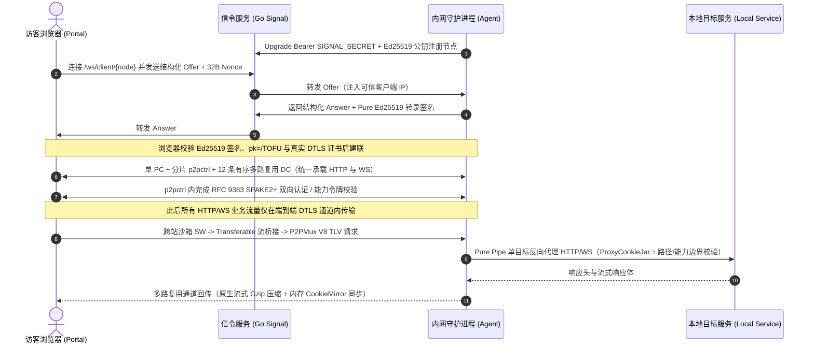

<p align="center">
  
</p>

# Zero-Client P2P WebRTC Intranet Penetration Gateway

### 浏览器端零客户端依赖的 P2P WebRTC 端到端内网穿透网关

<p align="center">
  <a href="README.md"><b>简体中文</b></a> · <a href="README_en.md"><b>English</b></a> · <a href="https://beingnoability.github.io/WebRTC-Gateway/"><b>官方文档站 (Documentation)</b></a>
</p>

[](https://go.dev/)
[](https://www.typescriptlang.org/)
[](https://github.com/pion/webrtc)
[](https://github.com/BeingNoAbility/WebRTC-Gateway/pkgs/container/webrtc-p2p-server)
[](LICENSE)
[](https://github.com/BeingNoAbility/WebRTC-Gateway/actions/workflows/ci.yml)

> [!IMPORTANT]
> **版本状态**：当前为 **v5.0.0-alpha.3** 预发布版本（[V7 架构 RFC](docs/rfcs/v7.0-architecture.md)）。版本演进与历史变更见 [CHANGELOG](CHANGELOG.md)。

---

## 为什么选择 WebRTC Gateway？

| 方案分类 | 代表技术 | 核心限制 | WebRTC Gateway 方案 |
| :--- | :--- | :--- | :--- |
| **公网端口中继** | FRP / NPS / Ngrok / Cloudflare Tunnel | 全部业务流量经过中心服务器，受带宽与隐私限制 | **P2P 点对点直连**：通过 WebRTC STUN/ICE 建立端到端 DTLS 隧道；信令仅负责撮合 SDP 与 ICE 候选，不中继业务数据；对称 NAT 回退可选用户自建 TURN（仅转发 DTLS 密文） |
| **虚拟局域网 VPN** | Tailscale / WireGuard / ZeroTier | 访客设备必须安装原生客户端或虚拟网卡驱动 | **零客户端 (Zero-Client)**：访客使用 Chrome、Edge、Safari、Firefox 等标准浏览器打开链接即可接入 |

---

## 核心特性速览

- **统一多路复用数据面（P2PMux V8）**：采用单一 `RTCPeerConnection` + 1 条分片控制通道（`id=0` `p2pctrl`）+ 12 条预协商有序多路复用通道（`id=1..12` `p2p_01..p2p_12`，按单调 `StreamID` 统一承载 HTTP 与流式 WebSocket，无需动态 DCEP 通道），8 字节定长帧头、纯载荷字节 `CREDIT` 流控与紧凑二进制 TLV 头编码（内置 `FetchCtx`、`RespFlags` 与行内 Cookie TLV），消除跨流队头阻塞与微包流控死锁。
- **抗信令中间人的密码学边界**：信令仅传输严格校验的结构化 `SessionDescriptor` 并由双端确定性合成 16 行 DataChannel-only SDP；每个 Agent 持久化独立 **Ed25519 身份密钥**，对长度前缀转录做 Pure Ed25519 签名（含 `-allow-public` 模式），并在 DTLS 建连后校验远端证书真实指纹（支持 `getRemoteCertificates` 的引擎），配合 `#node?pk=` 钉扎与 Fail-Closed `IndexedDB` TOFU；访客口令在 DTLS 控制通道内运行 **RFC 9383 SPAKE2+（P-256、300,000 轮 PBKDF2 + HKDF）双向零知识认证**，并强制校验双方确认值防降级；支持由 Agent 签发可实时吊销、限路径、限只读且持久化吊销状态的 **Ed25519 能力分享令牌**。
- **两档沙箱隔离、W3C Fetch 抗 CSRF 门禁与 Transferable 流桥接**：服务端采用启动期显式源配置（`-portal-origin` + `-sandbox-origin`，本地回环使用 `-dev`），提供 **Tier 1 跨站通配符隔离**（不同 eTLD+1 派生 `sbx-<24hex>` 独立源）与 **Tier 2 受限隔离**（固定单域跨站或 `-allow-same-site-sandbox` 同站通配符，门户持续显示 Tier 2 警示条）；门户 CSP 锁定 `style-src 'self'` 与 `connect-src 'self'`（启动期预渲染内容哈希资产与 ETag）；SW 通过原生 Transferable `ReadableStream` 桥接数据流、下发外置 `/__p2p_gw__/boot.js` 并按指令级重写保留上游 CSP，无条件拒绝 `destination=document` 逃逸、按标签页隔离 `clientToTab` 配额并配合 `CookieMirror` / `ProxyCookieJar` 隔离 `HttpOnly` Cookie。
- **纯管道代理与 Fail-Closed `O_NOFOLLOW` 静态适配器**：HTTP / WebSocket 统一复用严格单目标 `DestinationPolicy`（单一精确目标源、可选 `-upstream-host` 虚拟主机头覆写、WS 302 跳转拦截与 Resolve 后置能力校验）、统一 `ProxyCookieJar`（按 `httpOnly` / `visible` 池分别限额）、16 KiB 真流式 WebSocket 代理与原生流式 `gzip`（浏览器原生 `DecompressionStream('gzip')`，零第三方解压依赖）；`-dir` / `-file` 采用 Go `os.Root` 逐级 `OpenRoot` 只读处理器，默认强制 `O_NOFOLLOW` 拒绝一切软链与点文件（可选 `-follow-symlinks` 仅限根与能力前缀内解析）并对所有静态文件下发 `CSP: sandbox`。
- **单一权威 Go 信令与构建期前端内嵌**：前端内容哈希资产于构建期经 `make build`（`-tags embedweb`）按显式清单嵌入 Go `signal` 单一二进制，支持节点绑定密钥原子持久化（`-bound-keys-file`）与逐节点注册密钥隔离（`-node-secrets-file`，最小 16 字节）。

---

## 快速开始 (Quickstart)

### 方式一：源码本地运行（`localhost` / `*.localhost` 安全上下文）

```bash
# 1. 构建前端产物与内嵌 Web 资产的 Go 二进制
make build

# 2. 启动信令服务器（-dev 显式启用本地回环 *.localhost 跨站沙箱模式；密钥不少于 16 字节）
./bin/signal -addr 127.0.0.1:8888 -dev -signal-secret dev-cluster-secret-16b

# 3. 启动内网 Agent（必须设置 ACCESS_SECRET，或显式传入 -allow-public）
ACCESS_SECRET=change-me ./bin/agent \
  -id homeserver \
  -signal ws://127.0.0.1:8888/ws \
  -signal-secret dev-cluster-secret-16b \
  -target http://127.0.0.1:8080
```

在浏览器访问 `http://localhost:8888/#homeserver`，按提示在 DTLS 通道内输入访问口令即可直连本地 `8080` 服务。

### 方式二：生产双域部署与 Docker Compose

生产环境要求启动期显式配置跨站源（推荐 Tier 1 跨站通配符 `PORTAL_ORIGIN` + `SANDBOX_ORIGIN=https://*.sandbox.example.net`；或 Tier 2 受限固定单域 `https://app.example.net`）以及不少于 16 字节的 `SIGNAL_SECRET`（除非显式声明 `-allow-anonymous-agents`）：

```bash
cat <<'EOF' > .env
PORTAL_ORIGIN=https://portal.example.com
SANDBOX_ORIGIN=https://*.sandbox.example.net
SIGNAL_URL=wss://portal.example.com/ws
SIGNAL_SECRET=replace-with-strong-cluster-secret
ACCESS_SECRET=replace-with-strong-visitor-secret
EOF

docker compose up -d --build
```

离线签发短期只读能力分享链接：

```bash
./bin/agent -id homeserver -identity-key /path/to/homeserver.ed25519.key \
  -mint-link 24h -mint-path /public -mint-readonly \
  -portal-url https://portal.example.com
```

---

## 系统交互时序



---

## 文档导航

- [Agent 典型用例与配置模板](docs/guide/agent-use-cases.md)
- [本地反代协作与典型适配模式](docs/guide/reverse-proxy-recipes.md)
- [服务端典型用例与部署模板](docs/guide/server-use-cases.md)
- [系统架构与核心设计](docs/guide/architecture.md)
- [P2PMux V8 线协议规范](docs/guide/protocol-specification.md)
- [安全机制与密码学边界](docs/guide/security.md)
- [Agent 与信令服务端配置](docs/guide/agent-configuration.md)
- [生产部署与两档沙箱规划](docs/guide/deployment.md)
- [静态文件与目录只读适配器](docs/guide/file-server.md)
- [V7 架构决策记录 (RFC)](docs/rfcs/v7.0-architecture.md)
- [贡献者开发指南 (`CONTRIBUTING.md`)](CONTRIBUTING.md)
- [测试策略与本地门禁 (`scripts/gate.sh`)](docs/TESTING_CHECKLIST.md)

---

## 许可证

本项目遵循 [MIT License](LICENSE) 开源。
