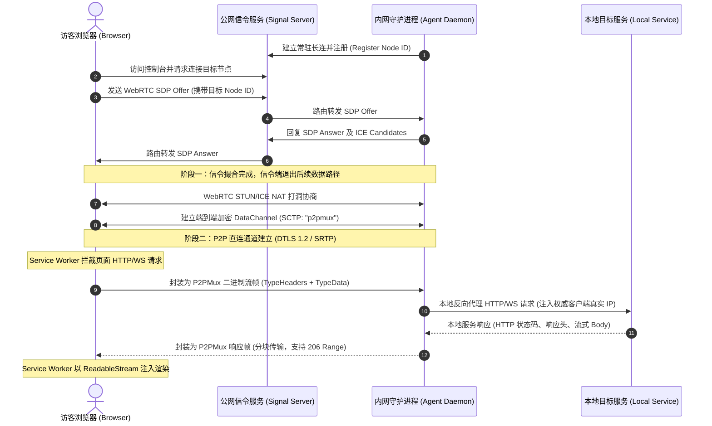

<p align="center">
  
</p>

# Zero-Client P2P WebRTC Intranet Penetration Gateway
### 浏览器端零客户端依赖的 P2P WebRTC 端到端内网穿透网关

<p align="center">
  <a href="README.md"><b>简体中文</b></a> · <a href="README_en.md"><b>English</b></a> · <a href="https://beingnoability.github.io/WebRTC-Gateway/"><b>📖 官方文档站 (Documentation)</b></a>
</p>

[](https://go.dev/)
[](https://www.typescriptlang.org/)
[](https://github.com/pion/webrtc)
[](https://github.com/BeingNoAbility/WebRTC-Gateway/pkgs/container/webrtc-p2p-server)
[](LICENSE)
[](https://github.com/BeingNoAbility/WebRTC-Gateway/actions/workflows/ci.yml)

---

## 为什么选择 WebRTC Gateway？

传统穿透与远程接入方案存在难以兼顾的物理妥协：

| 方案分类 | 代表技术 | 核心瓶颈与工程代价 | WebRTC Gateway 解决方案 |
| :--- | :--- | :--- | :--- |
| **公网端口中继** | FRP / NPS / Ngrok / Cloudflare Tunnel | 所有数据流经中心 VPS 节点，受限于昂贵的中继带宽，存在流量成本与隐私风险 | **P2P 点对点直连**：基于 WebRTC STUN/ICE 打洞，流量点对点直通，零中心带宽消耗 |
| **虚拟局域网 VPN** | Tailscale / WireGuard / ZeroTier | 访客设备必须预装客户端软件或系统级 TUN/TAP 驱动，临时访问门槛极高 | **浏览器端零客户端 (Zero-Client)**：访客无需安装 App 或插件，打开网页链接即刻连通 |

本项目基于 **WebRTC RTCDataChannel (SCTP) + 纯浏览器端 Service Worker 透明拦截与 DOM 虚拟化沙箱** 构建：
1. **访客端免客户端**：任意现代浏览器（Chrome、Edge、Safari、Firefox、iOS/Android）直接访问指定域名或 URL Hash；
2. **端到端加密传输**：浏览器与私有内网的 Agent 守护进程建立 DTLS 1.2 / SRTP 传输层加密直连（RFC 8831），公网信令仅负责网络拓扑撮合，无法解密任何业务数据；
3. **业务应用零改造**：自动代理 HTTP/HTTPS、HTTP 206 媒体流拖拽、WebSocket 双向通信与会话 Cookie，后端 Web 应用无需修改任何代码。

---

## 核心特性速览

- **真正零客户端**：无需安装任何客户端、根证书或浏览器扩展，打开 URL 即刻直达私有服务。
- **P2P 直连吞吐**：基于 WebRTC STUN/ICE 自动打洞，数据传输受限于物理链路带宽与 SCTP 拥塞控制，无中继限速（对称型 NAT 自动降级至 TURN）。
- **移动漫游自愈 (ICE Restart)**：手机在 Wi-Fi 与 5G 蜂窝网络切换时，毫秒级自动触发原地重协商，长连接与多媒体会话不中断。
- **权威客户端 IP 透传与 WAF 协同**：Agent 反向代理请求时，权威注入访客真实公网 IP 至标准 `X-Forwarded-For` 与 `X-Real-IP` 请求头，天然适配雷池 SafeLine、Nginx WAF、ModSecurity 单 IP 审计与频控拦截。
- **双密钥解耦与无状态时效分享**：控制面集群注册（`-signal-secret`）与数据面访客口令（`-access-secret`）物理隔离；支持纯数学生成 HMAC-SHA256 限时分享链接，到期自动失效。
- **实时 WebRTC HUD 诊断面板**：右下角悬浮药丸实时显示直连/中继状态，一键展开 RTT、吞吐流速、丢包率与候选对拓扑。
- **三大运行模式三选一**：支持本地服务反代（`-target`）、纯静态目录与网站托管（`-dir`）、单个大文件流式轻量分发（`-file`）。

---

## 1 分钟极速上手 (Quickstart)

### 方式一：Docker Compose 生产推荐部署

根目录已提供开箱即用的编排文件，启动服务端与示例穿透端：

```bash
docker compose up -d
docker compose logs -f
```

在本地浏览器打开 `http://localhost:8888/#myhome` 即可完成端到端直连验证。

### 方式二：单命令二进制直接运行

从 [GitHub Releases](https://github.com/BeingNoAbility/WebRTC-Gateway/releases) 下载对应平台的预编译二进制：

```bash
# 1. 启动公网信令服务端（内置嵌入式 Web 门户控制台）
./signal -addr :8888

# 2. 在内网目标主机启动 Agent（反代本地现有 Web 服务）
./agent -node-id myhome -signal ws://<server-ip>:8888/ws -target http://127.0.0.1:8080
```

在远程访客浏览器中直接访问：  
👉 `http://<server-ip>:8888/#myhome`

---

## 系统交互时序全景



---

## 官方技术文档知识中心 (Documentation Hub)

项目全量技术实现、深度原理与运维手册已完全沉淀至 [官方 VitePress 文档站](https://beingnoability.github.io/WebRTC-Gateway/)。请依照场景查阅对应专题指南：

| 专题模块 | 核心内容概述 | 快速链接 |
| :--- | :--- | :--- |
| **系统架构与协议原理** | 深入理解 P2PMux v1 二进制分帧协议、浏览器 Service Worker 透明拦截、DOM 虚拟化补丁与独立 CookieJar 机制 | [架构与设计原理](./docs/guide/architecture.md) |
| **生产部署完全手册** | Cloudflare Workers 边缘免服务器部署、自建 Linux/Windows 单二进制守护进程、Docker Compose 编排与非特权容器加固 | [生产部署指南](./docs/guide/deployment.md) |
| **配置参数完全字典** | Agent 与 Signal 全量 40+ 命令行参数、环境变量、配置优先级机制与 YAML/JSON 模板 | [配置完全手册](./docs/guide/agent-configuration.md) |
| **安全机制与访问控制** | 控制面与数据面密钥物理隔离、HMAC-SHA256 无状态时效安全分享、路径穿越防御与真实客户端 IP 透传 | [安全与权限控制](./docs/guide/security.md) |
| **P2P 文件与目录服务** | 纯内存零端口监听文件分发、大文件流式断点续传与现代化暗黑风文件树只读托管 | [文件与目录服务](./docs/guide/file-server.md) |
| **跨浏览器兼容性矩阵** | Chrome、Edge、Firefox (Tier 1) 与 iOS Safari/WebKit (Tier 2) 深度适配说明与后台挂起自愈流水线 | [浏览器兼容性矩阵](./docs/guide/browser-compatibility.md) |
| **故障排查与常见问题** | 对称型 NAT (NAT 4) 穿透诊断、TURN 降级中继配置、自签 HTTPS 证书与移动漫游排障 FAQ | [故障排查与 FAQ](./docs/guide/troubleshooting.md) |
| **工程规范与审计门禁** | 文档与文案工程规范、辩证审查 5 大不变量、全息实战 7 大维度测试清单、正式发版核验红线 | [工程规范与门禁清单](./docs/STYLE_GUIDE.md) |

---

## 代码仓库结构概览

```text
webrtc-gateway/
├── cmd/                            # Go 核心二进制入口
│   ├── agent/                      # 穿透端守护进程 (Agent CLI)
│   └── signal/                     # 一体化信令服务端 (Signal Server CLI)
├── pkg/                            # 核心业务逻辑包
│   ├── agent/                      # Agent 状态机与 WebRTC 连接管理
│   ├── signaling/                  # 信令 Broker 路由撮合与 Session 调度
│   ├── mux/                        # P2PMux 多路复用协议 Go 端实现
│   ├── proxy/                      # HTTP/WebSocket/File 反向代理引擎
│   └── protocol/                   # 二进制帧结构编解码
├── web/                            # 前端 Web 门户与浏览器沙箱
│   ├── src/portal/                 # 现代化极简 Web 控制台与设置弹窗
│   ├── src/sw/                     # Service Worker 网络透明拦截器
│   ├── src/patch/                  # DOM / XHR / WebSocket 虚拟化补丁
│   └── src/protocol/               # TypeScript 版 P2PMux 编解码器
├── edge/                           # Cloudflare Workers 一体化边缘信令脚本
├── configs/                        # 示例配置文件 (agent / server)
├── docs/                           # 官方 VitePress 技术文档站与规范清单
└── test/                           # 自动化测试套件与浏览器真实矩阵验证
```

---

## 开源协议与致谢

本项目基于 [MIT License](LICENSE) 开源。核心网络穿透能力依托于纯 Go 实现的 [Pion WebRTC](https://github.com/pion/webrtc) 协议栈。
