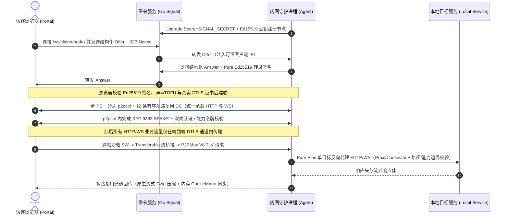

<p align="center">
  
</p>

# Zero-Client P2P WebRTC Intranet Penetration Gateway

### 浏览器端零客户端依赖的 P2P WebRTC 端到端内网穿透网关

<p align="center">
  <a href="README.md"><b>简体中文</b></a> · <a href="README_en.md"><b>English</b></a> · <a href="https://beingnoability.github.io/WebRTC-Gateway/"><b>官方文档站 (Documentation)</b></a>
</p>

[](https://go.dev/)
[](https://www.typescriptlang.org/)
[](https://github.com/pion/webrtc)
[](https://github.com/BeingNoAbility/WebRTC-Gateway/pkgs/container/webrtc-p2p-server)
[](LICENSE)
[](https://github.com/BeingNoAbility/WebRTC-Gateway/actions/workflows/ci.yml)

> [!IMPORTANT]
> **版本状态**：当前为 **v5.0.0-alpha.4** 预发布版本，现行线协议为 `P2PMux V8`（规范见[协议规范](docs/guide/protocol-specification.md)；[V7 架构 RFC](docs/rfcs/v7.0-architecture.md) 为历史架构决策记录）。版本演进与历史变更见 [CHANGELOG](CHANGELOG.md)。

---

## 为什么选择 WebRTC Gateway？

| 方案分类 | 代表技术 | 核心限制 | WebRTC Gateway 方案 |
| :--- | :--- | :--- | :--- |
| **公网端口中继** | FRP / NPS / Ngrok / Cloudflare Tunnel | 全部业务流量经过中心服务器，受带宽与隐私限制 | **P2P 点对点直连**：通过 WebRTC STUN/ICE 建立端到端 DTLS 隧道；信令仅负责撮合 SDP 与 ICE 候选，不中继业务数据；对称 NAT 回退可选用户自建 TURN（仅转发 DTLS 密文） |
| **虚拟局域网 VPN** | Tailscale / WireGuard / ZeroTier | 访客设备必须安装原生客户端或虚拟网卡驱动 | **零客户端 (Zero-Client)**：访客使用 Chrome、Edge、Safari、Firefox 等标准浏览器打开链接即可接入 |

---

## 核心特性速览

- **零客户端**：访客用 Chrome、Edge、Safari、Firefox 等标准浏览器打开链接即可访问，无需安装软件、插件或证书（详见[浏览器兼容性](docs/guide/browser-compatibility.md)）。
- **P2P 直连**：浏览器与内网 Agent 之间建立端到端加密通道，信令服务器只负责撮合连接，不转发业务数据（详见[架构](docs/guide/architecture.md)）。
- **访问口令不经过服务器**：口令在加密通道内完成双向验证，信令服务器无法获得口令或其可离线破解的校验值（详见[安全模型](docs/guide/security.md)）。
- **可控的分享链接**：Owner 可签发限定路径、只读、可随时吊销的分享令牌，再也不用共享主口令（详见[安全模型](docs/guide/security.md)）。
- **应用中立**：原样代理现有 HTTP 与 WebSocket 服务，无需修改应用；浏览器中的访问被隔离在独立沙箱，Cookie 不与其他站点混用（详见[Agent 配置](docs/guide/agent-configuration.md)）。
- **安全的静态文件分享**：一条命令即可分享单个文件或目录（`-file` / `-dir`），默认只读，并拒绝软链接与隐藏文件（详见[文件服务器](docs/guide/file-server.md)）。
- **单一二进制部署**：信令服务器内嵌全部前端资源，一个可执行文件或一个容器镜像即可运行（详见[部署](docs/guide/deployment.md)）。

---

## 快速开始 (Quickstart)

### 方式一：源码本地运行（`localhost` / `*.localhost` 安全上下文）

```bash
# 1. 构建前端产物与内嵌 Web 资产的 Go 二进制
make build

# 2. 启动信令服务器（-dev 显式启用本地回环 *.localhost 跨站沙箱模式；密钥不少于 16 字节）
./bin/signal -addr 127.0.0.1:8888 -dev -signal-secret dev-cluster-secret-16b

# 3. 启动内网 Agent（必须设置 ACCESS_SECRET，或显式传入 -allow-public）
ACCESS_SECRET=change-me ./bin/agent \
  -id homeserver \
  -signal ws://127.0.0.1:8888/ws \
  -signal-secret dev-cluster-secret-16b \
  -target http://127.0.0.1:8080
```

在浏览器访问 `http://localhost:8888/#homeserver`，按提示在 DTLS 通道内输入访问口令即可直连本地 `8080` 服务。

### 方式二：生产双域部署与 Docker Compose

生产环境要求启动期显式配置跨站源（推荐 Tier 1 跨站通配符 `PORTAL_ORIGIN` + `SANDBOX_ORIGIN=https://*.sandbox.example.net`；或 Tier 2 受限固定单域 `https://app.example.net`）以及不少于 16 字节的 `SIGNAL_SECRET`（除非显式声明 `-allow-anonymous-agents`）：

```bash
cat <<'EOF' > .env
PORTAL_ORIGIN=https://portal.example.com
SANDBOX_ORIGIN=https://*.sandbox.example.net
SIGNAL_URL=wss://portal.example.com/ws
SIGNAL_SECRET=replace-with-strong-cluster-secret
ACCESS_SECRET=replace-with-strong-visitor-secret
EOF

docker compose up -d --build
```

离线签发短期只读能力分享链接：

```bash
./bin/agent -id homeserver -identity-key /path/to/homeserver.ed25519.key \
  -mint-link 24h -mint-path /public -mint-readonly \
  -portal-url https://portal.example.com
```

---

## 系统交互时序



---

## 文档导航

- [Agent 典型用例与配置模板](docs/guide/agent-use-cases.md)
- [本地反代协作与典型适配模式](docs/guide/reverse-proxy-recipes.md)
- [服务端典型用例与部署模板](docs/guide/server-use-cases.md)
- [系统架构与核心设计](docs/guide/architecture.md)
- [P2PMux V8 线协议规范](docs/guide/protocol-specification.md)
- [安全机制与密码学边界](docs/guide/security.md)
- [Agent 与信令服务端配置](docs/guide/agent-configuration.md)
- [生产部署与两档沙箱规划](docs/guide/deployment.md)
- [静态文件与目录只读适配器](docs/guide/file-server.md)
- [V7 架构决策记录 (RFC，历史)](docs/rfcs/v7.0-architecture.md)
- [贡献者开发指南 (`CONTRIBUTING.md`)](CONTRIBUTING.md)
- [测试策略与本地门禁 (`scripts/gate.sh`)](docs/TESTING_CHECKLIST.md)

---

## 许可证

本项目遵循 [MIT License](LICENSE) 开源。
