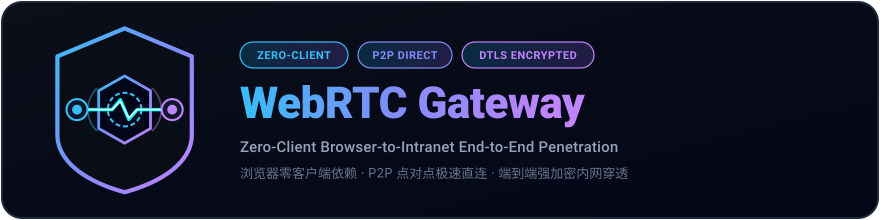
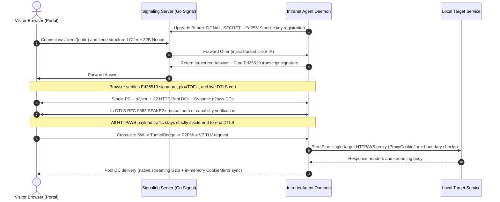

<p align="center">
  
</p>

# Zero-Client P2P WebRTC Intranet Penetration Gateway

### Browser Zero-Client End-to-End Encrypted P2P WebRTC Gateway

<p align="center">
  <a href="README.md"><b>简体中文</b></a> · <a href="README_en.md"><b>English</b></a> · <a href="https://beingnoability.github.io/WebRTC-Gateway/en/"><b>Documentation Site</b></a>
</p>

[](https://go.dev/)
[](https://www.typescriptlang.org/)
[](https://github.com/pion/webrtc)
[](https://github.com/BeingNoAbility/WebRTC-Gateway/pkgs/container/webrtc-p2p-server)
[](LICENSE)
[](https://github.com/BeingNoAbility/WebRTC-Gateway/actions/workflows/ci.yml)

> [!IMPORTANT]
> **Release Status**: Current pre-release is **v5.0.0-alpha.3** ([V7 Architecture RFC](docs/en/rfcs/v7.0-architecture.md)). Full version history is recorded in [CHANGELOG](CHANGELOG.md).

---

## Why WebRTC Gateway?

| Approach | Representative Tools | Key Constraints | WebRTC Gateway Approach |
| :--- | :--- | :--- | :--- |
| **Public Port Relay** | FRP / NPS / Ngrok / Cloudflare Tunnel | All traffic transits a central server with relay bandwidth cost and privacy exposure | **Direct P2P Tunnel**: End-to-end DTLS over WebRTC STUN/ICE; signaling only brokers SDP and ICE candidates and never relays payload data; user-run TURN is an optional fallback forwarding DTLS ciphertext only |
| **Mesh VPN** | Tailscale / WireGuard / ZeroTier | Visitors must install native apps or kernel TUN/TAP drivers | **Zero-Client Browser Access**: Visitors open a URL in stock Chrome, Edge, Safari, or Firefox |

---

## Core Capabilities

- **DataChannel Pool Data Plane (P2PMux V7)**: Uses one `RTCPeerConnection` with 1 control channel (`id=0` `p2pctrl`), 32 pre-negotiated reusable HTTP pool channels (`id=1..32` `p2p_01..p2p_32`, strict 5-state single-slot FSM with monotonic `Gen`), and dynamic dedicated `"p2pws"` WebSocket channels over an 8-byte fixed frame header and binary TLV encoding (`FetchCtx`, `RespFlags`, and inline cookie TLVs), eliminating cross-stream head-of-line blocking and large-WS deadlocks.
- **Anti-MITM Cryptographic Boundary**: Signaling exchanges strictly validated structured `SessionDescriptor` payloads and both peers deterministically synthesize minimal 16-line DataChannel-only SDPs. Each Agent persists an **Ed25519 identity keypair** signing length-prefixed transcripts (including `-allow-public`), verified with the live negotiated DTLS certificate fingerprint, `#node?pk=` pinning, and Fail-Closed `IndexedDB` TOFU. Visitor password auth runs **RFC 9383 SPAKE2+ (P-256, 300,000-round PBKDF2 + HKDF)** mutual zero-knowledge verification inside DTLS with mandatory downgrade protection; Owners can mint live-revocable, path- and read-only-scoped **Ed25519 capability tokens** backed by atomic persistence.
- **3-Tier Cross-Site Sandbox, W3C Fetch Anti-CSRF Gate & In-Memory CookieMirror**: Production supports dual fixed domains (Tier 1 `-portal-domain` + `-sandbox-host`, no wildcard cert required), single-root wildcard (Tier 2 `-allow-same-site-sandbox` + `Origin-Agent-Cluster: ?1`), and dual-root wildcard (Tier 3 `-portal-domain` + `-sandbox-domain` with device-salted HMAC `sbx-<24hex>` origins; local dev auto-uses `*.localhost`). Portal CSP locks `style-src 'self'` and `connect-src 'self'` with content-hashed embedded assets; SW enforces one-time `enterNonce`, W3C Fetch anti-CSRF gating, and `frame-ancestors`; `appFrame` sets `sandbox` to block top navigation; in-memory `CookieMirror` pairs with split-pool `ProxyCookieJar` and shields the tunnel SW from PWA unregistration.
- **Pure Pipe Proxy and Minimal `os.Root` Static Adapter**: HTTP and WebSocket share a strict single-target `DestinationPolicy` (exact target origin only, optional `-upstream-host` virtual-host header override, WS 302 redirect blocking, and post-resolve capability enforcement), split-pool RFC 6265bis `ProxyCookieJar`, 16 KiB streaming WebSocket proxying, and native streaming `gzip` (`DecompressionStream('gzip')`, zero third-party decompression dependencies); `-dir` and `-file` plug a stepwise `os.Root` read-only handler enforcing `CSP: sandbox` and dotfile/symlink isolation.
- **Single Authoritative Go Signal & Build-Time Asset Embedding**: Content-hashed frontend bundles are embedded at build time via an explicit manifest under `-tags embedweb` (`make build`) into the single `signal` binary, supporting atomic Ed25519 node bindings (`-bound-keys-file`) and per-node registration secrets (`-node-secrets-file`).

---

## Quickstart

### Option 1: Local Source Run (`localhost` / `*.localhost` Secure Context)

```bash
# 1. Build web frontend assets and Go binaries with embedded web assets
make build

# 2. Start Signal server (loopback automatically enables *.localhost cross-site sandbox mode)
./bin/signal -addr 127.0.0.1:8888 -signal-secret dev-cluster-secret

# 3. Start intranet Agent (ACCESS_SECRET required unless -allow-public is passed)
ACCESS_SECRET=change-me ./bin/agent \
  -id homeserver \
  -signal ws://127.0.0.1:8888/ws \
  -signal-secret dev-cluster-secret \
  -target http://127.0.0.1:8080
```

Open `http://localhost:8888/#homeserver` in your browser and enter the access secret inside the DTLS auth prompt to reach local port `8080`.

### Option 2: Production Dual-Domain Deployment with Docker Compose

Non-loopback deployments fail closed unless cross-site domains (Tier 1 fixed `PORTAL_DOMAIN` + `SANDBOX_HOST`, or Tier 3 wildcard `PORTAL_DOMAIN` + `SANDBOX_DOMAIN`, on distinct sites) and `SIGNAL_SECRET` (or explicit `-allow-anonymous-agents`) are configured:

```bash
cat <<'EOF' > .env
PORTAL_DOMAIN=portal.example.com
SANDBOX_DOMAIN=sandbox.example.net
SIGNAL_SECRET=replace-with-strong-cluster-secret
ACCESS_SECRET=replace-with-strong-visitor-secret
EOF

docker compose up -d --build
```

Mint an offline scoped read-only capability link:

```bash
./bin/agent -id homeserver -identity-key /path/to/homeserver.ed25519.key \
  -mint-link 24h -mint-path /public -mint-readonly \
  -portal-url https://portal.example.com
```

---

## End-to-End Sequence



---

## Documentation Map

- [Agent Use Cases & Recipes](docs/en/guide/agent-use-cases.md)
- [Local Reverse-Proxy & Adapter Recipes](docs/en/guide/reverse-proxy-recipes.md)
- [Server Use Cases & Deployment Recipes](docs/en/guide/server-use-cases.md)
- [Architecture and Core Design](docs/en/guide/architecture.md)
- [P2PMux V7 Wire Protocol Specification](docs/en/guide/protocol-specification.md)
- [Security and Cryptographic Boundaries](docs/en/guide/security.md)
- [Agent and Signal Server Configuration](docs/en/guide/agent-configuration.md)
- [Production Deployment and 3-Tier Sandbox](docs/en/guide/deployment.md)
- [Read-Only Static File and Directory Adapter](docs/en/guide/file-server.md)
- [V7 Architecture Decision Record (RFC)](docs/en/rfcs/v7.0-architecture.md)
- [Contributor Guide (`CONTRIBUTING.md`)](CONTRIBUTING.md)
- [Testing Strategy & Machine Gate (`scripts/gate.sh`)](docs/en/TESTING_CHECKLIST.md)

---

## License

Released under the [MIT License](LICENSE).
