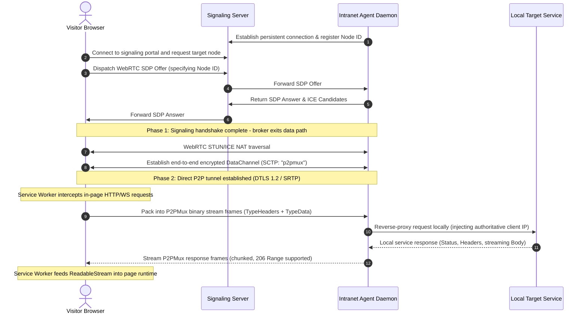

<p align="center">
  
</p>

# Zero-Client P2P WebRTC Intranet Penetration Gateway
### End-to-End P2P WebRTC Reverse Proxy Gateway with Zero Client Dependencies in Visitor Browsers

<p align="center">
  <a href="README.md"><b>简体中文</b></a> · <a href="README_en.md"><b>English</b></a> · <a href="https://beingnoability.github.io/WebRTC-Gateway/en/"><b>📖 Official Documentation</b></a>
</p>

[](https://go.dev/)
[](https://www.typescriptlang.org/)
[](https://github.com/pion/webrtc)
[](https://github.com/BeingNoAbility/WebRTC-Gateway/pkgs/container/webrtc-p2p-server)
[](LICENSE)
[](https://github.com/BeingNoAbility/WebRTC-Gateway/actions/workflows/ci.yml)

---

## Why WebRTC Gateway?

Traditional remote access and penetration solutions force difficult compromises:

| Category | Typical Tech | Engineering Bottlenecks & Trade-offs | WebRTC Gateway Approach |
| :--- | :--- | :--- | :--- |
| **Public Relay / Port Mapping** | FRP / NPS / Ngrok / Cloudflare Tunnel | All traffic traverses centralized VPS nodes, throttled by narrow upstream bandwidth with recurring server costs and privacy concerns | **Direct P2P Traversal**: Powered by WebRTC STUN/ICE NAT traversal. Traffic flows peer-to-peer with zero cloud relay bandwidth cost |
| **Virtual LAN VPN** | Tailscale / WireGuard / ZeroTier | Requires dedicated client installations, system-level virtual network drivers (TUN/TAP), and root privileges on visitor devices | **Zero-Client Architecture**: Visitors need only a modern web browser. Open the URL or custom subdomain to connect instantly |

This project is built upon **WebRTC RTCDataChannel (SCTP) + In-Browser Service Worker Transparent Interception & DOM Virtualization Sandbox**:
1. **Zero Client on Visitor Side**: Open any modern browser (Chrome, Edge, Safari, Firefox, iOS/Android mobile browsers);
2. **End-to-End Transport Encryption**: The browser negotiates with the intranet **Agent daemon** via lightweight signaling, establishes a WebRTC STUN/ICE direct data channel, and enforces standard DTLS 1.2 / SRTP transport encryption (RFC 8831). The public broker only routes metadata and cannot inspect traffic;
3. **Zero Application Modification**: Fully virtualizes HTTP/HTTPS, HTTP 206 video seeking, full-duplex WebSockets, and isolated session CookieJars without modifying any backend code.

---

## Key Highlights

- **Zero-Client Access**: No desktop apps, mobile apps, browser extensions, or root CA certificates needed on the visitor side.
- **P2P Direct Throughput**: Bounded by physical link bandwidth and SCTP congestion control without public relay throttling (symmetric NAT automatically falls back to TURN).
- **Mobile Roaming Self-Healing (ICE Restart)**: Millisecond-level in-place renegotiation when switching between Wi-Fi and 5G cellular networks without reloading pages or dropping connections.
- **Authoritative Client IP & Enterprise WAF Integration**: The Agent reverse proxy injects the authoritative client IP into standard `X-Forwarded-For` and `X-Real-IP` headers for accurate rate-limiting, GeoIP auditing, and single-IP blocking in SafeLine, Nginx WAF, and ModSecurity.
- **Dual-Secret Decoupling & Stateless Share Links**: Control plane cluster registration (`-signal-secret`) and data plane visitor passwords (`-access-secret`) are strictly decoupled; supports pure mathematical HMAC-SHA256 time-limited sharing links.
- **Real-Time WebRTC Diagnostic HUD**: Floating status pill shows direct vs relay connection status; opens a diagnostics modal displaying RTT, packet loss, throughput, and candidate pair topology.
- **Three Operating Modes**: Supports intranet HTTP/WS reverse proxy (`-target`), zero-port static directory hosting (`-dir`), and single-file streaming delivery (`-file`).

---

## 1-Minute Quickstart

### Option 1: Docker Compose (Production Recommended)

An all-in-one compose file is included in the repository root:

```bash
docker compose up -d
docker compose logs -f
```

Open `http://localhost:8888/#myhome` in your browser to verify the connection.

### Option 2: Pre-compiled Single Binary

Download pre-compiled binaries from [GitHub Releases](https://github.com/BeingNoAbility/WebRTC-Gateway/releases):

```bash
# 1. Start the signaling server (includes embedded Web Console)
./signal -addr :8888

# 2. Launch the Agent on your intranet server (proxies local service)
./agent -node-id myhome -signal ws://<server-ip>:8888/ws -target http://127.0.0.1:8080
```

Open in any remote browser:  
👉 `http://<server-ip>:8888/#myhome`

---

## Architecture & End-to-End Data Flow



---

## Documentation Hub

Comprehensive implementation details, architectural deep dives, and production operation manuals are hosted on the [Official VitePress Documentation Site](https://beingnoability.github.io/WebRTC-Gateway/en/):

| Documentation Topic | Overview | Link |
| :--- | :--- | :--- |
| **Architecture & Protocol Specifications** | P2PMux v1 binary framing, Service Worker transparent fetch interception, DOM virtualization patches, and CookieJar isolation | [Architecture & Design](./docs/en/guide/architecture.md) |
| **Production Deployment Manual** | Cloudflare Workers edge deployment, standalone Linux/Windows daemons, Docker Compose orchestration, and non-root hardening | [Production Deployment](./docs/en/guide/deployment.md) |
| **Configuration Reference** | Full 40+ CLI flags, environment variables, precedence rules, and YAML/JSON templates | [Configuration Reference](./docs/en/guide/agent-configuration.md) |
| **Security & Access Control** | Control vs data plane secret decoupling, HMAC-SHA256 time-limited links, path traversal sandbox defense, and authoritative IP propagation | [Security & Access Control](./docs/en/guide/security.md) |
| **P2P File & Directory Server** | Zero-port in-memory file sharing, HTTP 206 Range resumption, and dark-themed directory browsing | [File & Directory Server](./docs/en/guide/file-server.md) |
| **Browser Compatibility Matrix** | Tier 1 vs Tier 2 browser support, iOS Safari / WebKit background hibernation, and re-attachment self-healing | [Browser Compatibility](./docs/en/guide/browser-compatibility.md) |
| **Troubleshooting & FAQ** | Symmetric NAT (NAT 4) diagnostics, TURN fallback relay configuration, auto-TLS SAN generation, and roaming self-healing FAQ | [Troubleshooting & FAQ](./docs/en/guide/troubleshooting.md) |
| **Engineering Specifications** | Documentation style guide, dialectical review guidelines (5 invariants), real-world testing checklist, and release quality gates | [Engineering Specifications](./docs/en/STYLE_GUIDE.md) |

---

## Repository Structure

```text
webrtc-gateway/
├── cmd/                            # Go binary entrypoints
│   ├── agent/                      # Intranet penetration daemon (Agent CLI)
│   └── signal/                     # Unified signaling server (Signal Server CLI)
├── pkg/                            # Core backend packages
│   ├── agent/                      # WebRTC peer connection & lifecycle state machine
│   ├── signaling/                  # Signaling broker & peer session routing
│   ├── mux/                        # P2PMux binary multiplexing protocol in Go
│   ├── proxy/                      # HTTP / WebSocket / File reverse proxy engine
│   ├── banner/                     # Terminal TTY detection and clean security warning banners
│   └── protocol/                   # Binary frame serialization & decoding
├── web/                            # Frontend Web Portal & in-browser sandbox
│   ├── src/portal/                 # Minimalist Web Console & Settings Modal
│   ├── src/sw/                     # Service Worker transparent network interceptor
│   ├── src/patch/                  # DOM / XHR / WebSocket virtualization monkey patches
│   └── src/protocol/               # TypeScript implementation of P2PMux
├── edge/                           # Cloudflare Workers edge signaling script
├── configs/                        # Example configuration templates (agent / server)
├── docs/                           # Official VitePress documentation site & specifications
└── test/                           # Automated test suites & real-browser matrix runners
```

---

## License & Acknowledgments

This project is open-source under the [MIT License](LICENSE). Core WebRTC capabilities are powered by the pure-Go [Pion WebRTC](https://github.com/pion/webrtc) protocol stack.
