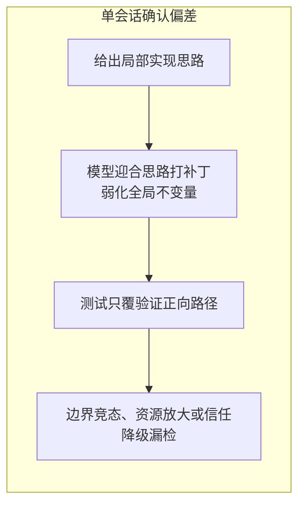

# AI 辅助开发指南 (AI-Assisted Development Guide)

> **定位与关联**：AI 编码代理的仓库入口文件为根目录 [`AGENTS.md`](https://github.com/BeingNoAbility/WebRTC-Gateway/blob/main/AGENTS.md)。本指南只规范 AI 辅助开发的风险控制与实质准入标准，不另立技术原则；所有工程底线以 [核心原则](./CONSTITUTION.md)、[审查清单](./REVIEW_GUIDELINES.md) 与 [设计边界与架构权衡](./DESIGN_TRADEOFFS.md) 为准。

---

## 一、为什么单会话生成不够

在涉及点对点传输、密码学、并发状态机与浏览器跨站隔离的系统中，单一会话内直接“描述想法 → 生成代码 → 自评通过”存在三类系统性风险：



1. **迎合偏见与局部过拟合**：同一上下文中的模型倾向于维护前文假设，即使该假设破坏了资源边界、锁层级或信任隔离。
2. **捷径诱惑**：面对协议兼容或环境阻碍时，模型容易提议违背核心原则的“省事绕路”，例如：

| 核心原则 | AI 常见捷径倾向 | 正确约束 |
| :--- | :--- | :--- |
| 原则一：零数据中继与诚实边界 | 提议由信令服务器转发业务流量，或在信令消息中传递口令哈希以省一次往返。 | 信令仅撮合连接；端点验签与访客鉴权只在端到端加密通道内完成；对称 NAT 仅允许用户自建 TURN 转发密文。 |
| 原则二：零客户端 | 提议安装浏览器扩展、自定义根证书或开启实验 Flag 绕过引擎差异。 | 仅使用标准 Web 平台规范，并为跨引擎差异提供可预期的降级路径。 |
| 原则三：透明管道与应用中立 | 提议内置业务 UI、按特定应用名/路径硬编码特判，或放宽 Fail-Closed 默认值。 | 按 [核心原则](./CONSTITUTION.md#一、定位与三条核心原则) 在标准规范层求解，或交由下游标准 HTTP/WS 边界组合。 |

3. **范围膨胀与伪测试**：顺手重构无关代码、用无约束 `sleep` 掩盖时序竞态，或在单测中复制生产逻辑而非加载真实模块。

---

## 二、实质准入标准

本仓库**不要求僵化的形式流程**；文档调整或局部孤立修复只需常规审阅并通过本地门禁。但凡涉及核心传输、多路复用、密码学与认证、信令代理边界、并发状态机或浏览器沙箱的 AI 辅助变更，必须满足以下三条实质标准：

1. **独立上下文对抗审查**：在不继承编写上下文的独立会话（或独立审查子代理 / 不同架构模型）中，以“只找反例与缺陷”的角色对照 [审查清单](./REVIEW_GUIDELINES.md) 与 [设计边界与架构权衡](./DESIGN_TRADEOFFS.md) 逐维审视 diff，绝不以编写会话的自我评价代替审查。
2. **确定性负向验证**：对抗审查确认成立的每一项边界、并发、资源或安全风险，都必须补充直接驱动真实模块的自动化负向测试（见 [测试策略与验证清单](./TESTING_CHECKLIST.md)），并证明该测试在未修复代码上失败、修复后稳定通过。
3. **人类逐行终审与机器门禁**：人类提交者必须逐行理解全部 diff，对其正确性、安全性与长期可维护性承担最终责任；确保零私密数据与零追踪构建产物，并在提交前通过 [`scripts/gate.sh`](https://github.com/BeingNoAbility/WebRTC-Gateway/blob/main/scripts/gate.sh)（涉及核心协议、信令或沙箱时运行 `scripts/gate.sh --full`）。

---

## 三、原则导向的提示词骨架

提示词应引用仓库内的单一事实源文档，而非把具体版本的协议常数硬编码进模板：

### 模板 1：实现阶段

```text
请先阅读仓库中的 AGENTS.md、docs/CONSTITUTION.md、docs/REVIEW_GUIDELINES.md、docs/DESIGN_TRADEOFFS.md，以及本次改动涉及的 docs/guide/ 专题规范。

【任务目标】
<描述要解决的问题、目标与预期边界>

【约束】
1. 遵守变更尺度：日常修复只修改直接相关代码，不顺带无关重构；
2. 满足三条核心原则与全部 Fail-Closed 安全不变量，不引入特定应用硬编码；
3. 改动边界、并发、资源或安全逻辑时，同步提供驱动真实模块的确定性负向测试，并说明修改前后测试结果。
```

### 模板 2：独立上下文对抗审查

```text
你是分布式系统与网络安全对抗审查者。请先阅读仓库中的 AGENTS.md、docs/CONSTITUTION.md、docs/REVIEW_GUIDELINES.md 与 docs/DESIGN_TRADEOFFS.md，以及改动对应的 docs/guide/ 权威规范。

不要总结优点，只针对以下 diff 寻找反例：
1. 是否违背核心原则、Fail-Closed 不变量或永久 Non-Goals？
2. 是否存在信任边界混淆、密码学/规范化漏洞、不对称资源耗尽（内存/CPU/FD/基数）、跨 I/O 持锁、生命周期泄漏或浏览器合成执行陷阱？
3. 给出每条成立风险的触发路径与最小可复现负向测试思路。

【候选 Diff 与说明】
<粘贴 git diff 与变更上下文>
```
