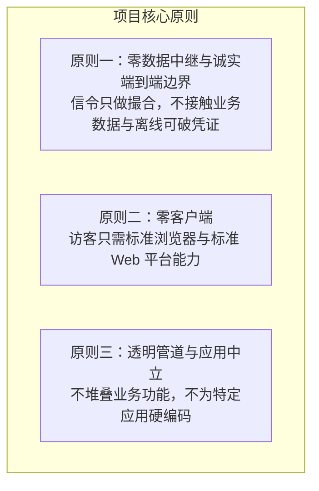

# 项目核心原则 (Project Constitution)

> **文档分层与优先级**：核心原则（本文，定义不变的项目定位、三条核心原则与 Fail-Closed 安全不变量）> [审查清单](./REVIEW_GUIDELINES.md)（第一性工程审查框架）> [设计边界与架构权衡](./DESIGN_TRADEOFFS.md)（永久 Non-Goals、可重评权衡与典型跨层陷阱）。当前版本的具体线协议参数、密码原语与 CLI 默认值以 `docs/guide/` 下各专题规范为单一事实源。
>
> 本文使用“必须 / 应当 / 可以”表达 RFC 2119 中的 MUST / SHOULD / MAY。

---

## 一、定位与三条核心原则

WebRTC Gateway 的生态定位介于三类现有工具之间：相比 VPN（WireGuard / Tailscale）无需访客安装客户端；相比中心化穿透（Cloudflare Tunnel / frp）不在公网服务器中继或解码业务数据；相比通用反向代理（Nginx / Caddy）只承担窄边界的透明 P2P 传输管道，将复杂路由、多源聚合与业务改写交由标准 HTTP/WS 边界组合。

任何代码、方案或架构演进都必须满足以下三条核心原则。违反任意一条的变更，审查结论为 REJECT（见 [签核矩阵](./REVIEW_GUIDELINES.md#三、审查结论与签核矩阵)）。

### 原则一：零数据中继与诚实端到端边界

- **信令与数据面解耦**：信令服务器只负责连接协商（交换连接描述与候选地址），不得缓存、解码或中继任何 HTTP / WebSocket 业务流量，也不得引入需要公网中心服务器转发明文业务数据的架构。
- **零离线可破凭证与端到端认证**：信令通道不得传输可离线暴破的口令验证器或数据面会话句柄。端点身份验证、防主动中间人绑定以及访客访问认证必须在端到端加密传输通道内完成。
- **诚实声明前端代码交付 TCB**：向浏览器交付前端静态代码（门户与沙箱脚本）的组件天然位于前端可信计算基（TCB）内。系统必须如实声明这一边界，不得借不可验证的运行时覆盖制造“前端与信令解耦”的虚假安全感；仅当存在可密码学验证的完整性与源绑定机制时，方可经 RFC 探索拆分前端交付路径。
- **TURN 例外**：直连穿透受阻时，用户可以选用自建 TURN 中继。只要 TURN 仅转发端到端加密密文、无法读取或篡改业务载荷，即符合本原则。

### 原则二：零客户端

- 访客不得被要求安装原生客户端、浏览器扩展、自定义根证书或开启实验性浏览器 Flag。
- 前端实现必须仅依赖标准 Web 平台规范（如 Service Worker、Fetch、Streams、WebCrypto、WebRTC DataChannel 等），不得依赖私有或定制浏览器行为。
- 浏览器支持范围以 [浏览器兼容性](./guide/browser-compatibility.md) 为准；当新能力在部分主流引擎上受限时，应当提供可预期的降级路径。

### 原则三：透明管道与应用中立

- 网关只负责提供透明的点对点传输管道。文件管理、终端、相册、用户账号体系等业务功能归属内网应用本身，不得堆叠进门户或 Agent 界面。内置只读静态共享能力仅允许作为极简标准 HTTP 适配器接入统一代理管线，不得衍生专用线协议或业务 UI。
- **不得为特定应用硬编码**：当某个内网应用出现兼容问题时，修复必须落在 IETF RFC、W3C 规范或通用传输与代理抽象层，不得编写按应用名称、私有路径或专有请求头特判的分支。
- **应用兼容三步分流决策树**（处理任意“某应用打不开 / 需要兼容”的 Issue 或 PR 时按序判定）：
  1. **标准规范、通用代理或浏览器沙箱语义缺失**（例如 iframe 权限策略、Service Worker / Fetch 行为、RFC Cookie 边界）→ 修入主仓核心，使全部应用受益；
  2. **通用反向代理标准能力**（例如 SNI、子路径边界、通用上游主机头覆写）→ 主仓仅增加默认关闭、与应用名无关的通用开关，具体参数组合沉淀为社区维护的声明式配置配方；
  3. **特定应用的私有怪癖**（定制 DOM/JS 改写、私有路径或响应体替换、专有鉴权流程）→ 明确拒入主仓，不提供进程内应用插件或沙箱 JS 补丁钩子；引导下游在目标出口处通过标准 HTTP/WS 边界组合本机通用反向代理（如 Nginx / Caddy）或独立适配 Sidecar 解决。

---

## 二、变更尺度与演进机制

| 变更类型 | 要求 |
| :--- | :--- |
| **日常变更**（缺陷修复、安全加固、PATCH / MINOR） | 默认最小改动：只修改与问题直接相关的代码，不夹带无关重构；保持线协议与配置向后兼容，并严格遵守原则三。 |
| **架构演进与大版本重构**（MAJOR） | 可通过不兼容演进替换协议、传输层或核心模块，但必须满足：① 在 `docs/rfcs/` 提交设计提案（RFC）并获批准；② PR 中声明架构演进并关联 RFC；③ 全部受影响运行时、跨语言黄金向量、一致性测试与双语文档同步迁移；④ 迁移完成后清除废弃双轨逻辑。 |

---

## 三、Fail-Closed 安全不变量

凡是会削弱认证、机密性、隔离边界或协议严格性的能力，都必须默认关闭并由显式开关启用；不得以“开箱便利”为由放宽默认行为，所有降级开关必须在配置文档中明示安全边界。

| 安全域 | 不可放宽的 Fail-Closed 不变量 | 当前版本参数与机制单一事实源 |
| :--- | :--- | :--- |
| **默认鉴权与最小准入** | Agent 注册到信令与访客访问受保护目标默认均需鉴权；未配置必需密钥且未显式开启开放模式时必须拒绝启动。共享凭据下默认禁止高风险在线权限变更（如强制换钥），仅在隔离凭据或显式授权时允许。 | [安全机制](./guide/security.md)、[配置参考](./guide/agent-configuration.md) |
| **传输机密性与校验** | 不得默认通过非回环明文链路传输准入密钥；代理上游 HTTPS 目标默认严格校验证书链与主机名；默认抑制内网原始主机地址暴露（如 mDNS 混淆）。 | [安全机制](./guide/security.md)、[配置参考](./guide/agent-configuration.md) |
| **浏览器隔离与严格策略** | 非回环部署默认强制控制门户与被代理应用沙箱跨站隔离；门户实施严格内容安全策略（禁用内联执行、禁止未授权嵌入与运行时信令端点覆盖），并拒绝任意外部 Origin 建立信令 WebSocket 连接。 | [安全机制](./guide/security.md)、[生产部署](./guide/deployment.md) |
| **严格出口与代理边界** | 单个 Agent 的代理出口严格限定于管理员显式配置的单一精确目标源（及可选子路径），禁止跨源开放代理与未授权跳转逃逸；仅从显式信任的反向代理（默认仅回环）采信客户端 IP 转发头。 | [安全机制](./guide/security.md)、[本地反代协作](./guide/reverse-proxy-recipes.md) |
| **静态内容主动执行禁锢** | 直接暴露的静态文件默认按不可信内容隔离脚本执行（不依赖文件扩展名判断），并隐藏点文件、阻断越界软链接与目录穿越。 | [只读文件适配器](./guide/file-server.md) |
| **显式配置与严格校验** | 禁止隐式自动加载当前工作目录配置文件；未知配置字段、非法安全开关或矛盾参数必须在启动期失败拒绝，而非静默回退。 | [配置参考](./guide/agent-configuration.md) |

与上述不变量对应的完整工程审查维度见 [审查清单](./REVIEW_GUIDELINES.md#二、六大第一性审查维度)。
