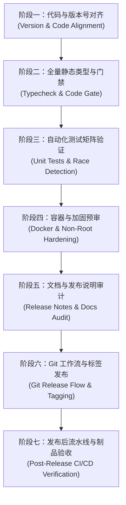

# WebRTC Gateway 正式发版核对清单 (Official Release Checklist)

> **目标与规范说明**：  
> 本清单是 WebRTC Gateway 项目每次发布新版本（正式版 / 次版本 / 补丁热修复版）的**强制工程门禁**。所有发版流程必须严格按顺序执行并逐项确认，确保**零回归、零遗漏、零破坏性变更**。  
> 团队成员可根据项目架构演进随时在文末追加新的核验项。

---

## 🗺️ 发版工作流全景图 (Release Workflow)



---

## 阶段一：代码与版本号多点对齐 (Version & Code Alignment)

- [ ] **1.1 Go 客户端版本变量更新**
  - **位置**：[cmd/agent/main.go](file:///cmd/agent/main.go) 中的 `var Version = "vX.Y.Z"`
  - **操作**：将版本号字符串订正为本次发布的目标版本（例如 `v1.9.2`）。
  - **验证命令**：`go run ./cmd/agent -v`
  - **预期输出**：必须输出包含新版本的标准信息，如 `WebRTC Gateway Agent vX.Y.Z`。

- [ ] **1.2 Go 服务端版本变量更新**
  - **位置**：[cmd/signal/main.go](file:///cmd/signal/main.go) 中的 `var Version = "vX.Y.Z"`
  - **操作**：将版本号字符串订正为本次发布的目标版本（例如 `v1.9.2`）。
  - **验证命令**：`go run ./cmd/signal -v`
  - **预期输出**：必须输出包含新版本的标准信息，如 `WebRTC Gateway Signal vX.Y.Z`。

- [ ] **1.3 CLI 命令行帮助与参数文档核验**
  - **检查**：本次发版若涉及任何 CLI 参数的新增、修改、废弃或默认值调整：
    - `cmd/agent/main.go` 的 `printAgentUsage` 帮助文案与环境变量（ENV）说明是否对齐？
    - `cmd/signal/main.go` 的 `printSignalUsage` 帮助文案与环境变量（ENV）说明是否对齐？
  - **验证命令**：
    ```bash
    go run ./cmd/agent -h
    go run ./cmd/signal -h
    ```
  - **预期输出**：帮助文档排版整齐，语法清晰，运行模式、安全认证选项及实战示例准确无误。

- [ ] **1.4 前端资产版本号更新与嵌入产物 Git Cleanliness 硬断言**
  - **位置**：[web/package.json](file:///web/package.json) 中的 `"version"` 字段与 [web/dist/](file:///web/dist/)。
  - **操作**：对齐版本号；若本次迭代修改了前端源码（`web/src/`），必须重新打包并验证产物已被暂存：
    ```bash
    npm --prefix web run build
    # 自动化差分断言：若前端源码发生过改动，打包后必须通过 git diff 确认 dist 已更新且全量暂存：
    git diff --exit-code web/dist
    ```
  - **判定标准**：确保在提交前 `git status --porcelain web/dist` 干净无遗漏，严禁出现“源码修改了但未重新 build 或未暂存 dist”导致 Go 二进制内嵌旧版前端资产。

- [ ] **1.5 Cloudflare Worker 边缘配置与入口对齐**
  - **位置**：[web/wrangler.toml](file:///web/wrangler.toml)、[edge/cloudflare-worker/worker.js](file:///edge/cloudflare-worker/worker.js)
  - **核对项**：
    - 确认 `web/wrangler.toml` 中的 `main` 路径必须严格指向 `../edge/cloudflare-worker/worker.js`；
    - 确认 `web/` 根目录下绝对不存在历史残留的孤立 `worker.js` 冗余副本（防 P0-1 分叉复发）；
    - 确认边缘脚本内部版本响应头或 User-Agent 常量与本次发版一致。

---

## 阶段二：全量静态类型与代码门禁 (Typecheck & Linters)

- [ ] **2.1 前端 TypeScript 严格类型检查**
  - **验证命令**：
    ```bash
    npm --prefix web run typecheck
    ```
  - **判定标准**：`tsc --noEmit` 必须以退出码 `0` 完成，**零类型错误 (0 errors)、零警告**。

- [ ] **2.2 Go 官方静态分析 (vet)**
  - **验证命令**：
    ```bash
    go vet ./...
    ```
  - **判定标准**：无任何未使用的变量、死锁可疑点或格式化占位符不匹配报错。

- [ ] **2.3 Go 统一代码格式化 (gofmt)**
  - **验证命令**：
    ```bash
    go fmt ./...
    ```
  - **判定标准**：确保所有修改或新增的 Go 代码严格遵守官方排版风格，无额外排版 diff。

- [ ] **2.4 VitePress 官方文档站静态构建预检**
  - **验证命令**：
    ```bash
    npm --prefix docs run docs:build
    ```
  - **判定标准**：必须以退出码 `0` 成功完成全量中英文页面静态 SSR 渲染与打包，零构建异常、零死链警告。防止代码合入 `main` 后 GitHub Pages 部署 CI 报错阻断。

---

## 阶段三：自动化测试矩阵验证 (Tests & Race Detection)

- [ ] **3.1 Go 全量自动化测试**
  - **验证命令**：
    ```bash
    go test -v ./...
    ```
  - **判定标准**：涵盖 `cmd/agent`、`cmd/signal`、`pkg/agent`、`pkg/mux`、`pkg/protocol`、`pkg/proxy`、`pkg/signaling` 及 `test/` 的所有单元测试与端到端测试用例必须全部通过（PASS）。

- [ ] **3.2 Go 并发数据竞争检测 (Data Race Detection)**
  - **验证命令**：
    ```bash
    go test -race ./pkg/... ./cmd/...
    ```
  - **判定标准**：在多核心并发压力下，Broker 注册锁、Mux 多路复用会话映射、Agent 生命周期零并发竞争警报（`WARNING: DATA RACE`）。
  - **平台依赖提示**：Go `-race` 探针强依赖 CGO 工具链。若本地在 Windows 宿主机且未配置 GCC/MinGW，本地执行会提示 `go: -race requires cgo`；在此情况下，该竞态门禁将由 Linux CI 环境（`.github/workflows/ci.yml`）或 WSL 严格执行守护。

- [ ] **3.3 前端与虚拟化沙箱全量测试矩阵**
  - **验证命令**：
    ```bash
    npm --prefix web test
    ```
  - **判定标准**：必须依次通过三大验证流水线：
    1. **子域名智能解析逻辑**：`test_subdomain_logic.cjs` 全通过；
    2. **节点保留、沙箱虚拟化与 SW 多标签页隔离**：`node_id_preservation_test.cjs` 全通过；
    3. **P2P 文件保险库下载 Hub 与流式切片**：`test_vault_download.cjs` 全通过。

- [ ] **3.4 多平台交叉编译烟雾预检 (Cross-Compilation Smoke Test)**
  - **目的**：确保未无意引入平台特定的非兼容依赖或常量，防止推送标签后 GitHub Actions `release.yml` 构建 6 大平台时半途失败。
  - **快速验证命令**：
    ```bash
    # Linux / macOS (bash):
    GOOS=linux GOARCH=amd64 go build -o /dev/null ./cmd/agent ./cmd/signal
    GOOS=darwin GOARCH=arm64 go build -o /dev/null ./cmd/agent ./cmd/signal
    GOOS=windows GOARCH=amd64 go build -o /dev/null ./cmd/agent ./cmd/signal

    # Windows (PowerShell):
    $env:GOOS="linux"; $env:GOARCH="amd64"; go build -o NUL ./cmd/agent ./cmd/signal
    $env:GOOS="darwin"; $env:GOARCH="arm64"; go build -o NUL ./cmd/agent ./cmd/signal
    $env:GOOS="windows"; $env:GOARCH="amd64"; go build -o NUL ./cmd/agent ./cmd/signal
    Remove-Item Env:GOOS, Env:GOARCH
    ```
  - **判定标准**：各目标平台交叉编译在数秒内以退出码 `0` 成功退出，零编译错误。

---

## 阶段四：容器与加固预审 (Docker & Container Pre-flight)

- [ ] **4.1 Dockerfile.agent 非特权用户（Least Privilege）核验**
  - **位置**：[Dockerfile.agent](file:///Dockerfile.agent)
  - **核对项**：
    - 镜像创建独立非特权用户：`addgroup -g 10001 -S appgroup && adduser -u 10001 -S appuser -G appgroup -H -D`；
    - 执行文件具备读取与执行权限：`chmod 0755 /app /app/agent`；
    - 镜像默认以非特权用户运行：`USER 10001:10001`；
    - 支持外部任意 `--user <uid>:<gid>` 正常传参启动。

- [ ] **4.2 Dockerfile.server 权限与特权端口（CAP_NET_BIND_SERVICE）核验**
  - **位置**：[Dockerfile.server](file:///Dockerfile.server)
  - **核对项**：
    - 赋予特权端口绑定能力：`setcap 'cap_net_bind_service=+ep' /app/server`，构建完成即清理 `libcap-setcap`；
    - 镜像默认以非特权用户运行：`USER 10001:10001`；
    - 即使在非特权身份或传入 `--user 1000:1000` 时，内部若配置 `:443` 或 `:80` 依然可正常监听与服务；
    - 健康检查探针正常：`HEALTHCHECK CMD /app/server -health || exit 1` 在非特权用户下返回 `0`。

- [ ] **4.3 Docker Compose 生产编排一致性核验**
  - **位置**：[docker-compose.yml](file:///docker-compose.yml)
  - **核对项**：检查镜像标签、环境变量示例、端口映射与 `user: "1000:1000"` 注释清晰完备。

- [ ] **4.4 本地 Docker 多阶段构建与非特权冒烟预检（双镜像）**
  - **目的**：提前在本地环境验证 Dockerfile 编译流程与基础镜像包依赖，杜绝因第三方包名变更或构建参数失效导致推 Tag 后 GHCR Actions 编译报错紧急撤标。
  - **验证命令**：
    ```bash
    # 预构建服务端与 Agent 镜像，并以 10001:10001 非特权身份探测版本
    docker build -f Dockerfile.server -t webrtc-p2p-server:smoke-test .
    docker run --rm --user 10001:10001 webrtc-p2p-server:smoke-test -v

    docker build -f Dockerfile.agent -t webrtc-p2p-agent:smoke-test .
    docker run --rm --user 10001:10001 webrtc-p2p-agent:smoke-test -v
    ```
  - **判定标准**：双镜像多阶段构建成功完成，且容器在受限非特权 UID (10001:10001) 下均正常打印出新版本号并以退出码 `0` 退出。

---

## 阶段五：文档与发布说明审计 (Release Notes & Docs Audit)

- [ ] **5.1 🌟 docs/RELEASE_NOTES.md 严格单版本守则（关键红线）**
  - **位置**：[docs/RELEASE_NOTES.md](file:///docs/RELEASE_NOTES.md)
  - **⚠️ 核心红线原则**：  
    **`docs/RELEASE_NOTES.md` 必须且只能包含本次发布的最新一个版本的更新公告！**  
    严禁累加或堆叠历史过往版本的说明（历史全量记录由 `CHANGELOG.md` 负责维护）。
  - **内容规范**：
    - 版本号与日期（如 `## [vX.Y.Z] - YYYY-MM-DD`）；
    - 核心定性与解决的问题；
    - 关键技术突破/架构演进细节说明；
    - 预编译二进制跨平台支持与官方多架构 Docker 镜像拉取命令。

- [ ] **5.2 CHANGELOG.md 历史累积归档**
  - **位置**：[CHANGELOG.md](file:///CHANGELOG.md)
  - **核对项**：在文档顶部追加新版本条目，遵循 [Keep a Changelog](https://keepachangelog.com/) 规范（`Added` / `Changed` / `Deprecated` / `Removed` / `Fixed` / `Security`）。

- [ ] **5.3 主文档多语言对齐**
  - **位置**：[README.md](file:///README.md)、[README_en.md](file:///README_en.md)
  - **核对项**：最新版本号提及、CLI 参数说明表、Docker 部署命令是否与新功能同步。

- [ ] **5.4 官方技术文档与专题指南对齐**
  - **位置**：[docs/guide/](file:///docs/guide/) 目录（例如 `agent-configuration.md`、`deployment.md` 等）
  - **核对项**：检查所有引用参数、特性说明与操作步骤是否同步更新。

- [ ] **5.5 配置文件示例模板与注释严谨性审计**
  - **位置**：[configs/server.example.yaml](file:///configs/server.example.yaml)、[configs/agent.example.yaml](file:///configs/agent.example.yaml)
  - **核对项**：
    - 本版本新增或调整的配置项（如新安全参数、白名单规则、流控参数）已在示例文件中列出，且默认值与 Go 二进制常量严格一致（例如 agent 的 `max_streams: 512`，signal 的 `addr: ":8888"`, `max_ip_conns: 64`）；
    - 严格审核配置文件中的文字注释，确保说明准确严谨，严禁出现与实际代码能力不符的夸大或误导性注释。

---

## 阶段六：Git 工作流与标签发布 (Git Release Flow & Tagging)

- [ ] **6.1 双分支规范与工作树清理**
  - **确认**：所有开发与修复已在 `dev` 分支完成并测试通过；
  - **合并**：将 `dev` 分支合并至 `main` 分支：
    ```bash
    git checkout main
    git merge dev
    ```
  - **整洁度与零残留绝对断言**：
    ```bash
    git status
    git status --porcelain
    ```
    确认输出完全为空且提示 `nothing to commit, working tree clean`，确保没有任何未被 `.gitignore` 捕获的临时本地调试脚本、中间产物或未提交修改带入发版 Tag。

- [ ] **6.2 创建语义化 Git 附注标签 (Annotated Tag)**
  - **标签格式**：严格使用 `v` 前缀加语义化版本号（如 `v1.9.2`）；
  - **打标命令**：
    ```bash
    git tag -a vX.Y.Z -m "Release vX.Y.Z: <简要版本摘要>"
    ```

- [ ] **6.3 推送主分支与标签触发 GitHub Actions**
  - **推送命令**：
    ```bash
    git push origin main dev --tags
    ```

- [ ] **6.4 恢复开发分支就绪状态**
  - **切换命令**：
    ```bash
    git checkout dev
    ```
  - 确认本地工作目录切回 `dev` 分支，为下一轮迭代做好准备。

---

## 阶段七：发布后流水线与制品验收 (Post-Release Verification)

- [ ] **7.1 跨平台编译矩阵与 GitHub Release 验收 (`release.yml`)**
  - 打开 GitHub 仓库 Actions 页面，确认 `Release` 工作流全绿通过；
  - 打开 GitHub Releases 页面，确认本次发版已自动草拟/发布，且挂载了 **6 大操作系统与芯片架构**的可执行压缩包及 **`SHA256SUMS.txt` 全局校验和清单**：
    - `webrtc-gateway_vX.Y.Z_linux_amd64.tar.gz`
    - `webrtc-gateway_vX.Y.Z_linux_arm64.tar.gz`
    - `webrtc-gateway_vX.Y.Z_windows_amd64.zip`
    - `webrtc-gateway_vX.Y.Z_windows_arm64.zip`
    - `webrtc-gateway_vX.Y.Z_darwin_amd64.tar.gz`
    - `webrtc-gateway_vX.Y.Z_darwin_arm64.tar.gz` (Apple Silicon)
    - `SHA256SUMS.txt`（包含上述 6 大制品 SHA256 校验和的明文清单）

- [ ] **7.2 GHCR 多架构 Docker 镜像验收 (`docker.yml`)**
  - 确认 `Build and Push Docker Images` 工作流构建成功；
  - 确认 GitHub Packages (`ghcr.io`) 成功更新以下标签：
    - `ghcr.io/beingnoability/webrtc-p2p-server:vX.Y.Z` & `:latest` (含 `linux/amd64` 与 `linux/arm64`)
    - `ghcr.io/beingnoability/webrtc-p2p-agent:vX.Y.Z` & `:latest` (含 `linux/amd64` 与 `linux/arm64`)

- [ ] **7.3 官方文档站 GitHub Pages 部署验收 (`deploy-pages.yml`)**
  - 确认 `Deploy Documentation to Pages` 工作流执行成功，官方文档站页面（https://beingnoability.github.io/WebRTC-Gateway/）自动保持最新。

- [ ] **7.4 线上制品冒烟抽检 (Smoke Sanity Check)**
  - 在 Linux 生产或测试环境拉取新镜像，执行非特权冒烟探针：
    ```bash
    docker run --rm --user 1000:1000 ghcr.io/beingnoability/webrtc-p2p-server:latest -v
    docker run --rm --user 1000:1000 ghcr.io/beingnoability/webrtc-p2p-agent:latest -v
    ```
  - 确认正常输出新版本号并以退出码 `0` 退出。

---

## 🚨 应急回滚流程 (Emergency Rollback Playbook)

如果在打标推送后发现致命 P0 漏洞或流水线阻断：

1. **撤回 Git Tag**：
   ```bash
   # 删除本地标签
   git tag -d vX.Y.Z
   # 删除远程仓库标签（阻断发布流程）
   git push origin :refs/tags/vX.Y.Z
   ```
2. **在 GitHub Web 界面取消/删除未就绪的 Release 草稿**；
3. **在 `dev` 分支排查修复问题并补全测试**；
4. **重新从阶段一执行清单，合并至 `main` 后重新打标发布**。

---

## 📝 附录：新确认项追加指南模板

当后续项目引入新组件（如移动端 SDK、自动化 ACME、新协议集成等）时，请在对应阶段下方按此格式追加：

```markdown
- [ ] **X.Y [组件/模块名称] 专项检查项**
  - **位置**：[path/to/file](file:///path/to/file)
  - **操作**：说明具体需要核对或修改的内容。
  - **验证命令**：`运行的验证脚本或测试命令`
  - **判定标准**：明确给出何为合格、何为失败。
```
