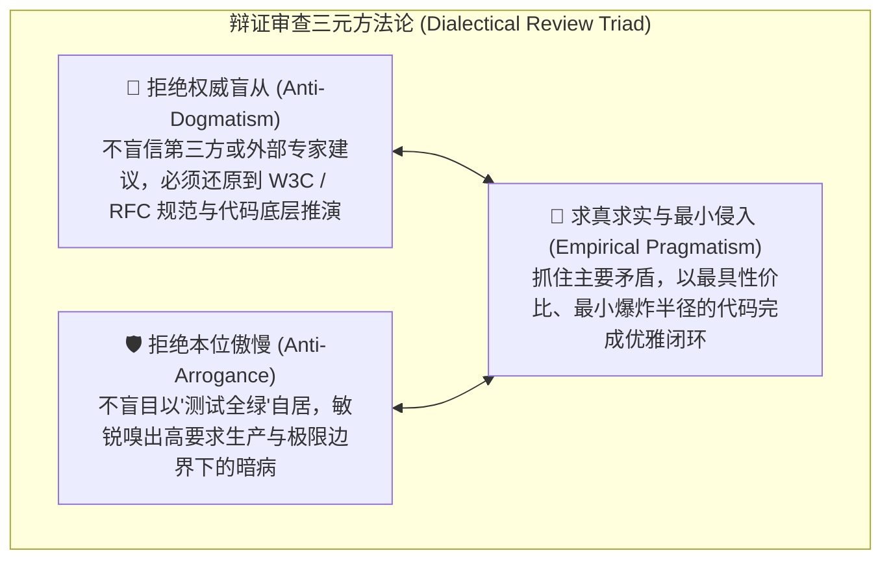
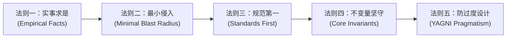
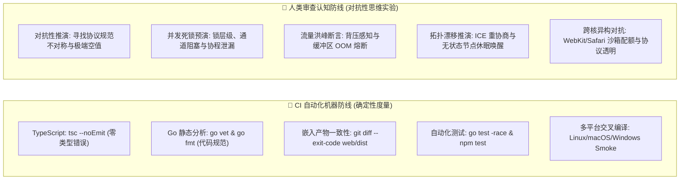
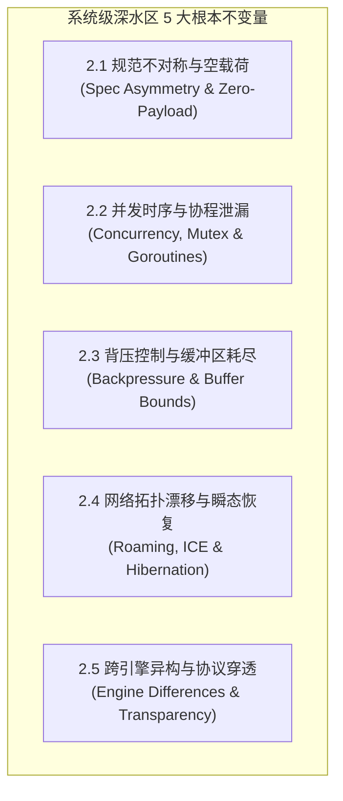
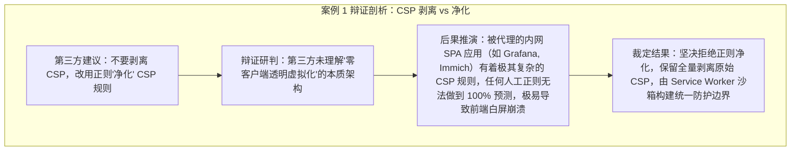

# WebRTC Gateway 辩证审查原则与核对清单 (Dialectical Review Guidelines & Checklist)

> **导言与定性**：  
> 在高复杂度的网络穿透、WebRTC 协议栈与浏览器沙箱虚拟化工程中，“审查”（Code Review & Architecture Review）不仅是一道代码质量门禁，更是**对技术路线的辩证思辨与工程哲学把关**。  
> 本指南旨在跳出“过拟合以往 Bug”的马其诺防线陷阱，清晰界定**“自动化 CI 机器防线”**与**“人类对抗性推演防线”**的权责边界，建立一套**直击系统级底层不变量、拒绝盲从、实事求是、控制爆炸半径**的辩证审查标准与操作清单。

---

## 一、 辩证审查的核心心法 (Dialectical Mindset)

### 1. 反对两种认知偏见

1. **盲从与教条主义 (Blind Compliance)**：
   - *表现*：第三方审计或上级专家提出某项安全/架构意见后，未经深度推演与沙箱断言，盲目全盘照收，结果“修了一个理论漏洞，搞垮了生产业务”。
   - *戒律*：任何外部意见**必须经过第一性原理推演**。必须反问：该建议的底层前提是什么？在我们的特殊架构（零客户端沙箱、流式数据通道）下是否适用？
2. **本位傲慢与经验主义 (Defensive Arrogance)**：
   - *表现*：开发者因“本地单测 100% 绿灯”、“常规页面访问秒开”而对审查提出的极端边界隐患（Edge Cases）产生抵触情绪，归咎为“吹毛求疵”。
   - *戒律*：单测全绿只能证明**已写出的断言成立**，无法证明**未设防的边界安全**。必须敬畏生产环境的不确定性（如长时间闲置休眠、空体请求、网络乱序包、移动端网络切换）。

### 2. 辩证审查的五大黄金法则 (The 5 Golden Principles)

| 原则 | 核心内涵 | 辩证执行准则 |
| :--- | :--- | :--- |
| **一、实事求是与工程归因** | 拒绝模糊定性，一切以证据与规范说话。 | 区分“架构缺陷”、“逻辑 Bug”与“前沿特性引入伴随的极限边界”。定性必须精准，不夸大、不掩盖。 |
| **二、最小侵入与受控爆炸半径** | 凡能用 5 行代码封堵的边界，坚决不用 50 行重构。 | 优先考虑局部防御与精准旁路，严禁在修复补丁中“顺手捎带”非相关的激进重构。 |
| **三、规范第一与标准遵从** | 遇到行为争议，向官方规范看齐。 | 严格以 W3C (Fetch/Streams/Worker)、IETF (RFC 9110 HTTP/RFC 8831 WebRTC) 为最终仲裁标准，不依赖未定义行为。 |
| **四、不变量坚守 (Invariants)** | 任何修改不得动摇系统的根基设计。 | 坚守“零客户端/零插件”、“控制面与数据面密钥绝对解耦”、“Web 浏览器同源沙箱”三大核心不变量。 |
| **五、反过度设计 (YAGNI)** | 适度超前，但绝不提前透支复杂度。 | 抵制“为了未来可能出现的场景”引入笨重的外部存储、冗余的分层或非必要的协议重写。 |

### 3. 权责解耦：机器防线 vs 人类认知防线

> [!IMPORTANT]
> **权责分工红线**：机器能做的（编译、静态类型、格式化、已有测试回归），交由 GitHub Actions CI 机器硬核阻断；  
> **人类审查者的核心价值，在于执行机器无法穷尽的“思维实验（Thought Experiments）”与“对抗性推演（Adversarial Analysis）”。**

---

## 二、 辩证审查操作核对清单 (Systemic Invariants Checklist)

本清单用于**架构方案评审 (RFC Review)** 与 **代码合并审查 (Pull Request Review)**。审查人与提交人须共同逐项反思并签核：

### 维度一：动机、必要性与爆炸半径审查 (Architecture & Blast Radius)

- [ ] **1.1 需求真实性与反过度设计审视 (YAGNI Check)**
  - **根本追问**：该改动是否对应真实场景痛点？是否是在没有实际业务量支撑的情况下提前引入多租户、多路由或重型抽象？
  - **辩证反思**：如果**不改动系统**，现有机制能否通过配置或上层简单适配解决？代码增加的维护成本是否低于其带来的收益？
  - **合格判定**：改动必须具备明确的 ROI 与真实应用场景，坚决剔除形式主义分层。

- [ ] **1.2 爆炸半径与向后兼容性核验 (Blast Radius)**
  - **根本追问**：改动会波及哪些上下游模块？
  - **辩证反思**：如果旧版本 Agent 连接新版本 Signal，或者新版本 Web Portal 连接旧版本 Agent，握手与流式传输是否仍能平滑运行？
  - **合格判定**：核心通信协议改动必须保留兼容降级分支，绝不允许直接导致异构版本握手崩溃。

- [ ] **1.3 废弃参数即时阻断 (Fail-Fast on Deprecation)**
  - **根本追问**：对于宣布废弃（Deprecated）的参数或行为，是否还在为了“向下兼容”无底线保留模糊别名？
  - **辩证反思**：保留模糊参数（如历史 `-secret` 别名）是否会给运维人员埋下安全误区，误以为启用了访客密码而实则内网裸奔？
  - **合格判定**：废弃参数在启动时必须立即 Fail-Fast 报错退出，给出明确指引。

---

### 维度二：系统级深水区不变量审查 (Five Systemic Invariants)

- [ ] **2.1 规范不对称性与边界空值审计 (Spec Asymmetry & Zero-Payload Invariants)**
  - **根本追问**：在协议转换、请求过滤或流式管道中，是否充分考虑了协议规范中的“不对称边界”？
    - 如：空 Payload（`HEAD` 请求、`204 No Content`、`304 Not Modified`、`Content-Length: 0`）、分块截断、提前 Abort/Cancel。
    - 是否对空流误启用了必须要求有效 Header 的处理管线（如解压流、哈希流）导致抛出非预期错误？
  - **对标规范**：RFC 9110 (HTTP Semantics), W3C Fetch & Streams Specification.

- [ ] **2.2 并发安全、锁层级与协程生命周期 (Concurrency, Mutex Hierarchy & Leaks)**
  - **根本追问**：并发逻辑在极限网络抖动或突发中断下能否保证协程安全自愈？
    - **锁层级（Lock Ordering）**：本改动是否在持有锁 A 的同时尝试获取锁 B？跨 Package 调用时是否存在反向调用导致死锁的时序？
    - **协程退出保证**：每个派生的 `go func()` 是否均受 `context.Context`、读取 EOF 或明确的通道关闭信号约束？在对端静默断网、读写阻塞或 Context 取消时，协程能否在有限时间内完全回收？
    - **非缓冲通道阻塞**：向 Channel 发送数据是否可能因下游无人消费而导致发送方永久挂死？

- [ ] **2.3 背压控制与物理资源耗尽防护 (Backpressure & Buffer Bounds)**
  - **根本追问**：当上游生产者速率远大于下游消费者速率时，系统是否有物理制动能力？
    - 如果被代理的内网 NAS 以 1Gbps 发送大文件，而公网访客处于 5Mbps 弱网环境：数据在 WebRTC DataChannel 积压时，网关是否有背压感知并暂停从后端 Socket 读取？还是在内存中无限制缓冲直至 OOM 崩溃？
    - 内存中维护的会话表、IP 表、流映射表是否有明确的最大容量限制与定期的孤儿键淘汰清理（Janitor Loop）机制？

- [ ] **2.4 网络拓扑漂移、容灾状态机与瞬态恢复 (Roaming, ICE & Ephemerality)**
  - **根本追问**：当底层运行环境发生断续、物理漂移或实例休眠唤醒时：
    - 移动端访客在 4G ↔ Wi-Fi 切换触发网络拓扑漂移时，ICE 重协商（ICE Restart）能否平滑完成？5 秒断网宽限期内已建立的 Mux Stream 是否能保持不中断？无法恢复时半开连接（Half-Open Sockets）能否被彻底释放？
    - Serverless/边缘节点（如 Cloudflare DO）唤醒后能否幂等还原完整业务上下文（节点密码、鉴权需求、IP 计数），确保不漏鉴权、不漏计费？

- [ ] **2.5 跨浏览器内核沙箱异构性与业务透明穿透 (Cross-Browser Sandbox & Transparency)**
  - **根本追问**：虚拟化补丁与代理逻辑是否具有跨引擎普适性与业务透明度？
    - **跨内核壁垒**：是否引入了仅在 Chromium 成立但在 iOS WebKit/Safari 受到严苛配额或后台存活时间限制的机制？代码是否具备无损降级能力？
    - **复杂协议透明度**：改动是否对内网复杂应用（如 HomeAssistant, Jellyfin, Immich）的 **SSE（Server-Sent Events 长连接）**、**206 Partial Content（视频点播拖拽）**、**WebSocket 二进制帧与 Ping/Pong** 保持透明？是否会在不知情下强制 Buffer 整个响应破坏流式体验？

---

### 维度三：安全基线与沙箱隔离审查 (Security & Sandbox Invariants)

- [ ] **3.1 凭据绝不泄露原则 (Zero Credential Leakage)**
  - **根本追问**：敏感凭据在各层次间是否保持最小可见性？
  - **辩证反思**：`SIGNAL_SECRET` 是否绝不会以任何形式出现在前端 DOM、URL Query、Hash 或浏览器控制台中？
  - **合格判定**：控制面信令密码与数据面访客密码绝对物理隔离；前端仅持有访客授权，无权获知集群管控密钥。

- [ ] **3.2 沙箱虚拟化与同源策略捍卫 (Sandbox Integrity)**
  - **根本追问**：代理沙箱与浏览器的同源安全模型是否一致？
  - **辩证反思**：第三方提议“修改/净化 CSP”是否会导致内网应用规则冲突报错白屏？
  - **合格判定**：在内网代理沙箱内剥离目标网站的限制性 CSP，交由网关 Service Worker 统一构建安全隔离边界；多标签页通过 `resultingClientId` 与专属 Session Map 保持物理隔离。

- [ ] **3.3 容器与非特权执行加固 (Least Privilege Execution)**
  - **根本追问**：容器与守护进程是否运行在最小必要特权下？
  - **合格判定**：镜像默认采用非特权用户（UID 10001），特权端口（:443/:80）仅通过 Linux Capabilities（`cap_net_bind_service`）单点赋权，严禁 root 进程直跑。

---

### 维度四：对抗性反向证伪与测试审查 (Adversarial Falsification)

- [ ] **4.1 辩证反向证伪测试 (Falsification Testing)**
  - **审查聚焦点**：不仅要证明“正确时能够通过”，更要证明“异常时能够拦截”。
  - **审查动作**：要求 PR 提供针对本次改动的**反向破坏性测试用例**（例如：伪造跨节点信令篡改、传入不合法的残卷流 ID、发送带压缩头但无 Body 的 `HEAD` 请求、模拟生产者吞吐压垮消费者的背压场景）。
  - **合格判定**：反向证伪用例在修复前必然失败（RED），在修复后稳定通过（GREEN）。

- [ ] **4.2 确定性测试覆盖 (Deterministic Test Coverage)**
  - **审查动作**：新增的单元测试与集成测试不得包含任何无约束的 `time.Sleep` 竞争条件，必须使用 Channel、WaitCondition 或原子事件驱动，确保在 CI 并发负载下 100% 可重复通过。

---

## 三、 辩证审查经典案例库 (Post-Mortem Case Studies)

本章节沉淀项目演进中的经典辩证交锋，作为将抽象原则具象化的一线实战范例：

### 案例 1：CSP 拦截之辩 ——【全量剥离 vs 规则净化】

### 案例 2：跨网压缩直通之辩 ——【W3C 合成流限制与硬件解压】

- **背景**：为了提升传输效率，提出对 JS/CSS 开启 Gzip 跨网传输。
- **浅层方案**：直接透传 upstream 的 `Content-Encoding: gzip` 响应头。
- **深水区陷阱 (规范不对称性)**：W3C Fetch 规范强制要求：浏览器针对 Service Worker 合成流（Synthetic Response）**不会**自动执行硬件 Gzip 解压，导致浏览器将压缩乱码当作 JS 解析而抛出语法错误！同时针对 `HEAD` / 204 等空载荷，送入解压管线会抛出 `TypeError: Compressed input was truncated`。
- **辩证解法**：Agent 将外部标记转换为内部协议头 `x-p2p-content-encoding: gzip` 并剔除原始头；浏览器端通过 Web Streams API 的 `stream.pipeThrough(new DecompressionStream('gzip'))` 进行硬件硬件加速解压；并在遇到 `HEAD` 请求与空响应体时双向主动绕过，达成 100% 规范兼容与 300% 传输加速。

### 案例 3：DO 边缘休眠之辩 ——【轻量 Session 附件 vs 重型持久化库】

- **背景**：Cloudflare Worker 迁移至 WebSocket Hibernation 导致 DO 长时间休眠后唤醒，内存变量丢失。
- **教条做法**：引入外部 KV 或 D1 关系型数据库，每次消息都去读库校验鉴权。
- **辩证研判**：引入外部存储将带来网络延迟、数据库调用费用增加，且违背了边缘信令轻量快速的初衷。
- **辩证解法**：充分利用 Cloudflare 原生的 `ws.serializeAttachment()` 机制，在 Agent 注册时将密码与鉴权状态以轻量 JSON 存入 WebSocket 会话；在唤醒全入口（`fetch` 与 `handleWSClose`）执行幂等懒加载重建映射。**0 额外存储费用，0 外部依赖，< 30 行优雅闭环**。

### 案例 4：幽灵流消除之辩 ——【奇偶水位线严格校验 vs 宽容放行】

- **背景**：早期多路复用在客户端主动取消后，管道内迟到帧会导致创建幽灵流并耗尽会话。
- **教条做法**：粗暴引入绝对递增水位线，凡小于当前最大 ID 的一律丢弃。
- **深水区陷阱 (时序与并发)**：客户端发起奇数流（1, 3, 5），服务端发起偶数流（2, 4, 6）。若用全局单调水位线，服务端回包偶数流将直接被误杀，单测与双向通讯挂死！
- **辩证解法**：区分客户端与服务端的对端 ID 奇偶性（客户端只认 `frame.streamId % 2 === 0`），只对同向流执行水位线与奇偶校验，既保住了全双工通信，又彻底杜绝了僵尸流。

### 案例 5：纯字节流注入之辩 ——【字符串解码 vs 二进制切片拼接】

- **背景**：Service Worker 需向被代理的 HTML 动态注入 `window.__P2P_PORTAL_ORIGIN__` 与脚本补丁。
- **浅层做法**：将流式 chunk 通过 `TextDecoder.decode()` 转为 JS 字符串，通过 `html.replace('<head>', '<head><script>...')` 替换，再通过 `TextEncoder.encode()` 传出。
- **深水区陷阱**：流式传输切片是任意字节边界。若一个汉字或 Emoji 的 3~4 字节正好被网络分包拆在两个 chunk 中，`TextDecoder` 在第一个 chunk 末尾解码失败会产生替换字符（`\uFFFD` 乱码），导致网页永久乱码崩坏！
- **辩证解法**：采用纯字节扫描（`Uint8Array` 查找 ASCII 序列 `<head>` 的字节特征），命中后直接在字节数组上执行切片拼接，后续所有 chunk 直接零拷贝纯透传。

---

## 四、 审查结果定性与签核规范 (Sign-off Matrix)

审查人在出具 Review 审查意见时，必须给出明确的定性结论与改动定级：

| 审查裁定等级 | 适用情境 | 下一步动作 |
| :---: | :--- | :--- |
| 🟢 **ACCEPT (无保留通过)** | 方案符合五大黄金原则，经过深水区 5 大根本不变量推演，反向证伪测试充分，零架构隐患。 | 可直接合并入 `dev` 分支。 |
| 🟡 **DEFENSIVE PATCH (需防御性微调)** | 核心逻辑成立，但在前沿特性/极限网络边界下存在潜在规范陷阱（< 30 行可修复）。 | 提供具体的最小侵入式修复代码建议，补齐单测后通过。 |
| 🔴 **REJECT (原则性否决)** | 方案违背核心不变量（如破坏沙箱隔离、泄露密钥、过度设计引入重型依赖）。 | 说明否决的规范条款与架构推演理由，退回方案设计阶段重新推导。 |

---

> [!NOTE]
> 本审查原则与核对清单受项目主分支保护。凡涉及核心网络协议栈（`pkg/mux`、`pkg/proxy`、`web/src/protocol`、`web/src/sw`）的大型 PR，必须在 PR 描述中逐项核对并附带反向证伪用例。
