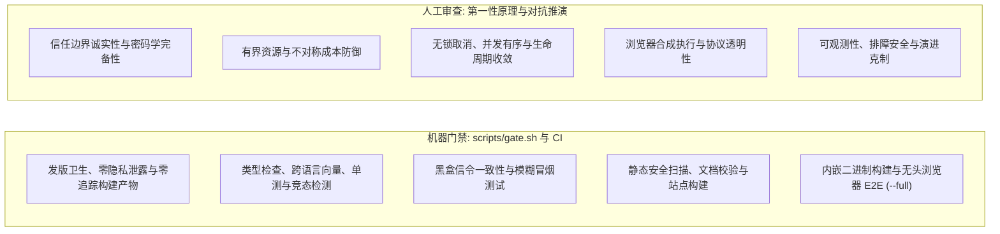

# 审查清单 (Review Guidelines)

> **文档分层与优先级**：[核心原则](./CONSTITUTION.md) > 审查清单（本文，第一性工程评审框架）> [设计边界与架构权衡](./DESIGN_TRADEOFFS.md)。具体线协议常量、预算水位与默认参数以 [协议规范](./guide/protocol-specification.md)、[安全机制](./guide/security.md) 与 [配置参考](./guide/agent-configuration.md) 为单一事实源。
>
> 本文用于架构提案评审（RFC Review）与代码合并审查（PR Review）。规范用语“必须 / 应当 / 可以”对应 RFC 2119 的 MUST / SHOULD / MAY。

---

## 一、审查分工：机器门禁与人工对抗推演

- **不盲从外部建议或 AI 自检**：任何审计建议或实现方案，必须回溯到 W3C / IETF 规范、威胁模型与实际代码语义验证前提是否成立，再决定是否采纳。
- **不以测试全绿自居**：自动化测试只验证已知断言；人工对抗审查必须主动推演未知反例——长时间休眠、空载荷、半截断连、网络切换、时钟跳变与恶意对端输入。
- **确定性检查交由机器**：格式、静态分析、版本一致、双语文档结构与既有回归全部由 [`scripts/gate.sh`](https://github.com/BeingNoAbility/WebRTC-Gateway/blob/main/scripts/gate.sh) 与 CI 门禁自动把关。

---

## 二、六大第一性审查维度

### 维度一：定位、变更尺度与应用中立

- [ ] **1.1 问题真实性与复杂度克制（YAGNI）**：改动解决真实工程问题，收益明显大于长期维护与认知复杂度，不引入缺乏依据的抽象层。
- [ ] **1.2 变更尺度与同步迁移**：日常修复仅改动直接相关代码并保持向后兼容；架构演进须有获批 RFC，并同步更新全部受影响运行时、黄金测试向量、一致性套件与双语文档。
- [ ] **1.3 应用中立与标准边界**：不含针对特定应用名、私有路径或专有请求头的硬编码分支；应用兼容诉求严格按 [核心原则三步分流决策树](./CONSTITUTION.md#原则三-透明管道与应用中立) 处置，测试使用合成协议向量。
- [ ] **1.4 供应链与依赖克制**：优先使用语言标准库与原生 Web 平台 API；引入任何新运行期依赖前，必须评估安全攻击面、传递依赖数量、维护活跃度与前端产物体积影响。
- [ ] **1.5 配置、文档与制品同步**：新增或变更配置项、错误码、行为边界或线协议时，同一 PR 同步更新配置示例与中英文指南；严禁提交真实域名、私网 IP、凭据或构建产物。

### 维度二：诚实信任边界与 Fail-Closed 安全基线

- [ ] **2.1 信任边界诚实性**：绝不把运行在不可信执行上下文中的脚本补丁当作安全隔离边界；隔离必须由浏览器源/站点策略、操作系统内核边界或端到端密码学强制执行。明确标出改动对 TCB（可信计算基）的影响。
- [ ] **2.2 密码学与身份完备性**：信令侧不存在离线口令暴破预言机或数据面会话句柄；认证与验签具备域分离、抗降级、端到端传输层活体绑定与常量时间敏感比较；未完成认证前严禁放行数据面业务流量。
- [ ] **2.3 规范单解与输入净化**：优先采用最小结构化契约替代自由文本正则解析，消除跨引擎解析差分；路径、主机名与客户端 IP 提取仅执行单次规范化（阻断二次解码、IP 映射塌缩、开放重定向与跨根软链接穿越）。
- [ ] **2.4 Fail-Closed 默认基线**：改动不得放宽 [核心原则第三节](./CONSTITUTION.md#三、fail-closed-安全不变量) 中的任何安全不变量；新增降级或兼容选项必须默认关闭并在配置文档写明安全边界。
- [ ] **2.5 最小权限运行与泄露响应**：容器与进程保持非特权与最小写权限；示例与测试严格使用保留域名（`example.com`、`*.example`）与文档 IP（`192.0.2.x`、`198.51.100.x`）。若机密不慎进入已推送提交，必须先吊销轮换密钥再重写全部受影响分支历史。

### 维度三：有界资源与不对称成本防御

- [ ] **3.1 多层内存预算与真实开销记账**：对不可信或慢速对端可控的缓冲实行多层上限（流 / 会话 / 全局）；记账须覆盖每条目元数据开销与底层切片容量（避免子切片堆放大），并在流关闭、错误或提前响应等所有退出路径无条件归还。
- [ ] **3.2 流式处理与抗放大防御**：大载荷与长消息（HTTP 体、WebSocket 帧、压缩流）采用固定内存占用的流式转发而非整包缓存；对解压流与帧重组施加明确的输出体积、膨胀比、分片数与超时上限。
- [ ] **3.3 超越内存的资源边界（CPU、FD 与状态基数）**：审视攻击者能否以低成本触发高昂 CPU 计算（KDF、验签、正则回溯、深层解析）、耗尽文件描述符 / 上游连接池，或令限流表、连接表、监控指标标签基数无界增长。
- [ ] **3.4 饱和 Fail-Closed 与诚实背压**：限流器或状态表饱和且无闲置项可回收时必须 Fail-Closed 拒绝，且绝不驱逐活跃锁定或安全关键状态；流控补窗信用必须受可验证的已投递/已消费数据量钳制，不得盲信不可信对端自报数值。具体数值上限与水位见 [协议规范](./guide/protocol-specification.md)。

### 维度四：并发有序、无锁取消与全生命周期收敛

- [ ] **4.1 锁层级与禁止跨阻塞 I/O 持锁**：全仓锁获取顺序一致，绝不在持有同步锁期间执行可能阻塞的网络、磁盘或通道读写；取消与重置路径必须能无锁唤醒阻塞中的读写协程。
- [ ] **4.2 因果有序与代际守卫**：依赖传输原语或显式单调代际号保证消息因果顺序，避免易失步的跨信道乱序重组；所有异步回调、定时器与重连分支均受会话或代际标识守卫，防止过期事件污染新会话。
- [ ] **4.3 完整生命周期收敛**：每个后台协程、定时器、事件监听器与子连接都必须绑定明确的取消上下文或关闭信号，确保对端静默断网、进程优雅停机、浏览器标签页冻结（`bfcache`）或页面卸载时在有限时间内彻底回收。
- [ ] **4.4 瞬态恢复与幂等边界**：断网重连与通道恢复不得阻塞主视图状态，且严禁在请求状态不明时对非幂等或带请求体的操作（如 `POST` / `PUT` / `PATCH` / `DELETE`）盲目自动重试；对涉及过期时间与窗口计数的逻辑评估系统时钟跳变影响。

### 维度五：浏览器合成执行与协议透明性

- [ ] **5.1 HTTP / WebSocket 规范不对称**：正确处理无体请求与响应（`HEAD`、`204`、`205`、`304`、`Content-Length: 0`）、提前取消与上游异常断连（上游半截 EOF 必须区分于客户端取消并返回 `502`）；保持 SSE、`206 Partial Content`、强 `ETag` 与 RFC 6455 关闭语义的透明性。
- [ ] **5.2 浏览器合成响应与流式内容处理**：Service Worker 合成响应须显式协商压缩与解压边界（不误删非目标编码）；响应头严格满足 Fetch ByteString 与 RFC 5987 编码要求；任何流式 HTML 注入都必须在字节级尊重多字节编码、字符集预扫描窗口与标准文档模式（防 Quirks Mode）。
- [ ] **5.3 不可信租户状态隔离与跨引擎兼容**：静态主动文档与交互代理应用采用清晰的 CSP 分治策略；客户端可读写状态与服务端受保护会话状态严格隔离且符合 RFC 6265bis 规范；验证改动在主流桌面与移动浏览器引擎（含 WebKit / Safari 限制）下的降级表现。

### 维度六：可观测性、运维诊断与确定性负向验证

- [ ] **6.1 可操作且脱敏的诊断信息**：启动失败、网络穿透受阻、证书校验失败或权限被拒时，应向运维或用户给出足以定位根因的清晰错误分类，同时确保口令、能力令牌、内部路径与私密凭据绝不进入日志、指标或面向访客的报错页面。
- [ ] **6.2 强制确定性负向测试**：涉及边界校验、并发状态机、资源流控或安全隔离的改动，必须补充自动化负向测试，并在 PR 中给出未修复前失败、修复后通过的证据。
- [ ] **6.3 真实模块与零脆弱同步**：测试直接驱动真实生产模块，禁止复制逻辑占位；严禁依赖无约束 `sleep` 掩盖时序竞态。测试分层策略见 [测试策略与验证清单](./TESTING_CHECKLIST.md)。

---

## 三、审查结论与签核矩阵

| 结论 | 适用情境 | 下一步 |
| :---: | :--- | :--- |
| **ACCEPT** | 满足全部核心原则与 Fail-Closed 不变量；相关审查维度无遗留风险；`scripts/gate.sh`（核心改动含 `--full`）全绿；负向测试齐全且具确定性。 | 合并。 |
| **DEFENSIVE PATCH** | 架构方向正确，但缺少局部边界防御、可观测性或负向测试，补齐范围小且无需重新设计。 | 按审查意见补齐防御与负向测试后合并。 |
| **REJECT** | 违反任一核心原则、放宽 Fail-Closed 不变量、破坏信任边界、引入特定应用硬编码、引入不可接受的无界资源风险，或绕过 RFC 实施不兼容大改。 | 明确指出违反的原则与风险并退回设计；架构重评按 RFC 流程推进。 |

> [!NOTE]
> 区分“不可触碰的永久红线”与“随前提变化可经 RFC 重评的当前架构权衡”，请查阅 [设计边界与架构权衡](./DESIGN_TRADEOFFS.md)。
