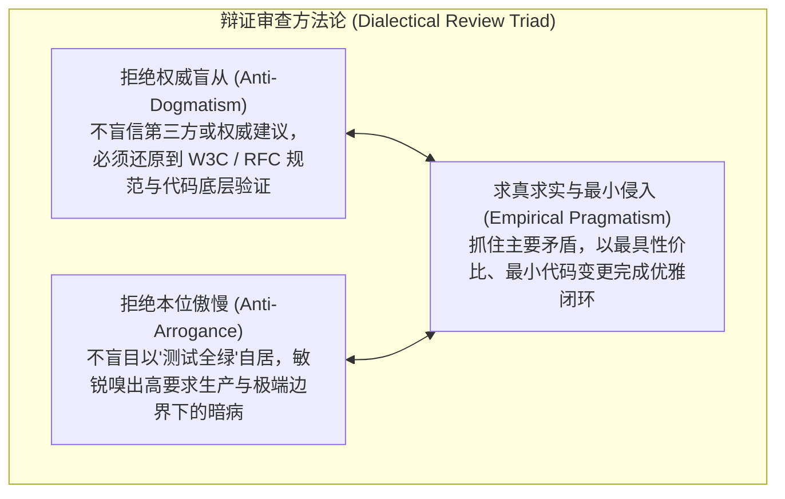
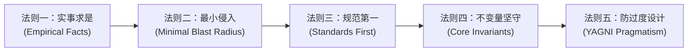
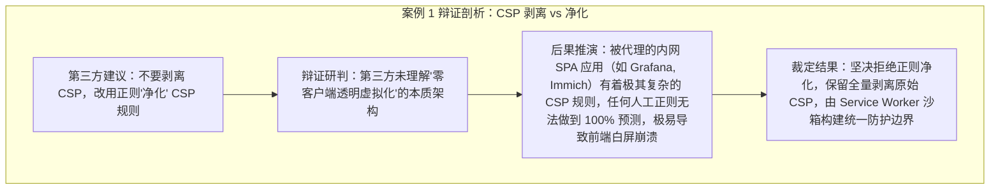

# WebRTC Gateway 辩证审查原则与核对清单 (Dialectical Review Guidelines & Checklist)

> **导言与定性**：  
> 在高复杂度的网络穿透、WebRTC 协议栈与浏览器沙箱虚拟化工程中，“审查”（Code Review & Architecture Review）不仅是一道代码质量门禁，更是**对技术路线的辩证思辨与工程哲学把关**。  
> 本指南提炼自 WebRTC Gateway 历次架构升级、第三方同行评审与深水区 Bug 根治的实战博弈，旨在建立一套**拒绝盲从、实事求是、精准归因、控制爆炸半径**的辩证审查标准与操作清单。

---

## 一、 辩证审查的核心心法 (Dialectical Mindset)

### 1. 反对两种认知偏见

1. **盲从与教条主义 (Blind Compliance)**：
   - *表现*：第三方审计或上级专家提出某项安全/架构意见后，未经深度推演与沙箱断言，盲目全盘照收，结果“修了一个理论漏洞，搞垮了生产业务”。
   - *戒律*：任何外部意见**必须经过第一性原理推演**。必须反问：该建议的底层前提是什么？在我们的特殊架构（零客户端沙箱、流式数据通道）下是否适用？
2. **本位傲慢与经验主义 (Defensive Arrogance)**：
   - *表现*：开发者因“本地单测 100% 绿灯”、“常规页面访问正常”而对审查提出的极端边界隐患（Edge Cases）产生抵触情绪，归咎为“吹毛求疵”。
   - *戒律*：单测全绿只能证明**已写出的断言成立**，无法证明**未设防的边界安全**。必须敬畏生产环境的不确定性（如长时间闲置休眠、空体请求、网络乱序包）。

### 2. 辩证审查的五大黄金法则 (The 5 Golden Principles)

| 原则 | 核心内涵 | 辩证执行准则 |
| :--- | :--- | :--- |
| **一、实事求是与工程归因** | 拒绝模糊定性，一切以证据与规范说话。 | 区分“架构缺陷”、“逻辑 Bug”与“前沿特性引入伴随的极限边界”。定性必须精准，不夸大、不掩盖。 |
| **二、最小侵入与受控爆炸半径** | 凡能用 5 行代码封堵的边界，坚决不用 50 行重构。 | 优先考虑局部防御与精准旁路，严禁在修复补丁中“顺手捎带”非相关的激进重构。 |
| **三、规范第一与标准遵从** | 遇到行为争议，向官方规范看齐。 | 严格以 W3C (Fetch/Streams/Worker)、IETF (RFC 9110 HTTP/RFC 8831 WebRTC) 为最终仲裁标准，不依赖未定义行为。 |
| **四、不变量坚守 (Invariants)** | 任何修改不得动摇系统的根基设计。 | 坚守“零客户端/零插件”、“控制面与数据面密钥绝对解耦”、“Web 浏览器同源沙箱”三大核心不变量。 |
| **五、反过度设计 (YAGNI)** | 适度超前，但绝不提前透支复杂度。 | 抵制“为了未来可能出现的场景”引入笨重的外部存储、冗余的分层或非必要的协议重写。 |

---

## 二、 辩证审查操作核对清单 (Dialectical Review Checklist)

本清单用于**方案设计评审 (RFC/Design Review)** 与 **代码合并审查 (Pull Request Review)**。审查人与提交人须共同逐项反思并签核：

### 阶段一：动机与方案推演审查 (Proposal & Feasibility)

- [ ] **1.1 需求真实性与反过度设计审视 (YAGNI Check)**
  - **审查聚焦点**：该需求或优化是否对应真实痛点？是否是为了“看起来优雅”而引入了非必要的复杂度？
  - **辩证反思**：如果**不改动系统**，现有的机制能否通过配置或上层简单适配解决？是否属于提前过度设计？
  - **合格判定**：改动必须具备明确的 ROI 与真实应用场景，无冗余的分层封装。

- [ ] **1.2 爆炸半径与向后兼容性核验 (Blast Radius)**
  - **审查聚焦点**：改动会波及哪些上下游模块？
  - **辩证反思**：如果旧版本 Agent 连接新版本 Signal，或者新版本 Web Portal 连接旧版本 Agent，握手与流式传输是否仍能平滑运行？
  - **合格判定**：核心通信协议改动必须保留兼容降级分支，绝不允许直接导致异构版本握手崩溃。

- [ ] **1.3 性能代偿与资源开销核算 (Cost-Benefit Balance)**
  - **审查聚焦点**：改动是否带来了隐蔽的性能或内存代价？
  - **辩证反思**：新增的拦截层、流式包装是否导致 GC 压力剧增？在高并发打流时，CPU 开销与吞吐量是否在容忍范围内？
  - **合格判定**：对于高频数据通道（DataChannel），零内存拷贝与纯字节流透传是硬指标。

---

### 阶段二：规范对齐与深水区边界审查 (Specifications & Edge Cases)

- [ ] **2.1 空实体与无响应体请求边界 (Bodyless Responses)**
  - **审查聚焦点**：流式管道与硬件解压对空载荷的处理。
  - **辩证反思**：当遇到 `HEAD` 请求、`204 No Content`、`304 Not Modified` 或 `Content-Length: 0` 时，流式解压管线（如 `DecompressionStream`）是否会被投喂小于解压头字节（10 bytes）的数据？
  - **合格判定**：在代理端与客户端双向识别无实体请求并安全旁路解压，杜绝抛出 `TypeError: Compressed input was truncated`。

- [ ] **2.2 瞬态环境与休眠状态恢复审查 (Ephemeral & Hibernation States)**
  - **审查聚焦点**：Serverless 边缘实例或轻量容器在闲置休眠唤醒时的内存态保留。
  - **辩证反思**：实例长时间无访客进入休眠被再次唤醒时，内存中的哈希表（如活跃节点、鉴权密码、IP 映射）是否会丢失？唤醒后是否会在未鉴权状态下放行流量？
  - **合格判定**：必须在无状态框架原生机制（如 Cloudflare WebSocket Session Attachment）中做持久化绑定，全生命周期入口具备幂等懒加载重建（`ensureState`）。

- [ ] **2.3 流生命周期、幽灵流与单调水位线 (Ghost Streams & High-Water Mark)**
  - **审查聚焦点**：Mux 多路复用流的创建、并发奇偶性与关闭清理。
  - **辩证反思**：当访客切换页面或取消下载时，管道内迟到的旧流数据帧是否会被错误当成“新流”创建？单调水位线是否会误杀对端正常新流？
  - **合格判定**：严格执行发起方奇偶性校验（客户端只接收偶数流 ID，服务端只接收奇数流 ID），迟到残卷直接丢弃，严禁引发幽灵会话泄漏。

- [ ] **2.4 纯字节流注入与多字节编码截断 (Byte-Level Stream Injection)**
  - **审查聚焦点**：Service Worker 或中间件针对 HTML/JS 的流式动态代码注入。
  - **辩证反思**：是否存在通过 `TextDecoder` / `TextEncoder` 将整个 chunk 转为字符串操作？若注入点正好跨越了 UTF-8 多字节字符（如中文或 Emoji）边界，是否会导致乱码？
  - **合格判定**：必须使用纯字节匹配（`Uint8Array` 扫描 ASCII 特征标签如 `<head>`），命中后直接在字节数组层面拼接切片，后续 chunk 纯透传。

---

### 阶段三：安全基线与沙箱隔离审查 (Security & Sandbox Invariants)

- [ ] **3.1 凭据绝不泄露原则 (Zero Credential Leakage)**
  - **审查聚焦点**：密钥在各层间的可见性。
  - **辩证反思**：`SIGNAL_SECRET` 是否绝不会以任何形式出现在前端 DOM、URL Query、Hash 或浏览器控制台中？
  - **合格判定**：控制面信令密码与数据面访客密码绝对解耦；前端客户端只处理自身授权，无权接触集群集群管控密钥。

- [ ] **3.2 沙箱虚拟化与同源策略捍卫 (Sandbox Integrity)**
  - **审查聚焦点**：CSP、Cookie、LocalStorage 的多标签页隔离。
  - **辩证反思**：第三方是否提议“修改/净化 CSP”？如果净化后的规则拦截了被代理业务系统的合法请求该怎么办？
  - **合格判定**：在内网代理沙箱内，剥离目标网站的限制性 CSP，交由网关 Service Worker 统一构建安全隔离边界；多标签页通过 `resultingClientId` 与专属 Session Map 保持物理隔离。

- [ ] **3.3 资源限额与常驻内存泄露审查 (Rate Limiting & Chronic Leaks)**
  - **审查聚焦点**：长时间挂机服务端的内存与连接增长曲线。
  - **辩证反思**：针对恶意公网扫描或大量离散 IP 访问，限流器（RateLimiter）内部维护的 IP Map 是否只增不减？
  - **合格判定**：必须具备后台定时巡检与孤儿键清理机制（如 `janitorLoop`），Map 中切片为空时显式执行 `delete(map, key)`。

---

### 阶段四：测试反向证伪与代码洁癖审查 (Testing & Quality Gate)

- [ ] **4.1 辩证反向证伪测试 (Falsification Testing)**
  - **审查聚焦点**：不仅要证明“正确时能够通过”，更要证明“异常时能够拦截”。
  - **审查动作**：要求 PR 提供针对本次修复的**反向破坏性测试用例**（例如：伪造跨节点信令篡改、传入不合法的残卷流 ID、发送带压缩头但无 Body 的 `HEAD` 请求）。
  - **合格判定**：反向证伪用例在修复前必然失败（RED），在修复后稳定通过（GREEN）。

- [ ] **4.2 废弃参数即时阻断 (Fail-Fast on Deprecation)**
  - **审查聚焦点**：对于宣布废弃（Deprecated）的参数或行为。
  - **辩证反思**：是否还在为了“向下兼容”无底线保留别名，进而给运维人员埋下安全隐患？
  - **合格判定**：已废弃的危险参数在启动时必须立即 Fail-Fast 并输出明确指引，严禁暗度陈仓。

- [ ] **4.3 零残留与嵌入产物绝对一致性 (Asset Cleanliness)**
  - **审查聚焦点**：Go 二进制内嵌前端产物（`web/dist`）的纯粹性。
  - **审查动作**：执行自动化差分断言 `git diff --exit-code web/dist`。
  - **合格判定**：严禁出现“修改了前端 TypeScript 源码，但忘记重新打包或未暂存 `dist`”的情况。

---

## 三、 辩证审查经典实战案例库 (Case Studies & Dialectical Post-Mortems)

本章节记录项目演进过程中经历的 5 次经典辩证审查交锋，作为团队工程素养的鲜活培训教材：

### 案例 1：CSP 拦截之辩 ——【全量剥离 vs 规则净化】

### 案例 2：跨网压缩直通之辩 ——【W3C 合成流限制与硬件解压】

- **背景**：为了提升传输效率，提出对 JS/CSS 开启 Gzip 跨网传输。
- **浅层方案**：直接透传 upstream 的 `Content-Encoding: gzip` 响应头。
- **深水区陷阱**：W3C Fetch 规范强制要求：浏览器针对 Service Worker 合成流（Synthetic Response）**不会**自动执行硬件 Gzip 解压，导致浏览器将压缩乱码当作 JS 解析而抛出语法错误！
- **辩证解法**：Agent 将外部标记转换为内部协议头 `x-p2p-content-encoding: gzip` 并剔除原始头；浏览器端通过 Web Streams API 的 `stream.pipeThrough(new DecompressionStream('gzip'))` 进行硬件硬件加速解压；并在遇到 `HEAD` 请求与空响应体时主动绕过，达成 100% 规范兼容与 300% 传输加速。

### 案例 3：DO 边缘休眠之辩 ——【轻量 Session 附件 vs 重型持久化库】

- **背景**：Cloudflare Worker 迁移至 WebSocket Hibernation 导致 DO 长时间休眠后唤醒，内存变量丢失。
- **教条做法**：引入外部 KV 或 D1 关系型数据库，每次消息都去读库校验鉴权。
- **辩证研判**：引入外部存储将带来网络延迟、数据库调用费用增加，且违背了边缘信令轻量快速的初衷。
- **辩证解法**：充分利用 Cloudflare 原生的 `ws.serializeAttachment()` 机制，在 Agent 注册时将密码与鉴权状态以轻量 JSON 存入 WebSocket 会话；在唤醒全入口懒加载重建映射。**0 额外存储费用，0 外部依赖，< 30 行优雅闭环**。

### 案例 4：幽灵流消除之辩 ——【奇偶水位线严格校验 vs 宽容放行】

- **背景**：早期多路复用在客户端主动取消后，管道内迟到帧会导致创建幽灵流并耗尽会话。
- **教条做法**：粗暴引入绝对递增水位线，凡小于当前最大 ID 的一律丢弃。
- **深水区陷阱**：客户端发起奇数流（1, 3, 5），服务端发起偶数流（2, 4, 6）。若用全局单调水位线，服务端回包偶数流将直接被误杀，单测与双向通讯挂死！
- **辩证解法**：区分客户端与服务端的对端 ID 奇偶性（`frame.streamId % 2 === 0`），只对同向流执行水位线与奇偶校验，既保住了全双工通信，又彻底杜绝了僵尸流。

### 案例 5：弃用别名之辩 ——【容忍兼容隐患 vs 明确即时阻断】

- **背景**：信令服务端曾有一个历史兼容别名 `-secret`（实应为 `-signal-secret`）。
- **宽容做法**：继续保留 `-secret` 别名，“方便老用户”。
- **辩证研判**：`-secret` 命名模糊，用户极易将其误认为访客访问密码（`access-secret`），导致运维人员误以为配置了双重防护，实则内网资产完全裸奔！
- **辩证解法**：彻底下线兼容别名，当检测到传入 `-secret` 时，进程立即 Fail-Fast 报错退出，并输出清晰整改说明。安全问题容不得半点暧昧。

---

## 四、 审查结果定性与签核规范 (Sign-off Matrix)

审查人在出具 Review 审查意见时，必须给出明确的定性结论与改动定级：

| 审查裁定等级 | 适用情境 | 下一步动作 |
| :---: | :--- | :--- |
| 🟢 **ACCEPT (无保留通过)** | 方案符合五大黄金原则，边界已全量闭环，反向证伪测试充分，零架构隐患。 | 可直接合并入 `dev` 分支。 |
| 🟡 **DEFENSIVE PATCH (需防御性微调)** | 核心逻辑成立，但在前沿特性/极限网络边界下存在潜在规范陷阱（< 30 行可修复）。 | 提供具体的最小侵入式修复代码建议，补齐单测后通过。 |
| 🔴 **REJECT (原则性否决)** | 方案违背核心不变量（如破坏沙箱隔离、泄露密钥、过度设计引入重型依赖）。 | 说明否决的规范条款与架构推演理由，退回方案设计阶段重新推导。 |

---

> [!NOTE]
> 本审查原则与核对清单受项目主分支保护。凡涉及核心网络协议栈（`pkg/mux`、`pkg/proxy`、`web/src/protocol`、`web/src/sw`）的大型 PR，必须在 PR 描述中逐项核对并附带反向证伪用例。
