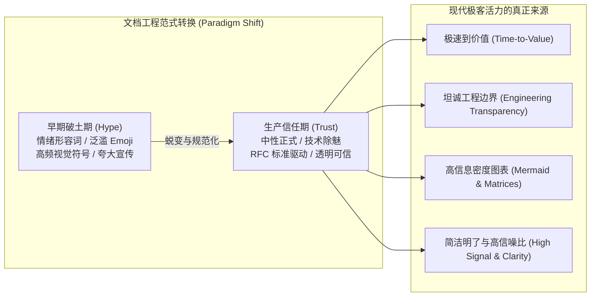
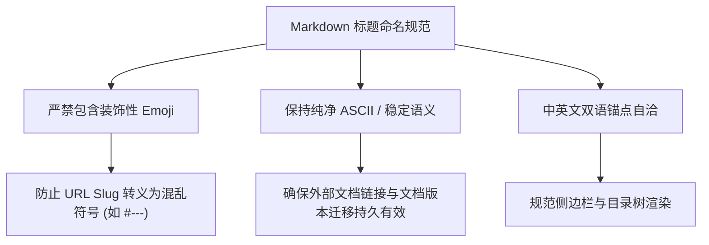
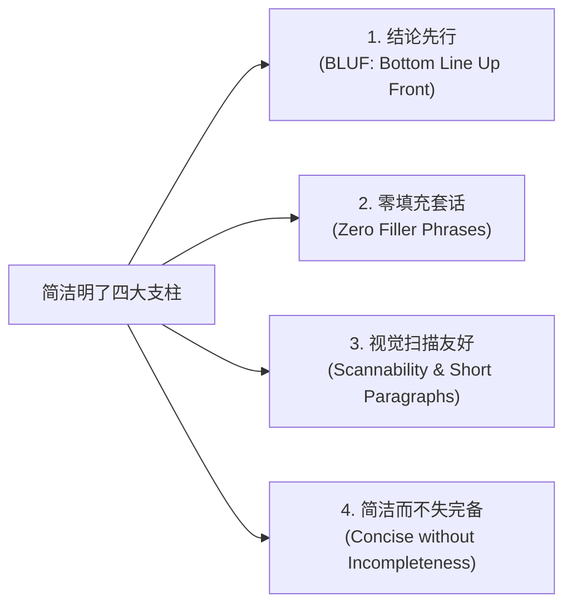
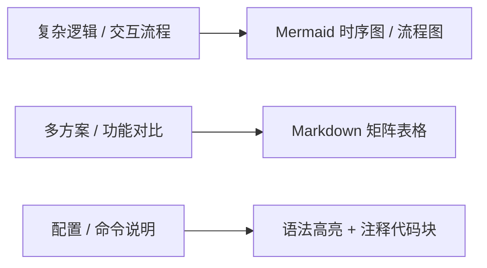
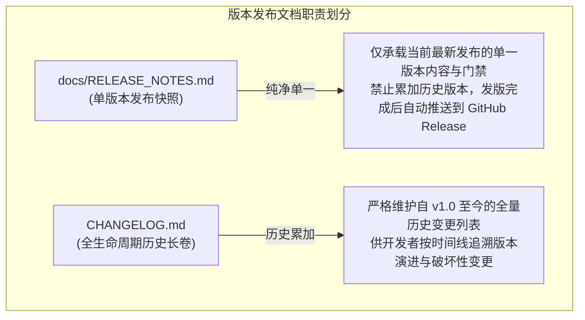

# WebRTC Gateway 文档与文案工程规范 (Documentation & Copywriting Engineering Style Guide)

> **规范定性与导言**：  
> 在高复杂度的网络穿透、WebRTC 协议栈与浏览器沙箱虚拟化工程中，**文档不仅是使用说明，更是系统架构设计与工程严谨性的直接镜像**。  
> 随着 WebRTC Gateway 跨入 `v2.0` 并在生产环境承载 NAS、私有云、Tailscale 与企业 WAF 等关键基础设施，项目的受众已从“概念尝鲜者”全面演进为“严谨的系统架构师、DevOps 工程师与安全审计人员”。  
> 本规范旨在推动技术文档与宣传文案**从“破土吸引期（Hype & Hook）”全面蜕变为“生产信任期（Infrastructure & Trust）”**，确立**中性克制、简洁明了、技术除魅、标题纯净、排版严谨、平视对话**的现代极客工程文档基准。

---

## 一、 核心工程哲学：中性、克制与极客活力

### 1. 为什么坚决推行“文档脱水”与“技术除魅”？

在基础设施级开源工程中，过度夸大的修辞与泛滥的表情符号会产生三项致命的工程负债：

1. **侵蚀技术信任**：  
   资深工程师与架构师对“颠覆传统”、“军工级”、“彻底告别痛点”等营销化词汇天然具备警惕心理。当文档声称“家庭宽带能跑多快就跑多快”时，专业读者会立刻质疑“SCTP 拥塞控制算法、单核加解密开销与 NAT 拓扑瓶颈的真实测试数据在哪里？”
2. **稀释有效信息密度**：  
   堆砌的形容词掩盖了关键的技术参数、边界限制、物理约束与前置依赖，显著增加运维查障和代码阅读成本。
3. **锚点污染与解析混乱**：  
   在 Markdown 标题（`#`、`##`）中嵌入 Emoji 会导致 VitePress、GitHub、GitLab 等解析器生成混乱且不规则的 URL 锚点（Slug），对跨平台文档跳转、外链引用和自动化爬虫极不友好。

### 2. 辩证解构：“中性正式”与“极客风貌”的辩证统一

“中性正式”绝不等于“僵死的官僚公文说明书”，更不是机械生硬的被动句堆砌。对标 **Vite、Tailscale、Bun、Astro、Stripe Docs、Rust 社区** 等当代顶尖开源典范，现代极客风貌的核心在于：

- **极速到价值（Time-to-Value）**：拒绝冗长的客套排比，三句话内直击技术本质，让开发者以最低成本跑通最小可用用例。
- **简洁明了与高信噪比（Clarity & High Signal）**：结论先行，剔除无意义的填充套话与修饰冗余，让核心参数、配置命令与物理约束一目了然。
- **诚实与透明（Engineering Transparency）**：不仅阐述架构优势，更敢于在显要位置公开物理定律与技术边界（例如明确告知对称型 NAT 无法直连时需回退至 TURN）。**敢于直面限制的坦荡，才是最硬核、最自信的极客态度。**
- **严谨的视觉审美**：代码块格式极简、Mermaid 图表干净利落、排版留白呼吸感好，用严密的逻辑图表替代文字口号。

---

## 二、 标题与导航纯净规范 (Title & Navigation Hygiene)

### 1. 标题严禁使用装饰性 Emoji
- **强制规则**：所有 Markdown 标题（`#`、`##`、`###`、`####`）**一律严禁包含任何 Emoji 表情符号**。
- **反例**：  
  `## 🌟 核心特性`  
  `### 🚀 生产部署指南`  
  `## 🔒 安全性与访问控制`
- **推荐正例**：  
  `## 核心特性 (Key Features)`  
  `### 生产部署指南 (Production Deployment)`  
  `## 安全性与访问控制 (Security & Access Control)`

### 2. 侧边栏与导航项显示准则
- VitePress 侧边栏（Sidebar）与顶部导航（Navbar）的配置文本，推荐保持文字纯净。
- 状态指示（如功能草案、废弃标记）优先使用文字标签（如 `[Draft]`、`[Deprecated]`），杜绝纯视觉装饰。

---

## 三、 技术除魅与措辞词汇表 (Technical De-hyping & Terminology)

在文档与文案中，**多用具体的专有名词、RFC 编号、物理度量和动词，杜绝无度量标准的极端副词与宣传修辞**。

### 1. 禁用词与推荐替换对照矩阵表

| 严禁 / 避免使用的表述 | 推荐的现代极客 / 客观中性表述 | 规范化替换理由 |
| :--- | :--- | :--- |
| **颠覆传统**内网穿透思路 | **免装客户端**的浏览器端 WebRTC 穿透架构 | 准确陈述技术形态，消除主观吹嘘感 |
| **军工级**非对称协商与强加密 | 遵循标准 WebRTC **DTLS 1.2 / SRTP 传输层加密** (RFC 8831) | 明确具体密码学规范与协议依据 |
| 家庭千兆宽带**能跑多快就跑多快** | P2P 直连吞吐**受限于物理链路带宽与 SCTP 拥塞控制**，无云中继带宽限制 | 尊重网络物理规律与传输层拥塞机制 |
| **彻底告别**访客显示为 127.0.0.1 的痛点 | **支持权威客户端 IP 透传 (X-Forwarded-For)**，适配 WAF 与安全审计 | 直接指出功能特性、请求头字段与业务价值 |
| **高科技**诊断 HUD | **实时 WebRTC 链路诊断面板** (覆盖 RTT/丢包率/候选对/重协商) | 精确描述面板包含的具体观测指标与功能 |
| **秒级**直连 / **秒级**切换 | 毫秒级直连 / 客户端即时路由切换 (Instant Routing) | 避免泛滥空洞的“秒级”营销修辞 |
| **100% 零配置开箱即用** | **零客户端依赖 (Zero-Client)**，单条命令即可启动 | 区分“免装客户端”与真实必需的最小化网络配置 |
| **完美适配**各大系统与场景 | 经全息测试套件验证支持主流 NAS、Docker 与浏览器环境 | 替换绝对化用语，给出验证方式与适用范围 |
| **单文件 1 秒安全分发** | **基于内存映射的轻量文件分发**，支持临时免密与时效签名 | 准确描述技术原理（mmap/HMAC-SHA256） |

### 2. 慎用与消除情绪化极端副词
- **黑名单词汇**：`秒杀`、`吊打`、`完全无敌`、`狂飙`、`绝对安全`、`完美无瑕`、`最强`、`无懈可击`。
- **中性替代范式**：用事实对比、基准测试（Benchmark）数据与标准测试用例替代情绪宣泄。

---

## 四、 简洁明了与高信噪比规范 (Conciseness, Clarity & Scannability)

技术文档最主要的阅读场景是**“现场实操、快速定位、紧急排障”**。冗长、拖沓、充满填充词的文档会成倍放大认知负荷。优秀的技术写作应当追求**“以最短路径传达最大确定性”**。

### 1. 结论先行 (Bottom Line Up Front, BLUF)
- **核心准则**：在章节、段落或排障说明的首句，**直接给出核心结论、操作指令或判定依据**，后续再展开原理推导或背景解释。严禁经过长篇大论的铺垫后才在文末揭晓关键配置项。
- **反例 (拖沓迂回)**：  
  *“在某些情况下，由于各个操作系统的网络配置机制与防火墙策略的不同，开发者在启动穿透客户端时可能会发现连接没有立刻建立，经过排查发现是因为端口未指定，因此我们提供了 `-target` 参数来指定内部应用地址……”*
- **正例 (简洁明了，结论先行)**：  
  *“使用 `-target` 指定被反代的目标内网服务地址（如 `-target http://127.0.0.1:8080`）。未显式指定时，Agent 缺省使用当前配置文件的默认端口。”*

### 2. 严控修饰词，坚决剔除“无意义填充短语 (Zero Filler Phrases)”
文档中严禁充斥无信息增量的客套套话与修饰冗余：

| 严禁出现的填充套话 | 改进方式 | 理由与原则 |
| :--- | :--- | :--- |
| **众所周知** / **顾名思义** | 直接删除，直接陈述技术事实 | 既然众所周知，写出即是噪音；若非众所周知，则属傲慢武断 |
| **显而易见** / **不难看出** | 直接删除，陈述数据对比或推导结论 | 增加读者挫败感，毫无实质信息量 |
| **值得一提的是** / **需要指出的是** | 直接删除，或使用 `> [!NOTE]` 提示容器 | 废话过渡词，关键信息应用标准容器或粗体强调 |
| **在实际使用场景中不难发现** | 直接提炼为具体的使用场景描述 | 冗长铺垫，直奔主题（如“高并发反代场景下...”） |
| **如前所述** / **正如前面章节讨论的那样** | 使用具体的文档内部超链接（如 `详见 [系统架构](./guide/architecture)`） | 模糊指代无法辅助快速检索，精确链接更具可跳转性 |

### 3. 单段聚焦与视觉扫描友好 (Scannability)
- **单段严控长度**：单个自然段严控在 **3 ~ 5 行** 以内。一个段落仅阐述一个独立的逻辑单元或事实。一旦出现逻辑转折或引入新概念，立即分段。
- **列表化与步骤化**：凡涉及 2 个以上的并列条件、操作步骤或对比属性，**必须使用无序列表（Bullet points）或有序列表（Numbered steps）**，严禁使用多个逗号或分号堆砌成十几行的“超长复句”。
- **最小可用配置（Minimal Reproducible Config）**：给出配置项时，直接呈现可直接复现粘贴的精简代码块，仅在关键行添加行内注释，杜绝在正文里用长篇文字去复述配置文件的每个键名。

### 4. 简洁与完备的辩证统一 (Concise without Incompleteness)
- **“简洁”是剔除水性修辞，绝非删减核心技术参数**。
- RFC 标准编号、具体字段名、超时阈值、错误状态码、硬件与网络边界等**关键确定性信息必须完整保留**。
- **检验标准**：去掉所有形容词与填充短语后，技术逻辑与参数闭环**不受任何影响**，即为高水平的简洁。

---

## 五、 语调自洽与极客表达范式 (Voice, Tone & Person)

### 1. 保持“平视对话的工程师语感”
- **避免浮夸亢奋腔**：“赶紧来试试吧！这绝对是你见过最好用的穿透神器！”
- **避免僵死官僚腔**：“本软件系统系根据特定网络协议针对远程穿透业务需求而特此设计实现之综合网关……”
- **提倡同行技术交流腔**：“我们通过 Service Worker 拦截浏览器内部的 HTTP/WebSocket 请求，并在用户态通过 SCTP 数据通道完成流式解包与转发。”

### 2. 坦诚技术边界与物理约束 (Engineering Transparency)
在文档的特性介绍或架构章节，**必须包含明确的局限性与降级路径说明**：
- 明确指出：WebRTC P2P 直连依赖 NAT 类型，在双方均为对称型 NAT（Symmetric NAT）的极端网络下无法完成直连打洞，必须配置 TURN 中继节点作为网络保底。
- 明确指出：端到端加解密与用户态 SCTP 分包会消耗一定的 CPU 算力，吞吐性能受限于运行环境硬件配置。
- 明确指出：移动端 Safari 在低电量模式或切入后台时可能会暂停 Worker 执行。

---

## 六、 排版格式与中英文混排规范 (Typography & Mechanics)

遵循现代中文技术文档排版最佳实践，保证视觉韵律与极佳的阅读舒适度。

### 1. 盘古之白（中西文混排半角空格）
中文字符与英文字母、阿拉伯数字、行内代码块之间，**必须保留一个半角空格**：
- **错误**：`WebRTC网关基于Go1.24构建，采用TypeScript编写ServiceWorker。`
- **正确**：`WebRTC 网关基于 Go 1.24 构建，采用 TypeScript 编写 Service Worker。`
- **例外**：中文标点符号与英文字符之间**不加空格**。例如：`“WebRTC 网关”是一个项目。`

### 2. 标点符号规范
- 中文正文使用**全角标点符号**（`，`、`。`、`！`、`：`、`（`、`）`、`；`）。
- 英文正文使用**半角标点符号**（`,`、`.`、`:`、`(`、`)`、`;`），且英文字后须紧跟一个半角空格。
- 杜绝标点符号连用（如 `！！！` 或 `？？？`）。除代码说明外，正文中尽量少用叹号。

### 3. 行内代码与专有名词大小写
专有名词必须严格遵循官方大小写规范，涉及文件名、命令、配置项、协议名时一律使用行内代码（反引号）：
- **正确**：`WebRTC`、`TypeScript`、`JavaScript`、`GitHub Actions`、`Docker`、`Service Worker`、`RTCDataChannel`、`Nginx`、`Synology DSM`。
- **错误**：`webrtc`、`Typescript`、`js`、`github actions`、`docker`、`serviceworker`、`nginx`。

### 4. 告警容器规范 (Alerts)
统一采用 GitHub Flavored Markdown / VitePress 原生告警语法，杜绝随意捏造的前缀符号：

> [!NOTE]
> 记录背景上下文、设计决策或协议原理解释。

> [!TIP]
> 提供使用技巧、性能优化建议或推荐的最佳实践。

> [!IMPORTANT]
> 强调核心前置条件、关键配置项或必知必会的架构事实。

> [!WARNING]
> 警示非破坏性但易出错的配置、向后兼容风险或潜在降级。

> [!CAUTION]
> 警告可能导致连接中断、数据丢失或网络安全敞口的高危操作。

---

## 七、 信息可视化规范 (Diagrams & Information Architecture)

能用图表说明清晰的架构与数据流，绝不使用冗长密集的文字段落。

1. **架构图与时序图**：统一采用 Mermaid 语法编写，必须使用规范合法的图表类型（`flowchart TD/LR`、`sequenceDiagram`、`stateDiagram-v2`），标签中包含括号或特殊字符时必须用双引号包裹（如 `node["Node (Info)"]`）。
2. **多方案对比**：强制使用 Markdown 表格，横向列出候选方案，纵向列出具体度量维度（如：打洞成功率、中继成本、客户端依赖、安全审计能力）。
3. **配置与命令行代码块**：
   - 所有代码块必须显式标明语言类型（`bash`、`yaml`、`json`、`go`、`ts`），并对关键字段添加行内注释，提供可直接复现的 Minimal Reproducible Example；
   - **纯命令严禁包含提示符（`$` 或 `>`）**：可执行命令一律不加 `$` 前缀，确保读者使用文档一键复制按钮时可直接粘贴运行；
   - **输入命令与输出展示解耦**：若需展示终端执行反馈，必须将输入命令（`bash` 代码块）与执行输出（`text` 或 `console` 代码块）拆分为独立代码块，严禁命令与输出混杂。
4. **站内内部超链接纯净度**：
   - 优先采用相对路径或 VitePress 规范路径（如 `[系统架构](./guide/architecture)` 或 `[发版清单](/RELEASE_CHECKLIST)`），杜绝散落失效的文件系统绝对路径。

---

## 八、 单版本发布原则 (Single-Version Release Notes Invariant)

为保持仓库文档的高信噪比与 CI/CD 自动化流水线的高效稳定，版本发布文档必须严格遵守**职责解耦原则**：

1. **`docs/RELEASE_NOTES.md`**：  
   - **核心不变量**：始终只维护**当前最新单一版本**的说明，严格执行中性、严谨、克制的文案。  
   - **高信噪比规范**：
     - **篇幅严控在 20 ~ 30 行**，结论先行，坚决剔除长篇叙述与多层嵌套长句；
     - **严禁重复罗列多平台制品与校验清单**（GitHub Releases 已原生展示完整 Assets 资产列表）；
     - **仅保留单行 Docker 镜像拉取命令**，严禁复制长篇重复的容器启动配置；
     - **固定结构四要素**：版本与一句话定性 ➔ 核心更新与修复 ➔ 破坏性变更 ➔ 容器镜像拉取。
   - **禁止行为**：严禁向此文件累加往期旧版本的历史记录。
2. **`CHANGELOG.md`**：  
   - 记录项目全生命周期的完整历史演进。每次发版前，将新版本条目追加到 `CHANGELOG.md` 顶部。

---

## 九、 落地执行与审查清单 (Enforcement & Review Checklist)

本清单用于日常 Pull Request 及版本发布的文档质量审查：

### 1. 提交者自检清单 (Author Checklist)
- [ ] 所有新增或修改的 Markdown 标题中**绝无 Emoji**。
- [ ] 严格践行**“简洁明了”与结论先行（BLUF）**，已剔除“众所周知/显而易见/值得一提的是”等无意义填充套话，单段聚焦在 3~5 行内，对视觉扫描友好。
- [ ] 检索并移除了“军工级”、“彻底告别”、“颠覆传统”、“秒级”等夸大性词汇，已用 RFC 规范或具体参数替代。
- [ ] 中西文、中文与数字、中文与行内代码之间均已保留**半角空格（盘古之白）**。
- [ ] 涉及网络限制与降级路径处，已坦诚披露技术边界与物理约束（如 NAT 拓扑与 TURN 依赖）。
- [ ] 代码块均已标注正确的语言高亮，复杂配置项附带行内说明。
- [ ] `docs/RELEASE_NOTES.md` 仅包含当前单一版本内容，未累积往期旧版本。

### 2. 审查人验证清单 (Reviewer Gate)
- [ ] 审查行文是否精炼干脆、直截了当，是否存在冗长复句或无信息增量的修辞铺垫。
- [ ] 检查生成的 VitePress 目录与 URL 锚点，确认无转义异常字符。
- [ ] 审查技术描述是否实事求是，是否存在过度承诺。
- [ ] 验证文档构建命令（`npm --prefix docs run docs:build`）是否 0 错误、0 警告顺利通过。
