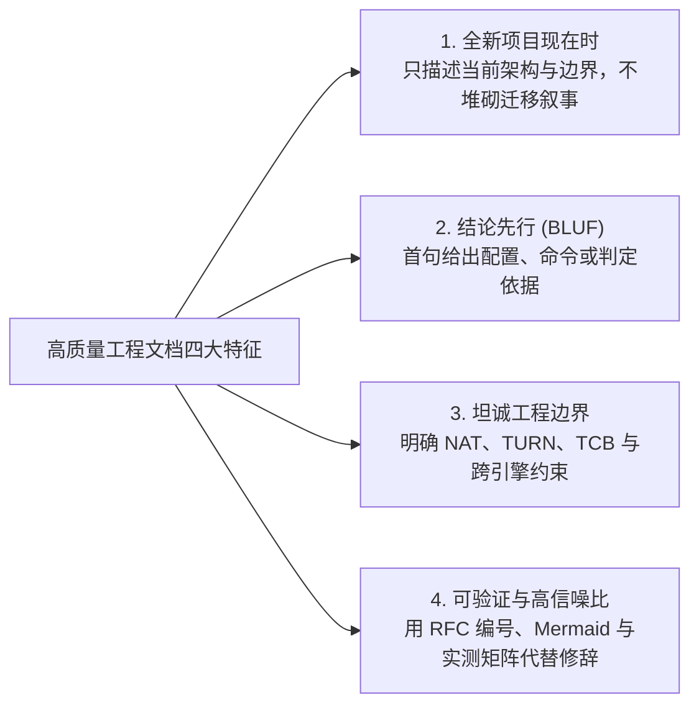

# WebRTC Gateway 文档与文案工程规范 (Documentation Style Guide)

> **适用范围**：仓库内全部 Markdown 文档（`docs/`、`docs/en/`、`README.md`、`README_en.md`、`CONTRIBUTING.md`、`AGENTS.md`、`CHANGELOG.md`）、VitePress 站点配置中的用户可见文本，以及 PR 模板与发布说明。
> 读者面向系统架构师、DevOps 工程师与安全审计人员。文档应当做到：**中性克制、全新项目视角、结论先行、技术事实可验证、标题纯净、双语对称**。
> 规范用语遵循第三章第 3 节（必须 / 应当 / 可以，对应 RFC 2119 的 MUST / SHOULD / MAY）。

---

## 一、核心工程哲学：中性、洁净与可验证

### 1. 全新项目视角原则（Greenfield Present Tense）

- 主线指南、配置参考、协议规范与治理文档应当**以全新项目的现在时**直接说明当前设计是什么、怎么配置、边界在哪里，**不应当**在正文中充斥“旧版曾经……”“已移除 XXX”“相比上一代废弃了 YYY”之类的历史对比包袱。
- 历史版本变更统一记录在 `CHANGELOG.md`；确有必要向后来者说明“永久 Non-Goals、可重评的当前架构权衡与跨层典型陷阱”的决策理由，集中沉淀在 [设计边界与架构权衡](./DESIGN_TRADEOFFS.md)，保持主指南纯净。

### 2. 简洁而完备

- **结论先行**：章节与排障段落首句直接给出结论、命令或触发条件，再展开机制说明。
- **分层去重与单一事实源**：治理文档（核心原则、审查清单、设计边界与架构权衡）只陈述领域不变量、抽象机制与权衡条件，不重复抄录当前版本的具体协议常量、内部符号名、CLI 参数或测试函数名；具体实现参数统一在 `docs/guide/` 对应规范中单点维护。删除“众所周知”“显而易见”“如前所述”等无增量套话。
- **控制段落与篇幅**：自然段控制在 3 ~ 5 行；单页软上限为 **500 行 / 40 KB**，超出时按专题拆分；简洁只删修辞，不删减 RFC 编号、超时阈值、状态码与安全边界。

---

## 二、标题与导航纯净规范

- **标题与 Mermaid 节点不得包含装饰性 Emoji**：保持纯文本与稳定 URL 锚点（Slug）；状态标注使用纯文字标签（如 `[Draft]`）。
- **锚点稳定性**：修改已有标题前须在全仓搜索该锚点引用并同步更新；VitePress 对数字开头的英文标题（如 `## 1. ...`）生成的锚点带有前导下划线（`#_1-...`），站内链接与锚点由 `docs/scripts/lint-docs.cjs`（`E8`）自动校验。

---

## 三、技术除魅与规范用语

### 1. 客观表述对照表

| 避免使用 | 推荐的客观表述 | 理由 |
| :--- | :--- | :--- |
| 颠覆传统穿透方案 | 零客户端浏览器端 WebRTC P2P 穿透网关 | 陈述技术形态，去掉主观宣传 |
| 军工级加密 | DataChannel 经 DTLS 1.2 加密（SCTP over DTLS，RFC 8261 / RFC 8831），配合 Ed25519 节点验签与通道内 RFC 9383 SPAKE2+ | 给出协议、RFC 与密码原语 |
| 100% 纯 P2P / 零中继 | 信令服务器不中继业务数据；对称 NAT 回退可选用户自建 TURN（仅转发端到端 DTLS 密文） | 坦诚 TURN 回退路径与边界 |
| 彻底告别 127.0.0.1 痛点 | 支持可信代理从右向左剥离 `X-Forwarded-For` 与客户端 IP 透传 | 指出具体机制与安全边界 |
| 单文件 1 秒安全分发 | 基于 Go `os.Root` 的只读静态适配器，配合可吊销 Ed25519 能力分享令牌 | 贴合真实实现与权限边界 |
| 数学上保证 / 物理级隔离 | 跨站双域浏览器源隔离 / 内核 `os.Root` 句柄禁锢 | 用可验证机制替代比喻 |

### 2. 禁用词与慎用词

- **禁用词（由 `docs/scripts/lint-docs.cjs` 自动阻断）**：
  - 中文：`颠覆传统`、`军工级`、`金融级`、`秒杀`、`吊打`、`完全无敌`、`绝对安全`、`完美无瑕`、`完美适配`、`彻底告别`、`能跑多快`、`高科技`、`最强`、`无懈可击`、`狂飙`、`首创`、`划时代`、`全息`、`秒级`、`深水区`、`护城河`、`物理级`、`数学上保证`、`世界上最严苛`、`一票否决`、`100% 零配置`。
  - 英文：`military-grade`、`bulletproof`、`revolutionary`、`pioneered`、`holographic`、`blazing`、`world-class`、`world's most`、`game-changing`、`game changer`、`unbeatable`、`flawless`、`magic`（作宣传形容词时；`magic number`/`magic bytes` 等技术术语除外）、`lightning-fast`、`indestructible`、`ultimate`。
- **慎用词**：`100%`、`绝对`、`彻底`、`完全`、`毫秒级` 仅在具备可复现测量命令或代码证明时使用。
- **规范优先级表述**：统一写作 **CONSTITUTION（核心原则）> REVIEW_GUIDELINES（审查清单）> DESIGN_TRADEOFFS（设计边界与架构权衡）**。

### 3. 规范性用语 (RFC 2119)

| 中文 | 英文 | 含义 |
| :--- | :--- | :--- |
| 必须 / 不得 | MUST / MUST NOT | 无例外的硬性要求 |
| 应当 / 不应当 | SHOULD / SHOULD NOT | 默认要求；偏离时须说明理由 |
| 可以 | MAY | 可选做法 |

---

## 四、排版、代码与可视化规范

### 1. 排版与示例脱敏

- **中西文混排**：中文与英文、数字、行内代码之间保留一个半角空格；中文标点与英文之间不加空格。
- **行内代码与专有名词**：命令、文件路径、CLI 参数、环境变量与代码标识符使用反引号（如 `scripts/gate.sh`、`-sandbox-origin`、`MemoryBudget`）；产品与协议名（WebRTC、TypeScript、Docker、Service Worker、Nginx）使用官方大小写且不加反引号。
- **示例域名与 IP**：必须使用 RFC 2606 / 6761 保留域名（`example.com`、`*.example`）与 RFC 5737 文档 IP（`192.0.2.x`、`198.51.100.x`、`203.0.113.x`）；本机默认值可用 `127.0.0.1`。
- **不硬编码易漂移计数**：测试用例数、键数量等会随提交变化的数据改写为“全部通过”或给出运行命令。
- **协议与版本名**：传输协议名与版本号以协议规范（`protocol-specification.md`）中的当前版本为准（如 P2PMux V8）；容器镜像标签统一使用带 `v` 前缀的 `vX.Y.Z`。

### 2. 代码块、Mermaid 与链接

- **代码块**：所有代码块必须标注语言（`bash`、`yaml`、`json`、`go`、`ts`、`text`）；命令块不得包含 `$ ` 提示符，命令与终端输出拆分到不同代码块。
- **Mermaid**：仅使用受支持图型（`flowchart`、`sequenceDiagram`、`stateDiagram-v2` 等），含括号的节点标签使用双引号包裹，改动后必须通过 `node docs/scripts/lint-mermaid.mjs`。
- **告警容器**：统一使用原生 GFM / VitePress 容器（`[!NOTE]`、`[!TIP]`、`[!IMPORTANT]`、`[!WARNING]`、`[!CAUTION]`）。
- **链接规范**：`docs/` 内部使用相对路径或站点路径；指向 `docs/` 之外的仓库文件（如 `scripts/gate.sh`、`configs/agent.example.yaml`）必须使用 GitHub 绝对 URL `https://github.com/BeingNoAbility/WebRTC-Gateway/blob/main/<path>`；严禁出现 `file://` 本地绝对路径（由 `scripts/verify-release-hygiene.mjs` 强制阻断）。

---

## 五、单版本发布说明与双语同步

### 1. `docs/RELEASE_NOTES.md` 与 `CHANGELOG.md` 分工

- **`docs/RELEASE_NOTES.md`**：单版本快照，只包含当前待发布的单一版本（由 `release.yml` 作为 GitHub Release 正文），控制在 35 行以内，含版本定性、核心变更与对应版本的 `docker pull` 命令（仅中文，通过头部提示链接至英文 `CHANGELOG.md`）。
- **`CHANGELOG.md`**：按 Keep a Changelog 记录全生命周期历史演进。

### 2. 文件命名与中英文同步

- 新建指南与专题文档使用小写 kebab-case（如 `agent-configuration.md`），文件名不得携带版本号后缀（RFC 目录 `docs/rfcs/` 与顶层治理文档如 `CONSTITUTION.md`、`REVIEW_GUIDELINES.md`、`DESIGN_TRADEOFFS.md` 除外）；英文镜像置于 `docs/en/` 相同相对路径（根目录 `README.md` 对应 `README_en.md`）。
- 修改中文文档必须在同一 PR 中同步修改英文镜像，保持章节结构、代码块与 Mermaid 数量一致（由 `lint-docs.cjs` `E7` 强制门禁校验）。
- 每次改动后运行 `npm --prefix docs run docs:lint`、`npm --prefix docs run docs:build` 与 `node scripts/verify-release-hygiene.mjs` 确认 0 错误、0 告警。
