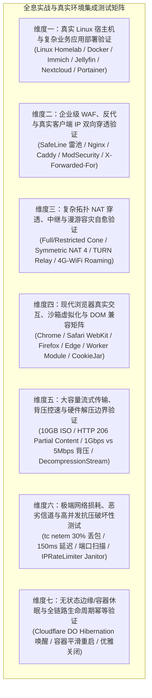
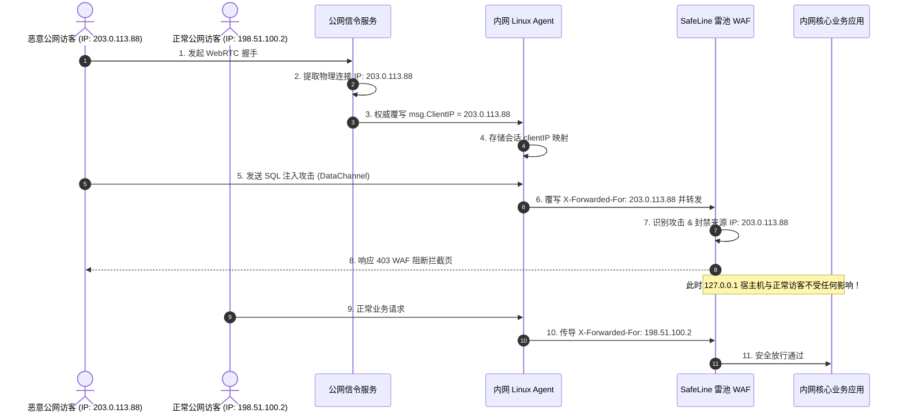

# WebRTC Gateway 全息实战与真实环境集成测试清单 (Real-World Testing Checklist)

> **导言与目标**：  
> WebRTC Gateway 是一个横跨 **Go 高并发底层系统、WebRTC/SCTP 穿透网络协议栈与现代浏览器同源沙箱虚拟化** 的多异构集成项目。简单的单元测试（Unit Tests）只能保证局部逻辑符合预期，根本无法穷尽真实公网环境下的网络抖动、浏览器内核配额、WAF 规则冲突以及高吞吐背压。  
> 本清单是项目在生产部署、跨版本集成或深水区重构时的**全息实战演练手册**。测试者必须基于真实的 Linux 宿主机、真实容器、真实企业级反代/WAF 与多品牌现代桌面/移动浏览器进行端到端闭环拨测。

---

## 🗺️ 全息实战测试 7 大维度矩阵



---

## 🛠️ 实战测试环境拓扑与匿名化准备

在执行实战拨测前，准备一套与生产网络拓扑一致的测试床（Testbed）：

```mermaid
flowchart LR
    subgraph External_Visitors["外部公网访客 (多端浏览器)"]
        BrowserA["Desktop Chrome / Edge"]
        BrowserB["Mobile iOS Safari (5G/4G)"]
        BrowserC["Firefox / macOS Safari"]
    end

    subgraph Public_Signaling["公网信令撮合中心"]
        Signal["Go Signal (:8888/:8443) 或<br/>Cloudflare Worker DO"]
    end

    subgraph Private_Homelab["私有内网测试宿主机 (Linux Testbed Host)"]
        Agent["WebRTC Gateway Agent<br/>(outbound-only, zero open ports)"]
        WAF["WAF 防火墙 (SafeLine / ModSecurity)"]
        ReverseProxy["Nginx / Caddy 反向代理"]
        Apps["真实业务集群 (Portainer / Jellyfin / LibreSpeed)"]

        Agent --> WAF --> ReverseProxy --> Apps
    end

    External_Visitors <-->|"1. WebSocket 信令交换 (SDP/ICE)"| Public_Signaling
    Private_Homelab <-->|"1. 长连监听注册"| Public_Signaling
    External_Visitors <====="2. WebRTC P2P 直连 (UDP DTLS-SRTP 加密数据通道)"=====> Private_Homelab
```

> [!NOTE] **测试环境参数配置约定（请严格匿名化，切勿泄露真实生产 IP）**：
> - **私有内网测试宿主机**：`<testbed-host-ip>`（例如 `192.168.1.x`，支持 SSH 远程运维测试）；
> - **公网信令服务器端点**：`wss://<signal-domain>/ws` 或自建 `ws://<signal-ip>:8888/ws`；
> - **集群准入密钥**：`-signal-secret <test-cluster-token>`；
> - **访客访问口令**：`-access-secret <test-visitor-pass>`。

---

## 维度一：真实 Linux 宿主机与复杂业务应用部署验证

本维度验证内网复杂 Web 服务在通过网关反向代理后，各项深度交互、富客户端逻辑是否 100% 保持原生体验：

- [ ] **1.1 重度富客户端管理面板验证 (Portainer / Grafana)**
  - **部署目标**：在 Linux 测试机上启动 Portainer：`docker run -d -p 9000:9000 portainer/portainer-ce:latest`。
  - **启动 Agent**：`./agent -node-id portainer -target http://127.0.0.1:9000`。
  - **测试用例与验证点**：
    1. **SPA 页面导航**：在访客浏览器中登录 Portainer，连续点击容器列表、镜像库、网络拓扑，验证基于 HTML5 History API 的路由跳转平滑，页面无刷新报错；
    2. **实时 WebSocket 控制台交互**：打开任意容器的 `Exec Console (bash/sh)` 终端，输入 `top`、`ls -la`、`vim`，验证双向键盘输入零延迟、ANSI 彩色高亮正常、窗口 Resize 自适应；
    3. **CSP 剥离验证**：审查控制台（F12），确认网关已成功剥离目标应用可能携带的限制性 CSP，未产生任何因 CSP 拦截导致的脚本白屏。

- [ ] **1.2 海量多媒体点播与无感拖拽验证 (Jellyfin / Immich)**
  - **部署目标**：部署包含 4K 高码率视频及超大相册目录的 Jellyfin 或 Immich。
  - **启动 Agent**：`./agent -node-id media -target http://127.0.0.1:8096`。
  - **测试用例与验证点**：
    1. **海量缩略图并发瀑布流**：在相册视图中快速持续向下滚动加载数千张缩略图，断言网关多路复用流调度平稳，未出现流拥塞丢包或 503 报错；
    2. **HTTP 206 Partial Content 快进跳播**：播放在线 4K MP4/MKV 视频，频繁前后拖动播放进度条至未缓冲区间；
    3. **抓包验证**：断言请求头携带 `Range: bytes=xxx-`，Agent 响应 `206 Partial Content` 与精准的 `Content-Range`，视频画面秒级继续播放，播放器零缓冲死锁；
    4. **图片防盗链破壁**：被代理系统引用的第三方图床图片正常渲染，无 403 Forbidden。

- [ ] **1.3 双向实时长连接与事件流验证 (HomeAssistant / Uptime Kuma)**
  - **部署目标**：部署 HomeAssistant 智能家居中枢。
  - **启动 Agent**：`./agent -node-id hass -target http://127.0.0.1:8123`。
  - **测试用例与验证点**：
    1. **SSE / WebSocket 实时状态流**：在浏览器控制面板切换灯光开关，断言状态在毫秒级内通过 WebSocket 双向帧同步；
    2. **SCTP 超大报文重组 (Defragmentation)**：当 HomeAssistant 下发包含全屋数百个实体属性的超大 JSON 状态包（> 64KB）时，断言网关前端环形拼包缓冲区成功拼接还原，前端无 `SyntaxError: Unexpected end of JSON input`；
    3. **长时间静默保活**：保持页面静止 30 分钟，验证保活 Ping/Pong 心跳正常，连接零中断。

- [ ] **1.4 极限物理带宽测速与 W3C 上传进度虚拟化 (LibreSpeed)**
  - **部署目标**：部署自建测速服务 `adolfintel/speedtest`。
  - **启动 Agent**：`./agent -node-id speedtest -target http://127.0.0.1:80`。
  - **测试用例与验证点**：
    1. **下行跑满物理千兆**：点击 Start 测速，下行速率应贴近测试宿主机与访客设备之间的真实物理链路峰值（如局域网达 900Mbps+）；
    2. **上行上传进度条平滑调度**：观察上行测速阶段，断言进度条平稳从 0% 前进至 100%，彻底规避 Chromium Bug 1214207 导致的上传进度卡死在 0% 缺陷；
    3. **Web Worker 测速线程支持**：验证 LibreSpeed 内部启动的多线程测速 Web Worker 能够正常穿透。

---

## 维度二：企业级 WAF、反代与真实客户端 IP 双向穿透验证

本维度验证在真实生产网络防护体系下，真实客户端 IP 能否穿透 WebRTC P2P 数据通道到达内网后端，并与安全组件（WAF、Nginx 限流）形成协同：



- [ ] **2.1 权威客户端真实 IP 穿透测试**
  - **部署工具**：在 Linux 测试宿主机启动 `traefik/whoami` 测试端点。
  - **启动 Agent**：`./agent -node-id whoami -target http://127.0.0.1:80`。
  - **测试动作**：使用外部公网电脑（非内网环境，如连接手机 5G 热点）打开 `https://<signal-domain>/#whoami`。
  - **断言判定**：
    - 检查 `whoami` 返回的 HTTP 请求头清单；
    - **`X-Forwarded-For`** 与 **`X-Real-IP`** 必须**严格等于外部公网访客的真实物理公网 IP**；
    - 绝不允许出现 `127.0.0.1`、信令服务器 IP 或局域网私有网段 IP。

- [ ] **2.2 恶意客户端伪造 IP 请求头对抗测试 (Anti-Spoofing)**
  - **测试动作**：恶意访客在浏览器控制台构造并伪造虚假请求头：
    ```javascript
    fetch('/api/test', {
      headers: {
        'X-Forwarded-For': '8.8.8.8',
        'X-Real-IP': '1.1.1.1'
      }
    });
    ```
  - **断言判定**：后端应用收到的请求头中，伪造的 `8.8.8.8` 被 Agent 强制覆写抹除，依然呈现权威信令注入的真实客户端 IP。

- [ ] **2.3 企业级 WAF (雷池 SafeLine / ModSecurity) 精准单 IP 拦截与封禁测试**
  - **拓扑准备**：在测试机上部署雷池 SafeLine WAF 容器，配置防护站点指向本地业务端口。
  - **测试动作**：
    1. 访客在穿透页面 URL 中追加 SQL 注入探测参数：`?id=1' AND 1=1 UNION SELECT null, version()--`；
    2. 观察浏览器画面，确认 WAF 立即返回炫酷的拦截告警页（HTTP 403）；
    3. 登录雷池 SafeLine 管理后台查看安全事件日志：
       - **攻击源 IP**：必须精准显示为访客的真实公网 IP（非 `127.0.0.1`）；
    4. **单 IP 封禁隔离性验证**：在 WAF 后台将该攻击源 IP 加入永久黑名单；
       - 该访客再次访问立即被全局封锁；
       - **核心防误杀验证**：从测试宿主机本机 `curl http://127.0.0.1:<port>` 或使用另一台不同 IP 的手机访问，确认**正常访客与本机服务完全畅通，未发生 127.0.0.1 全员误杀事故**。

- [ ] **2.4 Nginx 单 IP 频率限制 (Rate Limiting) 测试**
  - **Nginx 配置**：
    ```nginx
    limit_req_zone $binary_remote_addr zone=api_limit:10m rate=5r/s;
    server {
        location /api/ {
            limit_req zone=api_limit burst=10 nodelay;
        }
    }
    ```
  - **测试动作**：在访客浏览器控制台使用脚本快速连续发起 30 次请求。
  - **断言判定**：超过阈值后仅该访客收到 `429 Too Many Requests`，正常低频访问的其它设备不受影响。

- [ ] **2.5 跨域反向代理白名单过滤 (`-allowed-proxy-domains`)**
  - **配置参数**：`agent -allowed-proxy-domains "*.hdslb.com,*.bilivideo.com"`。
  - **测试动作**：
    1. 访问白名单内的 B 站图床图片：网关 Service Worker 成功拦截并转发给 Agent 代理，附带 `x-p2p-allowed-domains` 契约头，图片正常展示；
    2. 访问非白名单公网第三方链接（如 `https://github.com`）：浏览器 Service Worker 精准放行走访客本地物理网络，绝不向内网 Agent 抛出 400 Bad Request。

---

## 维度三：复杂拓扑 NAT 穿透、中继与漫游容灾自愈验证

本维度检验在面临企业级防火墙、严格 NAT 以及网络剧烈抖动时的穿透鲁棒性：

- [ ] **3.1 锥型 NAT 直连打洞测试 (Full / Restricted / Port-Restricted Cone)**
  - **场景**：常见家庭宽带或普通办公网络。
  - **测试验证点**：
    - 打开右下角 WebRTC HUD 悬浮球；
    - 验证 ICE Candidates 成功收集到本地局域网（`host`）与公网映射（`srflx`）候选；
    - 在 1~3 秒内打洞成功，HUD 状态药丸显示 **`⚡ P2P Direct`**；
    - 抓包确认双方直接通过 UDP 传输业务数据，中心信令服务器网卡流量归零。

- [ ] **3.2 双端对称型 NAT (Symmetric NAT 4) 极端中继降级测试**
  - **场景模拟**：在 Linux 测试机上配置 `iptables` 强制端口随机对称 NAT：
    ```bash
    iptables -t nat -A POSTROUTING -o eth0 -j MASQUERADE --random
    ```
  - **配置准备**：为 Agent 配置外部公网 TURN 中继服务器：
    ```bash
    ./agent -turn-url turn:relay.example.com:3478 -turn-user ops -turn-pass Secret123
    ```
  - **测试验证点**：
    - 双方均无法通过 STUN 反射候选建立配对；
    - 网关核心状态机自动平滑回退至 TURN 中继；
    - HUD 状态药丸自动切换为 **`🛡️ TURN Relay`**；
    - 页面请求正常返回，业务 100% 连通无阻断。

- [ ] **3.3 移动端 4G ↔ Wi-Fi 物理网络漂移与 ICE Restart 自愈测试**
  - **测试设备**：真实 iPhone / Android 移动端手机。
  - **测试动作**：
    1. 连接室内 Wi-Fi 打开视频网站并点击播放；
    2. 在视频连续播放期间，从屏幕顶部下拉控制中心，**突然关闭 Wi-Fi 开关**，手机底层瞬时强制切换为 5G/4G 移动蜂窝网络；
    3. 观察视频播放器与浏览器控制台；
  - **断言判定**：
    - 底层 TCP/WebSocket 套接字断开，浏览器自动闪连信令，保留现有 `RTCPeerConnection` 实例；
    - 浏览器向信令端发送带有 `iceRestart: true` 的新 Offer 协商；
    - Agent 触发 5 秒断网宽限期（Grace Window），延迟析构已有逻辑流；
    - 协商在新蜂窝网络 IP 上建立后，**视频画面无缝继续播放，无需手动刷新页面，下载任务不报错重下**。

- [ ] **3.4 手动 ICE Restart 诊断自愈测试**
  - **测试动作**：在任意活跃连接页面，点击右下角 HUD 诊断看板中的 **`🔄 立即触发 ICE Restart`** 按钮。
  - **断言判定**：控制台在 500ms 内完成原位重新握手，现有页面 DOM、表单输入值完整保留。

---

## 维度四：现代浏览器真实交互、沙箱虚拟化与 DOM 兼容矩阵

本维度在真实浏览器矩阵中验证 Service Worker 与虚拟化补丁的合规性：

- [ ] **4.1 现代 ES Module Web Worker 适配测试**
  - **测试场景**：使用 Vite 构建的现代前端应用或包含模块化 Worker 的系统（如 PDF.js v4+、新版 LibreSpeed）。
  - **测试动作**：在应用中触发后台计算任务（`new Worker(url, { type: 'module' })`）。
  - **断言判定**：
    - 前端补丁层透明拦截构造函数并附加 `?_p2p_worker=module` 查询参数；
    - Service Worker 分支检测到模块参数，动态注入 `import "/patch.js";`（传统 Worker 注入 `importScripts`）；
    - 控制台**零 `TypeError: Module scripts don't support importScripts()` 异常**，Worker 正常运行并能通过隧道发起网络请求。

- [ ] **4.2 W3C 规范级 204/304 Null-Body 严格断言测试**
  - **测试场景**：触发客户端带 `If-Modified-Since` 缓存头请求（返回 HTTP 304）或无实体 API（返回 HTTP 204/205）。
  - **断言判定**：
    - Service Worker 捕获并严格执行 `new Response(null, { status })`；
    - 控制台**零 `TypeError: Response with null-body status cannot have body` 报错**；
    - SPA 应用（Next.js / Vue）正常读取缓存并完成页面渲染。

- [ ] **4.3 Session CookieJar 物理隔离与多标签页防串扰测试**
  - **测试动作**：
    1. 在同一浏览器中打开两个标签页：
       - Tab 1 访问私有节点 A：`https://<signal>/#node-a`（登录用户 Alice）；
       - Tab 2 访问私有节点 B：`https://<signal>/#node-b`（登录用户 Bob）；
    2. 分别在两个标签页执行需要鉴权的操作；
    3. 在 Tab 1 点击“注销登录”；
  - **断言判定**：
    - Tab 2 的 Bob 登录态完全不受影响，无任何 Cookie 互相污染；
    - 检查底层网络包，Agent 为每个远端 Session 维护独立的 `http.CookieJar`；
    - 非 HttpOnly Cookie 自动与浏览器的 `document.cookie` 保持实时单向镜像同步。

- [ ] **4.4 新标签页 / 弹窗 Node ID 深度持久化测试**
  - **测试动作**：
    - 在被代理应用的页面内点击带有 `target="_blank"` 的超级链接，或页面通过 `window.open('/admin/dashboard')` 弹出新窗口。
  - **断言判定**：
    - Service Worker 向 HTML 动态注入 `window.__P2P_NODE_ID__`，`patch.js` 自动将新 URL 改写为 `?peer=<nodeId>#<nodeId>`；
    - 新标签页秒级命中同一节点直连隧道，**绝不脱离上下文误将子域名解析为 Node ID 导致 `Target agent offline` 报错**。

- [ ] **4.5 Anti-Frame-Busting 激进防框架劫持测试**
  - **测试场景**：被代理系统包含阻止 iframe 嵌入的防御代码（如 `if (top !== self) top.location = self.location`）。
  - **断言判定**：
    - 页面内嵌在 Portal iframe 中正常运作；
    - 外层 Portal 导航栏与 HUD 悬浮球保持常驻，未被内层恶意脚本强跳顶层。

- [ ] **4.6 跨浏览器引擎沙箱矩阵验证**
  - [ ] **Chromium (Chrome 120+, Edge, Brave)**：全功能 100% 绿灯。
  - [ ] **WebKit (macOS Safari 17+, iOS Safari 17+)**：
    - 验证 WebKit 严苛内存配额下无静默崩溃；
    - 验证 Service Worker 在 iOS 切到后台再切回前台时能正确恢复通信。
  - [ ] **Gecko (Firefox 125+)**：
    - 验证 Firefox 独特的 MessagePort 传递与 ReadableStream 消费无类型异常。

---

## 维度五：大容量流式传输、背压控速与硬件解压边界验证

本维度验证在物理极限条件下的数据通道抗压与解压管线合规性：

- [ ] **5.1 10GB 超大文件零内存拷贝下载测试**
  - **启动 Agent 模式**：`./agent -file /data/ubuntu-24.04-desktop-amd64.iso`（单文件 6GB~10GB）。
  - **测试动作**：访客在 Chrome / Safari 浏览器中点击下载。
  - **断言判定**：
    - 浏览器自动触发 Web File System API (`showSaveFilePicker`) 边下边落盘；
    - 使用 `top` / `htop` 观察浏览器标签页与 Linux Agent 内存占用：
      - Agent 内存占用稳定在 **< 50MB**；
      - 浏览器渲染进程内存稳定在 **< 100MB**；
    - 确认**未在内存中全量缓冲文件**，传输全程零 OOM 崩溃；
    - 校验下载完成的 ISO 文件 SHA256 哈希值与 Linux 宿主机原始文件完全一致。

- [ ] **5.2 生产端 1Gbps 对 5Mbps 弱网的极端背压 (Backpressure) 熔断测试**
  - **场景构建**：
    - Linux 宿主机处于千兆局域网高带宽环境；
    - 访客在 Chrome DevTools 的 Network 面板中将网络限制为 `Regular 3G (下行 1.5Mbps / 上行 750Kbps)`；
    - 发起超大文件下载或媒体点播。
  - **断言判定**：
    - Agent 进程持续监听 WebRTC DataChannel 的 `bufferedAmount`；
    - 当底层发送缓冲区超过低水位线时，Agent 自动制动暂停从文件/后端读取；
    - 观察 Agent 宿主机内存曲线：**维持水平常数线，绝不在内存中堆积数百 MB 待发数据**；
    - 在弱网下载期间点击 Portal 上的 **`⏹ 终止下载 (Cancel)`**，断言 DataChannel 立即发送 RST 帧，Agent 立即关闭本地读取流，无幽灵流悬挂。

- [ ] **5.3 Gzip 硬件流式直通与 HEAD / 空响应体边界测试**
  - **测试动作**：
    1. 访问被代理 Web 站点的庞大 JS/CSS 静态资源（> 5MB bundle）；
    2. 查看 DevTools 抓包，确认跨 P2P 隧道数据包体积缩减 60%~80%，响应头带有 `x-p2p-content-encoding: gzip`；
    3. 验证 Service Worker 调用原生硬件流式解压管线 `stream.pipeThrough(new DecompressionStream('gzip'))`，JS 代码无损坏且正常执行；
    4. **空体与 HEAD 预检边界拨测**：
       - 在控制台发起 `fetch('/bundle.js', { method: 'HEAD' })` 预检；
       - 或请求返回 `204 No Content` / `Content-Length: 0` 的接口；
       - 断言：解压管线精准旁路并回传 `null` body，**控制台零 `TypeError: Compressed input was truncated` 抛错**。

---

## 维度六：极端网络损耗、恶劣信道与高并发抗压破坏性测试

本维度使用 Linux 内核网络混沌工程工具（Traffic Control）注入恶劣信道：

```bash
# 常用测试床网络损耗注入命令集 (在 Linux Testbed 宿主机以 root 执行)
# 1. 模拟 30% 随机丢包与 150ms 跨国高延迟:
tc qdisc add dev eth0 root netem loss 30% delay 150ms 20ms

# 2. 模拟 25% 网络包乱序 (Packet Reordering):
tc qdisc add dev eth0 root netem delay 50ms reorder 25% 50%

# 3. 恢复网络正常状态:
tc qdisc del dev eth0 root
```

- [ ] **6.1 30% 丢包 + 150ms 延迟下的业务完整性测试**
  - **注入命令**：`tc qdisc add dev eth0 root netem loss 30% delay 150ms 20ms`。
  - **测试动作**：在访客浏览器中加载 Portainer 仪表盘并下载一张 20MB 图片。
  - **断言判定**：
    - 得益于 WebRTC 底层优化的 SCTP 选择性重传算法，页面可能加载变慢，但**所有图片与数据 100% 完整加载，无字节乱码或 CRC 损坏**；
    - 恢复网络命令执行后，信道在 2 秒内恢复极速。

- [ ] **6.2 25% 包乱序传输稳定性测试**
  - **注入命令**：`tc qdisc add dev eth0 root netem delay 50ms reorder 25% 50%`。
  - **断言判定**：P2PMux 二进制分帧协议严格按序号重组，控制台零分帧损坏报错。

- [ ] **6.3 公网恶意端口扫描与 IPRateLimiter 内存泄漏压力测试**
  - **测试工具**：使用 `wrk` 或并发测试脚本。
  - **测试动作**：
    1. 模拟 5,000 个伪造离散源 IP 向 Signal 服务端发起超频握手；
    2. 验证单 IP 最大连接配额（`-max-ip-conns 64`）生效，超频连接被立即拒绝；
    3. 停止压测并等待一个清理周期；
    4. 在服务端检查 `runtime.ReadMemStats` 与 pprof heap profile：
       - `msgTimes` 与 `failedAuths` 中的孤儿键被 `janitorLoop` 定时协程全部删除；
       - **常驻内存曲线平稳归底，彻底杜绝慢性内存膨胀**。

---

## 维度七：无状态边缘/容器休眠与全链路生命周期幂等验证

本维度检验生产环境中的休眠唤醒、容器热升级与退出幂等性：

- [ ] **7.1 Cloudflare Worker WebSocket Hibernation 边缘休眠唤醒测试**
  - **测试场景**：信令托管在 Cloudflare Worker Durable Object。
  - **测试动作**：
    1. Agent 成功注册上线后，保持闲置状态 30 分钟以上，使 Cloudflare 边缘 Durable Object 实例进入深度休眠态（Hibernation）；
    2. 访客在浏览器打开页面唤醒 DO 实例；
  - **断言判定**：
    - DO 唤醒时执行 `ensureState()`，从 WebSocket 会话附件中无损恢复 `nodeSecrets`、`nodeVisitorAuth` 与 `ipConns`；
    - 访客端输入口令后正常通过鉴权，防冒领校验严格执行；
    - **休眠唤醒后零鉴权绕过、零连接计数下溢**。

- [ ] **7.2 Agent / Signal 守护进程优雅关闭与自愈重连测试**
  - **测试动作**：
    1. 在多流活跃传输期间，向 Signal 进程发送 `kill -SIGTERM`；
    2. 验证 Signal 触发 5 秒 graceful shutdown 优雅关闭；
    3. 重启 Signal；
    4. 观察 Agent 客户端行为：
       - Agent 捕获断连后自动进入指数退避重连机制（2s, 4s, 8s...）；
       - Signal 启动完毕后，Agent 自动完成重连并重新注册 Node ID；
       - 访客刷新页面立即恢复正常访问，守护进程零挂死、零僵尸进程。

---

## 📋 实战测试合格判定与签字矩阵 (Sign-off Protocol)

每次正式大版本发版（如 `v2.0.0`）或引入核心协议层改动时，测试团队必须在上述 7 大维度中全量签核通过：

| 验证维度 | 核心检验焦点 | 必备通过条件 | 签字人 | 状态 |
| :---: | :--- | :--- | :---: | :---: |
| **维度一** | 真实 Linux 重度 Web 应用 | Portainer、Jellyfin、LibreSpeed 100% 交互无异常 | | ⬜ PENDING |
| **维度二** | 企业级 WAF 与真实客户端 IP | X-Forwarded-For 精准透传，WAF 拦截攻击源，防误杀生效 | | ⬜ PENDING |
| **维度三** | 复杂 NAT 与 4G/Wi-Fi 漫游 | 对称 NAT 降级 TURN，手机切网触发 ICE Restart 视频不卡死 | | ⬜ PENDING |
| **维度四** | 跨浏览器交互与 DOM 虚拟化 | Chrome/Safari/Firefox 均无报错，ES Module Worker 正常 | | ⬜ PENDING |
| **维度五** | 10GB 流式传输与背压限流 | 大文件边下边写盘，弱网背压内存 < 50MB，HEAD 旁路解压 | | ⬜ PENDING |
| **维度六** | 混沌网络损耗与抗压排毒 | 30% 丢包传输无损，高频扫描后 Janitor 彻底清空孤儿键 | | ⬜ PENDING |
| **维度七** | 边缘休眠唤醒与平滑生命周期 | Cloudflare DO 休眠唤醒鉴权不丢失，Signal 重启秒级重连 | | ⬜ PENDING |
