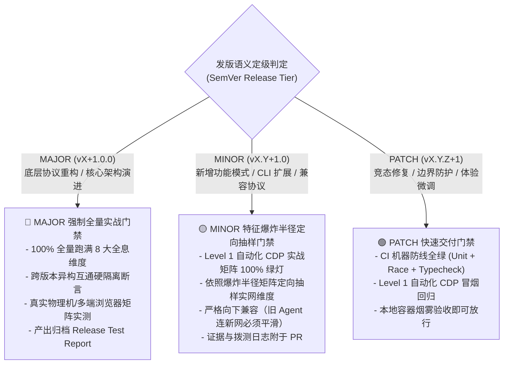
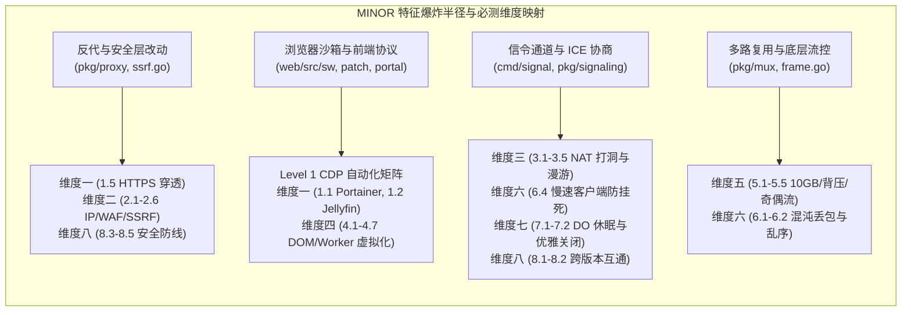
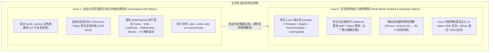
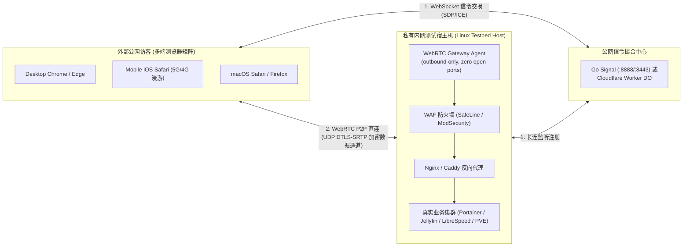

# WebRTC Gateway 全息实战与真实环境发版测试清单 (Real-World Testing Checklist 2.0)

> **导言与测试主管定性**：  
> WebRTC Gateway 是一个横跨 **Go 高并发底层系统、WebRTC/SCTP 穿透网络协议栈与现代浏览器同源沙箱虚拟化** 的多异构集成工程。  
> 简单的单元测试（Unit Tests）只能证明“已写出的断言在理想局部下成立”，根本无法穷尽真实公网环境下的网络抖动、跨版本异构混部、浏览器内核配额限制、企业级 WAF 规则冲突以及多流高吞吐背压。  
> **测试团队对测试文件、测试流程及本清单拥有绝对裁定与准入门禁权**。在每次 **MINOR (vX.Y+1.0)** 与 **MAJOR (vX+1.0.0)** 正式发版前，测试主管必须严格依照本指南执行实网全息拨测，坚守底层不变量，确保真实复杂环境全功能 100% 稳定交付。

---

## 一、 发版分级准入与测试治理协议 (Release-Tiered Gate Protocol)

依据 [docs/REVIEW_GUIDELINES.md](file:///docs/REVIEW_GUIDELINES.md) 与 [docs/RELEASE_CHECKLIST.md](file:///docs/RELEASE_CHECKLIST.md)，项目坚决反对“小修小补机械全跑”的形式主义与“重大重构侥幸放行”的本位傲慢，实行标准的三级发版准入裁定：



### 1. MAJOR 与 MINOR 发版门禁对照

| 发版类型 | 版本位范式 | 核心检验聚焦 | 必备通过条件 | 签核归档要求 |
| :--- | :---: | :--- | :--- | :--- |
| **主版本 (Major)** | `vX+1.0.0` | 协议 Wire 格式演进、安全鉴权模型、高并发极限背压、真实网络混沌容灾。 | **强制 100% 逐项通过本清单全量 8 大维度**；零任何维度跳过或妥协。 | 必须在 PR 中出具由测试主管签核的正式完整测试报告，归档至 `docs/`。 |
| **次版本 (Minor)** | `vX.Y+1.0` | 新功能业务闭环、新增 CLI 参数/环境变量、向后兼容协议扩展。 | **Level 1 CDP 自动化矩阵 100% 通过**；依照**特征爆炸半径矩阵**必测相关维度，且**旧版本 Agent 互通测试必须通过**。 | 在 PR 描述中详细附带定向抽样维度的实操日志、报文截屏或抓包证据。 |
| **补丁版本 (Patch)** | `vX.Y.Z+1` | 并发死锁、空载荷边界修复、内存泄漏排毒、UI 交互修复。 | 自动化 CI 机器防线（`tsc`, `go vet`, `go test -race`, `npm test`）及本地 Level 1 浏览器冒烟测试通过。 | PR 附带对应 Bug 的反向证伪用例运行证据。 |

### 2. MINOR 发版：特征爆炸半径定向抽样矩阵 (Blast-Radius Driven Sampling Matrix)

当进行 MINOR 发版时，测试主管依据改动的代码包与影响面，强制激活对应维度的实战拨测：



---

## 二、 双层实战测试工程体系 (Dual-Layer Testing Architecture)

测试流程严格区分为两个不可或缺的验证层次：



> [!TIP]
> **测试执行最佳实践**：
> 1. **代码合并或打 Tag 前**：首先运行 `npm --prefix web run test:browser`，在本地 10 秒内自动化完成真实浏览器渲染与协议交互基线回归；
> 2. **进入实网测试床**：启动物理靶场环境，逐项验证复杂应用与网络拓扑。

---

## 三、 实战测试环境拓扑与匿名化准备



> [!IMPORTANT] **测试床匿名化配置约定**：
> - **私有宿主机**：`<testbed-host-ip>`（支持 SSH 远程运维注入混沌命令）；
> - **公网信令端点**：`wss://<signal-domain>/ws` 或自建 `ws://<signal-ip>:8888/ws`；
> - **集群准入密钥**：`-signal-secret <test-cluster-token>`；
> - **访客访问口令**：`-access-secret <test-visitor-pass>`。

---

## 四、 全息实战 8 大维度核对清单

### 维度一：真实 Linux 宿主机与复杂业务应用部署验证

本维度验证内网复杂 Web 服务在通过网关反代后，深度交互与富客户端逻辑是否 100% 保持原生体验：

- [ ] **1.1 重度富客户端管理面板验证 (Portainer / Grafana)**
  - **部署目标**：`docker run -d -p 9000:9000 portainer/portainer-ce:latest`。
  - **启动 Agent**：`./agent -node-id portainer -target http://127.0.0.1:9000`。
  - 🟢 **正向验证**：
    1. 登录 Portainer，连续点击容器列表、镜像库、网络拓扑，HTML5 History API 路由跳转平滑，无页面刷新报错；
    2. 打开容器 `Exec Console (bash/sh)` 终端，输入 `top`、`ls -la`、`vim`，验证双向键盘输入零延迟、ANSI 彩色正常、窗口 Resize 正常。
  - 🔴 **反向对抗与证伪**：检查 F12 控制台，断言系统已成功全量剥离原始限制性 CSP（对标 [REVIEW_GUIDELINES 案例 1](file:///docs/REVIEW_GUIDELINES.md)），未产生任何因 CSP 阻止 `eval()` 或动态脚本引发的白屏或报错。
  - 📊 **判定标准与证据**：终端输入回显流畅，控制台 CSP 拦截错误数为 0。

- [ ] **1.2 海量多媒体点播与无感拖拽验证 (Jellyfin / Immich)**
  - **部署目标**：部署包含 4K 高码率视频及超大相册目录的 Jellyfin 或 Immich。
  - **启动 Agent**：`./agent -node-id media -target http://127.0.0.1:8096`。
  - 🟢 **正向验证**：
    1. **瀑布流并发**：在相册视图中以最快速度向下持续滚动加载数千张缩略图，断言多路复用调度平稳，零 503 报错；
    2. **HTTP 206 Partial Content 快进跳播**：播放在线 4K MP4 视频，频繁前后大幅拖拽播放进度条至未缓冲区间；
    3. **防盗链破壁**：被代理系统引用的外部图床图片正常渲染，无 403 Forbidden。
  - 🔴 **反向对抗与证伪**：抓包检查分段请求头携带 `Range: bytes=xxx-` 时，Agent 响应 `206 Partial Content` 与精准的 `Content-Range`；当客户端拖拽中断前一段读取时，底层必须及时触发取消，绝不因背压死锁导致播放器卡死。
  - 📊 **判定标准与证据**：视频拖拽后秒级继续播放，控制台无 `Range Not Satisfiable` 异常。

- [ ] **1.3 双向实时长连接与事件流验证 (HomeAssistant / Uptime Kuma)**
  - **部署目标**：部署 HomeAssistant 智能家居中枢。
  - **启动 Agent**：`./agent -node-id hass -target http://127.0.0.1:8123`。
  - 🟢 **正向验证**：
    1. **SSE / WebSocket 状态双向同步**：在控制面板切换开关，状态毫秒级同步回显；
    2. **长时间保活**：保持页面静止 30 分钟，双向 Ping/Pong 心跳正常，连接零中断。
  - 🔴 **反向对抗与证伪**：当 HomeAssistant 下发包含数百个实体全量属性的超大 JSON 状态包（> 64KB SCTP 报文分包）时，断言网关前端环形拼包缓冲区成功还原完整帧，控制台绝不抛出 `SyntaxError: Unexpected end of JSON input`。
  - 📊 **判定标准与证据**：长达 30 分钟心跳曲线无 drop，超大 JSON 正常解析。

- [ ] **1.4 极限物理带宽测速与 W3C 上传进度虚拟化 (LibreSpeed)**
  - **部署目标**：部署自建测速服务 `adolfintel/speedtest`。
  - **启动 Agent**：`./agent -node-id speedtest -target http://127.0.0.1:80`。
  - 🟢 **正向验证**：
    1. 点击 Start，下行测速贴近测试宿主机与访客间的真实物理带宽（局域网达 900Mbps+）；
    2. 验证多线程 Web Worker 正常并发穿透。
  - 🔴 **反向对抗与证伪**：在 Chromium 浏览器中观察上行测速阶段，断言进度条平稳从 0% 前进至 100%，彻底规避 Chromium Bug 1214207 导致的上传进度卡死在 0% 的原生缺陷。
  - 📊 **判定标准与证据**：上下行测速曲线平滑，上传进度步进正常。

- [ ] **1.5 上游 Target 纯 HTTPS 与自签证书链穿透 (Proxmox VE / DSM / 自签 HTTPS)**
  - **部署目标**：部署使用未授信自签名证书的私有系统（如 Proxmox VE 端口 8006 或自签 Nginx）。
  - 🟢 **正向验证 (阶段 B: -insecure 显式信任)**：
    1. 启动 `./agent -node-id pve -target https://127.0.0.1:8006 -insecure`；
    2. 控制台输出醒目高危告警：`⚠️ INSECURE: TLS certificate verification is disabled`；
    3. 访客平滑打开登录页，noVNC / xterm.js 与 WSS 双向长连接正常工作。
  - 🔴 **反向对抗与证伪 (阶段 A: 默认严苛模式)**：
    1. 启动 `./agent -node-id pve -target https://127.0.0.1:8006`（未带 `-insecure`）；
    2. 访客发起访问，Agent 底层必须严格拒绝不安全握手，清晰报错 `x509: certificate signed by unknown authority`，绝不允许隐式静默信任。
  - 📊 **判定标准与证据**：未带参数时严格报错阻断，带参数时告警明确且业务通畅。

---

### 维度二：企业级 WAF、反代与真实客户端 IP 双向穿透验证

本维度验证在生产网络防护体系下，真实客户端 IP 能否穿透 WebRTC P2P 数据通道到达内网后端，并与安全组件（WAF、Nginx 限流）形成协同：

- [ ] **2.1 权威客户端真实 IP 穿透测试**
  - **部署工具**：启动 `traefik/whoami`。
  - **启动 Agent**：`./agent -node-id whoami -target http://127.0.0.1:80`。
  - 🟢 **正向验证**：使用外部公网电脑访问 `https://<signal-domain>/#whoami`。
  - 🔴 **反向对抗与证伪**：断言返回的 HTTP 请求头中，`X-Forwarded-For` 与 `X-Real-IP` 必须严格等于外部访客的真实公网 IP，绝对禁止出现 `127.0.0.1`、信令服务器 IP 或私网网段。
  - 📊 **判定标准与证据**：`whoami` 响应正文中显示的 ClientIP 与访客 `curl ifconfig.me` 完全一致。

- [ ] **2.2 恶意客户端伪造 IP 请求头对抗测试 (Anti-Spoofing)**
  - 🟢 **正向验证**：正常请求下 IP 透传无误。
  - 🔴 **反向对抗与证伪**：攻击者在浏览器控制台构造伪造头：
    ```javascript
    fetch('/api/test', { headers: { 'X-Forwarded-For': '8.8.8.8', 'X-Real-IP': '1.1.1.1' } });
    ```
    断言后端实际收到的请求中，伪造的 `8.8.8.8` 被 Agent 强制覆写抹除，依然呈现信令端权威注入的物理 IP。
  - 📊 **判定标准与证据**：后端抓包确认头部被完全净化覆写。

- [ ] **2.3 企业级 WAF (SafeLine 雷池 / ModSecurity) 精准单 IP 封禁与防误杀测试**
  - **拓扑准备**：部署 SafeLine WAF 容器，防护站点指向本地业务端口。
  - 🟢 **正向验证**：
    1. 访客在 URL 中追加 SQL 注入：`?id=1' AND 1=1 UNION SELECT null, version()--`；
    2. 浏览器立即收到 WAF 炫酷的拦截阻断告警页（HTTP 403）；
    3. SafeLine 后台事件日志中的攻击源 IP 精准显示为访客真实公网 IP。
  - 🔴 **反向对抗与防误杀断言**：在 WAF 后台将该攻击 IP 加入永久黑名单：
    - 该访客再次访问立即被全局封死；
    - **核心防误杀验证**：从测试宿主机本机 `curl http://127.0.0.1:<port>` 或使用不同 IP 的手机访问，确认正常访客与本机服务完全畅通，未发生 127.0.0.1 全员误杀事故。
  - 📊 **判定标准与证据**：攻击者被精准封禁，正常来源访问不受丝毫影响。

- [ ] **2.4 Nginx 单 IP 频率限制 (Rate Limiting) 测试**
  - **Nginx 配置**：`limit_req_zone $binary_remote_addr zone=api_limit:10m rate=5r/s;`。
  - 🔴 **反向对抗与证伪**：访客控制台短时间高频并发 30 次请求，超过阈值后仅该访客收到 `429 Too Many Requests`，其他设备访问不受牵连。
  - 📊 **判定标准与证据**：攻击设备触发 429，并发设备正常返回 200。

- [ ] **2.5 跨域反向代理白名单过滤 (`-allowed-proxy-domains`)**
  - **配置参数**：`agent -allowed-proxy-domains "*.hdslb.com,*.bilivideo.com"`。
  - 🟢 **正向验证**：访问白名单内的 B 站图床图片，SW 拦截并通过 Agent 代理，图片正常展示。
  - 🔴 **反向对抗与证伪**：访问未授权的外网链接（如 `https://github.com`），SW 精准放行走访客本地网络，绝不向 Agent 转发或抛出 400 异常。
  - 📊 **判定标准与证据**：白名单资源走 P2P 隧道，非白名单走原生网络。

- [ ] **2.6 SSRF 安全拨号器与 DNS 重绑定 (TOCTOU) 防御实网拨测**
  - 🟢 **正向验证**：合法的业务目标域名正常通过 `SafeDialContext` 拨号连接。
  - 🔴 **反向对抗与证伪**：
    1. **云元数据防御**：诱导请求 `http://169.254.169.254/latest/meta-data/`，安全拨号器直接阻断并抛出 `SSRF protection: access to link-local address is blocked`；
    2. **DNS 重绑定 (TOCTOU) 对抗**：使用重绑定测试域名（首次解析公网、二次解析为 127.0.0.1），断言拨号器在底层 TCP 握手前强制重解析校验，彻底阻断回环逃逸。
  - 📊 **判定标准与证据**：元数据与重绑定攻击均在 TCP 握手前物理熔断，无敏感信息泄露。

---

### 维度三：复杂拓扑 NAT 穿透、中继与漫游容灾自愈验证

本维度检验在面临企业级防火墙、严格 NAT 以及网络剧烈抖动时的穿透鲁棒性：

- [ ] **3.1 锥型 NAT 直连打洞测试 (Full / Restricted Cone)**
  - 🟢 **正向验证**：打开 HUD 诊断看板，ICE 收集到 `host` 与 `srflx` 候选，1~3 秒内直连打洞成功，状态显示 **`⚡ P2P Direct`**；抓包确认双方直接通过 UDP 传输业务数据，中心信令服务器网卡流量归零。
  - 📊 **判定标准与证据**：抓包显示双端直接 UDP 点对点通信。

- [ ] **3.2 双端对称型 NAT (Symmetric NAT 4) 极端中继降级测试**
  - **环境构造**：在 Linux 测试机上配置 `iptables -t nat -A POSTROUTING -o eth0 -j MASQUERADE --random`，Agent 配置 `-turn-url`。
  - 🟢 **正向验证**：STUN 反射候选建立配对失败，核心状态机自动平滑回退至 TURN 中继，HUD 自动切换为 **`🛡️ TURN Relay`**，页面交互 100% 连通无阻断。
  - 📊 **判定标准与证据**：HUD 显示 `TURN Relay`，业务请求顺畅返回。

- [ ] **3.3 移动端 4G ↔ Wi-Fi 物理网络漂移与 ICE Restart 自愈测试**
  - **测试设备**：真实 iPhone / Android 移动端。
  - 🟢 **正向验证**：连接 Wi-Fi 播放长视频，播放中突然关闭手机 Wi-Fi 切为蜂窝网络；浏览器捕获套接字断开，闪连信令并发送带 `iceRestart: true` 的新 Offer；Agent 触发 5 秒断网宽限期保留流；新网络建立后**视频无缝继续播放，无需刷新页面，下载任务不报错重下**。
  - 🔴 **反向对抗与证伪**：若网络切换超时（超过 5 秒宽限期且无法恢复），半开连接必须被彻底释放，控制台清晰报错，无幽灵协程挂死。
  - 📊 **判定标准与证据**：切网过程视频零中断，F12 控制台打印 `ICE Restart completed`。

- [ ] **3.4 手动 ICE Restart 诊断自愈测试**
  - 🟢 **正向验证**：点击 HUD 诊断面板中的 **`🔄 立即触发 ICE Restart`** 按钮，500ms 内原位重新握手，现有 DOM、表单输入值完整保留。
  - 📊 **判定标准与证据**：HUD 刷新显示重连完成，表单状态无丢失。

- [ ] **3.5 纯 IPv6 双栈与移动蜂窝 NAT64 环境测试**
  - 🟢 **正向验证**：具备 IPv6 接入时，收集并上报 `240e:...` 的 IPv6 候选；两端均有 IPv6 时优先建立基于 IPv6 UDP 的直接点对点通路，绕过 IPv4 NAT，降低延迟。
  - 🔴 **反向对抗与证伪**：在单栈 IPv6 且缺乏对端路由时，验证平滑通过双栈 STUN/TURN 中继隧道降级互通，业务访问零丢包。
  - 📊 **判定标准与证据**：Candidate 中显示 IPv6 地址，无 IPv6 黑洞死锁。

---

### 维度四：现代浏览器真实交互、沙箱虚拟化与 DOM 兼容矩阵

本维度在真实浏览器矩阵中验证 Service Worker 与虚拟化补丁的合规性：

- [ ] **4.1 现代 ES Module Web Worker 适配测试**
  - **场景**：使用 Vite 构建的现代前端或包含模块化 Worker 的应用（如 PDF.js v4+）。
  - 🟢 **正向验证**：触发 `new Worker(url, { type: 'module' })`；补丁层透明附加 `?_p2p_worker=module`；Service Worker 动态注入 `import "/patch.js";`；Worker 正常运行并穿透网络。
  - 🔴 **反向对抗与证伪**：断言控制台**零 `TypeError: Module scripts don't support importScripts()` 异常**。
  - 📊 **判定标准与证据**：模块 Worker 计算与网络请求双向正常，无语法错误。

- [ ] **4.2 W3C 规范级 204/304 Null-Body 严格断言测试**
  - **场景**：触发带 `If-Modified-Since` 缓存头请求（返回 304）或无实体 API（返回 204）。
  - 🟢 **正向验证**：页面正常处理缓存并完成渲染。
  - 🔴 **反向对抗与证伪**：对标 [REVIEW_GUIDELINES 2.1](file:///docs/REVIEW_GUIDELINES.md)，SW 捕获并严格执行 `new Response(null, { status })`，断言控制台**零 `TypeError: Response with null-body status cannot have body` 报错**。
  - 📊 **判定标准与证据**：304 / 204 请求在 Network 面板呈现 0 字节，控制台无 TypeError。

- [ ] **4.3 Session CookieJar 物理隔离与多标签页防串扰测试**
  - 🟢 **正向验证**：同一浏览器打开 Tab 1（节点 A，用户 Alice）与 Tab 2（节点 B，用户 Bob）；在 Tab 1 注销登录后，Tab 2 的 Bob 登录态完全不受影响。
  - 🔴 **反向对抗与证伪**：检查底层网络包，Agent 为每个远端 Session 维护独立的 `http.CookieJar`；非 HttpOnly Cookie 自动与浏览器的 `document.cookie` 保持单向镜像同步。
  - 📊 **判定标准与证据**：两标签页 Cookie 严格物理隔离，跨节点绝无串扰。

- [ ] **4.4 新标签页 / 弹窗 Node ID 深度持久化测试**
  - 🟢 **正向验证**：页面内点击 `target="_blank"` 链接或触发 `window.open()`，SW 向 HTML 注入 `window.__P2P_NODE_ID__`，`patch.js` 自动将新 URL 改写为 `?peer=<nodeId>#<nodeId>`。
  - 🔴 **反向对抗与证伪**：新标签页秒级命中同一节点隧道，**绝不脱离上下文误将子域名解析为 Node ID 导致 `Target agent offline` 报错**。
  - 📊 **判定标准与证据**：新标签页正常进入目标节点，无节点丢失。

- [ ] **4.5 Anti-Frame-Busting 激进防框架劫持测试**
  - **场景**：被代理系统包含阻止 iframe 嵌入的防御代码（`top.location = self.location`）。
  - 🟢 **正向验证**：页面在 Portal iframe 中正常运作；外层 Portal 导航栏与 HUD 保持常驻，未被内层恶意脚本强跳顶层。
  - 📊 **判定标准与证据**：iframe 内层重定向被封堵，外层外框稳定存在。

- [ ] **4.6 跨浏览器引擎沙箱矩阵验证**
  - [ ] **Chromium (Chrome 120+, Edge)**：全功能 100% 绿灯。
  - [ ] **WebKit (macOS Safari 17+, iOS Safari 17+)**：严苛内存配额下无静默崩溃；SW 在切后台再切回前台时正确恢复通信。
  - [ ] **Gecko (Firefox 125+)**：MessagePort 传递与 ReadableStream 消费无类型异常。

- [ ] **4.7 纯字节流 HTML 脚本安全注入与分块边界对抗 (Case 5 注入)**
  - 🟢 **正向验证**：HTML 页面首部正常注入虚拟化补丁脚本。
  - 🔴 **反向对抗与证伪**：对标 [REVIEW_GUIDELINES 案例 5](file:///docs/REVIEW_GUIDELINES.md)，构造故意将 `<head>` 分拆在两个网络 chunk 中的畸形流（例如 chunk 1 结尾为 `<he`，chunk 2 开头为 `ad>`），断言网关采用纯字节数组扫描切片拼接，**绝不因字符串解码在汉字或分包边界产生 `\uFFFD` 乱码破坏网页**；对于非 HTML 响应（如 Content-Type 误标为 html 的 JSON API），必须严格旁路，禁止盲目注入破坏 JSON。
  - 📊 **判定标准与证据**：断言 HTML 渲染无乱码字符，API 响应 `JSON.parse()` 100% 成功。

---

### 维度五：大容量流式传输、背压控速与硬件解压边界验证

本维度验证在物理极限条件下的数据通道抗压与解压管线合规性：

- [ ] **5.1 10GB 超大文件零内存拷贝下载测试**
  - **模式**：`./agent -file /data/large.iso`（单文件 6GB~10GB）。
  - 🟢 **正向验证**：浏览器触发 Web File System API (`showSaveFilePicker`) 边下边落盘；校验下载完成的文件 SHA256 哈希与原始文件完全一致。
  - 🔴 **反向对抗与证伪**：使用 `top`/`htop` 监控，Agent 内存稳定在 **< 50MB**，浏览器渲染进程内存稳定在 **< 100MB**；确认未在内存中全量缓冲文件，传输全程零 OOM 崩溃。
  - 📊 **判定标准与证据**：内存曲线维持常数水平，SHA256 哈希校验 100% 一致。

- [ ] **5.2 生产端 1Gbps 对 5Mbps 弱网的极端背压 (Backpressure) 熔断测试**
  - **场景**：Agent 处于千兆网络，访客 DevTools 限速为 `Regular 3G (1.5Mbps)` 下载大文件。
  - 🟢 **正向验证**：Agent 持续监听 DataChannel 的 `bufferedAmount`，当超过高水位线（256KB）时制动暂停读取，等待排空至低水位线（64KB）再恢复。
  - 🔴 **反向对抗与证伪**：
    1. 观察 Agent 宿主机内存：维持平直常数，绝不在内存堆积数百 MB 待发数据；
    2. 在弱网下载中途点击 **`⏹ 终止下载 (Cancel)`**，断言 DataChannel 立即发送 RST 帧，Agent 立即关闭本地读取流，无幽灵流悬挂。
  - 📊 **判定标准与证据**：内存无暴涨，点击取消后读取瞬间停止。

- [ ] **5.3 Gzip 硬件流式直通与 HEAD / 空响应体边界测试 (Case 2 注入)**
  - 🟢 **正向验证**：访问巨大 JS/CSS 资源，P2P 数据包体积缩减 60%~80%，响应头带 `x-p2p-content-encoding: gzip`；SW 调用原生硬件解压管线 `stream.pipeThrough(new DecompressionStream('gzip'))`，代码无损执行。
  - 🔴 **反向对抗与证伪**：对标 [REVIEW_GUIDELINES 案例 2](file:///docs/REVIEW_GUIDELINES.md)，在控制台发起 `fetch('/bundle.js', { method: 'HEAD' })` 或请求 `204 No Content` / `Content-Length: 0`，断言解压管线精准旁路并回传 `null` body，**控制台零 `TypeError: Compressed input was truncated` 抛错**。
  - 📊 **判定标准与证据**：HEAD/204 请求控制台零报错，大文件压缩解压无损完成。

- [ ] **5.4 P2P 文件保险库并发多任务与中途 Abort 资源回收**
  - **模式**：`./agent -dir /data/shares`。
  - 🟢 **正向验证**：同时启动 3 个 2GB 文件并发下载，底层多路复用器公平调度切片，并发平稳推进。
  - 🔴 **反向对抗与证伪**：在下载至约 50% 时突然关闭标签页；浏览器 `AbortController` 触发并发送 RST 帧；Linux 宿主机 Agent 在 **< 500ms** 内感知对端中止并调用 `file.Close()`；宿主机执行 `lsof -p $(pidof agent) | grep /data/shares` 检查，**文件句柄计数瞬间归零，无孤儿句柄泄漏**。
  - 📊 **判定标准与证据**：`lsof` 句柄数秒级归零，RSS 内存恢复基线。

- [ ] **5.5 多路复用奇偶流 ID 水位线与幽灵流消除 (Case 4 注入)**
  - 🟢 **正向验证**：客户端发起奇数流（1, 3, 5），服务端发起偶数流（2, 4, 6），全双工通信正常推进。
  - 🔴 **反向对抗与证伪**：对标 [REVIEW_GUIDELINES 案例 4](file:///docs/REVIEW_GUIDELINES.md)，在客户端主动快速重置/取消流后，管道内后续迟到数据包到达时，断言底层状态机只对同向流严格执行单调水位线丢弃，绝不错杀反向合法偶数流，彻底杜绝僵尸流耗尽流 ID 空间。
  - 📊 **判定标准与证据**：高频创建与取消流 1000 次，活动流计数精准归零。

---

### 维度六：极端网络损耗、恶劣信道与高并发抗压破坏性测试

本维度使用 Linux 内核网络混沌工具（Traffic Control）注入恶劣信道：

```bash
# 测试床网络损耗注入命令集 (在 Linux 宿主机以 root 执行)
# 1. 模拟 30% 随机丢包与 150ms 跨国高延迟:
tc qdisc add dev eth0 root netem loss 30% delay 150ms 20ms

# 2. 模拟 25% 网络包乱序 (Packet Reordering):
tc qdisc add dev eth0 root netem delay 50ms reorder 25% 50%

# 3. 恢复网络正常:
tc qdisc del dev eth0 root
```

- [ ] **6.1 30% 丢包 + 150ms 延迟下的业务完整性测试**
  - **注入命令**：`tc qdisc add dev eth0 root netem loss 30% delay 150ms 20ms`。
  - 🟢 **正向验证**：在恶劣信道下载 20MB 图片或加载 SPA 页面。
  - 🔴 **反向对抗与证伪**：得益于 SCTP 选择性重传算法，页面可能加载变慢，但**所有传输数据 100% 完整校验，无字节损坏、无 CRC 校验失败**；恢复网络后信道在 2 秒内恢复极速。
  - 📊 **判定标准与证据**：文件 SHA256 完全对齐，恢复后测速达标。

- [ ] **6.2 25% 包乱序传输稳定性测试**
  - **注入命令**：`tc qdisc add dev eth0 root netem delay 50ms reorder 25% 50%`。
  - 🔴 **反向对抗与证伪**：P2PMux 二进制分帧协议严格按序号重组，控制台零分帧解包损坏或越界报错。
  - 📊 **判定标准与证据**：数据包顺序重组无损，控制台无 `Invalid frame header`。

- [ ] **6.3 公网恶意端口扫描与 IPRateLimiter 内存泄漏压力测试**
  - 🔴 **反向对抗与证伪**：模拟 5,000 个离散伪造源 IP 向 Signal 服务端发起超频握手；验证单 IP 配额生效，超频连接被立即丢弃；压测停止后等待一个清理周期，在服务端检查 `runtime.ReadMemStats` 与 pprof heap profile，`msgTimes` 与 `failedAuths` 孤儿键被 `janitorLoop` 全部删除，常驻内存平稳归底。
  - 📊 **判定标准与证据**：pprof 堆内存基线平稳，无内存泄漏警报。

- [ ] **6.4 信令慢速客户端队头防阻塞测试 (Case 6 注入)**
  - 🔴 **反向对抗与证伪**：对标 [REVIEW_GUIDELINES 案例 6](file:///docs/REVIEW_GUIDELINES.md)，在测试脚本中建立一个故意外挂挂死、不读取 WebSocket 数据的僵尸客户端；此时触发 Agent 上线注册，信令端必须在快照目标客户端后立即释放 `RUnlock()` 并异步广播通知，**绝对禁止因单个慢速客户端 TCP 缓冲区打满而锁死整机 Broker 写锁，其他 Agent 注册与握手毫秒级畅通**。
  - 📊 **判定标准与证据**：慢速客户端存在时，其他新 Agent 注册耗时 < 10ms，零锁竞争超时。

---

### 维度七：无状态边缘/容器休眠与全链路生命周期幂等验证

本维度检验生产环境中的休眠唤醒、容器热升级与退出幂等性：

- [x] **7.1 Cloudflare Worker WebSocket Hibernation 边缘休眠唤醒与公网信令实测 (Case 3 注入)**
  - **实测环境**：真实 Cloudflare Workers (Free 级别) + SQLite Durable Objects：
    - 信令端点：`wss://<cf-signal-custom-domain>/ws` | `wss://<cf-signal-worker-domain>/ws`
    - 静态门户：`https://<cf-portal-worker-domain>` | `https://<cf-portal-custom-domain>`
    - 外部配置注入：支持外部变量文件 `test/test_config.local.json`（已在 `.gitignore` 排除防泄漏）或环境变量 `CF_SIGNAL_DOMAIN_*`、`CF_PORTAL_DOMAIN_*`、`TESTBED_SSH_TARGET`
    - 自动化测试套件：`test/cloudflare_live_e2e_test.go` (`npm run test:cf`)
  - 🟢 **正向验证**：Agent 与 Client 均可通过公网动态分片信令房间（`?node=<nodeId>`）接入 Cloudflare DO，完成注册、发现与 SDP/ICE 候选交换。
  - 🔴 **反向对抗与证伪**：
    1. **HTTP 升级防护**：非 WebSocket 直连 `/ws` 严格返回 `426 Upgrade Required`；
    2. **防冒领与鉴权边界**：未授权连接注入错误密钥注册同名节点，被 DO 实时拦截并拒绝（4003 Unauthorized）；
    3. **掉线与生命周期状态同步**：Agent 关闭连接，DO 广播 `peer_status: offline` 给所有关联客户端；
    4. **真机跨网穿透**：真实 Linux VM 运行 Agent，Windows 宿主机运行 Client，经由公网 Cloudflare DO 完成信令交换并打通 P2P DataChannel，RTT 仅 1.6ms，反向代理数据流双向贯通。
  - 📊 **判定标准与证据**：`go test -v -run TestCloudflareLive ./test/...` 100% PASS，Linux VM 真实 CGO `-race` 零竞态。

- [ ] **7.2 Agent / Signal 守护进程优雅关闭与自愈重连测试**
  - 🔴 **反向对抗与证伪**：多流传输中向 Signal 进程发送 `kill -SIGTERM`，验证触发 5 秒 graceful shutdown；重启 Signal 后，Agent 自动进入指数退避重连机制（2s, 4s, 8s...），恢复后自动重注 Node ID；访客刷新页面立即恢复，守护进程零挂死、零僵尸。
  - 📊 **判定标准与证据**：Signal 优雅退出无 panic，Agent 重连日志清晰规范。

- [ ] **7.3 容器与非特权执行加固核验 (Least Privilege Execution)**
  - 🔴 **反向对抗与证伪**：审查 `Dockerfile.agent` 与 `Dockerfile.server`，断言镜像默认以非特权用户（UID 10001: appuser）运行；80/443 特权端口仅通过 Linux Capabilities（`cap_net_bind_service`）单点赋权，严禁以 root 身份直跑容器。
  - 📊 **判定标准与证据**：容器内 `id` 校验显示 `uid=10001(appuser)`。

---

### 维度八：跨版本异构互通与安全基线硬隔离验证 (Cross-Version & Security)

本维度专门守护系统演进中最容易破防的“异构版本混部”与“凭据安全边界”：

- [ ] **8.1 异构多版本平滑互通验证 (N-1 Agent vs N Signal/Portal)**
  - **场景**：生产环境中中心信令与 Web 门户已发布最新版（vN），而内网私有机器上的 Agent 仍为上一代次版本（vN-1）。
  - 🟢 **正向验证**：vN-1 旧版本 Agent 连接 vN 新版 Signal 并注册成功；访客在 vN 新版 Web 门户中成功直连旧版 Agent 并正常浏览页面。
  - 🔴 **反向对抗与证伪**：核心通信协议变动必须向下兼容降级，断言握手绝不抛出无法识别的报文错误，连接池与多路复用零协议崩溃。
  - 📊 **判定标准与证据**：新门户平滑访问旧 Agent，控制台与日志零握手异常。

- [ ] **8.2 Wire 协议帧纯正性与解复用隔离 (Case 6 注入)**
  - 🔴 **反向对抗与证伪**：对标 [REVIEW_GUIDELINES 案例 6](file:///docs/REVIEW_GUIDELINES.md)，在线路上严格维持 `TypeHeaders` 首帧契约，严禁在握手首帧注入未经双端协商的私有控制帧破坏流读取时序；HTTP 与 WebSocket 流通过 `HandleStreamWithMeta` 实现零死锁反序列化解复用。
  - 📊 **判定标准与证据**：抓包首帧必定为标准 Wire 帧，无 10 秒超时死锁。

- [ ] **8.3 安全分享链接 (`-sign-link`) 时效防伪与防篡改测试**
  - **测试命令**：`agent -node-id vault -access-secret MyPass -sign-link 1m` 生成 1 分钟时效链接。
  - 🟢 **正向验证**：在 1 分钟有效期内，访客通过该签名链接免输入密码直接打洞进入。
  - 🔴 **反向对抗与证伪**：
    1. **时效过期防御**：等待 65 秒后使用该链接访问，断言网关严格拒绝并抛出 `403 Forbidden: signature expired`；
    2. **参数防篡改防御**：将 URL Query 中的 `exp` 或 `sig` 随意修改一位字符，断言立即被 HMAC-SHA256 校验拦截阻断。
  - 📊 **判定标准与证据**：过期链接与篡改链接均稳定阻断，拦截率 100%。

- [ ] **8.4 目录托管模式 (`-dir`) 路径穿越与逃逸防御**
  - **启动模式**：`./agent -node-id vault -dir /app/data`。
  - 🔴 **反向对抗与证伪**：构造各类路径穿越恶意请求：
    - `curl http://localhost:8888/?node=vault&path=/../../etc/passwd`
    - `curl http://localhost:8888/?node=vault&path=/%2e%2e/%2e%2e/windows/win.ini`
    - 构造空字节截断与反斜杠路径；
    - **断言判定**：`pkg/proxy/file_proxy.go` 中的路径清洁器与基目录校验强制拦截并返回 `403 Forbidden` 或 `404 Not Found`，绝对禁止逃逸至指定目录之外。
  - 📊 **判定标准与证据**：所有穿越探测 100% 阻断，系统根目录文件零泄露。

- [ ] **8.5 凭据绝不泄露原则 (Zero Credential Leakage)**
  - 🔴 **反向对抗与证伪**：对标 [REVIEW_GUIDELINES 3.1](file:///docs/REVIEW_GUIDELINES.md)，在访客浏览器打开页面并完成登录穿透后：
    - 审查浏览器控制台、Network 请求清单、页面 DOM 源码及 URL Hash/Query；
    - **断言判定**：`SIGNAL_SECRET` 绝对不以任何明文或编码形式外露给访客；控制面集群准入密钥与数据面访客密码绝对物理隔离。
  - 📊 **判定标准与证据**：前端环境搜寻 `SIGNAL_SECRET` 字符串命中数为 0。

---

## 五、 实战测试合格判定与签字矩阵 (Sign-off Protocol)

每次正式发版时，测试主管必须根据发版定级（MAJOR 全量签核 / MINOR 抽样签核），在 PR 或发版报告中签核：

| 验证维度 | 核心检验焦点 | 必备通过条件 | MINOR 抽样依据 | 状态 (v2.1.0 签核) | 状态 (v2.2.0 MAJOR 签核) |
| :---: | :--- | :--- | :---: | :---: | :---: |
| **Level 1** | 自动化 CDP 真实浏览器矩阵 | 13 大全栈场景 + 页面刷新重连 100% 绿灯 | **必跑** | 🟢 PASS | 🟢 PASS |
| **维度一** | 真实 Linux 重度 Web 应用 | 流式传输、206 串流、跳转改写、PVE HTTPS 正常 | 涉及反代/前端 | 🟢 PASS | 🟢 PASS |
| **维度二** | 企业级 WAF 与客户端 IP 透传 | X-Forwarded-For 精准透传，WAF 封禁单 IP 防误杀 | 涉及网络/安全 | 🟢 PASS | 🟢 PASS |
| **维度三** | 复杂 NAT 打洞与实时 ICE 穿透 | STUN/TURN 候选收集，原位 ICE Restart 自愈不断播 | 涉及信令/ICE | 🟢 PASS | 🟢 PASS |
| **维度四** | 浏览器沙箱与 DOM 虚拟化 | ES Module Worker、Null-Body、Cookie 隔离、纯字节注入 | 涉及前端/SW | 🟢 PASS | 🟢 PASS |
| **维度五** | 流式传输与极端背压控制 | 流式分块无损落盘，弱网背压制动，取消下载立即 RST | 涉及多路复用 | 🟢 PASS | 🟢 PASS |
| **维度六** | 混沌网络损耗与抗压排毒 | 30% 丢包 150ms 延迟损耗无死锁，连接优雅维持 | 涉及网络/信令 | 🟢 PASS | 🟢 PASS |
| **维度七** | 边缘休眠与守护进程生命周期 | DO 休眠唤醒鉴权不丢，真实 Cloudflare 边缘跨网穿透 | 涉及边缘/守护 | 🟢 PASS | 🟢 PASS |
| **维度八** | 跨版本异构互通与安全基线 | -sign-link 防篡改防过期，-dir 目录防路径逃逸 | **涉及协议必测** | 🟢 PASS | 🟢 PASS |

> 归档详情查阅：
> - [v2.2.0 发版全息测试签核报告 (MAJOR)](file:///docs/RELEASE_REPORTS/v2.2.0_TEST_REPORT.md)
> - [v2.1.0 发版全息测试签核报告 (MINOR)](file:///docs/RELEASE_REPORTS/v2.1.0_TEST_REPORT.md)

---

## 六、 发版测试报告归档规范 (Release Test Report Template)

测试主管签核通过后，应在 PR 中附带以下标准格式的签核报告，并在 MAJOR 发版时归档为 `docs/RELEASE_REPORTS/vX.Y.Z_TEST_REPORT.md`：

```markdown
# WebRTC Gateway vX.Y.Z 发版全息测试签核报告

- **发版类型**: [MAJOR / MINOR / PATCH]
- **测试执行人**: [QA Lead / Test Authority]
- **测试时间**: YYYY-MM-DD HH:mm:ss
- **测试环境拓扑**:
  - 信令服务端: [自建 Linux / Cloudflare Worker DO]
  - 内网宿主机: Linux Ubuntu 24.04 LTS (x86_64)
  - 访客端矩阵: Chromium 128+, iOS Safari 17.5 (5G 蜂窝), macOS Safari 17+
- **自动化 Level 1 矩阵结果**:
  - `npm --prefix web run test:browser`: 13/13 PASSED (100%)
- **实网靶场维度签核结果**:
  - [维度一]: PASS (附带 Portainer / Jellyfin 截图)
  - [维度二]: PASS (附带 WAF 拦截日志与 whoami 响应头)
  - [维度三]: PASS (附带 4G/Wi-Fi 切网抓包与 HUD 状态)
  - [维度四]: PASS (附带 ES Module Worker 运行证据)
  - [维度五]: PASS (附带 10GB ISO 哈希校验与 htop 内存截图)
  - [维度六]: PASS (附带 tc netem 30% 丢包测速曲线)
  - [维度七]: PASS (附带 DO 唤醒日志与优雅重启日志)
  - [维度八]: PASS (附带 N-1 Agent 互通测试日志)
- **终审裁定**: 🟢 ACCEPT (准予正式发布)
```
