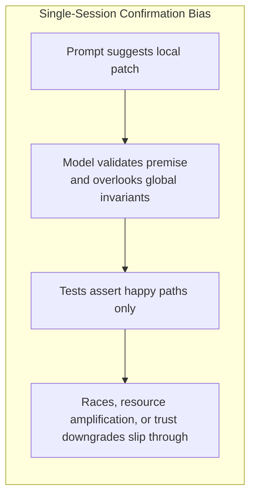

# AI-Assisted Development Guide

> **Scope and References**: The repository entry point for AI coding agents is [`AGENTS.md`](https://github.com/BeingNoAbility/WebRTC-Gateway/blob/main/AGENTS.md). This guide governs risk controls and substantive admission bars for AI-assisted contributions without defining separate engineering rules; all technical baselines live in [Constitution](./CONSTITUTION.md), [Review Guidelines](./REVIEW_GUIDELINES.md), and [Design Boundaries and Trade-offs](./DESIGN_TRADEOFFS.md).

---

## 1. Why Single-Session Generation Is Insufficient

In a system combining P2P transport, cryptography, concurrent state machines, and browser cross-site isolation, a single-session loop ("state idea → generate code → self-approve") carries three recurring failure modes:



1. **Sycophancy and local overfitting**: Within one context window, models tend to defend earlier assumptions even when they weaken resource budgets, lock ordering, or trust isolation.
2. **Shortcut temptations**: Under protocol or browser constraints, models often propose shortcuts that violate core principles:

| Core Principle | Common AI Shortcut Temptation | Required Boundary |
| :--- | :--- | :--- |
| Principle 1: Zero Data Relay & Honest E2E | Relay payloads through signaling, or send password hashes over signaling to save a round-trip. | Signaling only brokers setup; identity verification and visitor auth stay inside end-to-end encrypted transport; symmetric NAT fallback uses self-hosted TURN forwarding ciphertext only. |
| Principle 2: Zero Client | Recommend browser extensions, custom root CAs, or experimental flags to work around engine gaps. | Use standard Web Platform APIs only, with predictable fallbacks across browser engines. |
| Principle 3: Pure Pipe & Application-Agnostic | Bundle business UIs, hardcode app-specific paths/headers, or relax Fail-Closed defaults. | Follow the [Three Core Principles](./CONSTITUTION.md#_1-positioning-and-three-core-principles): solve spec gaps in core or compose downstream via standard HTTP/WS boundaries. |

3. **Scope creep and weak tests**: Mixing unrelated refactors into small fixes, hiding races behind unconstrained `sleep` calls, or duplicating production logic in tests instead of exercising real modules.

---

## 2. Substantive Admission Criteria

This repository **does not enforce rigid ceremony**: documentation edits and small isolated fixes follow standard review plus the local machine gate. However, AI-assisted changes touching core transport, multiplexing, cryptography/auth, signaling/proxy boundaries, concurrency state machines, or browser sandboxing MUST meet three substantive bars:

1. **Independent Adversarial Review**: Review the diff in a fresh context (a separate session, independent reviewer subagent, or distinct model) instructed solely to find counterexamples against [Review Guidelines](./REVIEW_GUIDELINES.md) and [Design Boundaries and Trade-offs](./DESIGN_TRADEOFFS.md) — never rely on the authoring session's self-assessment alone.
2. **Deterministic Negative Verification**: Every confirmed boundary, concurrency, resource, or security risk MUST be covered by an automated negative test driving real production modules (see [Testing Strategy and Checklist](./TESTING_CHECKLIST.md)), demonstrating failure before the fix and consistent passes afterward.
3. **Human Accountability and Machine Gate**: The human contributor MUST understand every line of the diff and own its correctness, security, and maintainability; ensure zero private data or tracked build outputs; and pass [`scripts/gate.sh`](https://github.com/BeingNoAbility/WebRTC-Gateway/blob/main/scripts/gate.sh) (`scripts/gate.sh --full` for core protocol, signaling, or sandbox changes).

---

## 3. Principle-Based Prompt Skeletons

Prompts should reference the repository's single-source-of-truth documents rather than hardcoding version-specific constants:

### Template 1: Implementation

```text
First read AGENTS.md, docs/en/CONSTITUTION.md, docs/en/REVIEW_GUIDELINES.md, docs/en/DESIGN_TRADEOFFS.md, and the relevant specification under docs/en/guide/.

[Goal]
<Describe the problem, desired behavior, and boundaries>

[Constraints]
1. Follow change scope: touch only directly relevant code for routine fixes without unrelated refactoring.
2. Uphold all three core principles and Fail-Closed invariants; never add app-specific hardcoding.
3. For boundary, concurrency, resource, or security logic, add deterministic negative tests against real modules and verify they fail before the fix and pass after.
```

### Template 2: Independent Adversarial Review

```text
You are a distributed-systems and security adversarial reviewer. First read AGENTS.md, docs/en/CONSTITUTION.md, docs/en/REVIEW_GUIDELINES.md, docs/en/DESIGN_TRADEOFFS.md, and the relevant docs/en/guide/ specs.

Do not summarize strengths. Search strictly for counterexamples in the diff below:
1. Does it violate any core principle, Fail-Closed invariant, or permanent non-goal?
2. Are there trust-boundary confusions, cryptographic/canonicalization flaws, asymmetric resource exhaustion (memory/CPU/FD/cardinality), locks across blocking I/O, lifecycle leaks, or synthetic browser-execution bugs?
3. For each valid risk, provide a concrete trigger path and minimal negative test idea.

[Candidate Diff & Context]
<Paste git diff and summary>
```
