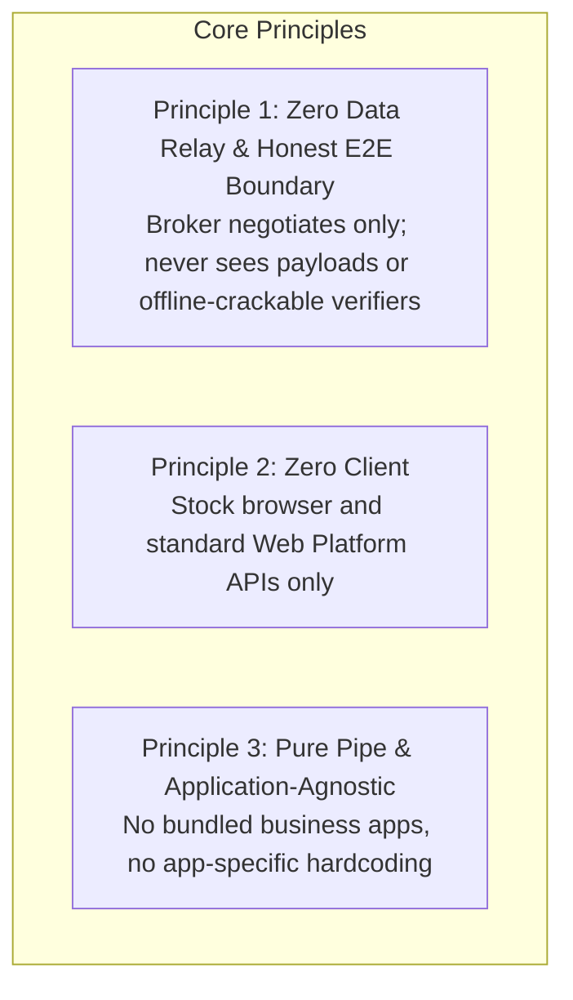

# Project Constitution

> **Document Layering and Precedence**: Constitution (this document — immutable positioning, three core principles, and Fail-Closed security invariants) > [Review Guidelines](./REVIEW_GUIDELINES.md) (first-principles review framework) > [Design Boundaries and Trade-offs](./DESIGN_TRADEOFFS.md) (permanent non-goals, revisitable architectural trade-offs, and canonical failure modes). Current wire parameters, cryptographic primitives, and exact CLI defaults live authoritatively in the guides under `docs/en/guide/`.
>
> Normative terms (MUST / SHOULD / MAY) follow RFC 2119.

---

## 1. Positioning and Three Core Principles

WebRTC Gateway occupies a distinct position among remote-access tools: unlike VPNs (WireGuard / Tailscale), visitors install nothing; unlike centralized tunnels (Cloudflare Tunnel / frp), no public server relays or inspects application traffic; unlike general reverse proxies (Nginx / Caddy), the gateway stays a narrow, transparent P2P transport pipe and composes complex routing, multi-origin aggregation, or response rewriting through standard HTTP/WS boundaries.

Every code change, RFC, or architecture evolution MUST satisfy all three principles below. Any violation results in REJECT (see [Sign-off Matrix](./REVIEW_GUIDELINES.md#_3-sign-off-matrix)).

### Principle 1: Zero Data Relay and Honest E2E Boundary

- **Control-Plane / Data-Plane Separation**: Signaling servers ONLY broker connection setup (exchanging session descriptors and connectivity candidates). They MUST NOT buffer, decode, or relay HTTP or WebSocket application payloads, and the architecture MUST NOT introduce centralized plaintext traffic relays.
- **No Offline-Crackable Verifiers and End-to-End Authentication**: Signaling messages MUST NOT carry offline-crackable password verifiers or data-plane session handles. Endpoint identity verification, active-MITM transport binding, and visitor authentication MUST occur end-to-end inside an encrypted transport channel.
- **Honest Frontend Code-Delivery TCB**: Whatever component serves browser code (portal and sandbox scripts) sits inside the client's frontend Trusted Computing Base (TCB). The project MUST state this boundary honestly rather than claiming illusory trust separation via unverifiable runtime overrides; decoupling frontend delivery from signaling is permissible only via an RFC backed by verifiable integrity and safe origin binding.
- **TURN Exception**: When direct NAT traversal fails, operators MAY deploy a self-hosted TURN server. Because TURN forwards only opaque end-to-end encrypted ciphertext (such as DTLS packets), it complies with this principle.

### Principle 2: Zero Client

- Visitors MUST NOT be required to install native clients, browser extensions, custom root CAs, or experimental browser flags.
- Frontend implementations MUST rely exclusively on standard Web Platform specifications (Service Worker, Fetch, Streams, WebCrypto, WebRTC DataChannel, etc.) rather than non-standard browser behaviors.
- Engine support follows [Browser Compatibility](./guide/browser-compatibility.md); capabilities unavailable on a supported engine SHOULD degrade predictably.

### Principle 3: Pure Pipe and Application-Agnostic

- The gateway provides a transparent P2P transport pipe only. Business features (file managers, terminals, media libraries, user account systems) belong to intranet applications behind the gateway and MUST NOT be bundled into the portal or agent UI. Built-in read-only static serving MAY plug only into the standard HTTP proxy pipeline without dedicated wire opcodes or custom application UIs.
- **No Application-Specific Hardcoding**: When an intranet application fails to work, fixes MUST live at the IETF RFC, W3C specification, or generic transport/proxy abstraction layer — never as branches keyed on app names, proprietary paths, or vendor headers.
- **Three-Step Application Compatibility Triage** (apply in order to every "app X does not work / needs compatibility" issue or PR):
  1. **Standard spec, generic proxy, or browser-sandbox semantic gap** (such as iframe permissions policy, Service Worker / Fetch behavior, or RFC cookie rules) → Fix in core so every application benefits;
  2. **Generic reverse-proxy capability** (such as SNI, subpath confinement, or generic upstream host-header override) → Add a default-off, vendor-neutral flag in core and keep app-specific flag combinations in community-maintained declarative recipes;
  3. **App-specific proprietary quirk** (custom DOM/JS rewrites, private path or body patching, or vendor auth flows) → Reject from core without adding in-process plugins or sandbox JS patch hooks; compose downstream at the standard HTTP/WS boundary using a local reverse proxy (such as Nginx or Caddy) or a standalone adapter sidecar.

---

## 2. Change Scope and Evolution

| Change Type | Requirements |
| :--- | :--- |
| **Routine changes** (bug fixes, security hardening, PATCH / MINOR) | Minimal focused diff by default: touch only code directly tied to the issue without unrelated refactoring; preserve wire and configuration compatibility while upholding Principle 3. |
| **Architectural evolution and major redesigns** (MAJOR) | Breaking changes to protocols, transports, or core architecture MAY proceed when: (1) an RFC in `docs/rfcs/` is approved; (2) the PR declares the major redesign and links the RFC; (3) all affected runtimes, cross-language golden vectors, conformance suites, and bilingual docs migrate together; (4) obsolete dual-track code is cleanly removed. |

---

## 3. Fail-Closed Security Invariants

Any capability that weakens authentication, confidentiality, isolation, or protocol strictness MUST default to off and require an explicit opt-in switch; defaults MUST NOT be relaxed for convenience, and every downgrade switch MUST document its security boundary.

| Security Domain | Non-Negotiable Fail-Closed Invariant | Single Source of Truth for Current Defaults |
| :--- | :--- | :--- |
| **Authentication and Least Admission** | Both agent registration to signaling and visitor access to protected targets require authentication by default; startup MUST fail closed when required secrets are absent unless an open mode is explicitly opted in. Privileged online mutations (such as forced key rotation under shared credentials) default to off unless isolated credentials or explicit operator opt-in apply. | [Security](./guide/security.md), [Configuration](./guide/agent-configuration.md) |
| **Transport Confidentiality and Verification** | Never transmit admission secrets over plaintext non-loopback links by default; upstream HTTPS certificate chains and hostnames are strictly verified by default; local network interface exposure is obfuscated by default where supported (such as mDNS). | [Security](./guide/security.md), [Configuration](./guide/agent-configuration.md) |
| **Browser Isolation and Strict Policy** | Non-loopback deployments require cross-site isolation between the control portal and proxied application sandbox by default; control-plane pages enforce strict CSP (no inline script/style execution, no unauthorized framing, no runtime signaling endpoint overrides) and reject arbitrary cross-origin WebSocket upgrades. | [Security](./guide/security.md), [Deployment](./guide/deployment.md) |
| **Strict Egress and Proxy Confinement** | Each agent confines forwarding strictly to its single explicitly configured target origin (and optional subpath) with zero cross-origin open proxying or unvalidated redirect escapes; forwarded client-IP headers are trusted only from explicitly configured proxies (loopback by default). | [Security](./guide/security.md), [Reverse-Proxy Recipes](./guide/reverse-proxy-recipes.md) |
| **Static Active-Content Sandboxing** | Directly served static files are sandboxed against script execution by default regardless of file extension; dotfiles, traversal paths, and symlinks escaping the configured root are blocked at the OS/path boundary. | [Read-Only Static Adapter](./guide/file-server.md) |
| **Explicit Configuration and Strict Validation** | Implicit auto-loading of configuration files from the current working directory is prohibited; unknown schema fields, malformed security flags, or conflicting options MUST fail closed at startup rather than silently falling back. | [Configuration](./guide/agent-configuration.md) |

Full review criteria corresponding to these invariants live in [Review Guidelines](./REVIEW_GUIDELINES.md#_2-six-first-principles-review-dimensions).
