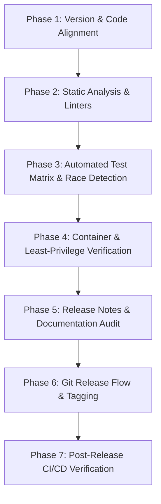

# WebRTC Gateway Official Release Quality Checklist

> **Mission & Scope**:  
> This checklist serves as the **mandatory quality gate** for every release (major milestone, minor enhancement, or patch hotfix) of the WebRTC Gateway project. All procedures must be strictly verified in sequence to guarantee **zero regressions, zero omissions, and zero breaking changes**.

---

## 🗺️ Release Workflow Overview



---

## Phase 1: Version & Code Multi-Point Alignment

- [ ] **1.1 Go Agent Version Variable Update**
  - **Location**: `var Version = "vX.Y.Z"` in `cmd/agent/main.go`
  - **Action**: Align the version string with the target release version.
  - **Verification**: `go run ./cmd/agent -v`
  - **Expected Output**: Must print `WebRTC Gateway Agent vX.Y.Z`.

- [ ] **1.2 Go Signaling Server Version Variable Update**
  - **Location**: `var Version = "vX.Y.Z"` in `cmd/signal/main.go`
  - **Action**: Align the version string with the target release version.
  - **Verification**: `go run ./cmd/signal -v`
  - **Expected Output**: Must print `WebRTC Gateway Signal vX.Y.Z`.

- [ ] **1.3 CLI Usage & Parameter Documentation Audit**
  - **Audit**: If any flags were added, modified, or deprecated:
    - Verify `cmd/agent/main.go` `printAgentUsage` alignment with ENV variables.
    - Verify `cmd/signal/main.go` `printSignalUsage` alignment with ENV variables.
  - **Verification**:
    ```bash
    go run ./cmd/agent -h
    go run ./cmd/signal -h
    ```

- [ ] **1.4 Frontend Asset Versioning & Git Cleanliness Assertion**
  - **Location**: `"version"` field in `web/package.json` and compiled assets in `web/dist/`.
  - **Action**: Align version; if `web/src/` was modified, rebuild and assert clean dist:
    ```bash
    npm --prefix web run build
    git diff --exit-code web/dist
    ```
  - **Criteria**: Output of `git status --porcelain web/dist` must be empty, preventing outdated assets from being embedded into Go binaries.

- [ ] **1.5 Cloudflare Worker Edge Alignment**
  - **Location**: `web/wrangler.toml`, `edge/cloudflare-worker/worker.js`
  - **Audit**: Confirm `main` in `web/wrangler.toml` strictly points to `../edge/cloudflare-worker/worker.js` with zero isolated duplicate scripts in `web/`.

---

## Phase 2: Static Analysis & Code Gates

- [ ] **2.1 Frontend TypeScript Strict Type Checking**
  - **Verification**: `npm --prefix web run typecheck`
  - **Criteria**: `tsc --noEmit` exits with code `0`, **0 errors, 0 warnings**.

- [ ] **2.2 Go Official Static Analysis (vet)**
  - **Verification**: `go vet ./...`
  - **Criteria**: Zero unused variables, lock anomalies, or printf format mismatches.

- [ ] **2.3 Go Code Formatting (gofmt)**
  - **Verification**: `go fmt ./...`
  - **Criteria**: All Go code complies with official formatting standards with zero diff.

- [ ] **2.4 VitePress Documentation Static SSR Pre-flight**
  - **Verification**: `npm --prefix docs run docs:build`
  - **Criteria**: Exits with code `0`, completing static SSR rendering with zero broken links or build errors.

---

## Phase 3: Automated Test Matrix & Race Detection

- [ ] **3.1 Go Comprehensive Automated Test Suite**
  - **Verification**: `go test -v ./...`
  - **Criteria**: All unit and end-to-end tests across `cmd/`, `pkg/`, and `test/` pass (PASS).

- [ ] **3.2 Go Concurrency Data Race Detection**
  - **Verification**: `go test -race ./pkg/... ./cmd/...`
  - **Criteria**: Zero data race warnings (`WARNING: DATA RACE`) under concurrent load.  
  *(Note: Requires CGO; verified in Linux CI if local environment lacks GCC)*.

- [ ] **3.3 Frontend Sandbox Virtualization Test Matrix**
  - **Verification**: `npm --prefix web test`
  - **Criteria**: All 3 test pipelines pass:
    1. Subdomain intelligent routing (`test_subdomain_logic.cjs`);
    2. Node preservation, sandbox virtualization, and SW multi-tab session isolation (`node_id_preservation_test.cjs`);
    3. P2P File Vault download hub and streaming pipeline (`test_vault_download.cjs`).

- [ ] **3.4 Cross-Platform Compilation Smoke Test**
  - **Verification**:
    ```bash
    # Linux / macOS (bash):
    GOOS=linux GOARCH=amd64 go build -o /dev/null ./cmd/agent ./cmd/signal
    GOOS=darwin GOARCH=arm64 go build -o /dev/null ./cmd/agent ./cmd/signal
    GOOS=windows GOARCH=amd64 go build -o /dev/null ./cmd/agent ./cmd/signal
    ```
  - **Criteria**: Clean builds for all 3 targets in seconds with zero compilation errors.

---

## Phase 4: Container & Least-Privilege Pre-flight

- [ ] **4.1 Dockerfile.agent Non-Root User Verification**
  - **Audit**: Non-root user creation (`appuser:appgroup`, UID `10001:10001`); binary permissions `0755`; default `USER 10001:10001`.

- [ ] **4.2 Dockerfile.server Non-Root & Privileged Port (CAP_NET_BIND_SERVICE) Verification**
  - **Audit**: Granted `setcap 'cap_net_bind_service=+ep' /app/server`; default `USER 10001:10001`; healthy probe `HEALTHCHECK CMD /app/server -health || exit 1`.

- [ ] **4.3 Docker Compose Production Alignment**
  - **Audit**: Verify `docker-compose.yml` service configurations, health checks, and `user: "1000:1000"` annotations.

---

## Phase 5: Documentation & Release Notes Audit

- [ ] **5.1 🌟 docs/RELEASE_NOTES.md Single-Version Principle (Strict Red Line)**
  - **Rule**: `docs/RELEASE_NOTES.md` **must only contain release notes for the single latest version being released**. Historical records belong exclusively in `CHANGELOG.md`.

- [ ] **5.2 CHANGELOG.md Historical Archival**
  - **Audit**: Append the new version entry at the top following [Keep a Changelog](https://keepachangelog.com/) standards (`Added`, `Changed`, `Deprecated`, `Removed`, `Fixed`, `Security`).

- [ ] **5.3 Bilingual Documentation Alignment**
  - **Audit**: Update `README.md`, `README_en.md`, `docs/`, and `docs/en/` with current version numbers, CLI usage tables, and Docker deployment tags.

- [ ] **5.4 Configuration Template & Comment Precision**
  - **Audit**: `configs/server.example.yaml` and `configs/agent.example.yaml` default values strictly match Go runtime constants.

- [ ] **5.5 Architecture Review Guidelines & Post-Mortem Audit**
  - **Location**: `docs/REVIEW_GUIDELINES.md` and `docs/en/REVIEW_GUIDELINES.md`
  - **Audit**: Retrospectively verify whether major bugs or architectural features resolved in this iteration were distilled into the Case Studies or enriched the 5 systemic invariants (spec asymmetry, concurrency leaks, backpressure bounds, topology roaming, cross-engine sandbox). Serves as the ultimate retrospective safety net prior to tagging.

---

## Phase 6: Git Workflow & Tag Release

- [ ] **6.1 Branch Hygiene & Clean Working Tree**
  - **Merge**: Merge `dev` into `main`:
    ```bash
    git checkout main
    git merge dev
    ```
  - **Cleanliness Assertion**: `git status --porcelain` must be completely empty.

- [ ] **6.2 Semantic Annotated Tag Creation**
  - **Command**:
    ```bash
    git tag -a vX.Y.Z -m "Release vX.Y.Z: <Version Summary>"
    ```

- [ ] **6.3 Push Branches & Tags to Trigger CI/CD**
  - **Command**:
    ```bash
    git push origin main dev --tags
    ```

- [ ] **6.4 Return to Development Branch**
  - **Command**:
    ```bash
    git checkout dev
    ```

---

## Phase 7: Post-Release CI/CD Verification

- [ ] **7.1 Cross-Platform Compilation Artifacts (`release.yml`)**
  - Confirm GitHub Release contains binaries for 6 OS/arch combinations and `SHA256SUMS.txt`.

- [ ] **7.2 GHCR Multi-Arch Docker Images (`docker.yml`)**
  - Confirm `ghcr.io` updates `:vX.Y.Z` and `:latest` tags for `linux/amd64` and `linux/arm64`.

- [ ] **7.3 Official Documentation Deployment (`deploy-pages.yml`)**
  - Confirm GitHub Pages deployment updates the live site: https://beingnoability.github.io/WebRTC-Gateway/

- [ ] **7.4 Container Sanity Smoke Probe**
  - Test pulling and running container binaries under restricted non-root UID:
    ```bash
    docker run --rm --user 1000:1000 ghcr.io/beingnoability/webrtc-p2p-server:latest -v
    docker run --rm --user 1000:1000 ghcr.io/beingnoability/webrtc-p2p-agent:latest -v
    ```
