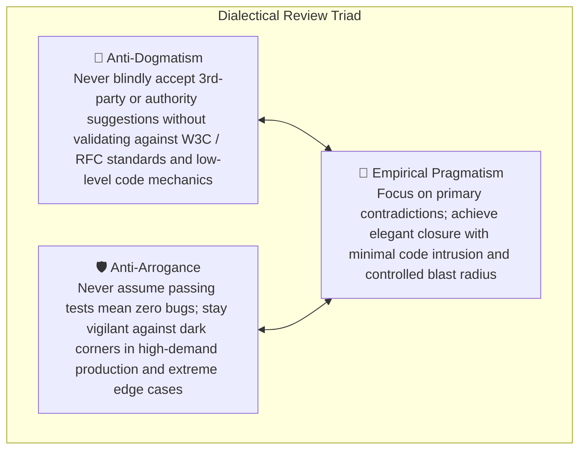
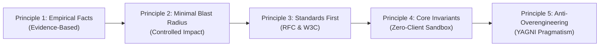
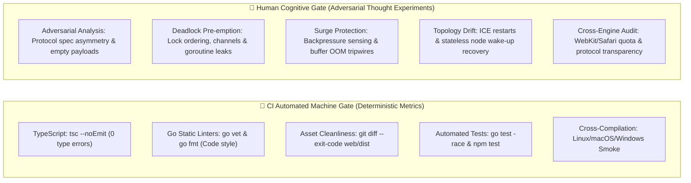
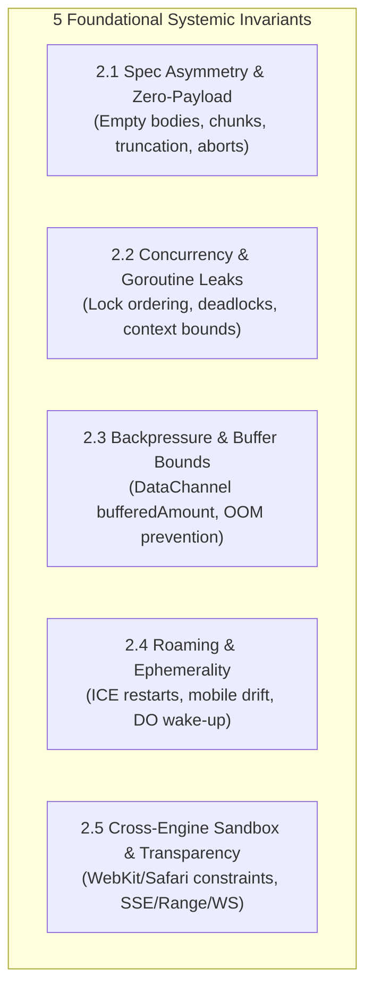
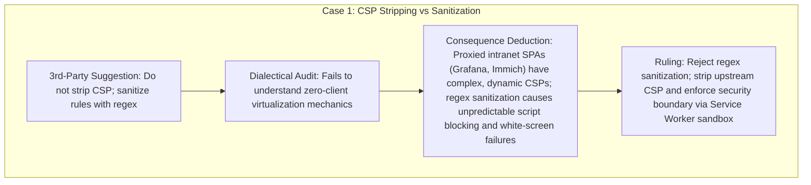

# WebRTC Gateway Dialectical Review Guidelines & Checklist

> **Introduction & Mission Statement**:  
> In complex network traversal, WebRTC protocol stacks, and browser sandbox virtualization engineering, "Review" (Code Review & Architecture Review) is not merely a syntactic quality gate, but **a dialectical philosophy check on technical direction**.  
> This guideline escapes the "Maginot Line Fallacy" of overfitting to past bugs, clearly delineates the boundary between the **"Automated Machine Gate"** and the **"Human Cognitive Review Gate"**, and establishes a dialectical review framework anchored in **systemic invariants, anti-dogmatism, empirical evidence, and blast radius control**.

---

## 1. The Dialectical Mindset

### 1.1 Overcoming Two Cognitive Biases

1. **Blind Compliance & Dogmatism**:
   - *Symptom*: When a third-party auditor or external expert proposes an architectural or security change, adopting it without adversarial deduction, inadvertently breaking production functionality.
   - *Rule*: Every external critique **must undergo first-principles deduction**. Ask: What are the foundational assumptions of this suggestion? Do they hold true within our zero-client browser sandbox and streaming multiplexed data channels?
2. **Defensive Arrogance & Empiricism**:
   - *Symptom*: Rejecting critiques because "all unit tests pass" or "my local page loads fine", dismissing edge-case analysis as nitpicking.
   - *Rule*: Green unit tests only prove **existing assertions hold**; they never prove **undefended boundaries are safe**. Respect real-world production anomalies (extended idle hibernation, empty-body HTTP requests, out-of-order packets, mobile network roaming).

### 1.2 The 5 Golden Principles

| Principle | Core Meaning | Dialectical Execution Directive |
| :--- | :--- | :--- |
| **1. Empirical Facts & Root Cause** | Reject vague assertions; base decisions on code evidence and specifications. | Distinguish architectural design defects, common logic bugs, and edge cases arising from advanced features. |
| **2. Minimal Blast Radius** | If an edge case can be sealed in 5 lines of defensive code, never rewrite 50 lines. | Prioritize localized guards and bypasses; strictly forbid unrelated refactorings inside bug fix patches. |
| **3. Standards First** | In behavioral disputes, align with official protocol specifications. | Treat W3C (Fetch/Streams/Worker) and IETF (RFC 9110 HTTP / RFC 8831 WebRTC) as ultimate arbiters. |
| **4. Core Invariants** | No change shall compromise the architectural foundation. | Uphold three invariants: zero-client/zero-plugin, control/data plane secret decoupling, and browser same-origin sandbox. |
| **5. Anti-Overengineering (YAGNI)** | Be forward-looking, but never prematurely incur complexity. | Resist adding heavy external storage, multi-tenant abstractions, or unneeded protocol rewrites without real volume. |

### 1.3 Division of Labor: Machine CI Gate vs Human Cognitive Gate

> [!IMPORTANT]
> **Boundary Rule**: Tasks that machines can execute deterministically (compilation, linters, formatting, asset diffs, test suites) belong strictly in GitHub Actions CI;  
> **Human cognitive bandwidth must be preserved for adversarial thought experiments and systemic invariant deduction.**

---

## 2. Systemic Invariants Review Checklist

This checklist is applied during **Architecture RFC Reviews** and **Pull Request Code Reviews**:

### Dimension 1: Motivation, Necessity & Blast Radius

- [ ] **1.1 Real Need & Anti-Overengineering (YAGNI Check)**
  - *Core Question*: Does this change address a verified production pain point? Does it introduce multi-tenant or heavy abstractions prematurely?
  - *Dialectical Reflection*: Without modifying core code, can this be achieved via config or upper-layer adaptation? Is the maintenance cost lower than the benefit?
  - *Pass Criteria*: The change must have clear ROI and concrete use cases; eliminate bureaucratic layering.

- [ ] **1.2 Blast Radius & Backward Compatibility**
  - *Core Question*: What upstream and downstream modules will this modify or impact?
  - *Dialectical Reflection*: If an older Agent connects to a newer Signaling Server, or a newer Web Portal connects to an older Agent, does the session survive?
  - *Pass Criteria*: Core protocol revisions must retain compatibility fallbacks; never break heterogeneous version handshakes.

- [ ] **1.3 Deprecation Fail-Fast**
  - *Core Question*: For deprecated flags or behaviors, are ambiguous aliases retained in the name of "backward compatibility"?
  - *Dialectical Reflection*: Does an ambiguous flag (e.g. legacy `-secret`) create a false sense of security for ops teams while leaving the service open?
  - *Pass Criteria*: Deprecated flags must immediately fail-fast at startup with clear remediation instructions.

- [ ] **1.4 Documentation & Configuration Parity Invariant**
  - *Core Question*: If this change introduces or adjusts CLI flags, environment variables, default thresholds, headers, or error codes:
  - *Dialectical Reflection*: Has the code been updated while documentation and example configuration files remain stale, causing operational errors in production?
  - *Pass Criteria*: The PR must synchronously update technical guides (`docs/guide/`), bilingual `README` files, CLI help messages, and template configurations (`configs/*.example.yaml`).

---

### Dimension 2: Five Systemic Deep-Water Invariants

- [ ] **2.1 Specification Asymmetry & Zero-Payload Invariants**
  - *Core Question*: In protocol translations and streaming pipelines, are asymmetric protocol boundaries handled?
    - Empty payloads (`HEAD`, `204 No Content`, `304 Not Modified`, `Content-Length: 0`), stream truncations, early client cancellations.
    - Does an empty stream inadvertently trigger pipelines requiring full headers (e.g. decompression streams, checksum streams) and throw unexpected exceptions?
  - *Standards*: RFC 9110 (HTTP Semantics), W3C Fetch & Streams Specification.

- [ ] **2.2 Concurrency Safety, Lock Hierarchy & Goroutine Leaks**
  - *Core Question*: Does concurrency logic guarantee self-healing under extreme network jitter?
    - **Lock Ordering**: Does the change acquire lock B while holding lock A? Are there cross-package callback deadlocks?
    - **Goroutine Lifetime**: Is every spawned `go func()` governed by `context.Context`, EOF, or explicit channel closures? If a peer silently drops, does the goroutine terminate within bounded time?
    - **Unbuffered Channel Blocking**: Can sending to an unbuffered channel block permanently if the consumer aborts?

- [ ] **2.3 Backpressure Control & Physical Resource Exhaustion**
  - *Core Question*: When producer throughput vastly exceeds consumer throughput, does the system throttle?
    - If an intranet 1Gbps NAS transfers a large file to a 5Mbps mobile visitor: does the gateway monitor WebRTC DataChannel `bufferedAmount` low-water marks and pause socket reads, or accumulate memory until OOM?
    - Do in-memory session, IP, and stream maps have bounded capacities and scheduled Janitor GC loops?

- [ ] **2.4 Network Topology Roaming & Ephemeral State Recovery**
  - *Core Question*: When underlying environments drift or serverless instances wake up:
    - Mobile roaming (4G ↔ Wi-Fi): Does ICE Restart trigger smoothly? Do multiplexed streams survive within the 5-second grace window? Are half-open sockets cleaned up?
    - Serverless/Edge (Cloudflare DO): Does instance wake-up idempotently restore full business context (node secrets, visitor auth flags, IP counts) without bypassing security?

- [ ] **2.5 Cross-Browser Sandbox Discrepancies & Protocol Transparency**
  - *Core Question*: Are virtualization patches universally robust across browser engines, and transparent to real-world applications?
    - **Engine Discrepancies**: Does the logic rely on Chromium behaviors while violating WebKit/Safari Service Worker lifetime or memory quota constraints?
    - **Protocol Transparency**: Does proxying remain 100% transparent for complex apps (HomeAssistant, Jellyfin, Immich) using **SSE (Server-Sent Events)**, **206 Partial Content (video scrubbing)**, and **WebSocket binary frames** without unintended buffering?

---

### Dimension 3: Security Baseline & Sandbox Integrity

- [ ] **3.1 Zero Credential Leakage**
  - *Core Question*: Are secrets strictly segregated across layers?
  - *Pass Criteria*: `SIGNAL_SECRET` must never appear in frontend DOM, URL query parameters, hash fragments, or client logs; control and data plane credentials remain physically isolated.

- [ ] **3.2 Sandbox Isolation & Same-Origin Preservation**
  - *Core Question*: Does proxy virtualization maintain browser same-origin integrity?
  - *Pass Criteria*: Upstream restrictive CSPs are stripped and unified under the Service Worker sandbox boundary; multi-tab sessions are isolated via `resultingClientId` mappings.

- [ ] **3.3 Non-Root & Least-Privilege Execution**
  - *Core Question*: Are containers and daemons restricted to minimal required permissions?
  - *Pass Criteria*: Production Docker images run as non-root (UID 10001), with privileged port binding (:443/:80) granted exclusively via Linux Capabilities (`cap_net_bind_service`).

---

### Dimension 4: Adversarial Falsification & Testing

- [ ] **4.1 Adversarial Falsification Testing**
  - *Core Directive*: PRs must provide negative test cases (e.g. forged cross-node signaling, invalid stream IDs, compressed empty-body HEAD requests, backpressure overflow simulations).
  - *Pass Criteria*: The negative test MUST fail without the patch (RED) and pass with the patch (GREEN).

- [ ] **4.2 Deterministic Test Coverage**
  - *Core Directive*: Unit tests must not contain unconstrained `time.Sleep` calls; synchronization must use channels, wait conditions, or atomic events to guarantee 100% repeatability in CI.

---

## 3. Post-Mortem Case Studies

Historical dialectical review debates documented as concrete engineering case studies:

### Case 1: The CSP Debate — [Full Stripping vs Regex Sanitization]

### Case 2: Streaming Gzip Passthrough — [W3C Synthetic Response & Hardware Decompression]

- **Context**: Enabling Gzip compression across P2P tunnels for static JS/CSS assets.
- **Superficial Approach**: Transparently relaying upstream `Content-Encoding: gzip`.
- **Deep-Water Trap (Spec Asymmetry)**: W3C Fetch specification dictates that browsers **never** automatically decompress synthetic responses generated by Service Workers, causing syntax errors when parsing raw gzip bytes as JavaScript! Furthermore, feeding empty bodies (`HEAD`, 204) into decompression streams throws `TypeError: Compressed input was truncated`.
- **Dialectical Solution**: Agent converts header to internal `x-p2p-content-encoding: gzip`; Service Worker decompresses via browser-native `DecompressionStream('gzip')`, while bypassing `HEAD` and empty responses to maintain 100% spec compliance and 300%+ speedup.

### Case 3: Durable Object Hibernation — [WebSocket Attachments vs External DB]

- **Context**: Migrating Cloudflare Workers to WebSocket Hibernation caused in-memory state loss across idle wake-ups.
- **Dogmatic Approach**: Adding external KV or D1 database calls on every message.
- **Dialectical Audit**: External storage incurs network latency, increased billing, and contradicts lightweight edge signaling.
- **Dialectical Solution**: Leveraged Cloudflare native `ws.serializeAttachment()` to store secrets and auth flags inside WebSocket attachments, lazily rebuilding in-memory maps on wake-up. **0 extra storage cost, 0 external dependencies, < 30 lines of code**.

### Case 4: Ghost Stream Elimination — [Parity Watermarks vs Naive Monotonic Checks]

- **Context**: Client request cancellations left stray frames in the tunnel, spawning zombie streams.
- **Dogmatic Approach**: Discarding all frames with stream ID less than max observed ID.
- **Deep-Water Trap (Concurrency & Asymmetry)**: Clients allocate odd stream IDs (1, 3, 5) while agents allocate even IDs (2, 4, 6). A single global high-water mark terminates legitimate reverse streams and kills full-duplex communication.
- **Dialectical Solution**: Enforce peer ID parity validation (`frame.streamId % 2 === 0` for client) before stream instantiation, safely dropping stray frames without disrupting bidirectional multiplexing.

### Case 5: Pure Byte Stream Injection — [Text Decoding vs Binary Slicing]

- **Context**: Service Worker dynamically injects script tags into HTML responses.
- **Superficial Approach**: Decoding stream chunks with `TextDecoder`, replacing `<head>`, and re-encoding with `TextEncoder`.
- **Deep-Water Trap (Spec Asymmetry)**: Stream chunks split across arbitrary byte boundaries. Multi-byte UTF-8 sequences (e.g. Chinese characters or emojis) split between chunks cause `TextDecoder` to emit replacement characters (`\uFFFD`), permanently corrupting web content.
- **Dialectical Solution**: Scan raw bytes (`Uint8Array`) for ASCII `<head>` signature; slice and splice directly at the byte level, passing subsequent chunks untouched without memory reallocation.

### Case 6: Stream Handshake Demux & Signaling Broadcast Traps — [Wire Invariants vs Deadlocks]

- **Context**: To eliminate proxy handshake overhead, proposals suggested emitting dedicated `TypeWSConnect` frames on the wire and synchronously broadcasting peer online status across waiting clients.
- **Deep-Water Traps (Protocol Invariants & HoL Blocking)**:
  1. In `pkg/mux/mux.go`, `TypeWSConnect` frames are directed into `inboundData`, while proxies wait on `ReadHeaders` (`headersCh`). Changing wire frames induces a 10-second handshake timeout deadlock.
  2. Holding `RLock` during synchronous `client.Send` causes slow or buffer-stalled WebSocket clients to block all subsequent agent registrations on the entire broker.
- **Dialectical Solution**: Retain `TypeHeaders` wire frames; demultiplex headers once inside `agent.go` and pass pre-parsed metadata via `HandleStreamWithMeta`. Snapshot target clients and release `RUnlock()` immediately, broadcasting asynchronously via goroutine with unique `SessionID: client.ID` preserved per client.

### Case 7: Reconnection Generational Guard — [Disparate Maps vs Aggregate Root Generation Model]

- **Context**: Mobile network drift or ICE restarts initiate a 5-second graceful teardown grace period. When clients reconnect rapidly or initiate ICE Restart, a new PeerConnection and Mux are established, but the delayed 5-second timer fires and unconditionally destroys the new connection and evicts the active CookieJar!
- **Deep-Water Trap (State Fragmentation & Teardown Race)**: Disparate global session maps (`activeConns`, `pendingTeardowns`, `activeMuxes`, `clientIPs`) lack unified lifecycle governance, causing asynchronous callbacks and stale timers to race against and evict new connections.
- **Dialectical Solution**: Consolidate session state into an `AgentSession` aggregate root in `pkg/agent/session.go` with a monotonic `Generation` counter. Teardown timers and callbacks strictly bind to `(gen, pc)`. If the current generation has advanced or the PC has been replaced, stale teardown actions are safely ignored; session-scoped `offerMu` serializes offers without head-of-line blocking.

### Case 8: Concurrent Stream Admission Limits — [Load Check vs Atomic CAS Admission & RAII Release]

- **Context**: Bounding maximum concurrent multiplexed streams (`maxConcurrentStreams`, default 512) under high-throughput request bursts.
- **Deep-Water Trap (TOCTOU Race Window)**: Relying on `atomic.LoadInt64(&a.activeStreams) >= limit` permits concurrent goroutines to pass the condition simultaneously, triggering subsequent parallel increments and severely exceeding concurrency limits.
- **Dialectical Solution**: Implement `tryAcquireStream()` with an atomic CAS loop (`atomic.CompareAndSwapInt64`) returning a `sync.Once` RAII release closure, guaranteeing active streams strictly adhere to concurrency limits without race condition leakage.

### Case 9: Orthogonal Channel Separation Against HoL Blocking — [Virtual In-Band Tagging vs Physical Dual DataChannels]

- **Context**: Early gateway implementations ran multiplexing over a single DataChannel (`p2pmux`). When users downloaded multi-gigabyte ISO files or streamed high-bitrate video, payload throughput saturated the underlying SCTP congestion window and socket buffers. Control signaling—such as heartbeat Pings, `TypeHeaders` stream handshakes, or `TypeRstStream` frame cancellations—was queued behind bulk payload chunks, spiking perceived RTT into multiple seconds and triggering false timeout disconnects.
- **Superficial Approach**: Implementing an application-level priority queue scheduler to reorder frames before writing to the DataChannel.
- **Deep-Water Trap (Transport-Layer Physical Blocking)**: Even with application-level priority reordering, the underlying WebRTC DataChannel SCTP protocol stack enforces ordered delivery or shares the congestion window across the single channel. Once bulk data fills the socket's `bufferedAmount`, lower-priority chunks cannot be preempted, making transport-level head-of-line blocking physically inevitable.
- **Dialectical Solution**: Establish two orthogonal physical DataChannels natively in WebRTC: `p2pcontrol` (dedicated to control frames: `TypeHeaders`, `TypePing`, `TypePong`, `TypeRstStream`) and `p2pdata` (dedicated to bulk payloads: `TypeData`, `TypeWSData`). Control frame writes completely bypass data backpressure checks (`writeFrameControl`), providing true physical isolation. This eliminates control-plane starvation under heavy traffic, maintaining single-digit millisecond Ping RTT under extreme loads.

### Case 10: Cross-Channel Race Conditions — [Discarding Unordered Chunks vs Bounded Orphan Frame Pool & Reaper Timeout]

- **Context**: Decoupling traffic into physical dual DataChannels (`p2pcontrol` and `p2pdata`) eliminates HoL blocking, but introduces a distributed concurrency race: while SCTP guarantees strict in-order delivery *within* a single DataChannel, **there is no global total ordering across distinct DataChannels in operating system network stacks and multi-core thread scheduling**. Under network jitter or high concurrency, data chunks may arrive before control frames—i.e. `TypeData` arrives before the `TypeHeaders` defining the stream metadata.
- **Dogmatic Approach**: Immediately discard unknown stream IDs or return an immediate `RST_STREAM` error.
- **Deep-Water Trap (Silent Data Loss vs OOM Memory Exhaustion)**: Discarding early data frames causes silent truncation of initial payloads or large downloads, breaking decompressed assets and integrity checks. Immediately terminating the stream kills legitimate connections. Conversely, buffering unallocated stream data indefinitely allows malicious clients to flood phantom stream IDs and trigger out-of-memory (OOM DoS) crashes.
- **Dialectical Solution**: Design a strictly bounded orphan frame reassembly pool (`pendingOrphans`) inside `P2PMux`:
  1. **Strict Quota Budgets**: Enforce a 64KB per-stream limit (`DefaultMaxOrphanBytesPerStream`) and a 256KB global aggregate ceiling (`DefaultMaxTotalOrphanBytes`), rejecting excess frames;
  2. **Stream State Machine Claiming**: When the delayed `TypeHeaders` arrives to open the stream, it atomically invokes `takeOrphanFrames(streamID)` to inject buffered orphan frames in sequence into the new stream queue;
  3. **Reaper Timeout (500ms TTL)**: If an orphan frame is not claimed by a matching `HEADERS` within **500ms (`DefaultOrphanFrameTTL`)**, a background reaper routine aborts the phantom stream via `TypeRstStream` and reclaims all orphan memory back to the global budget, ensuring zero memory leakage.

### Case 11: Ephemeral Share Link Anti-Replay Defense — [Static Shared Signatures vs DTLS Certificate Fingerprint HMAC Binding]

- **Context**: The gateway provides `-sign-link` to allow administrators to issue time-limited, password-free direct access links (e.g. 1 hour guest access to an internal dashboard).
- **Superficial Approach**: Signing only Node ID and expiration timestamp: `sign = HMAC(Secret, nodeID + exp)`, verified statically at the signaling hub.
- **Deep-Water Trap (Packet Sniffing & Cross-Device Replay Attacks)**: Share links sent via chat apps, email, or unencrypted networks can be intercepted in transit or extracted from server logs. An attacker possessing the URL within its validity window can replay the link from an unauthorized external machine and breach internal services. Furthermore, IP-binding defenses falsely block legitimate mobile users experiencing Wi-Fi/cellular NAT roaming.
- **Dialectical Solution**: Leverage underlying WebRTC cryptographic invariants via **DTLS Certificate Fingerprint Binding**:
  1. The client generates an ephemeral self-signed WebRTC DTLS certificate and derives its SHA-256 certificate fingerprint (`sdpFingerprint`);
  2. During signaling authentication, the client must not only provide the base URL signature, but must compute a combined HMAC using the base signature as the secret key: `expectedBoundShareSign = ComputeHMAC(shareSign, fmt.Sprintf("%s:%d:%s", nodeID, exp, sdpFingerprint))`;
  3. The Agent extracts the peer DTLS certificate fingerprint from the local WebRTC session and enforces verification;
  4. **Adversarial Falsification**: If an attacker intercepts the valid URL and replays it from another machine, their browser's newly generated DTLS certificate fingerprint will physically differ from that of the intended recipient. The computed signature mismatch causes the Agent to **reject the connection 100% of the time**, rendering intercepted URLs useless for replay.

---

## 4. Sign-off Matrix

Reviewers must assign one of three explicit verdicts upon completing a review:

| Verdict | Condition | Action |
| :---: | :--- | :--- |
| 🟢 **ACCEPT** | Complies with the 5 Golden Principles; passes all 5 systemic invariants; accompanied by adversarial tests; zero architectural debt. | Merge directly into `dev`. |
| 🟡 **DEFENSIVE PATCH** | Sound core architecture, but reveals potential edge-case traps (< 30 lines to resolve). | Provide minimal defensive code suggestions; approve upon test pass. |
| 🔴 **REJECT** | Violates core invariants (breaks sandbox, leaks credentials, introduces unwarranted dependencies). | Provide specification-backed architectural deduction; return to RFC phase. |

---

> [!NOTE]
> This review guide is protected by repository rules. Any pull request modifying core protocol layers (`pkg/mux`, `pkg/proxy`, `web/src/protocol`, `web/src/sw`) must address this checklist and include adversarial falsification tests.
