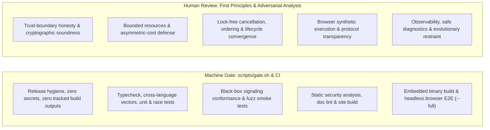

# Review Guidelines

> **Document Layering and Precedence**: [Constitution](./CONSTITUTION.md) > Review Guidelines (this document — first-principles engineering review framework) > [Design Boundaries and Trade-offs](./DESIGN_TRADEOFFS.md). Exact wire constants, budget watermarks, and CLI defaults live authoritatively in [Wire Protocol](./guide/protocol-specification.md), [Security](./guide/security.md), and [Configuration](./guide/agent-configuration.md).
>
> This framework governs both RFC Reviews and PR Reviews. Normative terms (MUST / SHOULD / MAY) follow RFC 2119.

---

## 1. Review Division: Machine Gate vs Human Adversarial Analysis

- **Verify premises before adopting advice**: Never blindly accept external audit findings or AI self-reviews; trace every claim back to W3C / IETF specifications, the threat model, and real code behavior first.
- **Green tests prove known assertions only**: Passing suites cannot catch unmodeled failure classes. Human adversarial review MUST probe idle suspension, empty payloads, partial disconnects, network handoffs, clock skew, and hostile peer inputs.
- **Automate deterministic checks**: Formatting, static analysis, version parity, bilingual doc parity, and known regressions belong in [`scripts/gate.sh`](https://github.com/BeingNoAbility/WebRTC-Gateway/blob/main/scripts/gate.sh) and CI.

---

## 2. Six First-Principles Review Dimensions

### Dimension 1: Scope, Motivation, and Application Neutrality

- [ ] **1.1 Real Need and Complexity Restraint (YAGNI)**: The change solves a genuine engineering problem whose benefit outweighs long-term maintenance and cognitive cost, without speculative abstraction layers.
- [ ] **1.2 Change Scope and Coordinated Migration**: Routine fixes touch only directly related code and stay backward-compatible; major redesigns have an approved RFC and migrate all affected runtimes, golden vectors, conformance suites, and bilingual docs together.
- [ ] **1.3 Application Neutrality and Standard Boundaries**: Zero branches keyed on specific app names, proprietary paths, or vendor headers; compatibility requests follow the [Three-Step Compatibility Triage](./CONSTITUTION.md#principle-3-pure-pipe-and-application-agnostic) and tests use synthetic protocol vectors.
- [ ] **1.4 Supply-Chain and Dependency Restraint**: Prefer standard libraries and native Web Platform APIs; any new runtime dependency MUST justify its attack surface, transitive footprint, maintenance health, and frontend bundle size impact.
- [ ] **1.5 Config, Docs, and Hygiene Parity**: Changes to flags, error semantics, security boundaries, or wire formats update example configs and bilingual guides in the same PR; zero real domains, private IPs, secrets, or build artifacts enter Git.

### Dimension 2: Honest Trust Boundaries and Fail-Closed Security

- [ ] **2.1 Trust-Boundary Honesty**: Never treat JavaScript shims inside an untrusted execution context as a security boundary; isolation MUST be enforced by browser origin/site primitives, OS kernel boundaries, or end-to-end cryptography. State any change to the Trusted Computing Base (TCB) explicitly.
- [ ] **2.2 Cryptographic and Identity Soundness**: Zero offline password oracles or data-plane session handles on signaling; authentication and signing enforce domain separation, downgrade resistance, live transport binding, and constant-time comparisons on secrets; block data-plane traffic prior to completed authentication.
- [ ] **2.3 Single Canonical Interpretation and Input Validation**: Prefer strict minimal schemas over free-text regex parsing to eliminate parser differentials; canonicalize paths, hostnames, and client IPs in a single pass (preventing double-decoding, IP-mapping collapse, open redirects, and cross-root symlink escapes).
- [ ] **2.4 Fail-Closed Baseline**: No change may relax any invariant in [Constitution Section 3](./CONSTITUTION.md#_3-fail-closed-security-invariants); any compatibility or downgrade switch MUST default to off and document its security boundary.
- [ ] **2.5 Least-Privilege Runtime and Leak Response**: Containers and binaries run non-root with minimal write permissions; examples and tests use reserved domains (`example.com`, `*.example`) and documentation IPs (`192.0.2.x`, `198.51.100.x`). If a secret ever enters pushed history, revoke and rotate credentials first, then rewrite affected branch history.

### Dimension 3: Bounded Resources and Asymmetric-Cost Defense

- [ ] **3.1 Multi-Tier Memory Budgets and True-Cost Accounting**: Bound untrusted or slow-peer buffering across stream, session, and global tiers; charge per-item metadata overhead and exact slice capacity (preventing sub-slice heap amplification), and release budgets unconditionally on every close, error, or early-response exit path.
- [ ] **3.2 Streaming and Anti-Amplification Guards**: Stream large HTTP bodies, WebSocket messages, and compressed streams in bounded O(1) memory instead of full-payload buffering; enforce explicit output size, expansion ratio, fragment count, and assembly time limits.
- [ ] **3.3 Beyond Memory (CPU, FDs, and Cardinality)**: Check whether an untrusted peer can cheaply trigger expensive CPU work (KDF, signature checks, regex backtracking, deep parsing), exhaust file descriptors or upstream sockets, or cause unbounded growth in state tables or metric label cardinality.
- [ ] **3.4 Fail-Closed Saturation and Honest Backpressure**: Saturated limiters or state tables MUST fail closed without evicting security-critical entries (such as active lockouts); clamp flow-control credits against verifiable delivery/consumption rather than trusting peer-reported values. Current numeric limits live in [Wire Protocol](./guide/protocol-specification.md).

### Dimension 4: Concurrency Safety, Lock-Free Cancellation, and Lifecycle Convergence

- [ ] **4.1 Lock Hierarchy and No Locks Across Blocking I/O**: Maintain a single global lock order; never hold synchronization locks across blocking network, disk, or channel I/O; cancellation and reset paths MUST unblock waiting I/O without acquiring I/O locks.
- [ ] **4.2 Causal Ordering and Generation Guards**: Rely on transport ordering guarantees or explicit monotonic generation tokens instead of fragile cross-channel orphan queues; guard all async callbacks, timers, and reconnect transitions with session/generation tokens so stale events cannot corrupt new sessions.
- [ ] **4.3 Complete Lifecycle Convergence**: Every goroutine, timer, event listener, and child connection MUST be bound to explicit cancellation or close signals so silent peer disappearance, graceful shutdown, browser tab suspension (`bfcache`), or page unload converges in bounded time.
- [ ] **4.4 Transient Recovery and Idempotency Boundaries**: Reconnection and channel recovery MUST avoid disrupting active application views and MUST NOT blindly retry non-idempotent or body-bearing requests (`POST` / `PUT` / `PATCH` / `DELETE`) when outcome is uncertain; evaluate clock-skew impact on expirations and rate-limit windows.

### Dimension 5: Browser Synthetic Execution and Protocol Transparency

- [ ] **5.1 HTTP / WebSocket Spec Asymmetries**: Handle empty-body requests and responses (`HEAD`, `204`, `205`, `304`, `Content-Length: 0`), early aborts, and premature upstream EOFs (distinguished from client cancellation as `502`); preserve transparency for SSE, `206 Partial Content`, strong `ETag`s, and RFC 6455 close semantics.
- [ ] **5.2 Synthetic Responses and Streaming Content**: Negotiate Service Worker compression/decompression explicitly without corrupting unrelated encodings; enforce Fetch ByteString and RFC 5987 header safety; perform any streaming HTML injection at the byte level while preserving multi-byte encodings, charset prescan windows, and Standards Mode (preventing Quirks Mode).
- [ ] **5.3 Untrusted-Tenant State Isolation and Cross-Engine Support**: Maintain clear CSP separation between interactive proxied apps and untrusted static documents; isolate client-writable state from protected server session state per RFC 6265bis; verify graceful behavior across desktop and mobile browser engines (including WebKit / Safari constraints).

### Dimension 6: Observability, Diagnostics, and Deterministic Negative Verification

- [ ] **6.1 Actionable, Secret-Safe Diagnostics**: Startup rejections, NAT/TURN failures, TLS mismatches, auth blocks, and policy denials SHOULD report clear, actionable failure reasons while never leaking secrets, capability tokens, internal paths, or sensitive intranet metadata into logs, metrics, or visitor-facing errors.
- [ ] **6.2 Mandatory Deterministic Negative Tests**: Changes touching boundaries, concurrency, flow control, or security MUST add automated negative tests with evidence that they fail before the fix and pass afterward.
- [ ] **6.3 Real Modules and Flake-Free Synchronization**: Drive real production modules directly rather than duplicated mock stubs; prohibit unconstrained `sleep` synchronization. See [Testing Strategy and Checklist](./TESTING_CHECKLIST.md).

---

## 3. Sign-off Matrix

| Verdict | Criteria | Next Step |
| :---: | :--- | :--- |
| **ACCEPT** | Satisfies all core principles and Fail-Closed invariants; relevant review dimensions pass with no unresolved risks; `scripts/gate.sh` (plus `--full` for core changes) is green; deterministic negative tests included. | Merge. |
| **DEFENSIVE PATCH** | Sound architectural direction, but missing localized boundary checks, diagnostics, or negative tests that require minimal scoped additions. | Add defenses and negative tests, then merge. |
| **REJECT** | Violates any core principle, relaxes a Fail-Closed invariant, weakens a trust boundary, adds app-specific hardcoding, introduces unbounded resource risk, or makes breaking architectural changes without an approved RFC. | State violated principles and return for redesign; pursue architectural re-evaluation via RFC. |

> [!NOTE]
> To distinguish permanent non-goals from revisitable architectural trade-offs and canonical cross-layer failure patterns, see [Design Boundaries and Trade-offs](./DESIGN_TRADEOFFS.md).
