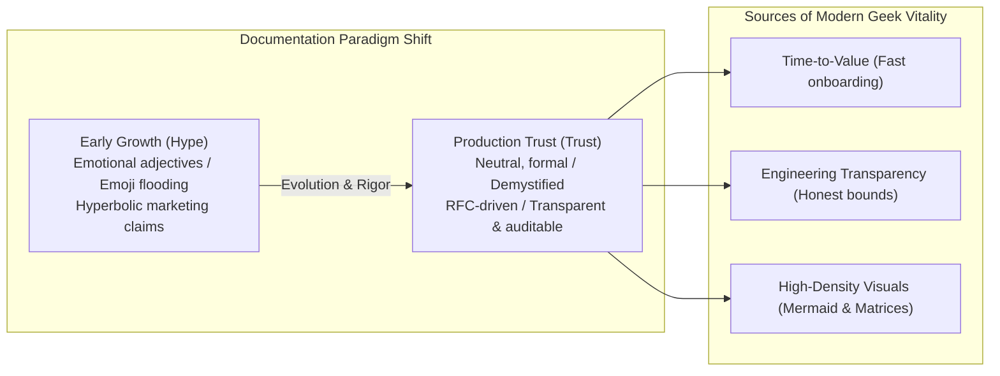
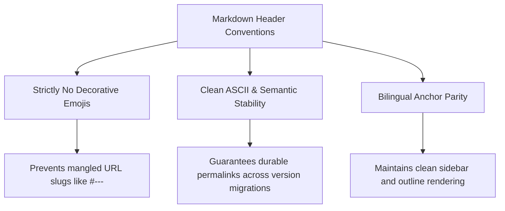
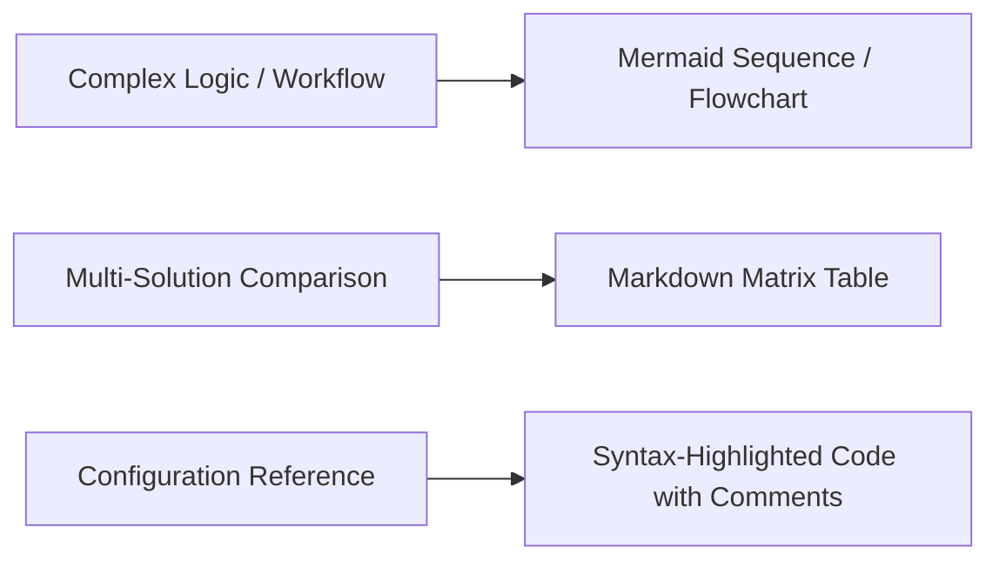
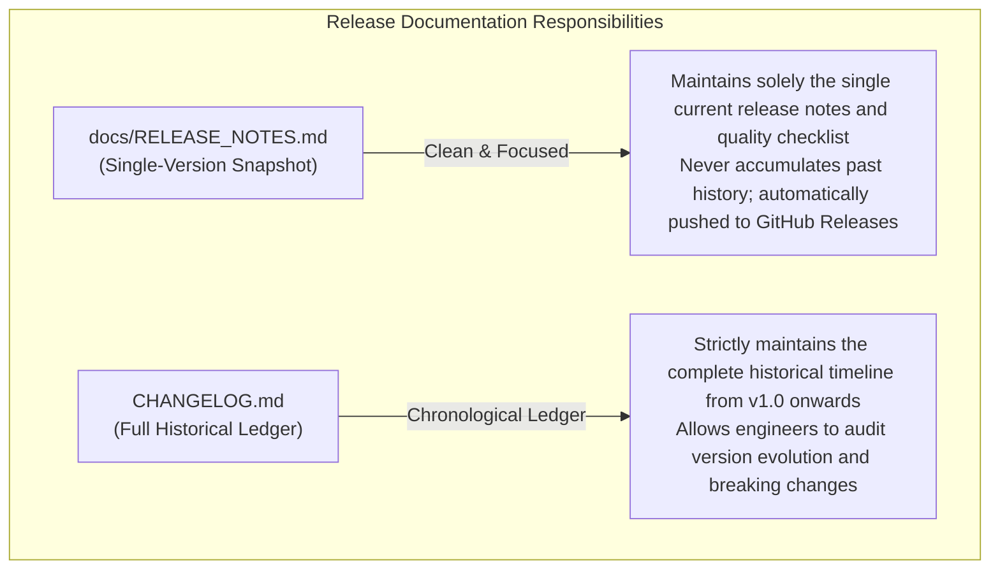

# WebRTC Gateway Documentation & Copywriting Engineering Style Guide

> **Preamble & Mandate**:  
> In high-complexity network traversal, WebRTC protocol stacks, and browser sandbox virtualization, **documentation is not merely an instruction manual—it is the direct mirror of system architecture and engineering rigor**.  
> As WebRTC Gateway advances into `v2.0` and operates in mission-critical environments spanning Synology DSM, private clouds, Tailscale, and enterprise WAF integrations, our audience has evolved from "early adopters" to "discerning infrastructure architects, DevOps engineers, and security auditors."  
> This specification transitions our technical literature and copy **from the "Hype & Hook" early phase to the "Infrastructure & Trust" production phase**, establishing a modern geek engineering benchmark centered on **neutral restraint, technical demystification, clean titles, typographic precision, and peer-to-peer discourse**.

---

## 1. Core Engineering Philosophy: Restraint, Rigor & Geek Spirit

### 1.1 Why We Strictly Enforce De-hyping & Documentation Hygiene

In infrastructure-grade open-source software, sensational rhetoric and ubiquitous emojis accumulate three critical engineering liabilities:

1. **Erosion of Technical Trust**:  
   Experienced engineers naturally distrust terms like "revolutionary," "military-grade," or "eliminating all pain points." When documentation claims "saturates whatever bandwidth your home fiber offers," engineers immediately challenge: "Where is the benchmark data on SCTP congestion control, single-core DTLS crypto overhead, and NAT traversal topology limits?"
2. **Dilution of Information Density**:  
   Superfluous adjectives conceal essential protocol parameters, architectural constraints, physical boundaries, and prerequisites, increasing troubleshooting and code comprehension overhead.
3. **Anchor Pollution & URL Slug Corruption**:  
   Embedding emojis in Markdown headers (`#`, `##`) causes parsers (VitePress, GitHub, GitLab) to generate irregular URL slugs (e.g., `#-key-features`), breaking automated tooling, permalinks, and external references.

### 1.2 Neutrality and Geek Vitality: A Dialectical Unity

"Neutral and formal" does not mean lifeless bureaucratic prose or rigid passive voice. Following modern engineering leaders such as **Vite, Tailscale, Bun, Astro, Stripe Docs, and the Rust Community**, geek vitality is defined by:

- **Time-to-Value**: Skip introductory fluff. Articulate the technical essence in three sentences and help developers execute a working minimal example in minutes.
- **Engineering Transparency**: State strengths clearly, but openly highlight physical limitations and architectural boundaries (e.g., explicit requirements for TURN relay fallback under symmetric NAT). **Honesty regarding constraints is the hallmark of true engineering confidence.**
- **Aesthetic Precision**: Clean code snippets, crisp Mermaid diagrams, and generous typography whitespace that communicate architectural rigor without slogans.

---

## 2. Title & Navigation Hygiene

### 2.1 Strictly No Decorative Emojis in Headers
- **Mandatory Rule**: All Markdown headers (`#`, `##`, `###`, `####`) **must not contain any emojis**.
- **Anti-patterns**:  
  `## 🌟 Key Features`  
  `### 🚀 Production Deployment`  
  `## 🔒 Security & Access Control`
- **Recommended**:  
  `## Key Features`  
  `### Production Deployment`  
  `## Security and Access Control`

### 2.2 Sidebar and Navigation Cleanliness
- Text in VitePress sidebar and navbar items must remain clean and concise.
- Status indicators (e.g., drafts, deprecations) should use text badges (e.g., `[Draft]`, `[Deprecated]`) rather than decorative icons.

---

## 3. Technical Demystification & Terminology

Use concrete proper nouns, RFC citations, quantifiable physical units, and active verbs. Prohibit unmeasurable, extreme adjectives and marketing buzzwords.

### 3.1 Banned vs. Recommended Terminology Matrix

| Banned / Hyperbolic Expression | Recommended Technical / Neutral Phrasing | Rationale |
| :--- | :--- | :--- |
| **Revolutionary / Subversive** penetration architecture | **Zero-client** browser-based WebRTC penetration architecture | Conveys concrete architecture; removes marketing pretense |
| **Military-grade** encryption and negotiation | WebRTC-standard **DTLS 1.2 / SRTP transport encryption** (RFC 8831) | Cites specific cryptographic standards and protocol RFCs |
| **As fast as your fiber can run** | Direct P2P throughput **bounded by physical link bandwidth and SCTP congestion control**, without cloud relay bottlenecks | Respects network physics and transport-layer congestion mechanics |
| **Completely eliminates** 127.0.0.1 visitor IP pain points | **Authoritative client IP propagation (X-Forwarded-For)** for WAF and audit compatibility | Directly states feature, HTTP header fields, and security value |
| **High-tech** diagnostic HUD | **Real-time WebRTC link diagnostic HUD** (RTT, loss rate, candidate pairs, renegotiation) | Precisely defines metrics and capabilities exposed |
| **Instantaneous / Sub-second** connection | Millisecond-level handshake / Client-side instant route switching | Replaces vague "lightning-fast" marketing buzzwords |
| **100% zero-config out of the box** | **Zero-client dependency**, runnable via single CLI command | Clarifies client-less architecture vs. necessary minimal network setup |
| **Flawlessly compatible** with all platforms | Tested across modern browsers, Linux, Docker, and Synology DSM environments | Replaces absolute claims with verified scope |
| **Secure single-file sharing in 1 second** | **Memory-mapped lightweight file delivery** with HMAC-SHA256 time-limited signatures | Accurately describes underlying engineering (mmap/HMAC-SHA256) |

### 3.2 Elimination of Emotional Adjectives
- **Banned Words**: `revolutionary`, `unbeatable`, `flawless`, `magic`, `lightning-fast`, `indestructible`, `ultimate`.
- **Neutral Replacement**: Present empirical benchmark numbers, reproducible test assertions, and protocol specifications.

---

## 4. Voice, Tone & Perspective

### 4.1 Peer-to-Peer Engineering Voice
- **Avoid Promotional Hype**: *"Try this now! This is the most incredible remote access tool you have ever seen!"*
- **Avoid Stiff Bureaucracy**: *"The present software implementation is hereby developed to facilitate operational ingress pursuant to remote connectivity mandates..."*
- **Adopt Respectful Technical Dialogue**: *"We intercept browser-internal HTTP and WebSocket requests via Service Worker, streaming frames over SCTP DataChannels in user space."*

### 4.2 Transparent Boundaries & Constraints
Every feature overview and architecture guide **must explicitly document known limitations and degradation paths**:
- Clearly note: WebRTC P2P direct connectivity depends on NAT topology; symmetric-to-symmetric NAT configurations require a TURN relay server fallback.
- Clearly note: End-to-end encryption and user-space SCTP packetization incur CPU overhead; throughput scales with host compute capacity.
- Clearly note: Mobile Safari may suspend Service Worker execution during low-power mode or background switching.

---

## 5. Typography & Formatting Mechanics

### 5.1 Code Blocks and Configuration Samples
- All fenced code blocks must specify an explicit syntax language (`bash`, `yaml`, `json`, `go`, `ts`).
- Complex configuration fields must feature inline explanatory comments.
- Code samples must represent valid, minimal, reproducible configurations.

### 5.2 Admonitions & Containers (Alerts)
Use standard GitHub Flavored Markdown / VitePress alert syntax. Avoid ad-hoc custom prefixes:

> [!NOTE]
> Relevant context, architectural rationale, or protocol details.

> [!TIP]
> Operational tips, performance tuning, and recommended best practices.

> [!IMPORTANT]
> Critical prerequisites, essential configuration parameters, or key facts.

> [!WARNING]
> Non-destructive but error-prone behaviors, backward compatibility notices, or fallback risks.

> [!CAUTION]
> High-risk operations capable of causing connection drops, data loss, or security exposure.

---

## 6. Information Architecture & Visuals

When an architectural flow or state machine can be represented visually, avoid dense walls of text.

1. **Architecture & Sequence Diagrams**: Use standard Mermaid syntax (`flowchart TD/LR`, `sequenceDiagram`, `stateDiagram-v2`). Wrap node labels containing special characters or parentheses in double quotes (e.g., `node["Node (Info)"]`).
2. **Feature Matrices**: Use Markdown tables comparing candidate solutions against quantifiable axes (e.g., direct connection rate, relay overhead, client dependency, WAF audit readiness).
3. **Configuration Blocks**: Provide concise, production-ready configuration blocks accompanied by parameter tables.

---

## 7. Single-Version Release Notes Invariant

To preserve high signal-to-noise ratio and ensure bulletproof CI/CD release automation, release documentation must adhere strictly to **separation of concerns**:

1. **`docs/RELEASE_NOTES.md`**:  
   - **Core Invariant**: Maintains **only the current, active version** with neutral, rigorous copy.  
   - **Forbidden Action**: Never append or accumulate previous releases into this file.
2. **`CHANGELOG.md`**:  
   - Chronologically records the entire lifecycle history. Prior to each release, prepend the new version entry to the top of `CHANGELOG.md`.

---

## 8. Enforcement & Review Checklist

Use this checklist during PR reviews and release qualification:

### 8.1 Author Checklist
- [ ] No Markdown headers contain emojis.
- [ ] Promotional words ("military-grade," "revolutionary," "sub-second," "flawless") have been replaced with RFC citations or quantitative parameters.
- [ ] Technical boundaries, NAT constraints, and TURN fallback paths are honestly disclosed.
- [ ] Code snippets have explicit language tags and explanatory comments.
- [ ] `docs/RELEASE_NOTES.md` contains only the single current release notes without accumulated past history.

### 8.2 Reviewer Gate
- [ ] Verify VitePress outline and generated URL slugs are clean and free of mangled escape sequences.
- [ ] Confirm technical claims are empirically grounded without overpromising.
- [ ] Ensure `npm --prefix docs run docs:build` completes with 0 errors and 0 warnings.
