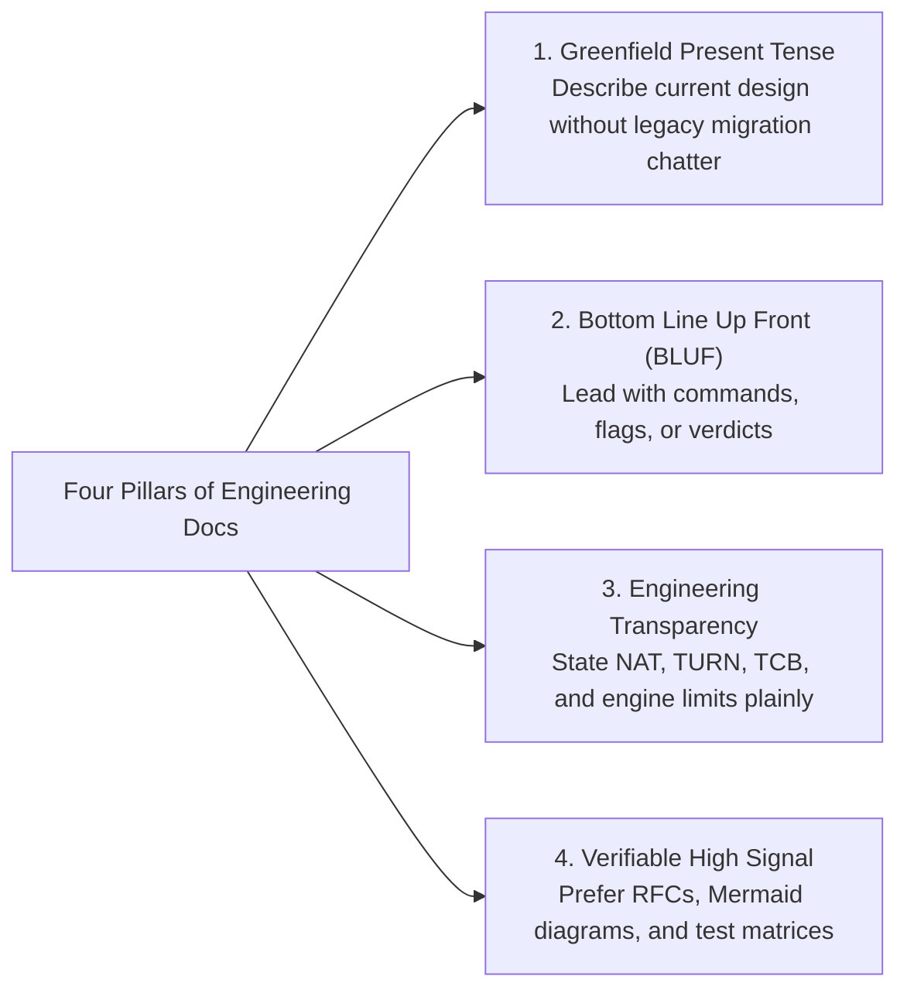

# WebRTC Gateway Documentation Style Guide

> **Scope**: All Markdown documentation (`docs/`, `docs/en/`, `README.md`, `README_en.md`, `CONTRIBUTING.md`, `AGENTS.md`, `CHANGELOG.md`), user-facing text in VitePress config, PR templates, and release notes.
> Target readers are systems architects, DevOps engineers, and security auditors. Documentation SHOULD be **objective, written in greenfield present tense, bottom-line up front, verifiable, and structurally mirrored between Chinese and English**.
> Normative keywords (MUST / SHOULD / MAY) follow RFC 2119.

---

## 1. Core Philosophy: Objective, Clean-Slate, and Verifiable

### 1. Greenfield Present Tense

- User guides, configuration references, protocol specifications, and governance documents SHOULD describe the current system directly in the present tense — what it is, how to run it, and where its boundaries lie — without scattering "removed from old versions" or "migrated from X" narratives across live guides.
- Historical version diffs belong in `CHANGELOG.md`; durable explanations of permanent non-goals, revisitable architectural trade-offs, and canonical cross-layer failure modes live centrally in [Design Boundaries and Trade-offs](./DESIGN_TRADEOFFS.md).

### 2. Concise Without Losing Precision

- **Bottom Line Up Front**: Lead every section and troubleshooting entry with the concrete action, flag, or root cause before explaining background details.
- **Layering and Single Source of Truth**: Governance documents (Constitution, Review Guidelines, Design Boundaries and Trade-offs) state domain invariants, abstract mechanisms, and revisit criteria without duplicating version-specific protocol constants, internal symbol names, CLI flag lists, or test inventories; current implementation details live authoritatively in `docs/en/guide/`. Omit filler transitions ("as we all know", "obviously", "it is worth noting").
- **Tight Paragraphs and Page Cap**: Keep paragraphs to 3–5 lines and individual pages under the soft cap of **500 lines / 40 KB**; cut rhetoric, never RFC numbers, timeouts, status codes, or security limits.

---

## 2. Title and Navigation Hygiene

- **No decorative Emoji in headings or Mermaid labels**: Keep headings plain text for stable URL slugs; denote status using text tags such as `[Draft]`.
- **Anchor stability**: Search the entire repository before renaming existing headings and update every anchor reference. VitePress prefixes numeric English headings (`## 1. ...`) with a leading underscore (`#_1-...`); internal links and anchors are enforced automatically by `docs/scripts/lint-docs.cjs` (`E8`).

---

## 3. Technical De-Hyping and Normative Language

### 1. Objective Terminology Table

| Avoid | Prefer | Reason |
| :--- | :--- | :--- |
| Revolutionary tunneling | Zero-client browser WebRTC P2P gateway | States technical architecture without hype |
| Military-grade encryption | DataChannels encrypted with DTLS 1.2 (SCTP over DTLS, RFC 8261 / RFC 8831), Ed25519 identity verification, and in-DTLS RFC 9383 SPAKE2+ | Cites concrete protocols, RFCs, and primitives |
| 100% pure P2P / zero relay | Signaling never relays payloads; self-hosted TURN (DTLS ciphertext only) is an optional fallback for symmetric NAT | Honest about TURN fallback boundaries |
| Say goodbye to 127.0.0.1 pain | Supports trusted-proxy right-to-left `X-Forwarded-For` peeling and client IP propagation | Names exact header and security rule |
| Instant 1-second file sharing | Go `os.Root` read-only static adapter with revocable Ed25519 capability tokens | Matches real implementation |
| Mathematically guaranteed / physical isolation | Cross-site dual-domain browser origin isolation / kernel `os.Root` confinement | Replaces metaphors with verifiable mechanisms |

### 2. Banned and Cautious Vocabulary

- **Banned words (enforced by `docs/scripts/lint-docs.cjs`)**:
  - Chinese: `颠覆传统`, `军工级`, `金融级`, `秒杀`, `吊打`, `完全无敌`, `绝对安全`, `完美无瑕`, `完美适配`, `彻底告别`, `能跑多快`, `高科技`, `最强`, `无懈可击`, `狂飙`, `首创`, `划时代`, `全息`, `秒级`, `深水区`, `护城河`, `物理级`, `数学上保证`, `世界上最严苛`, `一票否决`, `100% 零配置`.
  - English: `military-grade`, `bulletproof`, `revolutionary`, `pioneered`, `holographic`, `blazing`, `world-class`, `world's most`, `game-changing`, `game changer`, `unbeatable`, `flawless`, `magic` (as marketing hype; technical phrases like `magic bytes` are permitted), `lightning-fast`, `indestructible`, `ultimate`.
- **Cautious words**: Use `100%`, `guaranteed`, or millisecond claims only with reproducible command output or measurements.
- **Rule precedence wording**: Always write **CONSTITUTION > REVIEW_GUIDELINES > DESIGN_TRADEOFFS**.

### 3. Normative Keywords (RFC 2119)

| Chinese | English | Meaning |
| :--- | :--- | :--- |
| 必须 / 不得 | MUST / MUST NOT | Absolute requirement |
| 应当 / 不应当 | SHOULD / SHOULD NOT | Default requirement; justify deviations in PR |
| 可以 | MAY | Optional behavior |

---

## 4. Typography, Code, and Visual Standards

### 1. Formatting and Sanitized Examples

- **Spacing**: In Chinese prose, place one space between CJK characters and Latin letters, digits, or inline code; omit spaces next to CJK punctuation.
- **Inline code and casing**: Wrap commands, paths, CLI flags, env vars, and symbols in backticks (`scripts/gate.sh`, `-sandbox-domain`, `MemoryBudget`); keep product/protocol names (WebRTC, TypeScript, Docker, Service Worker, Nginx) in official casing without backticks.
- **Reserved examples**: Use only RFC 2606 / 6761 domains (`example.com`, `*.example`) and RFC 5737 IPs (`192.0.2.x`, `198.51.100.x`, `203.0.113.x`); `127.0.0.1` is valid for loopback defaults.
- **Avoid brittle counts**: Do not hardcode test counts or dictionary key counts; describe how to run the verifying command instead.
- **Protocol and tags**: Reference the current wire protocol version defined in `protocol-specification.md` (e.g., P2PMux V7); format container tags with a leading `v` (`vX.Y.Z`).

### 2. Code Blocks, Mermaid, and Links

- **Code blocks**: Every fenced block MUST declare a language (`bash`, `yaml`, `json`, `go`, `ts`, `text`); omit `$ ` shell prompts and separate commands from output.
- **Mermaid**: Use supported diagram types (`flowchart`, `sequenceDiagram`, `stateDiagram-v2`), quote labels containing parentheses, and verify with `node docs/scripts/lint-mermaid.mjs`.
- **Alerts**: Use native GFM / VitePress callouts (`[!NOTE]`, `[!TIP]`, `[!IMPORTANT]`, `[!WARNING]`, `[!CAUTION]`).
- **Links**: Use relative or VitePress paths inside `docs/`; link to repository files outside `docs/` via `https://github.com/BeingNoAbility/WebRTC-Gateway/blob/main/<path>`; never commit `file://` paths (enforced by `scripts/verify-release-hygiene.mjs`).

---

## 5. Single-Version Release Notes and Bilingual Parity

### 1. `docs/RELEASE_NOTES.md` vs `CHANGELOG.md`

- **`docs/RELEASE_NOTES.md`**: Single-version snapshot for the upcoming release (used as GitHub Release body by `release.yml`), kept under 35 lines with summary, key changes, and versioned `docker pull` commands (Chinese with link to English `CHANGELOG.md`).
- **`CHANGELOG.md`**: Full chronological history following Keep a Changelog.

### 2. Naming and Bilingual Synchronization

- Use lowercase kebab-case for new guides and technical references (`agent-configuration.md`) without version suffixes (except `docs/rfcs/` and established top-level governance files such as `CONSTITUTION.md`, `REVIEW_GUIDELINES.md`, and `DESIGN_TRADEOFFS.md`); mirror English pages at the identical path under `docs/en/` (`README.md` ↔ `README_en.md`).
- Update both Chinese and English mirrors in the same PR with matching heading, code-block, and Mermaid counts (enforced fatally by `lint-docs.cjs` `E7`).
- Run `npm --prefix docs run docs:lint`, `npm --prefix docs run docs:build`, and `node scripts/verify-release-hygiene.mjs` to confirm 0 errors and 0 warnings.
