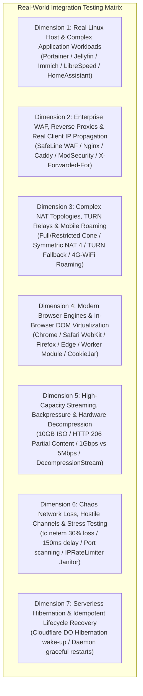
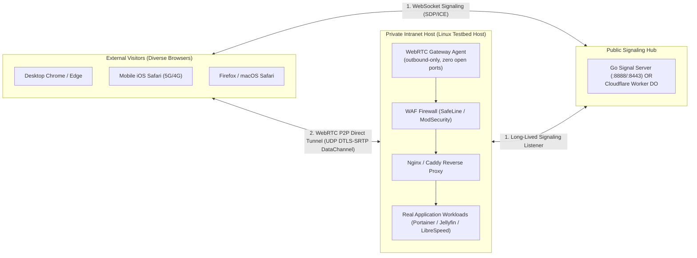
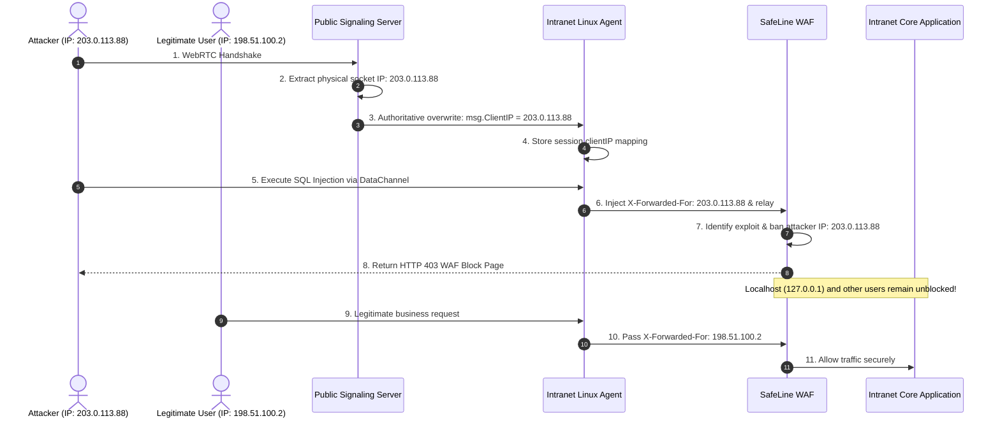

# WebRTC Gateway Real-World & Browser Integration Testing Checklist

> **Mission & Scope**:  
> WebRTC Gateway is a multi-heterogeneous project bridging **low-level concurrent Go systems, WebRTC/SCTP NAT-traversal protocol stacks, and modern browser same-origin sandbox virtualization**. Isolated unit tests only verify localized assertions; they cannot anticipate real-world network fluctuations, mobile WebKit memory constraints, enterprise WAF rule conflicts, or high-throughput backpressure.  
> This checklist serves as the **definitive real-world integration testing manual** for production deployments, major releases, and core protocol refactorings. Testing must be executed against real Linux testbed hosts, real containerized applications, enterprise reverse proxies/WAFs, and diverse desktop/mobile browser engines.

---

## Seven Dimensions of Real-World Integration Testing



---

## Testbed Topology & Anonymization Conventions

Before executing tests, establish a staging environment mirroring production topologies:



> [!NOTE] **Test Environment Anonymization Parameters (Do not commit real production IPs)**:
> - **Private Linux Testbed Host**: `<testbed-host-ip>` (e.g. `192.168.1.x`, accessible via SSH for testing);
> - **Public Signaling Endpoint**: `wss://<signal-domain>/ws` or self-hosted `ws://<signal-ip>:8888/ws`;
> - **Cluster Registration Secret**: `-signal-secret <test-cluster-token>`;
> - **Visitor Access Password**: `-access-secret <test-visitor-pass>`.

---

## Dimension 1: Real Linux Host & Complex Application Workloads

Verifies that heavy, modern web applications reverse-proxied through the gateway maintain 100% native responsiveness:

- [ ] **1.1 Rich Single Page Application (SPA) Administration (Portainer / Grafana)**
  - **Deployment**: Launch Portainer on the Linux testbed: `docker run -d -p 9000:9000 portainer/portainer-ce:latest`.
  - **Start Agent**: `./agent -node-id portainer -target http://127.0.0.1:9000`.
  - **Verification Points**:
    1. **SPA Routing**: Navigate between containers, image lists, and networks; assert smooth HTML5 History API transitions without 404s;
    2. **Real-Time WebSocket Shell**: Open a container `Exec Console (bash/sh)` terminal; execute `top`, `ls -la`, `vim`; verify zero-latency typing, ANSI colors, and window resize adaptability;
    3. **CSP Stripping**: Inspect DevTools (F12); confirm that the gateway stripped upstream restrictive CSPs, preventing script blocking and white-screen crashes.

- [ ] **1.2 Streaming Media & Sub-Second Scrubbing (Jellyfin / Immich)**
  - **Deployment**: Deploy Jellyfin or Immich with 4K high-bitrate media and photo libraries.
  - **Start Agent**: `./agent -node-id media -target http://127.0.0.1:8096`.
  - **Verification Points**:
    1. **High-Concurrency Thumbnail Grid**: Fast-scroll through thousands of photo thumbnails; assert multiplexed streams schedule smoothly without 503 errors;
    2. **HTTP 206 Partial Content Seeking**: Play a 4K video and scrub forward/backward repeatedly;
    3. **Packet Inspection**: Verify request headers carry `Range: bytes=xxx-` and the Agent responds with `206 Partial Content` and accurate `Content-Range`; playback resumes instantaneously without buffer deadlocks;
    4. **Anti-Hotlinking Bypasses**: Verify third-party images render properly without 403 Forbidden.

- [ ] **1.3 Full-Duplex Real-Time Communication (HomeAssistant / Uptime Kuma)**
  - **Deployment**: Deploy HomeAssistant smart home hub.
  - **Start Agent**: `./agent -node-id hass -target http://127.0.0.1:8123`.
  - **Verification Points**:
    1. **SSE / WebSocket Live State Streams**: Toggle light switches; assert UI states sync bidirectionally in milliseconds;
    2. **SCTP Message Defragmentation**: When HomeAssistant pushes large JSON state packages (> 64KB), confirm the frontend circular reassembly buffer reconstructs them without `SyntaxError: Unexpected end of JSON input`;
    3. **Long-Lived Idle Keepalive**: Idle the page for 30 minutes; assert WebSocket ping/pong keepalives maintain the connection without dropping.

- [ ] **1.4 Wire-Speed Throughput & W3C Upload Progress Virtualization (LibreSpeed)**
  - **Deployment**: Deploy `adolfintel/speedtest`.
  - **Start Agent**: `./agent -node-id speedtest -target http://127.0.0.1:80`.
  - **Verification Points**:
    1. **Wire-Speed Downlink**: Run speedtest; downlink should approach physical network capacity (e.g. 900Mbps+ on gigabit LAN);
    2. **Smooth Upload Progress Bar**: Observe the upload phase; assert the progress bar advances smoothly from 0% to 100%, completely avoiding Chromium Bug 1214207 where upload progress freezes at 0%;
    3. **Multi-Threaded Worker Support**: Confirm LibreSpeed Web Worker measurement threads execute correctly across the tunnel.

- [ ] **1.5 Upstream Target HTTPS & Self-Signed Certificate Chain (Proxmox VE / DSM / Self-Signed HTTPS)**
  - **Deployment**: Deploy a private management console on the Linux testbed that enforces HTTPS with self-signed or untrusted certificates (e.g. Proxmox VE console on port 8006, Synology DSM on port 5001, or OpenSSL self-signed Nginx HTTPS reverse proxy).
  - **Start Agent (Strict Security Comparison)**:
    1. **Phase A (Default Strict Verification)**:
       - Run `./agent -node-id pve -target https://127.0.0.1:8006`;
       - Initiate visitor access in browser;
       - **Pass Criteria**: Agent strictly rejects untrusted TLS handshakes with `x509: certificate signed by unknown authority`; zero silent fallback or implicit security downgrades;
    2. **Phase B (Explicit Trust Mode with -insecure)**:
       - Run `./agent -node-id pve -target https://127.0.0.1:8006 -insecure`;
       - **Pass Criteria**:
         - Startup console prints a prominent high-risk security warning: `⚠️ INSECURE: TLS certificate verification is disabled`;
         - Visitor browser loads the Proxmox VE / DSM login console smoothly;
         - Post-login Web terminals (noVNC / xterm.js) and WSS bidirectional sockets connect without issues; TLS SNI and encrypted tunneling operate reliably.

---

## Dimension 2: Enterprise WAF, Reverse Proxies & Real Client IP Propagation

Verifies that authentic visitor client IPs propagate end-to-end through WebRTC DataChannels into intranet backends, enabling security tool synergies:



- [ ] **2.1 Authoritative Client IP Propagation Test**
  - **Deployment**: Launch `traefik/whoami` on the Linux testbed.
  - **Start Agent**: `./agent -node-id whoami -target http://127.0.0.1:80`.
  - **Action**: Access `https://<signal-domain>/#whoami` from an external public network (e.g. cellular 5G hotspot).
  - **Pass Criteria**:
    - Inspect request headers returned by `whoami`;
    - **`X-Forwarded-For`** and **`X-Real-IP`** must **strictly equal the visitor's public physical IP**;
    - Must never display `127.0.0.1`, the signaling server IP, or private subnet CIDRs.

- [ ] **2.2 Anti-Spoofing Request Header Test**
  - **Action**: From the visitor DevTools console, dispatch requests with forged IP headers:
    ```javascript
    fetch('/api/test', {
      headers: { 'X-Forwarded-For': '8.8.8.8', 'X-Real-IP': '1.1.1.1' }
    });
    ```
  - **Pass Criteria**: Backend receives request headers where forged `8.8.8.8` headers are overwritten by the authoritative IP injected by signaling.

- [ ] **2.3 Enterprise WAF (SafeLine / ModSecurity) Targeted IP Ban Test**
  - **Setup**: Deploy SafeLine WAF in front of local applications on the Linux testbed.
  - **Action**:
    1. Visitor injects SQL probe payload into URL: `?id=1' AND 1=1 UNION SELECT null, version()--`;
    2. Confirm browser immediately displays the WAF block screen (HTTP 403);
    3. Check WAF administrative audit log:
       - **Attacker IP** must accurately display the visitor's public IP (not `127.0.0.1`);
    4. **Zero-False-Positive Ban Verification**: Ban the offending visitor IP in WAF;
       - Offending visitor is blocked;
       - **Core Test**: Access from testbed host via `curl http://127.0.0.1:<port>` or from another mobile device; **verify legitimate visitors and localhost services remain completely unaffected with zero false-positive shutdowns**.

- [ ] **2.4 Nginx Per-IP Rate Limiting Test**
  - **Action**: Rapidly fire 30 requests in a loop from a single browser.
  - **Pass Criteria**: Only the bursting IP receives `429 Too Many Requests`; requests from other concurrent devices proceed unthrottled.

- [ ] **2.5 Cross-Domain Reverse Proxy Whitelist (`-allowed-proxy-domains`)**
  - **Config**: `agent -allowed-proxy-domains "*.hdslb.com,*.bilivideo.com"`.
  - **Action**:
    1. Access whitelisted CDN assets: Service Worker proxies through Agent with `x-p2p-allowed-domains` headers;
    2. Access non-whitelisted external links (e.g. `https://github.com`): Service Worker cleanly routes through native visitor network, never triggering 400 Bad Request errors against the intranet gateway.

- [ ] **2.6 SSRF Safe Dialer & DNS Rebinding (TOCTOU) Defense Test**
  - **Mechanism**: Verifies hardware-level physical blocking of unauthorized internal addresses and fraudulent domains via `pkg/proxy/ssrf.go` (`SafeDialContext`).
  - **Verification Points**:
    1. **Cloud Metadata Injection Defense**:
       - Trigger requests towards cloud metadata IPs (e.g. `http://169.254.169.254/latest/meta-data/` or `http://[fd00:ec2::254]/`);
       - **Pass Criteria**: `SafeDialContext` inspects IP before TCP socket creation, immediately blocking with `SSRF protection: access to link-local address is blocked`, preventing credential leakage;
    2. **DNS Rebinding Defense (Time-of-Check to Time-of-Use)**:
       - Use dynamic DNS rebinding test hostnames (e.g. using `rbndr.us` resolving to a public IP on initial check and `127.0.0.1` on subsequent connects);
       - **Pass Criteria**: The dialer re-resolves and enforces strict filtering on every TCP handshake, preventing TOCTOU loopback escape.

---

## Dimension 3: Complex NAT Topologies, TURN Relays & Mobile Roaming

Verifies traversal robustness across strict enterprise firewalls and network transitions:

- [ ] **3.1 Cone NAT Direct Punching (Full / Restricted / Port-Restricted Cone)**
  - **Pass Criteria**: ICE collects host and reflexive (`srflx`) candidates; direct tunnel connects within 1~3 seconds; HUD displays **`⚡ P2P Direct`** with zero relay traffic on the signaling server.

- [ ] **3.2 Dual Symmetric NAT (Symmetric NAT 4) TURN Relay Fallback**
  - **Simulation**: Enforce random port assignment via iptables on the Linux testbed:
    ```bash
    iptables -t nat -A POSTROUTING -o eth0 -j MASQUERADE --random
    ```
  - **Config**: Configure TURN relay: `./agent -turn-url turn:relay.example.com:3478 -turn-user ops -turn-pass Secret123`.
  - **Pass Criteria**: STUN direct punching fails gracefully; gateway state machine falls back to TURN relay within 3 seconds; HUD displays **`🛡️ TURN Relay`**; business traffic continues without interruption.

- [ ] **3.3 Mobile 4G ↔ Wi-Fi Physical Network Roaming & ICE Restart**
  - **Device**: Physical iOS / Android smartphone.
  - **Action**:
    1. Stream a video over Wi-Fi;
    2. During continuous playback, pull down the control center and **abruptly toggle off Wi-Fi**, forcing transition to 5G cellular;
    3. Observe playback and DevTools console.
  - **Pass Criteria**:
    - Socket terminates; browser reconnects to signaling and dispatches Offer with `iceRestart: true`;
    - Agent enforces the 5-second grace window, delaying stream teardown;
    - WebRTC handshake renegotiates over the cellular route; **video continues playback seamlessly with zero page reload required**.

- [ ] **3.4 Manual ICE Restart Diagnostic Probe**
  - **Action**: Click **`🔄 Trigger ICE Restart`** in the HUD diagnostics card during an active session.
  - **Pass Criteria**: Renegotiates in place within 500ms while preserving existing DOM inputs and form states.

- [ ] **3.5 Pure IPv6 Dual-Stack & Mobile Cellular NAT64 Environment**
  - **Scenario**: Mobile cellular 5G networks frequently allocate pure IPv6 addresses; tests gateway adaptability across mixed protocol topologies.
  - **Verification Points**:
    1. **IPv6 STUN Candidate Gathering**: In an IPv6-capable mobile or test environment, inspect the HUD diagnostics card; confirm WebRTC gathers `typ host` and `typ srflx` IPv6 candidates (e.g. `240e:...` / `2408:...`);
    2. **IPv6 P2P Direct Tunneling**: When both peers have IPv6 connectivity, verify WebRTC prioritizes an IPv6 UDP direct tunnel, bypassing IPv4 NAT bottlenecks for lower latency;
    3. **NAT64 / DNS64 Relay Fallback**: In pure IPv6 cellular environments lacking end-to-end IPv6 routes, verify smooth fallback through dual-stack public STUN/TURN relays with zero packet loss or connection blackholes.

---

## Dimension 4: Modern Browser Engines & In-Browser DOM Virtualization

- [ ] **4.1 Modern ES Module Web Worker Adaptation**
  - **Scenario**: Applications using modern bundlers (Vite, VitePress, PDF.js v4) spawning module workers: `new Worker(url, { type: 'module' })`.
  - **Pass Criteria**: Client patch appends `?_p2p_worker=module`; Service Worker dynamically injects `import "/patch.js";`; **zero `TypeError: Module scripts don't support importScripts()` exceptions**.

- [ ] **4.2 W3C Spec Strict 204/304 Null-Body Assertion**
  - **Pass Criteria**: Cached 304 responses and REST 204 No Content return `new Response(null, { status })`; **zero `TypeError: Response with null-body status cannot have body` errors** across SPA navigations.

- [ ] **4.3 Multi-Tab Session CookieJar Physical Isolation**
  - **Action**: Open Tab 1 to Node A (Alice) and Tab 2 to Node B (Bob); log out of Node A.
  - **Pass Criteria**: Node B session remains authenticated with zero cookie crosstalk; non-HttpOnly cookies synchronize to `document.cookie` bidirectionally.

- [ ] **4.4 New Window / Tab Node ID Persistence**
  - **Action**: Click links with `target="_blank"` or trigger `window.open()`.
  - **Pass Criteria**: Service Worker injects `window.__P2P_NODE_ID__`; new window rewrites to `?peer=<nodeId>#<nodeId>`, preserving tunnel context without `Target agent offline` errors.

- [ ] **4.5 Anti-Frame-Busting Virtualization**
  - **Scenario**: Consoles with frame-busting scripts (`if (top !== self) top.location = self.location`).
  - **Pass Criteria**: Application runs seamlessly inside Portal iframes; outer Portal navbar and HUD remain intact.

- [ ] **4.6 Cross-Engine Sandbox Matrix**
  - [ ] **Chromium (Chrome 120+, Edge, Brave)**: 100% green across all pipelines.
  - [ ] **WebKit (macOS Safari 17+, iOS Safari 17+)**: Verify zero silent crashes under WebKit memory quotas; verify Service Worker resumes upon returning from background.
  - [ ] **Gecko (Firefox 125+)**: Verify MessagePort transfer and ReadableStream consumption.

---

## Dimension 5: High-Capacity Streaming, Backpressure & Hardware Decompression

- [ ] **5.1 10GB ISO Download with Zero Memory Buffer Bloat**
  - **Action**: Download a 10GB ISO (`./agent -file /data/ubuntu-24.04.iso`) in Chrome/Safari.
  - **Pass Criteria**:
    - Browser activates File System Access API (`showSaveFilePicker`);
    - Agent memory remains **< 50MB**; browser renderer memory remains **< 100MB**;
    - Zero OOM crashes; computed SHA256 checksum strictly matches the original host file.

- [ ] **5.2 1Gbps Producer vs 5Mbps Consumer Backpressure Throttling**
  - **Scenario**: Linux host on gigabit LAN; visitor throttled via Chrome DevTools to `Regular 3G (1.5Mbps)`.
  - **Pass Criteria**:
    - Agent monitors DataChannel `bufferedAmount`; pauses reads when high-water mark is hit;
    - Agent resident memory remains constant (< 32MB);
    - Clicking **`⏹ Cancel Download`** dispatches RST frames and aborts local file reads immediately with zero ghost streams.

- [ ] **5.3 Gzip Hardware Decompression & HEAD Bypass**
  - **Pass Criteria**:
    - Static JS/CSS assets transmit with `x-p2p-content-encoding: gzip` (60%~80% reduction);
    - Browser stream decompresses via native `DecompressionStream('gzip')` without corruption;
    - `fetch('/bundle.js', { method: 'HEAD' })` cleanly bypasses decompression; **zero `TypeError: Compressed input was truncated` errors**.

- [ ] **5.4 P2P File Vault Concurrent Multi-Download & Mid-Transfer Abort Reclamation**
  - **Start Agent Mode**: `./agent -file-server -file-dir /data/shares`.
  - **Action 1 (Concurrent Multiplexed Downloads)**:
    - In the File Vault UI, simultaneously check and download 3 files (> 2GB each);
    - **Pass Criteria**: 3 logical streams are fairly scheduled across a single DataChannel by the Muxer without starvation or odd/even stream ID collision;
  - **Action 2 (Mid-Transfer Abort / Immediate Tab Close)**:
    - At ~50% progress across all 3 files, click "Cancel All" or force-close the browser tab;
    - **Pass Criteria**:
      1. Browser `AbortController` fires and signals stream termination across the tunnel;
      2. Linux Agent detects disconnection within **< 500ms**, immediately invoking `file.Close()` on open file descriptors;
      3. Verify with `lsof -p $(pidof agent) | grep /data/shares`; **file descriptor count drops to zero immediately with zero orphan descriptor leaks**;
      4. Host RSS memory returns smoothly to baseline without buffer retention leaks.

---

## Dimension 6: Chaos Network Loss, Hostile Channels & Stress Testing

```bash
# Chaos testing commands on Linux Testbed Host (Run as root)
# 1. Simulate 30% packet loss and 150ms cross-continent latency:
tc qdisc add dev eth0 root netem loss 30% delay 150ms 20ms

# 2. Simulate 25% packet reordering:
tc qdisc add dev eth0 root netem delay 50ms reorder 25% 50%

# 3. Clean up chaos rules:
tc qdisc del dev eth0 root
```

- [ ] **6.1 30% Loss + 150ms Latency Channel Integrity**
  - **Pass Criteria**: Under 30% loss, SCTP retransmissions maintain byte-perfect data delivery with zero CRC corruptions.

- [ ] **6.2 25% Packet Reordering Stream Integrity**
  - **Pass Criteria**: P2PMux binary framing reassembles chunks by sequence without framing errors.

- [ ] **6.3 Port Scanning & IPRateLimiter Memory Leak Stress**
  - **Action**: Simulate 5,000 distinct source IPs flooding the signaling server.
  - **Pass Criteria**: Connection quotas (`-max-ip-conns 64`) reject floods; after test completion, `janitorLoop` prunes orphan IP keys; **resident memory returns to baseline with zero chronic leaks**.

---

## Dimension 7: Serverless Hibernation & Idempotent Lifecycle Recovery

- [ ] **7.1 Cloudflare Worker WebSocket Hibernation Wake-up Test**
  - **Action**: Idle connected agent for 30+ minutes until the Durable Object hibernates; send visitor request to wake it up.
  - **Pass Criteria**: DO `ensureState()` restores `nodeSecrets`, `nodeVisitorAuth`, and `ipConns` from session attachments; visitor authentication and anti-hijacking defenses enforce strictly with zero auth bypass.

- [ ] **7.2 Daemon Graceful Shutdown & Auto-Reconnection**
  - **Action**: Dispatch `kill -SIGTERM` to the Signal process during active transfers; restart Signal.
  - **Pass Criteria**: Signal executes 5-second graceful shutdown; Agent recovers via exponential backoff (2s, 4s, 8s...) and reconnects automatically without becoming a zombie process.

---

## Sign-off Protocol for Major Releases

| Dimension | Focus Area | Mandatory Requirement | Signee | Status |
| :---: | :--- | :--- | :---: | :---: |
| **Dimension 1** | Real Linux Heavy Web Apps | Portainer, Jellyfin, LibreSpeed 100% functional | | ⬜ PENDING |
| **Dimension 2** | Enterprise WAF & Real Client IP | Accurate X-Forwarded-For, WAF IP ban without localhost false positives | | ⬜ PENDING |
| **Dimension 3** | Complex NAT & Roaming Recovery | Symmetric NAT TURN fallback, 4G/Wi-Fi switch ICE Restart | | ⬜ PENDING |
| **Dimension 4** | Cross-Browser Engines & DOM Sandboxing | Zero errors across Chrome, Safari, Firefox; module workers pass | | ⬜ PENDING |
| **Dimension 5** | 10GB Streaming & Backpressure | Stream to disk, weak network memory < 50MB, HEAD gzip bypass | | ⬜ PENDING |
| **Dimension 6** | Chaos Network Loss & Stress | 30% packet loss data intact, Janitor sweeps orphan IP keys | | ⬜ PENDING |
| **Dimension 7** | Serverless Hibernation & Lifecycles | CF DO hibernation state restore, daemon restart auto-reconnect | | ⬜ PENDING |
