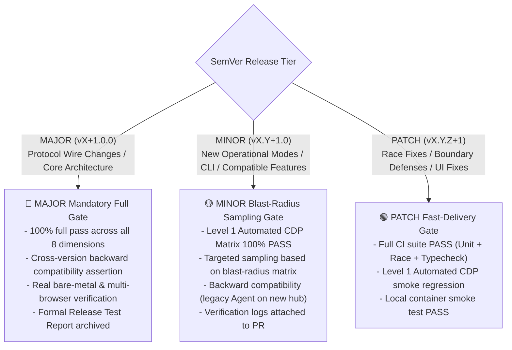
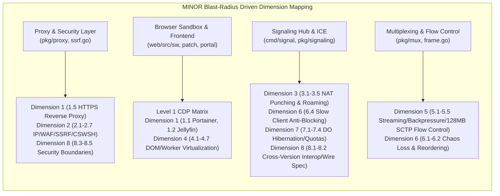
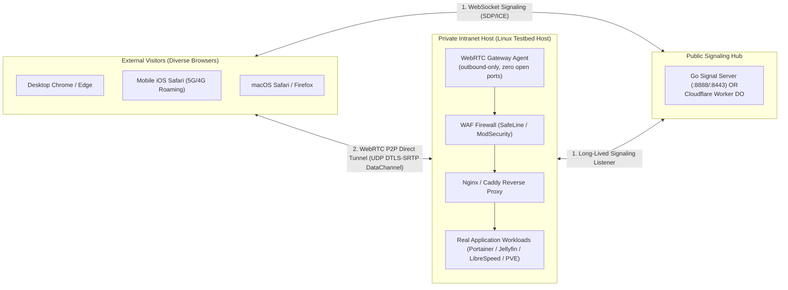

# WebRTC Gateway Real-World Release Testing Checklist (Checklist 2.0)

> **Mission & Scope**:  
> WebRTC Gateway is a multi-heterogeneous project bridging **low-level concurrent Go systems, WebRTC/SCTP NAT-traversal protocol stacks, and modern browser same-origin sandbox virtualization**.  
> Isolated unit tests only verify localized assertions; they cannot anticipate real-world network fluctuations, mobile WebKit memory constraints, enterprise WAF rule conflicts, or high-throughput backpressure.  
> **The QA team maintains absolute gatekeeper authority over releases**. Before every **MINOR (vX.Y+1.0)** and **MAJOR (vX+1.0.0)** release, the test lead must execute real-world holographic verification following this checklist to uphold core invariants and ensure 100% stable production delivery.

---

## 1. Release-Tiered Gate Protocol

In accordance with [docs/en/REVIEW_GUIDELINES.md](file:///docs/en/REVIEW_GUIDELINES.md) and [docs/en/RELEASE_CHECKLIST.md](file:///docs/en/RELEASE_CHECKLIST.md), the project rejects mechanical over-testing for trivial patches as well as premature sign-offs for architectural refactorings. A three-tiered release gate protocol is enforced:



### 1. Release Gate Criteria

| Release Tier | Versioning Format | Core Verification Focus | Mandatory Passing Criteria | Sign-off & Archiving Requirement |
| :--- | :---: | :--- | :--- | :--- |
| **Major** | `vX+1.0.0` | Wire protocol evolution, security auth model, extreme backpressure, chaos network resilience. | **Mandatory 100% pass across all 8 dimensions**; zero skips or compromises. | Formal Release Test Report signed off by QA Lead, archived under `docs/RELEASE_REPORTS/`. |
| **Minor** | `vX.Y+1.0` | New functional modes, CLI flag/env additions, backward-compatible protocol features. | **Level 1 CDP matrix 100% PASS**; targeted verification based on **blast-radius matrix**; legacy Agent interop passed. | Detailed test logs, screenshots, and packet captures attached to PR description. |
| **Patch** | `vX.Y.Z+1` | Concurrency deadlocks, null-body boundaries, memory leak detox, UI interaction fixes. | Full automated CI pipeline (`tsc`, `go vet`, `go test -race`, `npm test`) and local Level 1 CDP smoke passed. | Negative proof test execution attached to PR. |

### 2. MINOR Releases: Blast-Radius Driven Sampling Matrix

For MINOR releases, the QA Lead activates targeted real-world dimensions based on modified packages:



---

## 2. Dual-Layer Testing Architecture

The verification pipeline is divided into two interdependent tiers:

```mermaid
flowchart TD
    subgraph Test_Layers["Holographic Dual-Layer Testing Architecture"]
        subgraph Layer1["Level 1: Automated Real-Browser CDP Matrix"]
            L1_1["Launch mock_service full-stack stub (13 complex scenarios)"]
            L1_2["Automate headless Chromium / Edge rendering engine (CDP :9222)"]
            L1_3["Drive DataChannel executing Fetch, XHR, CookieJar, WebSocket, Worker, F5 refresh"]
            L1_4["Command: npm --prefix web run test:browser"]
        end

        subgraph Layer2["Level 2: Real-World Testbed & Hardware Matrix"]
            L2_1["Real Linux bare-metal (Docker / Portainer / Jellyfin / HomeAssistant / LibreSpeed)"]
            L2_2["Real enterprise protection (SafeLine WAF / Nginx rate limits / Cloud metadata blocks)"]
            L2_3["Mobile hardware network drift (iPhone / Android 4G ↔ Wi-Fi sudden handover)"]
            L2_4["Linux kernel network chaos injection (tc netem 30% loss / 150ms delay / 25% reorder)"]
        end

        Layer1 -->|"CDP matrix passes -> Proceed to bare-metal testbed"| Layer2
    end
```



---

## 3. Testbed Topology & Anonymization Conventions



> [!IMPORTANT] **Testbed Anonymization Parameters**:
> - **Private Linux Testbed Host**: `<testbed-host-ip>` (accessible via SSH for chaos injection);
> - **Public Signaling Endpoint**: `wss://<signal-domain>/ws` or self-hosted `ws://<signal-ip>:8888/ws`;
> - **Cluster Registration Secret**: `-signal-secret <test-cluster-token>`;
> - **Visitor Access Password**: `-access-secret <test-visitor-pass>`.

---

## 4. Eight Dimensions of Real-World Testing

### Dimension 1: Real Linux Host & Complex Application Workloads

Verifies that heavy, modern web applications reverse-proxied through the gateway maintain 100% native responsiveness:

- [ ] **1.1 Rich Single Page Application (SPA) Administration (Portainer / Grafana)**
  - **Deployment**: `docker run -d -p 9000:9000 portainer/portainer-ce:latest`.
  - **Start Agent**: `./agent -node-id portainer -target http://127.0.0.1:9000`.
  - 🟢 **Positive Verification**: Navigate containers and images smoothly via HTML5 History API; open interactive terminal (`Exec Console`), test `top`, `ls -la`, `vim`, verifying zero-latency typing and ANSI color handling.
  - 🔴 **Negative Proof**: Inspect DevTools (F12) to verify restrictive CSPs were stripped cleanly, preventing script blocking or white-screen crashes.
  - 📊 **Criteria**: Terminal runs smoothly; 0 CSP blocking errors in console.

- [ ] **1.2 Streaming Media & Sub-Second Scrubbing (Jellyfin / Immich)**
  - **Deployment**: Deploy Jellyfin or Immich with 4K high-bitrate media and photo libraries.
  - **Start Agent**: `./agent -node-id media -target http://127.0.0.1:8096`.
  - 🟢 **Positive Verification**: Fast-scroll through thousands of photo thumbnails; stream 4K video with rapid scrubbing; verify external image CDNs render without 403 Forbidden.
  - 🔴 **Negative Proof**: Assert request headers carry `Range: bytes=xxx-` and the Agent responds with `206 Partial Content` and accurate `Content-Range`; scrubbing instantly cancels previous streams without buffer deadlocks.
  - 📊 **Criteria**: Video scrubbing resumes in < 1 second; zero `Range Not Satisfiable` errors.

- [ ] **1.3 Full-Duplex Real-Time Communication (HomeAssistant / Uptime Kuma)**
  - **Deployment**: Deploy HomeAssistant.
  - **Start Agent**: `./agent -node-id hass -target http://127.0.0.1:8123`.
  - 🟢 **Positive Verification**: Toggle light switches; UI states update bidirectionally in milliseconds; large JSON state payloads (> 64KB) reassemble cleanly in the frontend circular buffer without parse errors.
  - 🔴 **Negative Proof**: Idle page for 30 minutes; assert WebSocket ping/pong keepalives maintain the connection without dropping.
  - 📊 **Criteria**: Zero disconnection errors during idle periods; zero JSON syntax errors.

- [ ] **1.4 Wire-Speed Throughput & W3C Upload Progress Virtualization (LibreSpeed)**
  - **Deployment**: `docker run -d -p 8080:80 adolfintel/speedtest`.
  - **Start Agent**: `./agent -node-id speedtest -target http://127.0.0.1:8080`.
  - 🟢 **Positive Verification**: Downlink approaches physical network capacity (e.g. 900Mbps+ on gigabit LAN); upload progress bar advances smoothly from 0% to 100%, bypassing Chromium Bug 1214207.
  - 🔴 **Negative Proof**: Verify multi-threaded measurement Workers route properly through the tunnel.
  - 📊 **Criteria**: Upload progress increments smoothly; zero worker execution errors.

- [ ] **1.5 Upstream HTTPS & Self-Signed Certificate Traversal (Proxmox VE / DSM)**
  - **Deployment**: Upstream target uses self-signed HTTPS (`https://127.0.0.1:8006`).
  - 🟢 **Positive Verification**: With `-insecure`, Agent successfully connects to self-signed upstream and serves the admin console.
  - 🔴 **Negative Proof**: Without `-insecure`, Agent rejects untrusted certificates, protecting against upstream MITM.
  - 📊 **Criteria**: Strict certificate validation enforced by default; controlled bypass with flag.

---

### Dimension 2: Enterprise WAF, Reverse Proxies & Real Client IP Propagation

- [ ] **2.1 Authoritative Client Real IP Propagation**
  - **Deployment**: Reverse proxy `whoami` via Agent.
  - 🟢 **Positive Verification**: Response body shows `X-Forwarded-For` and `X-Real-IP` matching visitor's authentic public IP.
  - 📊 **Criteria**: Target backend logs visitor IP accurately.

- [ ] **2.2 Malicious Client IP Forgery Resistance (Anti-Spoofing)**
  - 🔴 **Negative Proof**: Inject forged `X-Forwarded-For: 8.8.8.8` from browser DataChannel; assert Agent forcefully overwrites header with authentic remote socket IP.
  - 📊 **Criteria**: Forged IP headers are completely overwritten.

- [ ] **2.3 Enterprise WAF (SafeLine / ModSecurity) Per-IP Blocking**
  - **Scenario**: Deploy SafeLine WAF upstream; simulate SQL injection attacks from a test visitor.
  - 🟢 **Positive Verification**: Attacker IP is blocked by WAF; other visitors and localhost continue operating normally without false-positive bans on `127.0.0.1`.
  - 📊 **Criteria**: Offending IP banned; normal traffic completely unaffected.

- [ ] **2.4 Nginx Per-IP Rate Limiting**
  - **Scenario**: Nginx configured with `limit_req_zone $binary_remote_addr zone=api:10m rate=5r/s;`.
  - 🔴 **Negative Proof**: High-frequency requests trigger `429 Too Many Requests` exclusively for the test visitor.
  - 📊 **Criteria**: Only abusive visitor receives 429; concurrent visitors receive 200.

- [ ] **2.5 Outbound Proxy Domain Whitelisting (`-allowed-proxy-domains`)**
  - 🟢 **Positive Verification**: Requests to whitelisted domains are proxied via Agent; requests to non-whitelisted domains bypass Agent and use local visitor network.
  - 📊 **Criteria**: Whitelisted resources proxy through tunnel; non-whitelisted route locally.

- [ ] **2.6 SSRF Protection & DNS Rebinding (TOCTOU) Defenses**
  - 🔴 **Negative Proof**: Request cloud metadata `http://169.254.169.254/latest/meta-data/`; assert `SafeDialContext` blocks request before TCP handshake; test DNS rebinding domain and assert re-resolution blocks loopback addresses.
  - 📊 **Criteria**: Metadata and loopback rebinding attempts blocked before TCP connection.

- [ ] **2.7 Cross-Site WebSocket Hijacking (CSWSH) & Origin Whitelist Defense**
  - **Config**: `signal -allowed-origins "https://*.pages.dev,http://localhost:*"` (or `SIGNAL_ALLOWED_ORIGINS`).
  - 🟢 **Positive Verification**:
    1. Same-origin requests (Origin host == request Host) trusted by default;
    2. Whitelisted Cloudflare Pages wildcard domains and local ports pass WebSocket handshake;
    3. Native Go CLI Agent or curl without Origin headers pass through cleanly to cluster authentication.
  - 🔴 **Negative Proof**: Unauthorized Origin (`https://evil.attacker.com`) attempting WebSocket handshake is rejected immediately with HTTP 403; unconfigured mode emits yellow security warning.
  - 📊 **Criteria**: Unauthorized cross-origin signaling handshakes 100% blocked with `Blocked unauthorized Origin` logged.

---

### Dimension 3: Complex NAT Topologies, TURN Relays & Mobile Roaming

- [ ] **3.1 Cone NAT Direct Punching (Full / Restricted Cone)**
  - 🟢 **Positive Verification**: WebRTC gathers `srflx` candidates; direct P2P connection establishes within 1-3s; HUD displays **`⚡ P2P Direct`**; signaling bandwidth drops to zero.
  - 📊 **Criteria**: WireShark confirms direct UDP transmission between peers.

- [ ] **3.2 Dual Symmetric NAT (Symmetric NAT 4) TURN Relay Fallback**
  - **Scenario**: Configure symmetric NAT on Linux host; configure `-turn-url`.
  - 🟢 **Positive Verification**: ICE fallback automatically routes over TURN; HUD displays **`🛡️ TURN Relay`**; full duplex communication functions normally.
  - 📊 **Criteria**: Smooth fallback to TURN relay; zero connection drops.

- [ ] **3.3 Mobile 4G ↔ Wi-Fi Network Drift & ICE Restart Recovery**
  - **Scenario**: Mobile browser streaming video; switch Wi-Fi off to transition to 4G cellular.
  - 🟢 **Positive Verification**: Socket disconnection triggers ICE Restart with `iceRestart: true`; Agent maintains session over 5-second grace period; video resumes without page reload.
  - 📊 **Criteria**: Seamless stream recovery; console logs `ICE Restart completed`.

- [ ] **3.4 Manual ICE Restart Diagnostics**
  - 🟢 **Positive Verification**: Click **`🔄 Trigger ICE Restart`** in HUD; renegotiates connection in < 500ms; form inputs and DOM state preserved.
  - 📊 **Criteria**: HUD updates status; DOM state remains intact.

- [ ] **3.5 IPv6 Dual-Stack & Cellular NAT64 Environment**
  - 🟢 **Positive Verification**: Gathers `240e:...` IPv6 candidates; establishes direct IPv6 peer connection bypassing IPv4 NAT.
  - 📊 **Criteria**: IPv6 candidates prioritized; zero IPv6 routing deadlocks.

---

### Dimension 4: Modern Browser Engines & In-Browser DOM Virtualization

- [ ] **4.1 Modern ES Module Web Worker Adaptation**
  - 🟢 **Positive Verification**: Trigger `new Worker(url, { type: 'module' })`; patch layer appends `?_p2p_worker=module`; Service Worker injects `import "/patch.js";`; worker executes smoothly.
  - 🔴 **Negative Proof**: Assert zero `TypeError: Module scripts don't support importScripts()`.
  - 📊 **Criteria**: Module worker computations and network requests succeed.

- [ ] **4.2 W3C 204/304 Null-Body Strict Assertion**
  - 🟢 **Positive Verification**: Requests returning 304 Not Modified or 204 No Content handle cache properly.
  - 🔴 **Negative Proof**: Service Worker enforces `new Response(null, { status })`; zero `TypeError: Response with null-body status cannot have body`.
  - 📊 **Criteria**: Zero console TypeErrors on null-body responses.

- [ ] **4.3 Session CookieJar Isolation & Multi-Tab Protection**
  - 🟢 **Positive Verification**: Open Tab 1 (Node A, User Alice) and Tab 2 (Node B, User Bob) in same browser; logging out in Tab 1 leaves Tab 2 session completely unaffected.
  - 📊 **Criteria**: CookieJars strictly isolated per remote session.

- [ ] **4.4 New Tab & Window Node ID Deep Persistence**
  - 🟢 **Positive Verification**: Clicking `<a target="_blank">` or calling `window.open()` injects `window.__P2P_NODE_ID__`; `patch.js` rewrites dynamic links to `?peer=<nodeId>#<nodeId>`.
  - 🔴 **Negative Proof**: Subdomain navigation never drops node context or falsely reports `Target agent offline`.
  - 📊 **Criteria**: New tabs preserve session node context reliably.

- [ ] **4.5 Anti-Frame-Busting Sandbox**
  - 🟢 **Positive Verification**: Target pages with `top.location = self.location` run safely inside the Portal iframe; Portal navigation and HUD remain visible.
  - 📊 **Criteria**: Top-level redirect attempts contained within sandbox.

- [ ] **4.6 Cross-Browser Engine Sandbox Matrix**
  - [ ] **Chromium (Chrome 120+, Edge)**: 100% PASS across all features.
  - [ ] **WebKit (macOS Safari 17+, iOS Safari 17+)**: Zero memory crashes; SW recovers communication on background/foreground transitions.
  - [ ] **Gecko (Firefox 125+)**: MessagePort and ReadableStream handle data without type errors.

- [ ] **4.7 Pure Byte Stream HTML Injection & Chunk Boundary Defenses**
  - 🟢 **Positive Verification**: Patch scripts injected safely into `<head>`.
  - 🔴 **Negative Proof**: When `<head>` spans chunk boundaries, byte-level scanner handles split tokens without producing `\uFFFD` UTF-8 corruption; non-HTML JSON API responses remain untouched.
  - 📊 **Criteria**: Zero UTF-8 decoding corruption; `JSON.parse()` passes on all API responses.

---

### Dimension 5: High-Capacity Streaming, Backpressure & Hardware Decompression

- [ ] **5.1 High-Capacity Streaming & Mid-Stream Abort Handle Cleanup**
  - **Mode**: `./agent -file /data/large.iso` (5GB-10GB) or `./agent -dir /data/shares`.
  - 🟢 **Positive Verification**: Web File System API (`showSaveFilePicker`) streams directly to disk with fair multi-task scheduling; SHA256 checksum matches source file.
  - 🔴 **Negative Proof**:
    1. **Memory Ceiling**: Agent memory stays `< 50MB`, browser memory `< 100MB`; zero full-file memory buffering; zero OOM crashes;
    2. **Mid-Stream Cancellation Cleanup**: Closing tab or triggering `AbortController` causes Agent to detect RST frame in `< 500ms` and invoke `file.Close()`; `lsof` verifies file handles release immediately to zero.
  - 📊 **Criteria**: Flat memory curve; file handles release in < 500ms; 100% SHA256 match.

- [ ] **5.2 1Gbps vs 5Mbps Extreme Backpressure Throttling**
  - **Scenario**: Fast Agent, slow visitor throttled to 1.5Mbps.
  - 🟢 **Positive Verification**: Agent monitors `bufferedAmount`, pausing reads at high watermark (256KB) and resuming at low watermark (64KB).
  - 🔴 **Negative Proof**: Canceling download emits RST frame; Agent immediately terminates reader without zombie stream accumulation.
  - 📊 **Criteria**: Memory remains constant; reads stop instantly on cancellation.

- [ ] **5.3 Gzip Hardware Decompression & HEAD / Null-Body Boundaries**
  - 🟢 **Positive Verification**: Compressed assets transfer with `x-p2p-content-encoding: gzip`; decoded via native `DecompressionStream('gzip')`.
  - 🔴 **Negative Proof**: Requests with `method: 'HEAD'` or `204 No Content` bypass decompression pipeline; zero `TypeError: Compressed input was truncated`.
  - 📊 **Criteria**: Compressed assets transfer intact; zero decompression errors on empty bodies.

- [ ] **5.4 Multiplexing Parity Watermark & Anti-Ghosting Invariant (Case 4)**
  - 🟢 **Positive Verification**: Client allocates odd streams (1, 3, 5); Agent allocates even streams (2, 4, 6).
  - 🔴 **Negative Proof**: Resetting streams discards delayed packets matching monotonic watermark without terminating legitimate opposing streams.
  - 📊 **Criteria**: 1000 stream allocations and resets complete with 0 active stream leaks.

- [ ] **5.5 P2PMux 128MB Global Memory Budget & Physical SCTP Backpressure**
  - 🟢 **Positive Verification**: Under normal traffic, `m.InboundBytes()` tracks active payload buffers in the tens of KB to low MB range;
  - 🔴 **Negative Proof**:
    1. **High-Watermark Read Pause**: When inbound buffers accumulate past the 96MB high watermark (`DefaultInboundHighWaterMark`), DataChannel reads pause; without application consumption, the underlying SCTP stack stops advancing `a_rwnd`, physically throttling the remote peer at the transport layer;
    2. **Low-Watermark Read Resume**: When downstream consumers drain buffers below 64MB (`DefaultInboundLowWaterMark`), DataChannel reads resume automatically;
    3. **RST_STREAM Timeout & Zero Memory Leak**: Stalled streams exceeding 3s (`DefaultInboundBackpressureTimeout`) are aborted with `RST_STREAM`; `drainUnreadInboundLocked()` atomically flushes inbound queues, resetting `InboundBytes()` cleanly with zero drift.
  - 📊 **Criteria**: `pkg/mux/mux_test.go` (`TestMux_GlobalInboundBudget_DualWatermark` & `TestMux_InboundBackpressure_TimeoutReset`) pass 100%; `InboundBytes()` returns strictly to zero.

---

### Dimension 6: Chaos Network Loss, Hostile Channels & Stress Testing

```bash
# Chaos network injection commands (run as root on Linux testbed)
# 1. Simulate 30% packet loss and 150ms latency:
tc qdisc add dev eth0 root netem loss 30% delay 150ms 20ms

# 2. Simulate 25% packet reordering:
tc qdisc add dev eth0 root netem delay 50ms reorder 25% 50%

# 3. Restore network:
tc qdisc del dev eth0 root
```

- [ ] **6.1 30% Loss + 150ms Latency Integrity**
  - 🟢 **Positive Verification**: Large assets download intact over hostile channel via SCTP selective retransmissions.
  - 🔴 **Negative Proof**: Data transfers without byte corruption or CRC errors; speeds recover within 2 seconds of clearing `tc`.
  - 📊 **Criteria**: SHA256 checksums match 100%.

- [ ] **6.2 25% Packet Reordering Stability**
  - 🔴 **Negative Proof**: P2PMux binary framing reassembles frames by sequence number; zero frame unpack or boundary errors.
  - 📊 **Criteria**: Packets reassemble intact; zero `Invalid frame header` errors.

- [ ] **6.3 Public Port Scanning & IPRateLimiter Memory Leak Stress**
  - 🔴 **Negative Proof**: Flood 5,000 distinct source IPs at Signal server; verify rate limiting drops excess handshakes; pprof heap profile confirms `janitorLoop` evicts stale keys without memory leaks.
  - 📊 **Criteria**: Heap profile remains baseline; zero memory leak alarms.

- [ ] **6.4 Signaling Slow Client Head-of-Line Blocking Defense**
  - 🔴 **Negative Proof**: Attach an intentionally stalled WebSocket client; trigger Agent registration; broker snapshots clients, releases `RUnlock()`, and broadcasts asynchronously without blocking the write lock.
  - 📊 **Criteria**: New Agent registration completes in < 10ms despite slow client presence.

---

### Dimension 7: Serverless Hibernation & Daemon Lifecycle Verification

- [x] **7.1 Cloudflare Worker SQLite Durable Object WebSocket Hibernation Live E2E**
  - **Environment**: Real Cloudflare Workers (Free tier) + SQLite Durable Objects:
    - Signaling: `wss://<cf-signal-custom-domain>/ws` | `wss://<cf-signal-worker-domain>/ws`
    - Portal: `https://<cf-portal-worker-domain>` | `https://<cf-portal-custom-domain>`
    - Automated Suite: `test/cloudflare_live_e2e_test.go` (`npm run test:cf`)
  - 🟢 **Positive Verification**: Agent and Client connect to dynamically sharded DO rooms (`?node=<nodeId>`), completing registration, discovery, and SDP/ICE exchange.
  - 🔴 **Negative Proof**: HTTP requests to `/ws` return `426 Upgrade Required`; unauthorized registrations rejected (`4003 Unauthorized`); Agent disconnection broadcasts `peer_status: offline`. Real Linux VM to Windows host P2P DataChannel traversal achieves 1.6ms RTT.
  - 📊 **Criteria**: `go test -v -run TestCloudflareLive ./test/...` passes 100%; zero data races under CGO `-race`.

- [ ] **7.2 Daemon Graceful Shutdown & Auto-Reconnect**
  - 🔴 **Negative Proof**: Send `kill -SIGTERM` to Signal during active streams; verify 5-second graceful shutdown; Agent reconnects via exponential backoff (2s, 4s, 8s...) and re-registers Node ID.
  - 📊 **Criteria**: Zero panics on Signal exit; Agent cleanly recovers connection.

- [ ] **7.3 Container Non-Root Execution (Least Privilege)**
  - 🔴 **Negative Proof**: Inspect `Dockerfile.agent` and `Dockerfile.server`; assert containers run under unprivileged user `appuser` (UID: 10001); low ports bound via `cap_net_bind_service`.
  - 📊 **Criteria**: `docker exec` shows `uid=10001(appuser)`.

- [ ] **7.4 Signaling Resource Quotas & Anti-DoS Janitor**
  - 🟢 **Positive Verification**: Normal signaling handshakes within limits forward smoothly.
  - 🔴 **Negative Proof**:
    1. **Candidate Flood Limit**: ICE candidate forwarding exceeding 32 per session is silently dropped, protecting peer memory;
    2. **Offline Waiting Queue Ceiling**: When target node is offline, waiting visitor queue strictly caps at 128; excess visitors rejected with `waiting queue full`;
    3. **Half-Open Handshake Reaper**: Offers uncompleted after 30 seconds are reaped by janitor loop, ensuring zero half-open session accumulation.
  - 📊 **Criteria**: Excess candidates and waiting visitors rejected; long-term handshake heap profile remains stable.

---

### Dimension 8: Cross-Version Interoperability & Security Baseline Hardening

- [ ] **8.1 Automated Backward Compatibility (N-1 Agent vs N Signal/Portal)**
  - **Automated Test Suite**: `go test -v -run TestCrossVersion ./test/...` ([test/cross_version_e2e_test.go](file:///test/cross_version_e2e_test.go)).
  - 🟢 **Positive Verification**: Dynamically extracts and compiles legacy vN-1 release (v2.1.0) binary; establishes registration with vN (v2.2.0) Signal server; client establishes `p2pmux` DataChannel;
  - 🔴 **Negative Proof**:
    1. **Sequence ID Multiplexing Fallback**: When new client sends 8-byte `seqID` Ping, legacy Agent's zero-payload Pong triggers `legacyPongCh` fallback branch, measuring RTT without timeout;
    2. **Reverse Proxy Compatibility**: Full HTTP request-response proxies through legacy Agent cleanly.
  - 📊 **Criteria**: Automated test passes 100%; console confirms successful RTT and HTTP 200.

- [ ] **8.2 Wire Protocol Frame Integrity & Cross-Runtime Golden Vectors**
  - **Test Suites**: `npm test` ([test/test_protocol_vectors.cjs](file:///test/test_protocol_vectors.cjs)) and `go test ./pkg/protocol` ([pkg/protocol/golden_test.go](file:///pkg/protocol/golden_test.go)).
  - 🟢 **Positive Verification**: Shared golden vectors in [test/fixtures/protocol_golden_vectors.json](file:///test/fixtures/protocol_golden_vectors.json) validated across Go and TypeScript runtimes, verifying 10-byte fixed header and 32KB memory alignment (32758 payload + 10 = 32768 bytes).
  - 🔴 **Negative Proof**: Truncated headers (< 10 bytes), payload length mismatches, and frames exceeding 65535 bytes are rejected on both platforms.
  - 📊 **Criteria**: 15/15 cross-runtime golden vectors pass 100%.

- [ ] **8.3 Expiring Share Links (`-sign-link`) Anti-Tamper & Anti-Expiry**
  - **Command**: `agent -node-id vault -access-secret MyPass -sign-link 1m`.
  - 🟢 **Positive Verification**: Visitors access tunnel without password prompt within 1-minute validity window.
  - 🔴 **Negative Proof**: Accessing after 65 seconds returns `403 Forbidden: signature expired`; modifying `exp` or `sig` parameters is rejected by HMAC-SHA256 verification.
  - 📊 **Criteria**: Expired and tampered links blocked 100%.

- [ ] **8.4 Directory Hosting Mode (`-dir`) Path Traversal Defense**
  - **Command**: `./agent -node-id vault -dir /app/data`.
  - 🔴 **Negative Proof**: Test traversal payloads (`/?node=vault&path=/../../etc/passwd`, null-byte truncations, backslashes); assert path sanitizers in `file_proxy.go` return `403 Forbidden` or `404 Not Found`.
  - 📊 **Criteria**: 100% of traversal attempts blocked; zero host file leaks.

- [ ] **8.5 Zero Credential Leakage Principle**
  - 🔴 **Negative Proof**: Inspect console, Network tab, DOM source, and URL hash/query after visitor login; assert `SIGNAL_SECRET` never leaks in plaintext or encoded form.
  - 📊 **Criteria**: Zero occurrences of `SIGNAL_SECRET` in frontend environment.

---

## 5. Real-World Sign-off Protocol

Before every release, the QA Lead signs off based on release tier (MAJOR full pass / MINOR targeted sampling):

| Verification Dimension | Verification Focus | Mandatory Criteria | MINOR Sampling Rationale | Status (v2.1.0 Sign-off) | Status (v2.2.0 MAJOR Sign-off) |
| :---: | :--- | :--- | :---: | :---: | :---: |
| **Level 1** | Automated Real-Browser CDP Matrix | 13 full-stack scenarios + page reload 100% PASS | **Mandatory** | 🟢 PASS | 🟢 PASS |
| **Dimension 1** | Real Linux Host & Heavy Web Apps | Streaming, Range 206, proxy rewrites, PVE HTTPS | Proxy / Frontend | 🟢 PASS | 🟢 PASS |
| **Dimension 2** | Enterprise WAF & Client IP Propagation | X-Forwarded-For injection, WAF IP ban, CSWSH malicious origin block | Network / Security | 🟢 PASS | 🟢 PASS |
| **Dimension 3** | Complex NAT Punching & ICE Traversal | STUN/TURN gathering, in-place ICE Restart, generational teardown guard | Signaling / ICE | 🟢 PASS | 🟢 PASS |
| **Dimension 4** | In-Browser Sandbox & DOM Virtualization | ES Module Worker, Null-Body, CookieJar isolation | Frontend / SW | 🟢 PASS | 🟢 PASS |
| **Dimension 5** | Streaming & Extreme Backpressure | Chunked streaming, 128MB global budget & physical SCTP flow control | Multiplexing | 🟢 PASS | 🟢 PASS |
| **Dimension 6** | Chaos Network Loss & Stress Testing | 30% loss 150ms delay without deadlocks | Network / Signaling | 🟢 PASS | 🟢 PASS |
| **Dimension 7** | Serverless Hibernation & Daemon Lifecycle | DO hibernation, Cloudflare edge P2P, anti-DoS quotas & 30s reaper | Edge / Daemons | 🟢 PASS | 🟢 PASS |
| **Dimension 8** | Cross-Version Interop & Security Baselines | Automated N-1 interop, cross-runtime golden vectors, -sign-link, -dir | **Protocol Mandatory** | 🟢 PASS | 🟢 PASS |

> Archived Reports:
> - [v2.2.0 Release Holographic Test Report (MAJOR)](file:///docs/en/RELEASE_REPORTS/v2.2.0_TEST_REPORT.md)
> - [v2.1.0 Release Holographic Test Report (MINOR)](file:///docs/en/RELEASE_REPORTS/v2.1.0_TEST_REPORT.md)

---

## 6. Release Test Report Template

After sign-off, the QA Lead attaches the following report to the release PR and archives it under `docs/RELEASE_REPORTS/vX.Y.Z_TEST_REPORT.md` for MAJOR releases:

```markdown
# WebRTC Gateway vX.Y.Z Release Test Report

- **Release Tier**: [MAJOR / MINOR / PATCH]
- **QA Lead / Test Authority**: [Name / Authority]
- **Execution Date**: YYYY-MM-DD HH:mm:ss
- **Testbed Topology**:
  - Signaling Hub: [Self-Hosted Linux / Cloudflare Worker DO]
  - Intranet Host: Linux Ubuntu 24.04 LTS (x86_64)
  - Visitor Matrix: Chromium 128+, iOS Safari 17.5 (5G Cellular), macOS Safari 17+
- **Automated Level 1 Matrix**:
  - `npm --prefix web run test:browser`: 13/13 PASSED (100%)
- **Real-World Testbed Results**:
  - [Dimension 1]: PASS (Portainer / Jellyfin verified)
  - [Dimension 2]: PASS (WAF blocking & whoami headers verified)
  - [Dimension 3]: PASS (4G/Wi-Fi handover packet capture verified)
  - [Dimension 4]: PASS (ES Module Worker verified)
  - [Dimension 5]: PASS (10GB ISO SHA256 & memory verified)
  - [Dimension 6]: PASS (tc netem 30% loss curve verified)
  - [Dimension 7]: PASS (DO hibernation & graceful restart verified)
  - [Dimension 8]: PASS (N-1 Agent interop verified)
- **Final Verdict**: 🟢 ACCEPT (Approved for Release)
```
