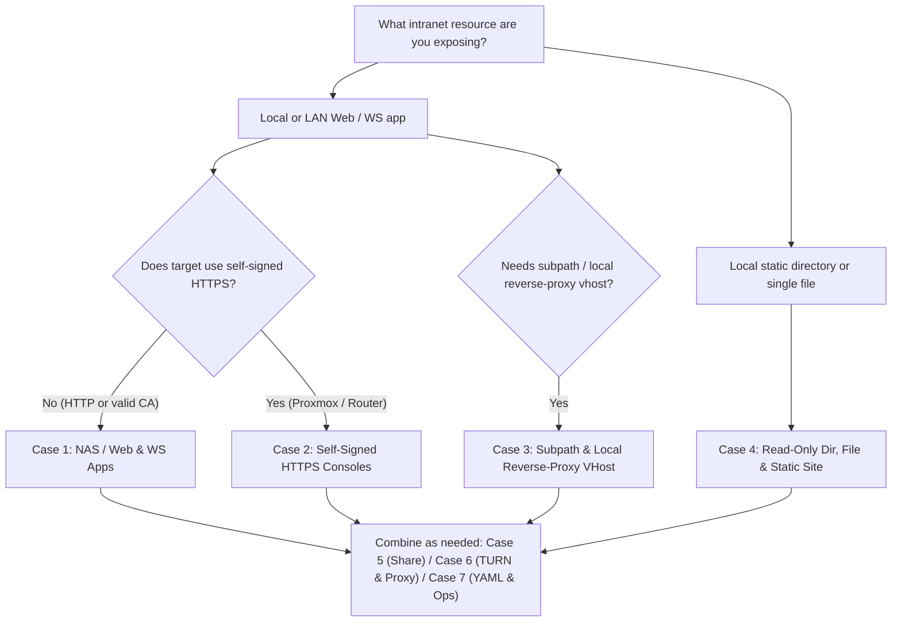

# Agent Use Cases & Recipes

> Audience: Agent administrators who have run the local setup and want to expose a NAS, intranet app, static files, or share links.

This guide provides ready-to-use Agent configurations, launch commands, and security boundaries organized by real-world scenarios. See [Agent & Server Configuration](./agent-configuration) for the full parameter reference, [Read-Only Static Adapter](./file-server) for `os.Root` details, and [Security & Cryptography](./security) for threat models.

---

## Scenario Quick Reference



| Scenario | Core Mode & Key Flags | Visitor Access | Typical Workloads |
| :--- | :--- | :--- | :--- |
| **1. NAS / Self-Hosted Web & WS Apps** | `-target http://...`, `ACCESS_SECRET_FILE`, persistent `-identity-key` | Password in Portal | Jellyfin, Home Assistant, Gitea, Code-Server |
| **2. Self-Signed HTTPS Consoles** | `-target https://...`, `-insecure-target`, `-sni` | Password in Portal | Proxmox VE, ESXi, OpenWrt, NAS HTTPS panels |
| **3. Subpath & Local Reverse-Proxy VHost** | `-target https://.../subpath`, `-upstream-host`, `-sni` | Password in Portal | Subpath apps, Nginx/Caddy/Ingress virtual hosts & multi-service fan-in |
| **4. Read-Only Dir / File / Docs Site** | `-dir` or `-file`, `-hide-dotfiles`, optional `-file-inline-active` | Password or share link | Photo/backup shares, releases, CI HTML reports |
| **5. Temporary Sharing & Headless Minting** | Portal online mint, CLI `-mint-link`, public `-allow-public` | `?pk=...&cap=...` or open | External demos, CI report links, short-lived RO access |
| **6. Strict Networks (Symmetric NAT / Proxy)** | `-turn-url` / `TURN_PASS_FILE`, `-proxy`, `-ice-mdns=true` | Same as standard | Dual symmetric NAT, segmented VLANs, egress rules |
| **7. Production Ops (YAML / Rekey / Metrics)** | `-config`, `-force-rekey`, `-metrics-addr`, `-ephemeral-identity` | Daemon ops & alerts | systemd services, key rotation, Prometheus scraping |

---

## Case 1: Personal NAS & Self-Hosted Web / WebSocket Apps

**Summary**: Run one Agent instance with its own `-id` per intranet application, supply secrets via `*_FILE`, and persist `-identity-key` so each app stays isolated in its own cross-site sandbox origin and survives restarts without breaking TOFU or pinned links.

### 1.1 CLI Launch with Secret Files

```bash
# Prepare least-privilege secret files (readable only by the service account)
install -d -m 0700 /etc/webrtc-gateway /var/lib/webrtc-gateway
printf '%s' 'replace-with-cluster-secret' > /etc/webrtc-gateway/signal.secret
printf '%s' 'replace-with-visitor-secret' > /etc/webrtc-gateway/access-nas.secret
chmod 0600 /etc/webrtc-gateway/*.secret

# Start Agent reverse-proxying a local app (HTTP, 206 Range, and WebSocket)
SIGNAL_SECRET_FILE=/etc/webrtc-gateway/signal.secret \
ACCESS_SECRET_FILE=/etc/webrtc-gateway/access-nas.secret \
./bin/agent \
  -id nas-media \
  -signal wss://portal.example.com/ws \
  -target http://127.0.0.1:8096 \
  -identity-key /var/lib/webrtc-gateway/nas-media.ed25519.key
```

Visitors open `https://portal.example.com/#nas-media`, enter the access secret inside the DTLS channel, and their browser pins the Agent's Ed25519 fingerprint automatically via TOFU.

### 1.2 Hosting Multiple Intranet Apps on One Host (systemd Template)

Each Agent binds one target and one `node_id`. A systemd template unit (`/etc/systemd/system/p2p-agent@.service`) manages separate configs and Ed25519 private keys cleanly:

```ini
[Unit]
Description=WebRTC Gateway Agent (%i)
After=network-online.target
Wants=network-online.target

[Service]
Type=simple
User=p2pgw
Group=p2pgw
ExecStart=/usr/local/bin/agent -config /etc/webrtc-gateway/agent-%i.yaml
Environment=SIGNAL_SECRET_FILE=/etc/webrtc-gateway/signal.secret
Environment=ACCESS_SECRET_FILE=/etc/webrtc-gateway/access-%i.secret
Restart=always
RestartSec=3
NoNewPrivileges=true
ProtectSystem=strict
ReadWritePaths=/var/lib/webrtc-gateway

[Install]
WantedBy=multi-user.target
```

> [!TIP]
> Avoid aggregating unrelated intranet services behind one broad proxy and a single Agent. Giving each trust boundary its own `node_id` places every app in an isolated cross-site sandbox origin (`sbx-<hash>.sandbox.example.net`).

---

## Case 2: Self-Signed HTTPS Intranet Consoles (Proxmox VE / Router / NAS)

**Summary**: Agents verify upstream TLS certificates by default. When targeting an internal console that uses a self-signed or private CA certificate, explicitly pass `-insecure-target`, and add `-sni` when the upstream routes by virtual-host SNI.

```bash
SIGNAL_SECRET_FILE=/etc/webrtc-gateway/signal.secret \
ACCESS_SECRET_FILE=/etc/webrtc-gateway/access-pve.secret \
./bin/agent \
  -id pve-console \
  -signal wss://portal.example.com/ws \
  -target https://192.0.2.10:8006 \
  -insecure-target \
  -sni pve.internal.example \
  -identity-key /var/lib/webrtc-gateway/pve-console.ed25519.key
```

> [!WARNING]
> `-insecure-target` only skips TLS chain verification between the Agent and the local target; browser-to-Agent DTLS 1.2 encryption and Ed25519 verification remain fully enforced. Only enable it on trusted internal networks.

---

## Case 3: Subpath Apps & Local Reverse-Proxy Virtual Hosts (`-upstream-host`)

**Summary**: Each Agent locks strictly to one exact `-target` origin (zero cross-origin proxying and zero black-box host rewriting). Pair `-upstream-host` with `-sni` when targeting local Nginx, Caddy, or Ingress virtual hosts, and delegate multi-origin aggregation or body rewrites to that local reverse proxy.

```bash
SIGNAL_SECRET_FILE=/etc/webrtc-gateway/signal.secret \
ACCESS_SECRET_FILE=/etc/webrtc-gateway/access-app.secret \
./bin/agent \
  -id intranet-suite \
  -signal wss://portal.example.com/ws \
  -target https://127.0.0.1:443/dashboard \
  -upstream-host app.internal.example \
  -sni app.internal.example \
  -identity-key /var/lib/webrtc-gateway/intranet-suite.ed25519.key
```

- **Subpath confinement**: Setting `-target` with `/dashboard` confines proxied requests to that subpath and blocks `/../admin` and `/..;/admin` escapes.
- **`-upstream-host` (`UPSTREAM_HOST`)**: Strictly validated as RFC 9110 `host[:port]` (Fail-Closed at startup, valid with `-target` only). Overrides the upstream HTTP and WebSocket `Host` header, `Origin`/`Referer` rewriting, `Location` header matching, and `ProxyCookieJar` virtual-host domain checks; pair with `-sni` for HTTPS virtual hosts.

> [!TIP]
> If an application requires multi-origin API aggregation, complex path stripping, custom header mutations, or response-body rewriting (such as Nginx `sub_filter` or Caddy rules), keep Agent untouched: run a standard local reverse proxy (Nginx, Caddy, or a standalone HTTP adapter sidecar) to handle those rules and point `Agent -target` (with optional `-upstream-host`) at that local proxy. See [Local Reverse-Proxy & Adapter Recipes](./reverse-proxy-recipes.md) for copy-pasteable Nginx and Caddy patterns.

---

## Case 4: Read-Only Static Directories, Single Files & Static Sites

**Summary**: `-dir` and `-file` expose local content via Go `os.Root` without running an external web server, and are mutually exclusive with `-target`.

### 4.1 Read-Only Directory or Single Artifact Distribution

```bash
# Share a read-only directory (dotfiles/dotfile-symlinks hidden and CSP: sandbox applied to all files by default)
SIGNAL_SECRET_FILE=/etc/webrtc-gateway/signal.secret \
ACCESS_SECRET_FILE=/etc/webrtc-gateway/access-files.secret \
./bin/agent \
  -id team-files \
  -signal wss://portal.example.com/ws \
  -dir /srv/share \
  -identity-key /var/lib/webrtc-gateway/team-files.ed25519.key

# Share a single large file mounted at / (supports 206 Range resumable downloads)
SIGNAL_SECRET_FILE=/etc/webrtc-gateway/signal.secret \
ACCESS_SECRET_FILE=/etc/webrtc-gateway/access-pkg.secret \
./bin/agent \
  -id build-artifact \
  -signal wss://portal.example.com/ws \
  -file /srv/releases/app-release.tar.gz \
  -identity-key /var/lib/webrtc-gateway/build-artifact.ed25519.key
```

### 4.2 Hosting Trusted Static Web Sites or Build Reports

By default, `-dir` sends `Content-Security-Policy: sandbox` on **all** served static files (including `.html`, `.svg`, and extensionless files) to block stored XSS from untrusted content. Only enable `-file-inline-active` when you author and trust every file in the directory (such as VitePress docs, test reports, or built SPA bundles):

```bash
SIGNAL_SECRET_FILE=/etc/webrtc-gateway/signal.secret \
ACCESS_SECRET_FILE=/etc/webrtc-gateway/access-docs.secret \
./bin/agent \
  -id ci-report \
  -signal wss://portal.example.com/ws \
  -dir /srv/ci-reports/latest \
  -file-inline-active \
  -identity-key /var/lib/webrtc-gateway/ci-report.ed25519.key
```

---

## Case 5: Temporary Sharing, Capability Links & Public Demos

**Summary**: Never share your master `ACCESS_SECRET` with temporary guests. Prefer **online minting** in the Portal Share modal for human collaboration, CLI **offline minting** (`-mint-link`) for headless scripts/CI, and `-allow-public` for openly accessible static demos.

### 5.1 Portal Online Minting vs. CLI Offline Minting

| Dimension | Portal Share Modal (`CAP_REQ`) | CLI Offline Minting (`-mint-link`) |
| :--- | :--- | :--- |
| **Best fit** | Interactive ad-hoc sharing by an operator | SSH workflows, CI notifications, scheduled scripts |
| **Requires running Agent daemon** | Yes (uses active Owner DTLS session) | **Yes** (CLI signs, prints URL, and exits; a daemon must serve the node) |
| **Visible in Portal & instant revoke** | **Immediate** (lists active connections, disconnects on revoke, and persists atomically to `-state-file`) | **After daemon restart** (CLI persists records to `-state-file`, but a running daemon only loads state on startup; use short TTLs) |
| **Identity key requirement** | Uses live daemon key automatically | Must point to the same persistent `-identity-key` as the daemon (never pair with `-ephemeral-identity`) |

### 5.2 Offline Short-Lived Read-Only Share Link (With Running Daemon)

```bash
# Assumes a running daemon for -id team-files sharing the same persistent Ed25519 key:
SHARE_URL=$(./bin/agent \
  -id team-files \
  -identity-key /var/lib/webrtc-gateway/team-files.ed25519.key \
  -portal-url https://portal.example.com \
  -mint-link 2h \
  -mint-path /public \
  -mint-readonly \
  -mint-max-conns 5)

printf '%s\n' "$SHARE_URL"
```

With Docker Compose, run a one-shot container sharing the persistent `agent_identity` volume:

```bash
docker compose run --rm agent \
  -mint-link 24h \
  -mint-readonly \
  -mint-path /public \
  -portal-url https://portal.example.com
```

> [!IMPORTANT]
> `-mint-readonly` allows only `GET`, `HEAD`, and `OPTIONS` and blocks WebSockets. It fits `-dir` shares, static docs, and REST dashboards cleanly; if an app relies on `POST` APIs (such as GraphQL) or WebSockets to render, omit `-mint-readonly` and tighten the TTL and `-mint-max-conns` instead.

### 5.3 Passwordless Public Demos (`-allow-public`)

For intentionally public documentation or demos, explicitly pass `-allow-public` (Ed25519 identity verification and cross-site sandbox isolation remain active):

```bash
SIGNAL_SECRET_FILE=/etc/webrtc-gateway/signal.secret \
./bin/agent \
  -id public-demo \
  -signal wss://portal.example.com/ws \
  -dir /srv/public-docs \
  -allow-public \
  -identity-key /var/lib/webrtc-gateway/public-demo.ed25519.key
```

---

## Case 6: Strict Networks (Symmetric NAT, Self-Hosted TURN & Internal Proxy)

**Summary**: Configure a self-hosted TURN relay (forwarding DTLS ciphertext only) when both sides sit behind symmetric NATs; use `-proxy` when the Agent must reach an isolated upstream VLAN via an internal proxy, and standard `HTTPS_PROXY` when signaling egress requires a proxy.

```bash
SIGNAL_SECRET_FILE=/etc/webrtc-gateway/signal.secret \
ACCESS_SECRET_FILE=/etc/webrtc-gateway/access-corp.secret \
TURN_PASS_FILE=/etc/webrtc-gateway/turn.secret \
./bin/agent \
  -id branch-erp \
  -signal wss://portal.example.com/ws \
  -target http://198.51.100.30:8080 \
  -proxy socks5://127.0.0.1:1080 \
  -stun-servers "stun:stun.example.com:3478" \
  -turn-url "turn:turn.example.com:3478?transport=udp" \
  -turn-user relay-user \
  -ice-mdns=true \
  -identity-key /var/lib/webrtc-gateway/branch-erp.ed25519.key
```

- **`-proxy` (`PROXY_URL`) scope**: Applies strictly to Agent-to-upstream `-target` HTTP and WebSocket connections. Invalid URLs fail closed at startup rather than falling back to direct dial.
- **Signaling egress proxy**: Outbound signaling WebSocket dialing honors standard `HTTPS_PROXY`, `HTTP_PROXY`, and `NO_PROXY` environment variables.
- **TURN URI syntax**: Follow RFC 7065 (`turn:host:port?transport=udp` or `turns:host:5349?transport=tcp`), without `//`.
- **Host IP privacy**: `-ice-mdns` defaults to `true`, obfuscating LAN, Docker bridge, and VPN interface addresses.

---

## Case 7: YAML Configs, Key Rotation & Observability

**Summary**: Store complex multi-option setups in an explicit YAML file (`-config` or `CONFIG_FILE`) while injecting secrets via `*_FILE`; use `-force-rekey` once when intentionally replacing a node's Ed25519 key.

### 7.1 Explicit YAML Configuration (`/etc/webrtc-gateway/agent-nas.yaml`)

See [`configs/agent.example.yaml`](https://github.com/BeingNoAbility/WebRTC-Gateway/blob/main/configs/agent.example.yaml) for every supported field.

```yaml
node_id: "nas-media"
signal_url: "wss://portal.example.com/ws"
identity_key: "/var/lib/webrtc-gateway/nas-media.ed25519.key"
state_file: "/var/lib/webrtc-gateway/nas-media.state.json"
target_url: "http://127.0.0.1:8096"
ice_mdns: true
max_streams: 512
metrics_addr: "127.0.0.1:9091"
portal_url: "https://portal.example.com"
```

Start the daemon and run a local health check:

```bash
SIGNAL_SECRET_FILE=/etc/webrtc-gateway/signal.secret \
ACCESS_SECRET_FILE=/etc/webrtc-gateway/access-nas.secret \
./bin/agent -config /etc/webrtc-gateway/agent-nas.yaml

# Probe /healthz from container healthcheck or monitoring scripts
./bin/agent -health -health-url http://127.0.0.1:9091/healthz
```

### 7.2 Planned Ed25519 Identity Key Rotation (`-force-rekey`)

The signaling server pins each `node_id` to its first registered Ed25519 public key (persisted across restarts when `-bound-keys-file` is set, or during the offline grace window otherwise). After reprovisioning a host or rotating a compromised key, verify that the server permits rekeying (under a shared `SIGNAL_SECRET`, `-allow-force-rekey` defaults to `false`; use per-node `-node-secrets-file` or temporarily enable `-allow-force-rekey=true`), then pass `-force-rekey` once on the Agent and remove the flag afterward:

```bash
rm -f /var/lib/webrtc-gateway/nas-media.ed25519.key

SIGNAL_SECRET_FILE=/etc/webrtc-gateway/signal.secret \
ACCESS_SECRET_FILE=/etc/webrtc-gateway/access-nas.secret \
./bin/agent \
  -config /etc/webrtc-gateway/agent-nas.yaml \
  -force-rekey
```

> [!NOTE]
> Reserve `-ephemeral-identity` for throwaway CI runs or short debugging sessions where TOFU continuity does not matter. Persistent daemons should always configure `-identity-key`.
