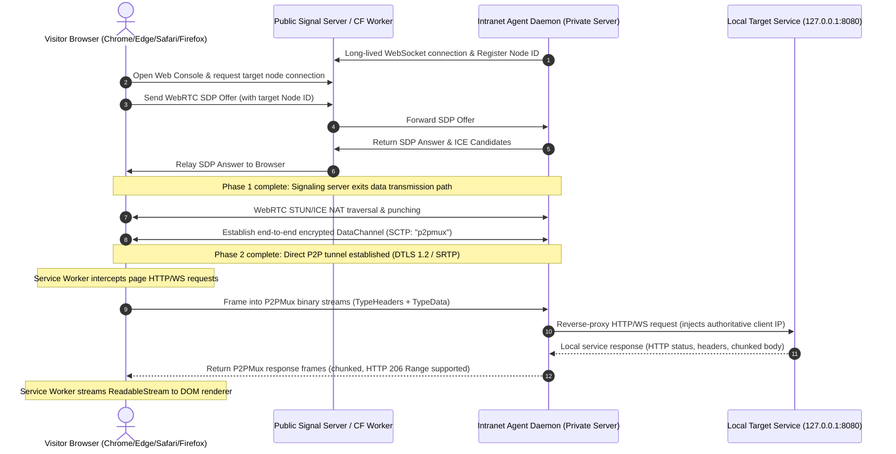

# System Architecture & Technical Specifications

WebRTC Gateway adopts a decoupled, cloud-native edge architecture comprising three core components:
1. **Browser Client (In-Browser Sandbox Runtime)**: Includes the Web Portal App-Shell, Service Worker traffic interceptor, DOM virtualization monkey-patches (`patch.js`), and the TypeScript P2PMux binary multiplexer;
2. **Signaling Server (Signaling & Session Broker)**: Stateless or lightweight in-memory WebSocket broker (supporting Cloudflare Workers or standalone Go daemons). Negotiates SDP Offer/Answer and ICE Candidates during handshakes and exits the data path once the P2P tunnel is established;
3. **Agent Daemon (Intranet Daemon)**: Long-running Go daemon managing WebRTC PeerConnections, unframing and multiplexing P2PMux binary streams, and reverse-proxying HTTP/WS to local services or streaming local files directly in memory.

---

## 1. System Architecture & End-to-End Data Flow



---

## 2. P2PMux v1 Binary Multiplexing Protocol Specification

To concurrently handle hundreds of independent HTTP requests, large file downloads, and full-duplex WebSocket connections across a single WebRTC `RTCDataChannel` without head-of-line blocking, the gateway utilizes the **P2PMux v1** binary multiplexing protocol.

For the formal mathematical and byte-level specification, consult the [P2PMux Wire Protocol Specification](./protocol-specification).

### Binary Frame Layout (10-Byte Fixed Header)

```text
 0                   1                   2                   3
 0 1 2 3 4 5 6 7 8 9 0 1 2 3 4 5 6 7 8 9 0 1 2 3 4 5 6 7 8 9 0 1
+-+-+-+-+-+-+-+-+-+-+-+-+-+-+-+-+-+-+-+-+-+-+-+-+-+-+-+-+-+-+-+-+
|                          Stream ID (32 bits)                  |
+-+-+-+-+-+-+-+-+-+-+-+-+-+-+-+-+-+-+-+-+-+-+-+-+-+-+-+-+-+-+-+-+
|   Type (8)    |   Flags (8)   |       Payload Length (32)     |
+-+-+-+-+-+-+-+-+-+-+-+-+-+-+-+-+-+-+-+-+-+-+-+-+-+-+-+-+-+-+-+-+
|       Payload Length (cont.)  |   Payload Data (0 ~ 32KB) ... |
+-+-+-+-+-+-+-+-+-+-+-+-+-+-+-+-+                               |
```

- **Stream ID (uint32, 4 bytes)**: Unique stream identifier. Client browsers allocate odd stream IDs (1, 3, 5...), while Agents allocate even stream IDs (2, 4, 6...) to prevent collisions;
- **Type (uint8, 1 byte)**: Frame semantic type:
  - `0x01 (TypeData)`: Stream payload chunk;
  - `0x02 (TypeHeaders)`: Stream initial metadata (JSON-serialized HTTP method, path, query, headers);
  - `0x03 (TypeRstStream)`: Stream reset or abnormal abort with optional error code;
  - `0x04 (TypeWindowUpdate)`: Flow control window increment credit;
  - `0x05 (TypePing)` / `0x06 (TypePong)`: RTT latency measurement and keepalive heartbeat;
  - `0x10 (TypeWSConnect)` / `0x11 (TypeWSData)` / `0x12 (TypeWSClose)`: Native WebSocket handshake, bi-directional data, and clean close frames.
- **Flags (uint8, 1 byte)**: Bitmask control flags:
  - `0x00 (FlagNone)`: Standard data frame;
  - `0x01 (FlagFin)`: Marks completion of stream transmission (half-close signal);
  - `0x02 (FlagAck)`: Control frame acknowledgment.
- **Payload Length (uint32, 4 bytes)**: Payload byte count (Big-Endian). Hard ceiling is **64KB (`MaxPayloadSize = 65536` bytes)**; recommended streaming chunk size is **32KB (`RecommendedChunkSize = 32758` bytes)**. Combining 32758-byte payload with 10-byte header yields exactly **32768 bytes (32KB)**, aligning with Go runtime size-classes and WebRTC SCTP MTU boundaries.

---

## 3. In-Browser DOM Virtualization & Service Worker Sandbox

### ① Service Worker & Dedicated MessagePort Channel
- The Portal registers the Service Worker and establishes a dedicated bidirectional pipeline via `MessagePort` (`PORTAL_ATTACH`);
- The Service Worker intercepts same-origin `fetch` events from the page and embedded iframes, forwarding requests over `MessagePort` to the in-page P2PMux dispatcher;
- Responses return as chunked `ReadableStream` pipelines, enabling large media and binary streams to decode and render progressively.

### ② W3C Fetch Strict Null-Body Alignment (204/304)
- Chromium and WebKit strictly prohibit response bodies on HTTP 204 No Content, 205 Reset Content, and 304 Not Modified status codes, throwing `TypeError: Response with null-body status cannot have body` if violated;
- The Service Worker validates status codes and forces `new Response(null, { status })`, guaranteeing stability for SPAs (Next.js, SvelteKit).

### ③ W3C XMLHttpRequest Upload Progress Virtualization
- Standard Service Workers contain a known limitation (Chromium Bug 1214207): proxied XHR uploads do not dispatch `xhr.upload.onprogress` events, causing upload progress bars to freeze at 0%;
- `patch.js` intercepts `XMLHttpRequest.prototype.send` and schedules virtualized W3C-compliant `ProgressEvent` sequences based on physical transfer speed, restoring smooth progress bars for LibreSpeed and file vaults.

### ④ WebSocket Defragmentation across SCTP Boundaries
- Native WebSocket messages can reach hundreds of kilobytes, exceeding WebRTC SCTP safe transmission limits (16KB~32KB);
- The gateway incorporates streaming defragmentation buffers on both ends: the sender prepends a 5-byte header (1-byte Opcode + 4-byte Length), and the receiver reassembles frames in a ring buffer before emitting `onmessage`.

### ⑤ Session-Isolated CookieJar & document.cookie Synchronization
- The Agent maintains an independent `http.CookieJar` per remote session, autonomously managing sensitive `Set-Cookie` (including `HttpOnly`) across upstream requests;
- Non-HttpOnly cookies are forwarded to the browser via response metadata, where `patch.js` synchronizes them into `document.cookie` for JavaScript compatibility.

### ⑥ Anti-Frame-Busting Sandbox
- Enterprise management dashboards (Portainer, Grafana) often include anti-clickjacking scripts (`if (window.top !== window.self) window.top.location = ...`);
- The gateway renders iframes without `allow-top-navigation` and injects virtualized proxies for `window.top`, `window.parent`, and `window.frameElement`, allowing seamless execution within the Portal sandbox.

### ⑦ Anti-Hotlinking Defense & Tab/Window Node ID Persistence
- **Anti-Hotlinking**: Injects `<meta name="referrer" content="no-referrer">` into HTML responses and rewrites Origin/Referer headers upstream, eliminating 403 Forbidden errors from third-party CDNs;
- **Window/Tab Persistence**: When opening links in new tabs (`<a target="_blank">` or `window.open`), the Service Worker maintains `activeNodeId` and injects `window.__P2P_NODE_ID__` into HTML streams. `patch.js` rewrites dynamic links to `?peer=${nodeId}#${nodeId}`, preventing new tabs from dropping node context.

### ⑧ Authoritative Client IP Propagation & WAF Synergy (v1.8.0+)
- **Authoritative Signaling Anchor**: When relaying SDP Offers, the signaling server extracts the socket remote IP (or Cloudflare `cf-connecting-ip`) and sets `msg.ClientIP = session.RemoteIP`, discarding forged client headers;
- **Agent Reverse-Proxy Override**: The Agent forcibly overrides `X-Forwarded-For` and `X-Real-IP` with the authoritative IP before proxying HTTP/WS requests;
- **WAF Synergy**: Enables SafeLine, Nginx WAF, and ModSecurity to perform per-IP rate limiting, individual IP blocking, and GeoIP logging, while supporting in-place ICE Restart IP updates on mobile network roaming.
