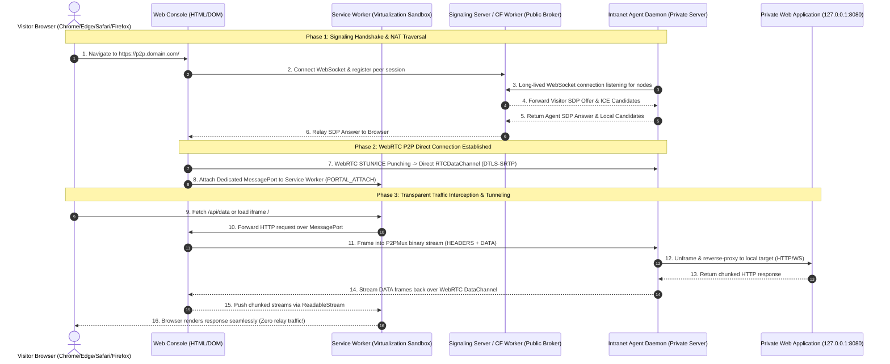

# System Architecture & Technical Specifications

This document outlines the architecture, end-to-end data flow, and protocol specifications of the Zero-Client WebRTC P2P Gateway.

---

## 1. System Architecture & End-to-End Data Flow



---

## 2. P2PMux v1 Binary Multiplexing Protocol Specification

All communications across the WebRTC `RTCDataChannel` utilize the high-performance **P2PMux v1** binary framing protocol. It features minimal overhead, stream multiplexing, and window-based backpressure.

### Frame Layout (9-Byte Header)

```text
+----------------+----------------+----------------+--------------------------+
|  StreamID (4B) | Type (1B, 0-6) |  Length (4B)   |   Payload (0..N Bytes)   |
|  Big-Endian    |  Uint8 Enum    |  Big-Endian    |   Binary Slice           |
+----------------+----------------+----------------+--------------------------+
```

### Frame Types

| Type Code | Constant | Direction | Description |
| :---: | :--- | :--- | :--- |
| `0x01` | `DATA` | Bidirectional | Carries raw binary payload chunks. |
| `0x02` | `HEADERS` | Bidirectional | Initial HTTP request/response metadata serialized as JSON. |
| `0x03` | `RST_STREAM` | Bidirectional | Terminates or aborts an active stream immediately. |
| `0x04` | `WINDOW_UPDATE` | Bidirectional | Credit-based flow control / backpressure acknowledgment. |
| `0x05` | `PING` | Bidirectional | Heartbeat keep-alive probe. |
| `0x06` | `PONG` | Bidirectional | Heartbeat keep-alive response. |

---

## 3. In-Browser DOM Virtualization Sandbox

1. **Service Worker MessagePort Tunneling**: Bypasses origin boundary limits via bidirectional `MessagePort` channels.
2. **W3C Fetch Strict Null-Body Alignment**: Enforces `new Response(null, { status })` for HTTP 204, 205, and 304 responses, preventing Chromium/WebKit type errors.
3. **W3C XHR Upload Progress Virtualization**: Intercepts `XMLHttpRequest.prototype.send` to dispatch simulated `ProgressEvent` sequences based on physical transfer speed.
4. **WebSocket Defragmentation**: Employs circular buffers and 5-byte headers (Opcode + Length) to reassemble fragmented frames across SCTP boundaries.
5. **Session-Isolated CookieJar & DOM Synchronization**: Server isolates independent CookieJars; non-HttpOnly cookies are mirrored into `document.cookie`.
6. **Anti-Frame-Busting Defense**: Strips `allow-top-navigation` on iframes and proxies `window.top` / `window.parent` references.
7. **New Tab / Window Node ID Persistence**: Service Worker injects `window.__P2P_NODE_ID__` into HTML streams, and `patch.js` rewrites dynamic links to `?peer=${nodeId}#${nodeId}`, preventing new window clicks from dropping the node context.
