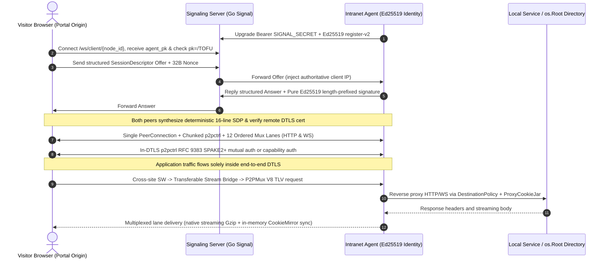

# Architecture and Core Design

WebRTC Gateway consists of three decoupled components:
1. **Browser Client (Modular Web Runtime)**: Independent Portal (content-hashed `/__p2p_gw__/portal.<hash>.js` and `portal.<hash>.css`), ephemeral bootstrap bridge (`/__p2p_gw__/bridge.html` and `/__p2p_gw__/assets/bridge.<hash>.js`), modular Service Worker (`/__p2p_gw__/sw.js`), external bootstrap script (`/__p2p_gw__/boot.js`), modular pure-compatibility DOM and in-memory `CookieMirror` patch (`/__p2p_gw__/assets/patch.<hash>.js`), and TypeScript P2PMux V8;
2. **Signaling Server (Single Authoritative Go Signal)**: Standalone Go binary (`cmd/signal`, pre-rendering embedded content-hashed frontend assets and SHA-256 ETags at startup under `-tags embedweb`) that brokers structured `SessionDescriptor` Offer/Answer payloads and ICE candidates without ever relaying or decoding application traffic;
3. **Agent Daemon (Intranet Service)**: Persistent Ed25519 identity, RFC 9383 SPAKE2+ in-DTLS authentication, single-PC 12-lane unified P2PMux V8 multiplexing, and Pure Pipe HTTP / 16 KiB streaming WebSocket / `O_NOFOLLOW` `os.Root` proxying.

---

## 1. End-to-End Interaction Sequence

---

## 2. Single-PC Unified Multiplexed Data Plane and Native Streaming Gzip

- **Channel Topology**: Each visitor session runs 1 `RTCPeerConnection` with 1 `FlagMore`-chunked control channel `p2pctrl` (`id=0`) and 12 pre-negotiated ordered multiplexed lanes `p2p_01..p2p_12` (`id=1..12`) carrying both HTTP and streaming WebSocket streams by per-lane monotonic `StreamID` (zero dynamic DCEP negotiation). See [P2PMux V8 Wire Protocol Specification](./protocol-specification) for wire rules.
- **Low Head-of-Line Blocking and Pure Payload-Byte Flow Control**: Concurrent streams spread across 12 independent ordered SCTP lanes while keeping each stream's headers, payload, and control frames strictly ordered in-band; wire `CREDIT` counts pure payload bytes only and flushes every `128 KiB` or `256` chunks, eliminating slot-reuse races and tiny-chunk SSE stalls.
- **Native Streaming Gzip Compression**: Service Worker signals native gzip support via `FetchCtx`; Agent streams Go stdlib `compress/gzip` with immediate per-write `Flush` (bypassing SSE, `206 Partial Content`, `Cache-Control: no-transform`, and empty bodies while preserving strong `ETag`s) and sets `RespFlag.DECOMPRESS_GZIP`, while SW uses native `DecompressionStream('gzip')` with pre-pull cancellation, `decompWriter.ready` backpressure synchronization, 0-byte EOF peeking, and expansion-ratio/output ceilings.
- **Short-Lived Signaling and Unified Silent Reconnect**: Portal closes its signaling WebSocket immediately once in-DTLS authentication succeeds (and also on initial ICE failure); on ICE/PC/control channel disconnect, Portal reconnects signaling on demand, builds a fresh `RTCPeerConnection`, and silently re-authenticates via SPAKE2+ using the tab's in-memory `(w0, w1)` verifier while keeping `appFrame` mounted without re-prompting for a password.

---

## 3. 2-Tier Sandbox Isolation and Modular Browser Runtime

### 1. Explicit Startup Origins, Ephemeral Bootstrap Bridge (`/__p2p_gw__/bridge.html`), and One-Time `enterNonce`

- **Explicit Startup Origins and 2-Tier Sandbox Isolation**: Signaling requires explicit `-portal-origin` and `-sandbox-origin` at startup (or explicit `-dev` for loopback `*.localhost`) without runtime `X-Forwarded-Proto` guessing. **Tier 1 cross-site wildcard isolation** (distinct eTLD+1 deriving device-salted HMAC `sbx-<24hex>` origins, plus 128-bit ephemeral `sbx-<32hex>` origins per capability tab) isolates Portal, nodes, and capability guests; **Tier 2 restricted isolation** covers both fixed single cross-site hosts and `-allow-same-site-sandbox` same-site wildcards (`Origin-Agent-Cluster: ?1`), both displaying a persistent warning banner in Portal;
- **Zero-Temporal-Overlap Bridge, Transferable Stream Bridge, and W3C Fetch Anti-CSRF Gate**: Portal returns `404` on `/__p2p_gw__/sw.js` and `/__p2p_gw__/bridge.html` with CSP locked to `style-src 'self'`, `connect-src 'self'`, `form-action 'self'`, and `frame-ancestors 'none'`; sandbox `/__p2p_gw__/sw.js` requires `Service-Worker: script` or `Sec-Fetch-Dest: serviceworker` with `Cross-Origin-Resource-Policy: same-origin`; `bridge.js` and `patch.js` reject Service Worker registration probes; Portal mounts `/__p2p_gw__/bridge.html?tab=<tabId>` with `sandbox="allow-scripts allow-same-origin"` ONLY while `appFrame` is absent, transfers `bridgePort`, and **immediately removes `bridgeFrame` from the DOM** on `P2P_BRIDGE_READY` before creating `appFrame`; SW and Portal bridge HTTP request/response bodies via native Transferable `ReadableStream` (falling back to `arrayBuffer()` on Firefox when `request.body === undefined`); before mounting `appFrame`, Portal registers a one-time 128-bit `enterNonce` bound to `(tabId, nextPath)` over `bridgePort`, and SW unconditionally blocks all `destination === 'document'` escapes (even for bound `clientId`s), rejects unbound subresources and cross-site POSTs, authorizes Back/Forward/Reload via W3C `replacesClientId` or a single-use short-lived `P2P_EXPECT_NAV` token from the bound root `appFrame`, isolates per-tab `clientToTab` quotas, and emits `frame-ancestors 'self' <portalOrigin>`;
- **Untrusted Tenant Boundary**: Portal `TunnelBridge` and Go Agent treat the sandbox origin as an untrusted tenant, stripping spoofed forwarding headers, clamping HTTP download `ackConsumed` strictly to delivered payload bytes, bounding HTTP/WS outbound queues and concurrency (with a 16 MiB WebSocket message cap), and protecting `HttpOnly` / `Secure` cookies inside the Agent's unified RFC 6265bis `ProxyCookieJar` with independent `httpOnly` / `visible` quotas.

### 2. Streaming HTML5 Head Injector, External `boot.js`, and In-Memory `CookieMirror`

- **Byte-Level HTML5 Tokenizer, External `boot.js`, and Directive-Level CSP Rewriter** (`web/src/sw/html_injector.ts`, `fetch_router.ts`): Handles HTML5 comments, unquoted attributes, nested/self-closing `<template>`/`<svg>`/`<math>` (including foreign self-closing `<title/>` and `<![CDATA[...]]>`), UTF-16 BOM passthrough, and split UTF-8 BOMs; injects strictly before the first executable `<script>` in headless or script-first documents; when HTTP omits `charset=`, peeks up to 1024 bytes inside `<head>` to keep `<meta charset>` ahead of the ~140-byte external `<script src="/__p2p_gw__/boot.js">` + `patch.js` pair (zero inline scripts); SW serves `/__p2p_gw__/boot.js` and rewrites upstream CSP directives while preserving upstream rules and propagating script `nonce`s, stripping strong `ETag`s whenever a body is transformed;
- **In-Memory `CookieMirror` and PWA Shield**: Modular `web/src/patch/` backs `Document.prototype.cookie` purely in memory (never writing real `document.cookie`), syncing bidirectionally via P2PMux V8 inline request/response TLVs with the Agent's `ProxyCookieJar` (peeking mutations non-destructively and committing on `REQ_ACK`, honoring `credentials: 'omit'`, and rejecting untrusted page-side `SW_COOKIE_SYNC`), and holds a private `navigator.serviceWorker` reference while hiding `/__p2p_gw__/sw.js` from app PWA `register`/`unregister`/`getRegistrations` calls;
- **Active Session Pruning and Verified SW Eviction Recovery**: SW actively probes and removes closed or reloaded tab sessions via `BRIDGE_PING` (3000 ms); if the browser evicts the SW while idle, SW emits per-tab `P2P_SW_EVICTED` to live nested `appFrame` clients, and Portal verifies port loss via `PORTAL_PING` before detaching `appFrame`, running a clean zero-temporal-overlap ephemeral `bridgeFrame` bootstrap, and remounting `appFrame`.

### 3. Frontend Module Structure (`web/src/`)

- `web/src/protocol/`: P2PMux V8 frame codec (`frame.ts`), binary TLV codec (`tlv.ts`), and 12-lane unified multiplexer (`mux.ts`);
- `web/src/shared/`: Strict Transferable stream IPC schemas (`ipc.ts`), WebCrypto and HKDF helpers (`crypto.ts`), RFC 9383 SPAKE2+ (`spake2p.ts`), Fail-Closed Ed25519 TOFU store (`identity.ts`), structured SDP extractor/synthesizer (`sdp.ts`), 2-tier sandbox derivation (`sandbox_origin.ts`), and strict URL rewriting (`url_rewrite.ts`);
- `web/src/portal/`: Config and RFC 7065 ICE validation (`core/config.ts`, automatic `cap=` scrubbing), signaling client (`core/signaling_client.ts`), single-PC transport and unified silent reconnect (`core/peer_session.ts`), 3-state SPAKE2+/capability auth FSM (`core/auth_client.ts`), stats (`core/stats_collector.ts`), cross-site Transferable bridge (`core/bridge.ts`), external stylesheet (`portal.css`), and lightweight UI (`ui/modals.ts`, `ui/smart_pill.ts`, `i18n.ts`, `app.ts`);
- `web/src/bridge/`, `web/src/sw/`, and `web/src/patch/`: Minimal bootstrap bridge page, modular SW anti-CSRF router/Transferable stream bridge/native gzip/HTML5 external injector/in-memory CookieMirror, and modularized 6-file compatibility patch (`cookie_patch.ts`, `fetch_xhr_patch.ts`, `ws_client_patch.ts`, `nav_patch.ts`, `types.ts`, `ws_patch.ts`).

---

## 4. 2-Tier Sandbox Deployment Modes Comparison

| Dimension | Tier 1: Dual-Root Cross-Site Wildcard (Recommended) | Tier 2 Restricted: Fixed Cross-Site Host | Tier 2 Restricted: Single-Root Same-Site Wildcard |
| :--- | :--- | :--- | :--- |
| **Domains & TLS** | Two distinct eTLD+1 roots, wildcard sandbox cert | Two fixed hosts on distinct eTLD+1 sites, standard single-host certs | Single root + wildcard subdomain cert |
| **Key Flags** | `-portal-origin` + `-sandbox-origin https://*.sandbox.example.net` | `-portal-origin` + `-sandbox-origin https://app.example.net` | `-portal-origin` + `-sandbox-origin https://*.sbx.example.com` + `-allow-same-site-sandbox` |
| **Isolation Properties** | Full cross-site isolation across Portal, nodes, and capability guests (no warning banner) | Cross-site from Portal, but nodes/guests share one sandbox origin (Tier 2 warning banner) | Per-node origins + `Origin-Agent-Cluster: ?1`, same-site with Portal (Tier 2 warning banner) |
| **Best Fit** | Multi-node production and enterprise intranets (recommended default) | Hosts without wildcard cert automation, single-node or mutually trusted apps | Single-domain trusted-app personal setups |
