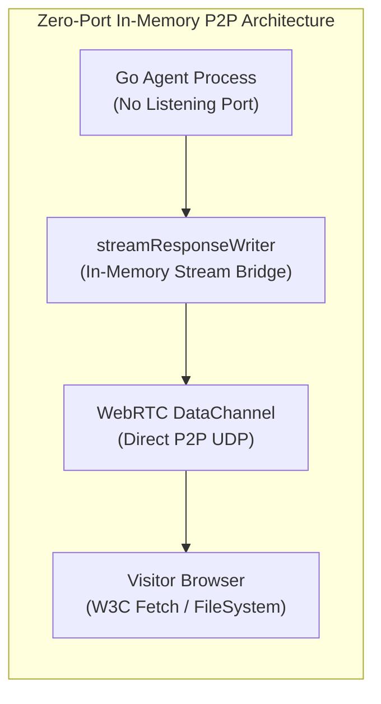

# P2P Zero-Port File & Directory Server

WebRTC Gateway introduces a native **Zero-Listener Port** P2P file distribution and static directory hosting capability.

The core value of this feature is: **leveraging WebRTC's zero-client architecture for lightweight in-browser direct file distribution**. Senders do not need to install complex cloud-drive software or open public router ports; receivers simply open any modern web browser to achieve direct P2P downloads.

---

## 1. Architecture Philosophy & Design Boundaries



### ① Outbound-Only & Zero-Port Philosophy
Traditional file servers (e.g. Nginx, Caddy, python `http.server`, FileBrowser) must bind and listen on a local host TCP port (such as `:8000`).  
WebRTC Gateway designs an innovative **`streamResponseWriter` in-memory stream adapter**:
- Bridges WebRTC P2PMux binary streams directly to Go's standard `http.ResponseWriter` inside memory;
- **The host opens zero inbound TCP listening ports**, eliminating port conflicts, privileged port binding restrictions, and firewall exposure;
- Maintains a strict **Outbound-Only** security posture.

### ② Four Anti-Bloat Guardrails
1. **Read-Only**: Strictly supports `GET`, `HEAD`, `OPTIONS`. Explicitly forbids `POST`, `PUT`, `DELETE`, uploading, renaming, or remote file mutations;
2. **Lightweight Interaction**: Single files stream directly to trigger native browser downloads or media playback; directories render via a lightweight, modern dark-themed HTML file tree with zero external UI framework dependencies;
3. **Zero External Storage Dependencies**: No SQLite, MySQL, or Redis; directly utilizes the underlying operating system file system;
4. **Hardened Security Sandbox**: Rigorously guards against `../` path traversal and symlink escape vulnerabilities.

---

## 2. Operating Modes & Usage

### Mode 1: Single-File Direct Sharing
Expose any local file (ranging from MBs to dozens of GBs of ISO images or 4K videos) directly over P2P:

```bash
# Start Agent serving a single file, and generate a 24-hour stateless signed share link:
./agent -node-id share-iso \
        -file /data/isos/Ubuntu-24.04-desktop-amd64.iso \
        -access-secret mySecret123 \
        -sign-link 24h
```

**CLI Output Example:**
```text
================================================================================
Generated Stateless Signed Share Link:
https://p2p.yourdomain.com/#share-iso?exp=1731852000&sign=a3f89e...
Expiration: 2026-11-17 18:00:00 CST (Valid for: 24h0m0s)
================================================================================
```

**Visitor Experience:**
- The recipient opens the signed link in any modern browser (Chrome, Safari, Firefox, Edge);
- Completes WebRTC direct STUN/ICE punching within seconds and begins downloading at full physical bandwidth;
- Traffic travels point-to-point without consuming central signaling relay bandwidth;
- The HMAC-SHA256 signature mathematically expires after 24 hours.

---

### Mode 2: Static Website & Directory Browsing
Host a local directory as a web site or downloadable file tree:

```bash
./agent -node-id docs -dir /data/websites/vitepress-dist
```

- **Automatic Indexing**: If the directory contains `index.html`, it is automatically rendered as the root index, seamlessly hosting VitePress, Vue/React build artifacts, MkDocs, or Astro static sites;
- **Responsive Dark File Tree**: If `index.html` is absent, the gateway renders a responsive dark-themed file tree supporting name sorting, file size formatting, and last modified timestamps.

---

## 3. Key Capabilities & Implementation

### ① Intelligent Content-Disposition Policy
Dynamically determines inline viewing vs attachment download based on MIME types:
- **Inline Viewing (`inline`)**: Images (`.png`, `.jpg`, `.webp`, `.svg`), videos (`.mp4`, `.webm`), audio (`.mp3`, `.wav`), documents (`.pdf`, `.txt`, `.json`);
  - Visitors can play, preview, and scrub media directly in the browser;
- **Direct Download (`attachment; filename="..."`)**: Archives (`.zip`, `.tar.gz`, `.7z`), disk images (`.iso`, `.img`), executables (`.exe`, `.bin`);
  - Automatically triggers the browser's native file saving pipeline.

### ② Native HTTP 206 Partial Content (Resumable Downloads & Video Scrubbing)
- Implements standard `Range: bytes=start-end` header parsing;
- Returns `206 Partial Content` with accurate `Content-Range: bytes 0-1048575/104857600` headers;
- Scrubbing video progress bars jumps instantaneously, enabling smooth video streaming and multi-threaded chunked downloads.

---

## 4. Hardened Security Sandbox & Special Filename Handling

For directory hosting mode, the gateway enforces a strict URL decoding and path sanitization pipeline:

```text
Visitor Request Path ➔ RFC 3986 URL Percent-Decoding ➔ Null-byte (\0) Inspection ➔ filepath.Clean
                     ➔ filepath.Rel Lexical Boundary Check (Eliminates ../ Traversal)
                       ➔ filepath.EvalSymlinks Physical Path Resolution (Eliminates Symlink Escapes)
```

1. **Special & Asian Filename Compatibility**:
   - Browsers percent-encode non-ASCII characters (e.g. Chinese, Japanese anime titles, square brackets `[ANi]`, spaces);
   - Performs `url.PathUnescape` prior to lexical sanitization, accurately matching physical disk files without 404 errors;
   - Scans for null-byte (`\0`) injections post-decoding and terminates invalid requests immediately (`400 Bad Request`).
2. **Lexical Traversal Defense**: Evaluates `filepath.Rel(rootDir, targetPath)`; if the relative path begins with `..` or resolves to an absolute outside path, responds with `403 Forbidden`.
3. **Symlink Escape Defense**: Uses `filepath.EvalSymlinks` to inspect physical disk targets; if a symbolic link points outside the managed root (e.g. `/etc/passwd`, `C:\Windows`), immediately rejects with `403 Forbidden`.
4. **Hidden File Shielding**: Blocks direct reading of dotfiles or directories prefixed with `.`.
