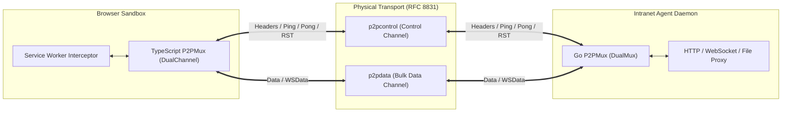
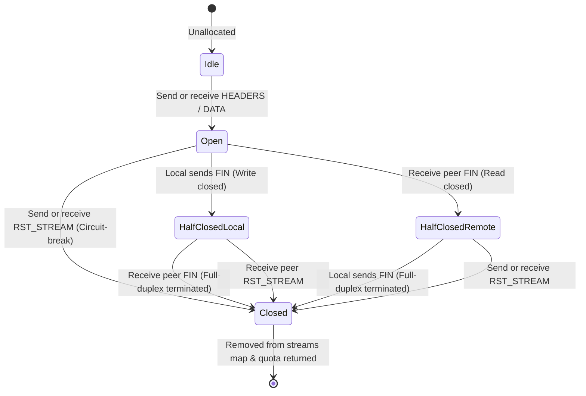
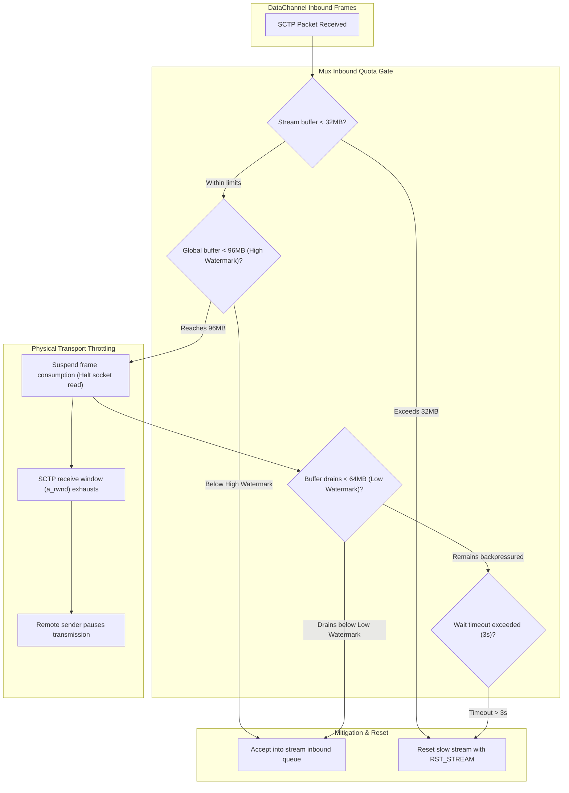
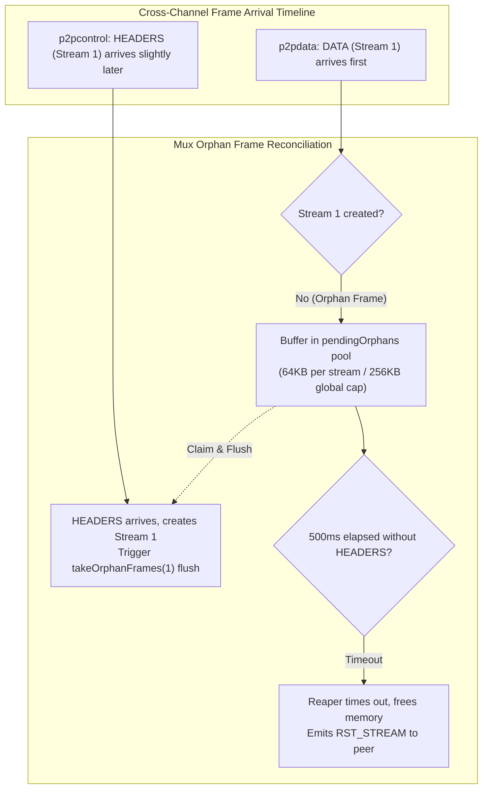

# P2PMux Wire Protocol Specification

> **Version**: v2.3.0 (Sprint 2 Native Dual-Channel Formalization)  
> **Underlying Transport**: IETF RFC 8831 (WebRTC DataChannel / SCTP)  
> **Design Goal**: A lightweight, deterministic, deadlock-free full-duplex binary multiplexing protocol tailored for browser sandboxes and intranet daemons, completely eliminating Head-of-Line blocking and natively aligned with Go and V8 runtime memory allocation classes.

---

## 1. Protocol Architecture & Design Philosophy



### 1. Why a Custom P2PMux Instead of HTTP/2 or yamux?
- **Browser Sandbox Boundary Limits**: Modern browser Web APIs (`RTCDataChannel`) expose message-oriented ArrayBuffer and Blob interfaces rather than raw TCP sockets. Standard HTTP/2 or yamux protocol engines cannot execute without TCP streaming socket primitives;
- **Zero Third-Party Dependencies & Minimal Footprint**: The Go implementation relies solely on standard library `encoding/binary`, while TypeScript uses standard Web `DataView` and `Uint8Array`, adding zero external runtime overhead;
- **32KB Memory Pool Alignment (Runtime Size-Classes)**:
  - P2PMux uses a **10-byte fixed header**;
  - Recommended single-chunk streaming payload size is `RecommendedChunkSize = 32758` bytes;
  - **$32758\text{ (Payload)} + 10\text{ (Header)} = 32768\text{ bytes} = 32\text{KB}$**;
  - This allocation boundary perfectly matches Go runtime size-classes and Linux jemalloc/tcmalloc 32KB allocation spans, achieving zero memory fragmentation and high buffer reuse under high concurrency.

---

## 2. 10-Byte Fixed Binary Frame Layout

P2PMux serializes all wire data in Big-Endian (network byte order). Each frame consists of a **10-byte fixed header** followed by a variable-length **Payload**:

```text
 0                   1                   2                   3
 0 1 2 3 4 5 6 7 8 9 0 1 2 3 4 5 6 7 8 9 0 1 2 3 4 5 6 7 8 9 0 1
+-+-+-+-+-+-+-+-+-+-+-+-+-+-+-+-+-+-+-+-+-+-+-+-+-+-+-+-+-+-+-+-+
|                          Stream ID                            |  (Offset 0..3)
+-+-+-+-+-+-+-+-+-+-+-+-+-+-+-+-+-+-+-+-+-+-+-+-+-+-+-+-+-+-+-+-+
|     Type      |     Flags     |        Payload Length         |  (Offset 4..7)
+-+-+-+-+-+-+-+-+-+-+-+-+-+-+-+-+-+-+-+-+-+-+-+-+-+-+-+-+-+-+-+-+
| (Length Cont) |               Payload Data (0..64KB)          |  (Offset 8..9)
+-+-+-+-+-+-+-+-+ - - - - - - - - - - - - - - - - - - - - - - - +
:                            Payload Data ...                   :  (Offset 10..)
+-+-+-+-+-+-+-+-+-+-+-+-+-+-+-+-+-+-+-+-+-+-+-+-+-+-+-+-+-+-+-+-+
```

### Field Definitions & Constraints

| Field Name | Byte Offset | Type | Encoding | Description & Constraints |
| :--- | :---: | :---: | :---: | :--- |
| **Stream ID** | `0 .. 3` | `uint32` | Big-Endian | **32-bit Logical Stream Identifier**.<br/>• `0x00000000`: Reserved control stream (PING/PONG only).<br/>• Odd (`1, 3, 5...`): Client browser-initiated logical streams.<br/>• Even (`2, 4, 6...`): Agent daemon-initiated logical streams. |
| **Type** | `4` | `uint8` | Unsigned Byte | **Frame Semantic Type**.<br/>Defines frame payload semantics and processing pipeline. |
| **Flags** | `5` | `uint8` | 8-bit Bitmask | **Control Bitmask**.<br/>Supports bitwise flags (e.g. `FlagFin = 0x01`, `FlagAck = 0x02`). |
| **Payload Length** | `6 .. 9` | `uint32` | Big-Endian | **Payload Byte Count**.<br/>• Maximum single frame payload: `65536` (64KB);<br/>• Total wire frame length strictly equals $10 + \text{Length}$;<br/>• Senders transmitting frames exceeding declared buffer limits must be rejected with `ErrInvalidFrameLength`. |
| **Payload** | `10 ..` | `[]byte` | Raw Binary | Frame data payload. Zero-length for control, FIN, and RST frames. |

---

## 3. Frame Types & Flags Semantic Matrix

### 1. Frame Types

| Type Code | Constant | Payload Format & Semantics | Trigger Scenario & Constraints |
| :---: | :--- | :--- | :--- |
| `0x01` | `TypeData` | Binary stream data chunk | Carries HTTP request/response bodies or direct file delivery data. |
| `0x02` | `TypeHeaders` | UTF-8 JSON-encoded metadata | Carries HTTP request/response headers, status codes, and paths. **A stream may receive valid headers exactly once**. |
| `0x03` | `TypeRstStream` | Optional error code (0 bytes default) | Aborts stream immediately. Senders cancel contexts, return memory quota, and deallocate stream IDs. |
| `0x04` | `TypeWindowUpdate` | 4-byte uint32 credit increment | Reserved for credit-based flow control extensions. |
| `0x05` | `TypePing` | 8-byte uint64 sequence ID | Mux-wide heartbeat keepalive probe and RTT calculation. StreamID must be `0`. |
| `0x06` | `TypePong` | 8-byte uint64 echo sequence ID | Direct reflection of PING sequence payload. StreamID must be `0`. |
| `0x10` | `TypeWSConnect` | UTF-8 JSON proxy handshake | Signals stream upgrade to a transparent full-duplex WebSocket tunnel. |
| `0x11` | `TypeWSData` | Chunked or complete WS frame | Carries intranet application native WebSocket binary and text frames. |
| `0x12` | `TypeWSClose` | WebSocket close code and reason | Notifies peer that the upstream native WebSocket has terminated cleanly. |

### 2. Flags Bitmask

```text
 7 6 5 4 3 2 1 0 (Bit Offset)
+-+-+-+-+-+-+-+-+
| Reserved  |A|F|
+-+-+-+-+-+-+-+-+
             │ └─ Bit 0: FlagFin (0x01) - Signals half-close (transmission complete)
             └─── Bit 1: FlagAck (0x02) - Acknowledgment flag
```

- **`FlagFin (0x01)`**:
  - Indicates that the sender has finished transmitting data on this stream;
  - Triggers local write-close (`writeClosed = true`) and peer read-close (`readClosed = true`);
  - May be combined with `TypeData` to deliver trailing data chunks, or transmitted independently with a 0-byte payload (e.g. empty `GET`/`HEAD` requests or `204 No Content` responses).
- **`FlagAck (0x02)`**:
  - Reserved for protocol-level handshake acknowledgments.

---

## 4. Stream Parity & Anti-Ghosting Invariants

To achieve zero-coordination, collision-free stream ID allocation across full-duplex peer connections, P2PMux strictly enforces the **stream parity invariant**:

```text
Visitor Browser (Client)                 Agent Daemon (Server)
┌──────────────────────┐                 ┌──────────────────────┐
│ Allocates Odd IDs    │                 │ Allocates Even IDs   │
│  1, 3, 5, 7, 9 ...   │                 │  2, 4, 6, 8, 10 ...  │
└──────────────────────┘                 └──────────────────────┘
            │                                       │
            │─── Frame(StreamID=1, Type=HEADERS) ──>│ (Valid: Agent accepts inbound odd stream)
            │<── Frame(StreamID=1, Type=DATA) ──────│ (Valid: Agent responds on same stream)
            │                                       │
            │<── Frame(StreamID=2, Type=DATA) ──────│ (Valid: Client accepts inbound even stream)
            │                                       │
            │─── Frame(StreamID=3, Type=DATA) ──> ? │ (If Stream 3 timed out & closed on Client)
            │                                       │ ➔ Agent defense: Discard late ghost frame
```

### 1. Parity Rules
1. **Client Rules**: Local new streams increment monotonically using odd IDs (`id % 2 === 1`). When receiving new inbound streams (`HEADERS`/`DATA`/`WS_CONNECT`), only even IDs (`id % 2 === 0`) are accepted;
2. **Agent Rules**: Local new streams increment monotonically using even IDs (`id % 2 === 0`). When receiving new inbound streams, only odd IDs (`id % 2 === 1`) are accepted;
3. **Violation Handling**: If an endpoint receives an unfamiliar stream ID matching its own parity, the frame is classified as an orphan ghost or protocol violation and **must be silently dropped without instantiating stream state**.

### 2. 32-Bit Wraparound Defense & Sliding Retention Window
- **Wraparound Threshold**: When stream counters approach `0xFFFF0000`, safe ID recycling initiates;
- **Sliding History Window**: Endpoints maintain a bounded sliding window of recently closed stream IDs (`closedStreams`, default capacity 1024);
- Delayed frames falling within the window are discarded. Older records outside the window (`maxPeerStreamID - streamWindow`) are pruned periodically to maintain constant $\mathcal{O}(1)$ memory bounds.

---

## 5. Stream Lifecycle & State Machine

Each P2PMux stream adheres to a bidirectional state machine decoupled across read and write directions, inspired by RFC 9113 (HTTP/2):



### State Transitions & Actions

| State | Trigger Event | Next State | Local Read/Write Permissions | Resource Actions |
| :--- | :--- | :--- | :---: | :--- |
| **Idle** | Local `OpenStream()` | **Open** | Read Allowed / Write Allowed | Allocates monotonic parity StreamID; increments active stream counter. |
| **Open** | Local calls `Close()` | **HalfClosedLocal** | Read Allowed / **Write Prohibited** | Emits `FlagFin` frame over wire; write channel closed. |
| **Open** | Receive peer `FlagFin` | **HalfClosedRemote** | **Drain Buffered Data** / Write Allowed | Read channel closed. Downstream reader returns `io.EOF` upon draining buffer. |
| **HalfClosedRemote** | Reader reaches EOF & local `Close()` | **Closed** | Prohibited | Bi-directional closure complete; asynchronously triggers `removeStream(id)`. |
| **Any Active State** | Call `Reset()` or receive `TypeRstStream` | **Closed** | **Terminated Immediately** | Cancels Context, atomically drains unread buffers, deallocates stream. |

> [!IMPORTANT]
> **Memory Accounting Invariant**:
> During clean stream shutdowns, readers drain all inbound buffers to EOF, naturally returning memory quotas to zero.
> **If a stream aborts unexpectedly (`Reset()`, remote `RST_STREAM`, socket disconnection, or timeout), the endpoint must explicitly invoke `drainUnreadInboundLocked()` to drain residual unread buffers, guaranteeing memory counters never deadlock!**

---

## 6. Resource Governance & Physical SCTP Window Backpressure

To eliminate risks where slow consumers deliberately buffer multiple streams and exhaust host memory, P2PMux v2.2 enforces a three-tiered defense architecture:



1. **Single-Stream Bound**:
   - Single-stream unread inbound memory is capped at **32MB** (`maxStreamInboundBytes`);
   - Violating streams are terminated with `RST_STREAM` without impacting sibling streams.
2. **Global Inbound Budget**:
   - Total unread inbound memory across all streams per Mux instance is capped at **128MB** (`DefaultMaxInboundBytes`).
3. **Dual-Watermark SCTP a_rwnd Throttling**:
   - **High Watermark (96MB)**: When inbound backlog reaches 96MB, frame consumption suspends on a condition variable, pausing reads from the underlying DataChannel;
   - **Physical Window Shrinkage**: Halting socket reads rapidly exhausts the SCTP transport receive window (`a_rwnd`), compelling the remote sender transport stack to stop transmitting;
   - **Low Watermark (64MB)**: As downstream consumers drain buffers below 64MB, the condition variable broadcasts, resuming frame processing;
   - **3-Second Reset Timeout**: Streams remaining blocked under backpressure beyond 3 seconds are reset via `RST_STREAM` to preserve overall system responsiveness.

---

## 7. Native Dual-Channel Routing & Orphan Frame Reconciliation Invariant

Starting in **v2.3.0**, the gateway upgrades its transport architecture from a single DataChannel to an **orthogonally isolated Dual-DataChannel pipeline**:

### 1. Channel Allocation & Routing Responsibilities

| Channel Label | Assigned Frame Types | Backpressure Strategy | Architectural Objective |
| :--- | :--- | :--- | :--- |
| **`p2pcontrol`** | • `0x02 TypeHeaders`<br/>• `0x03 TypeRstStream`<br/>• `0x04 TypeWindowUpdate`<br/>• `0x05 TypePing`<br/>• `0x06 TypePong` | **Zero Backpressure Delay** (Completely Bypasses Flow Control) | Ensures routing metadata, RTT latency probes, keepalive heartbeats, and stream resets arrive in single-digit milliseconds, eliminating HoL starvation. |
| **`p2pdata`** | • `0x01 TypeData`<br/>• `0x10 TypeWSConnect`<br/>• `0x11 TypeWSData`<br/>• `0x12 TypeWSClose` | **Dual-Watermark & SCTP a_rwnd Governed** (128MB Budget) | Manages high-throughput file downloads and application payloads with controlled backpressure throttling to prevent OOM crashes. |

### 2. Cross-Channel Races & Orphan Frame Buffering (Orphan Frame Invariant)

Because WebRTC allocates an independent SCTP transport stream for each DataChannel, high-concurrency micro-scheduling may cause a stream's initial `DATA` frame on `p2pdata` to arrive before the `HEADERS` frame arrives on `p2pcontrol`:



- **Per-Stream Memory Cap**: `DefaultMaxOrphanBytesPerStream = 64KB`. Excess orphan frames are discarded;
- **Global Memory Cap**: `DefaultMaxGlobalOrphanBytes = 256KB`. Prevents memory exhaustion attacks across concurrent streams;
- **500ms Timeout Fuse**: `DefaultOrphanFrameTTL = 500ms`. Expired orphan frames are purged, triggering an automatic `RST_STREAM` to release resources;
- **Zero-Loss Ordered Flushing**: When `TypeHeaders` arrives and creates the stream, buffered orphan frames are flushed immediately in byte-identical order to downstream readers.

---

## 8. Cross-Runtime Golden Test Vectors

To guarantee binary compatibility across heterogeneous platforms (Go CLI Agent, TypeScript Web Portal, Cloudflare Worker DO), the project formalizes cross-runtime golden vectors in `test/fixtures/protocol_golden_vectors.json`, validated across continuous integration suites:

- **Go Test Suite**: [pkg/protocol/golden_test.go](file:///pkg/protocol/golden_test.go) (deserialization, serialization, and 32KB allocation boundary assertions);
- **TypeScript Test Suite**: [test/test_protocol_vectors.cjs](file:///test/test_protocol_vectors.cjs) (mounted in `npm test` to ensure frontend parsers mirror the Go core engine);
- **Key Test Vectors**:
  - `zero_payload_fin`: `00000001010100000000` (Stream 1, Type DATA, Flag FIN, Len 0)
  - `zero_payload_rst`: `00000002030000000000` (Stream 2, Type RST, Flag NONE, Len 0)
  - `ping_with_seq`: `000000000500000000080102030405060708` (Stream 0, Type PING, 8-byte uint64)
  - `recommended_chunk_32kb`: 32758-byte payload yields exactly `32768` bytes post-framing.
