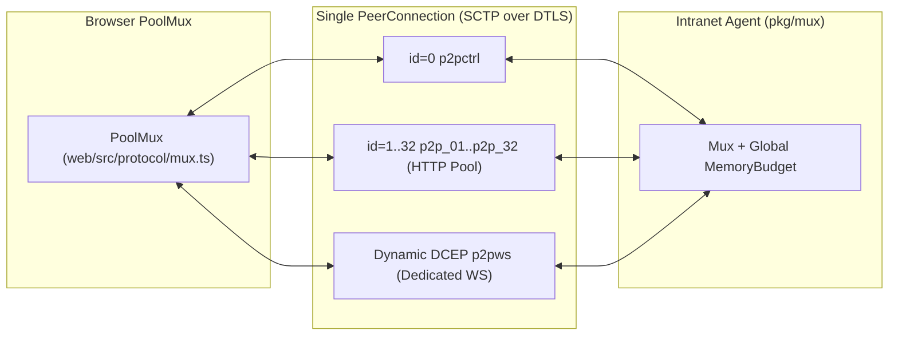

# P2PMux V7 Wire Protocol Specification

> **Protocol Version**: P2PMux V7 (corresponding to `"version": 7` in `test/fixtures/protocol_v7_golden_vectors.json`)  
> **Transport**: Single WebRTC `RTCPeerConnection` + `1` control channel + `32` pre-negotiated ordered HTTP pool channels + dynamic dedicated `"p2pws"` WebSocket channels (SCTP over DTLS, RFC 8831 / RFC 8261)  
> **Reference Implementations**: Go [`pkg/protocol/`](https://github.com/BeingNoAbility/WebRTC-Gateway/blob/main/pkg/protocol/frame.go), [`pkg/mux/`](https://github.com/BeingNoAbility/WebRTC-Gateway/blob/main/pkg/mux/mux.go); TypeScript [`web/src/protocol/`](https://github.com/BeingNoAbility/WebRTC-Gateway/blob/main/web/src/protocol/mux.ts)

P2PMux V7 uses a DataChannel-pool (DC-Pool) data plane between the browser and the intranet Agent: each active HTTP request exclusively occupies one pre-negotiated ordered pool channel governed by a strict 5-state single-slot FSM and monotonic `Gen`, and each WebSocket owns a dedicated dynamic ordered channel, eliminating cross-stream head-of-line blocking and large-WebSocket flow-control deadlocks.

---

## 1. Channel Topology and Reuse Invariants

Each visitor session establishes **1 `RTCPeerConnection`** composed of three ordered DataChannel classes:

| Channel ID | Label | Negotiation | Role | Permitted Frame Types |
| :---: | :--- | :--- | :--- | :--- |
| `0` | `p2pctrl` | Pre-negotiated ordered | Control plane (never queued behind bulk data) | `SETTINGS`, `AUTH_CHALLENGE`, `AUTH_RESPONSE`, `AUTH_RESULT`, `CAP_REQ`, `CAP_RESP`, `PING`, `PONG`, `GOAWAY` |
| `1..32` | `p2p_01` .. `p2p_32` | Pre-negotiated ordered | 32 reusable HTTP pool channels (all pre-auth frames dropped; strict 5-state single-slot FSM) | `HEADERS`, `CONTINUATION`, `DATA`, `CREDIT`, `RESET` |
| Dynamic DCEP | `p2pws` | Post-auth dynamic ordered | Dedicated WebSocket channel (1 DC per WebSocket connection, max 64 per session) | `HEADERS`, `CONTINUATION`, `CREDIT`, `RESET`, `WS_TEXT`, `WS_BINARY`, `WS_CONT`, `WS_CLOSE` |



### One-Stream-Per-DC and Generation (`Gen`) Invariant

Each HTTP pool channel carries at most one active stream at a time; each new request increments that slot's unsigned generation counter:

$$\text{Gen}_{\text{next}} = (\text{Gen}_{\text{prev}} + 1) \bmod 2^{32}, \quad \text{skipping } 0$$

In-band stream control (`CREDIT`, `RESET`) and payload frames (`HEADERS`, `CONTINUATION`, `DATA`) travel on the same ordered channel. Any late frame with `f.Gen != active.Gen` is dropped in O(1) without auxiliary state tables or cross-channel ordering coordination.

---

## 2. 8-Byte Fixed Frame Header Layout

All multi-byte integers are big-endian (network byte order). Every DataChannel message must contain exactly one complete frame (`len(msg) == 8 + payloadLen`):

```text
 0                   1                   2                   3
 0 1 2 3 4 5 6 7 8 9 0 1 2 3 4 5 6 7 8 9 0 1 2 3 4 5 6 7 8 9 0 1
+-+-+-+-+-+-+-+-+-+-+-+-+-+-+-+-+-+-+-+-+-+-+-+-+-+-+-+-+-+-+-+-+
|                        Gen (uint32)                           |  Offset 0..3
+-+-+-+-+-+-+-+-+-+-+-+-+-+-+-+-+-+-+-+-+-+-+-+-+-+-+-+-+-+-+-+-+
|     Type      |     Flags     |      Payload Length (u16)     |  Offset 4..7
+-+-+-+-+-+-+-+-+-+-+-+-+-+-+-+-+-+-+-+-+-+-+-+-+-+-+-+-+-+-+-+-+
|                   Payload (0 .. 65535 bytes)                  |  Offset 8..
+-+-+-+-+-+-+-+-+-+-+-+-+-+-+-+-+-+-+-+-+-+-+-+-+-+-+-+-+-+-+-+-+
```

- **Gen (4 bytes)**: Always `0` on `p2pctrl`; strictly monotonic non-zero generation (`>= 1`) on HTTP pool slots; always `1` on dedicated `"p2pws"` channels.
- **Type (1 byte)**: Frame opcode; unknown opcodes or channel mismatches fail immediately.
- **Flags (1 byte)**: Only `FlagFin = 0x01`, `FlagMsgFin = 0x02` (end-of-message marker on `WS_TEXT`/`WS_BINARY`/`WS_CONT`), and `FlagMoreHeaders = 0x04` are defined; all reserved bits must be `0`.
- **Payload Length (2 bytes)**: Ceiling `MaxPayloadSize = 65535` bytes (`uint16` max); default chunk size `DefaultChunkSize = 32760` bytes, clamped strictly downward against SCTP `maxMessageSize` (floor `MinMaxMessageSize = 4096` bytes, chunk floor `MinChunkSize = 1024` bytes).

---

## 3. Frame Types and Validation Rules

| Type | Name | Channel | Gen Rule | Allowed Flags | Payload Constraint |
| :---: | :--- | :--- | :---: | :---: | :--- |
| `0x01` | `SETTINGS` | `p2pctrl` | `0` | `0x00` | JSON session parameters (`max_frame_payload`, `pool_size`, `max_concurrent_ws`) |
| `0x02` | `AUTH_CHALLENGE` | `p2pctrl` | `0` | `0x00` | JSON (`agent_nonce`, `auth_methods`, `share_v`) |
| `0x03` | `AUTH_RESPONSE` | `p2pctrl` | `0` | `0x00` | JSON (`method`: `spake2p`/`cap`/`public`, `share_p`, `confirm_p`, `cap_token`, `cookie_resume_token`) |
| `0x04` | `AUTH_RESULT` | `p2pctrl` | `0` | `0x00` | JSON (`ok`, `role`, `confirm_v`, `cookie_resume_token`, `meta`) |
| `0x05` | `CAP_REQ` | `p2pctrl` | `0` | `0x00` | JSON (Owner capability mint / paginated list / revoke request) |
| `0x06` | `CAP_RESP` | `p2pctrl` | `0` | `0x00` | JSON (minted token or paginated active record list) |
| `0x08` | `PING` | `p2pctrl` | `0` | `0x00` | Exact 8-byte `uint64` sequence |
| `0x09` | `PONG` | `p2pctrl` | `0` | `0x00` | Exact 8-byte `uint64` echoed sequence |
| `0x0A` | `GOAWAY` | `p2pctrl` | `0` | `0x00` | Exact 4-byte BE `ErrorCode` |
| `0x10` | `HEADERS` | `p2p_01..32` / `p2pws` | `> 0` | `FIN \| MORE_HEADERS` | Compact binary TLV header block (max `64 KiB` total, `5 s` reassembly timeout) |
| `0x11` | `CONTINUATION` | `p2p_01..32` / `p2pws` | `> 0` | `MORE_HEADERS` (no `FIN`) | Max `16` frames; strict `expectingContinuation` check; zero-byte non-final fragments forbidden |
| `0x12` | `DATA` | `p2p_01..32` | `> 0` | `FIN` | Raw HTTP body bytes |
| `0x13` | `CREDIT` | `p2p_01..32` / `p2pws` | `> 0` | `0x00` | Exact 4-byte BE `uint32`, `1 <= delta <= 0x7fffffff` |
| `0x14` | `RESET` | `p2p_01..32` / `p2pws` | `> 0` | `0x00` | Exact 4-byte BE `ErrorCode` |
| `0x21` | `WS_TEXT` | `p2pws` | `1` | `MSG_FIN` | First chunk of a UTF-8 WebSocket text message |
| `0x22` | `WS_BINARY` | `p2pws` | `1` | `MSG_FIN` | First chunk of a WebSocket binary message |
| `0x23` | `WS_CONT` | `p2pws` | `1` | `MSG_FIN` | Continuation chunk (streaming reassembly up to 16 MiB without deadlock) |
| `0x24` | `WS_CLOSE` | `p2pws` | `1` | `0x00` | `u16 BE statusCode` + UTF-8 reason (<= 123 bytes) |

---

## 4. Compact Binary TLV Headers and Streaming WebSocket Frames

### 1. Request and Response TLV Encoding

Request and response headers use big-endian binary TLV encoding carrying `FetchCtx` (`SameOriginClient`, `TopLevelNav`, `ClientDecompressGzip`, `CredentialsOmit`), `RespFlags` (`DecompressGzip`), and inline cookie mutations/deltas (eliminating out-of-band ordering races), preserving multi-value headers (such as multiple `Content-Security-Policy` or `Vary` entries) while rejecting control bytes, CR/LF/NUL, and ASCII spaces (`0x20`) in request targets:

```text
Request TLV:
  [u8 kind (1=HTTP, 2=WS)] [u8 fetchCtxFlags] [u8 methodLen] [method UTF-8]
  [u16 targetLen] [target UTF-8 (no spaces/ctl)] [u16 headerCount <= 256]
  repeat headerCount: [u16 nameLen] [lowercase name] [u16 valLen] [value UTF-8]
  [u16 cookieMutCount <= 32]
  repeat cookieMutCount: [u8 op (1=set, 2=del)] [u8 nameLen] [name] [u16 valLen] [val] [u16 pathLen] [path] [i64 expiresMs]

Response TLV:
  [u16 status (100..599)] [u8 respFlags (bit0=DecompressGzip)] [u16 headerCount <= 256]
  repeat headerCount: [u16 nameLen] [lowercase name] [u16 valLen] [value UTF-8]
  [u16 cookieDeltaCount <= 64]
  repeat cookieDeltaCount: [u8 op (1=set, 2=del)] [u8 nameLen] [name] [u16 valLen] [val] [u16 pathLen] [path] [i64 expiresMs]
```

### 2. Dedicated `"p2pws"` Streaming WebSocket Framing

After a `StreamKind = 2` (WebSocket) handshake receives status `101` on a post-auth dynamic `"p2pws"` channel, messages stream across `WS_TEXT` / `WS_BINARY` plus zero or more `WS_CONT` chunks with `FlagMsgFin (0x02)` on the final chunk:

```text
Message <= 16 MiB:
  Frame 1: [Gen=1][Type=WS_TEXT|WS_BINARY][Flags=0x00 or MSG_FIN][chunk_0]
  Frame k: [Gen=1][Type=WS_CONT]          [Flags=0x00 or MSG_FIN][chunk_k]
Close:
  Frame  : [Gen=1][Type=WS_CLOSE]         [Flags=0x00]           [u16 code][reason <= 123B]
```

Receivers replenish `CREDIT` progressively per chunk within the `16 MiB` message cap so messages exceeding the `2 MiB` initial window stream without deadlock; violations close immediately with code `1009`.

---

## 5. Flow Control, Memory Budgets, and Lifecycle

- **In-Band Credit Flow Control, SCTP Watermarks, and Anti-Forgery Clamping**: Initial send window is `2 MiB` with a `30 s` send-window timeout (resets stream on timeout); per-DC SCTP send buffers enforce `512 KiB` high / `128 KiB` low watermarks; consumers send `CREDIT` in-band on the same DC, and browser `PoolStream.ackConsumed` clamps credit strictly to delivered unacknowledged bytes so an untrusted sandbox cannot forge window expansion.
- **Three-Tier Inbound Budgets, 64B Overhead Accounting, Exact-Sized Copies, and Unconditional Purge**: Go and TS copy inbound data and WS chunks into exact-sized buffers (`cap == len`), charging `len(payload) + 64` per frame against `4 MiB` per-stream, `32 MiB` per-session, and `256 MiB` Go global `MemoryBudget` caps (defending against 0/1-byte frame amplification); per-slot header assembly is capped at `64 KiB` / `16` frames / `5 s` (max `32` pool slots + `64` WS slots); stream `Close()` / `Reset()` unconditionally runs `purgeInbound()` to release unread bytes.
- **5-State Single-Slot FSM, Fast `POST` Preservation, and Lock-Free Reset**: Each HTTP pool slot transitions strictly `IDLE -> RECEIVING_HEADERS -> OPEN -> HALF_CLOSED -> CLOSED`, rejecting new-generation `HEADERS` on busy slots instead of silently preempting; `HTTPProxy` checks `stream.HasRequestBody()` (recorded from `!headersHadFin`), and `Reset()` terminates without acquiring the blocking write mutex, preventing dropped small POST bodies and write deadlocks.
- **Cross-Language Golden Vectors**: Go [`TestV7GoldenVectors`](https://github.com/BeingNoAbility/WebRTC-Gateway/blob/main/pkg/protocol/protocol_test.go) and TS `test/web/protocol.test.mjs` verify identical framing and SPAKE2+ RFC 9383 Appendix C.1 / KDF derivation against `test/fixtures/protocol_v7_golden_vectors.json` (including multi-byte UTF-8 and V7 TLVs).
