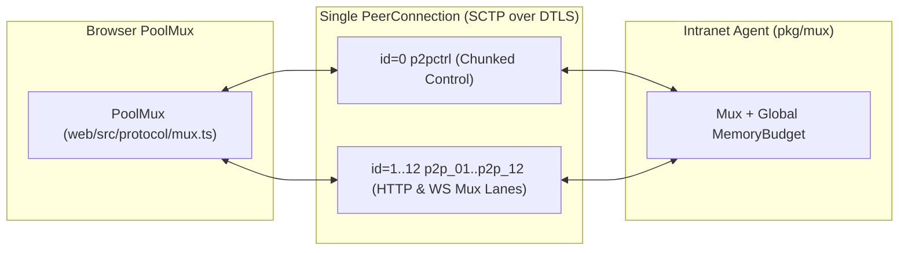

# P2PMux V8 Wire Protocol Specification

> **Protocol Version**: P2PMux V8 (corresponding to `"version": 8` in `test/fixtures/protocol_v8_golden_vectors.json`)  
> **Transport**: Single WebRTC `RTCPeerConnection` + `1` chunked control channel + `12` pre-negotiated ordered multiplexed data lanes (carrying both HTTP and streaming WebSocket over SCTP over DTLS, RFC 8831 / RFC 8261)  
> **Reference Implementations**: Go [`pkg/protocol/`](https://github.com/BeingNoAbility/WebRTC-Gateway/blob/main/pkg/protocol/frame.go), [`pkg/mux/`](https://github.com/BeingNoAbility/WebRTC-Gateway/blob/main/pkg/mux/mux.go); TypeScript [`web/src/protocol/`](https://github.com/BeingNoAbility/WebRTC-Gateway/blob/main/web/src/protocol/mux.ts)

P2PMux V8 uses a unified ordered multiplexed data plane between the browser and the intranet Agent: one `FlagMore`-chunked control channel paired with 12 pre-negotiated ordered data lanes carrying both HTTP and streaming WebSocket streams by monotonic `StreamID`, with zero dynamic DCEP channels and pure payload-byte `CREDIT` flow control, eliminating cross-stream head-of-line blocking, slot-reuse races, and tiny-frame window stalls.

---

## 1. Channel Topology and Monotonic StreamID Invariants

Each visitor session establishes **1 `RTCPeerConnection`** composed of two pre-negotiated ordered DataChannel classes:

| Channel ID | Label | Negotiation | Role | Permitted Frame Types |
| :---: | :--- | :--- | :--- | :--- |
| `0` | `p2pctrl` | Pre-negotiated ordered | Control plane (never queued behind bulk data; JSON frames support `FlagMore` chunking up to `128 KiB`) | `SETTINGS`, `AUTH_CHALLENGE`, `AUTH_RESPONSE`, `AUTH_RESULT`, `CAP_REQ`, `CAP_RESP`, `PING`, `PONG`, `GOAWAY` |
| `1..12` | `p2p_01` .. `p2p_12` | Pre-negotiated ordered | 12 multiplexed data lanes (all pre-auth frames dropped; carries both HTTP and WebSocket by monotonic `StreamID`, max 64 WS per session) | `HEADERS`, `DATA`, `CREDIT`, `RESET`, `WS_TEXT`, `WS_BINARY`, `WS_CLOSE` |



### Per-Lane Monotonic `StreamID` Invariant

Each data lane maintains its own strictly monotonic unsigned 32-bit stream counter (new streams pick the least-loaded lane by active count and send-buffer backlog):

$$\text{StreamID}_{\text{next}} = \text{StreamID}_{\text{prev}} + 1 \quad (1 \le \text{StreamID} \le 2^{32} - 1)$$

All frames for a stream (`HEADERS`, `DATA` / `WS_*`, `CREDIT`, `RESET`) travel in-band on the same ordered lane, eliminating slot-reuse FSMs and dynamic DCEP negotiation. Receivers reject duplicate or non-monotonic opening IDs and drop late frames for closed streams in O(1).

---

## 2. 8-Byte Fixed Frame Header Layout

All multi-byte integers are big-endian (network byte order). Every DataChannel message must contain exactly one complete frame (`len(msg) == 8 + payloadLen`):

```text
 0                   1                   2                   3
 0 1 2 3 4 5 6 7 8 9 0 1 2 3 4 5 6 7 8 9 0 1 2 3 4 5 6 7 8 9 0 1
+-+-+-+-+-+-+-+-+-+-+-+-+-+-+-+-+-+-+-+-+-+-+-+-+-+-+-+-+-+-+-+-+
|                     StreamID (uint32)                         |  Offset 0..3
+-+-+-+-+-+-+-+-+-+-+-+-+-+-+-+-+-+-+-+-+-+-+-+-+-+-+-+-+-+-+-+-+
|     Type      |     Flags     |      Payload Length (u16)     |  Offset 4..7
+-+-+-+-+-+-+-+-+-+-+-+-+-+-+-+-+-+-+-+-+-+-+-+-+-+-+-+-+-+-+-+-+
|                   Payload (0 .. 65535 bytes)                  |  Offset 8..
+-+-+-+-+-+-+-+-+-+-+-+-+-+-+-+-+-+-+-+-+-+-+-+-+-+-+-+-+-+-+-+-+
```

- **StreamID (4 bytes)**: Always `0` on `p2pctrl`; strictly monotonic non-zero stream ID (`>= 1`) per data lane.
- **Type (1 byte)**: Frame opcode; unknown opcodes or channel mismatches fail immediately.
- **Flags (1 byte)**: Only `FlagFin = 0x01` (HTTP half-close), `FlagMsgFin = 0x02` (final chunk of a `WS_TEXT`/`WS_BINARY` message), and `FlagMore = 0x04` (more chunks follow for `HEADERS` or JSON control frames) are defined; all reserved bits must be `0`.
- **Payload Length (2 bytes)**: Ceiling `MaxPayloadSize = 65535` bytes (`uint16` max); default chunk size `DefaultChunkSize = 32760` bytes, clamped strictly downward against SCTP `maxMessageSize` (floor `MinNegotiatedMaxMsgSize = 4096` bytes, chunk floor `MinChunkSize = 4088` bytes, guaranteeing `17 * 4088 >= 64 KiB` header reassembly and `34 * 4088 >= 128 KiB` control reassembly).

---

## 3. Frame Types and Validation Rules

| Type | Name | Channel | StreamID Rule | Allowed Flags | Payload Constraint |
| :---: | :--- | :--- | :---: | :---: | :--- |
| `0x01` | `SETTINGS` | `p2pctrl` | `0` | `MORE` | JSON session parameters (`max_frame_payload`, `pool_size`, `max_concurrent_ws`) |
| `0x02` | `AUTH_CHALLENGE` | `p2pctrl` | `0` | `MORE` | JSON (`agent_nonce`, `auth_methods`, `share_v`) |
| `0x03` | `AUTH_RESPONSE` | `p2pctrl` | `0` | `MORE` | JSON (`method`: `spake2p`/`cap`/`public`, `share_p`, `confirm_p`, `cap_token`, `cookie_resume_token`) |
| `0x04` | `AUTH_RESULT` | `p2pctrl` | `0` | `MORE` | JSON (`ok`, `role`, `confirm_v`, `cookie_resume_token`, `meta`) |
| `0x05` | `CAP_REQ` | `p2pctrl` | `0` | `MORE` | JSON (Owner capability mint / list / revoke request) |
| `0x06` | `CAP_RESP` | `p2pctrl` | `0` | `MORE` | JSON (minted token or active record list; chunkable via `FlagMore` up to `128 KiB`) |
| `0x08` | `PING` | `p2pctrl` | `0` | `0x00` | Exact 8-byte `uint64` sequence |
| `0x09` | `PONG` | `p2pctrl` | `0` | `0x00` | Exact 8-byte `uint64` echoed sequence |
| `0x0A` | `GOAWAY` | `p2pctrl` | `0` | `0x00` | Exact 4-byte BE `ErrorCode` |
| `0x10` | `HEADERS` | `p2p_01..12` | `> 0` | `FIN \| MORE` | Compact binary TLV header block (multi-frame continuation reuses `HEADERS` + `FlagMore`, max `64 KiB` / `17` frames; zero-byte non-final frames forbidden) |
| `0x12` | `DATA` | `p2p_01..12` | `> 0` | `FIN` | Raw HTTP body bytes (zero-byte payload without `FIN` forbidden) |
| `0x13` | `CREDIT` | `p2p_01..12` | `> 0` | `0x00` | Exact 4-byte BE `uint32` pure payload byte delta, `1 <= delta <= 0x7fffffff` |
| `0x14` | `RESET` | `p2p_01..12` | `> 0` | `0x00` | Exact 4-byte BE `ErrorCode` |
| `0x21` | `WS_TEXT` | `p2p_01..12` | `> 0` | `MSG_FIN` | UTF-8 WebSocket text message chunk (streams up to 16 MiB; zero-byte without `MSG_FIN` forbidden) |
| `0x22` | `WS_BINARY` | `p2p_01..12` | `> 0` | `MSG_FIN` | Binary WebSocket message chunk (streams up to 16 MiB; zero-byte without `MSG_FIN` forbidden) |
| `0x24` | `WS_CLOSE` | `p2p_01..12` | `> 0` | `0x00` | `u16 BE statusCode` + valid UTF-8 reason (<= 123 bytes) |

---

## 4. Compact Binary TLV Headers and Streaming WebSocket Frames

### 1. Request and Response TLV Encoding

Request and response headers use big-endian binary TLV encoding carrying `FetchCtx` (`SameOriginClient`, `ClientDecompressGzip`, `CredentialsOmit` suppressing cookie mutations and response cookie storage; legacy bit 1 is removed and strictly rejected as reserved), `RespFlags` (`DecompressGzip`), and inline cookie mutations/deltas (eliminating out-of-band ordering races, enforcing `0 <= expiresMs <= Number.MAX_SAFE_INTEGER`), preserving multi-value headers (such as multiple `Content-Security-Policy` or `Vary` entries) and valid UTF-8 characters (including BOM), while rejecting control bytes, CR/LF/NUL, and ASCII spaces (`0x20`) in request targets:

```text
Request TLV:
  [u8 kind (1=HTTP, 2=WS)] [u8 fetchCtxFlags] [u8 methodLen] [method UTF-8]
  [u16 targetLen] [target UTF-8 (no spaces/ctl)] [u16 headerCount <= 256]
  repeat headerCount: [u16 nameLen] [lowercase name] [u16 valLen] [value UTF-8]
  [u16 cookieMutCount <= 32]
  repeat cookieMutCount: [u8 op (1=set, 2=del)] [u8 nameLen] [name] [u16 valLen] [val] [u16 pathLen] [path] [i64 expiresMs]

Response TLV:
  [u16 status (100..599)] [u8 respFlags (bit0=DecompressGzip)] [u16 headerCount <= 256]
  repeat headerCount: [u16 nameLen] [lowercase name] [u16 valLen] [value UTF-8]
  [u16 cookieDeltaCount <= 64]
  repeat cookieDeltaCount: [u8 op (1=set, 2=del)] [u8 nameLen] [name] [u16 valLen] [val] [u16 pathLen] [path] [i64 expiresMs]
```

### 2. In-Lane Streaming WebSocket Framing

`StreamKind = 2` (WebSocket) runs directly on one of the 12 pre-negotiated data lanes: after receiving status `101`, messages stream across `WS_TEXT` or `WS_BINARY` frames with `FlagMsgFin (0x02)` on the final chunk:

```text
Message <= 16 MiB:
  Frame 1..k: [StreamID][Type=WS_TEXT|WS_BINARY][Flags=0x00 or MSG_FIN][chunk]
Close:
  Frame     : [StreamID][Type=WS_CLOSE]         [Flags=0x00]           [u16 code][reason <= 123B]
```

Receivers replenish pure payload-byte `CREDIT` progressively per chunk within the `16 MiB` message cap and `16384`-chunk ceiling (ensuring full `16 MiB` reassembly even at `4088`-byte minimum chunks) so messages exceeding the `512 KiB` initial window stream smoothly; all already-queued messages are drained before delivering `WS_CLOSE`; violations close immediately with code `1009`.

---

## 5. Flow Control, Memory Budgets, and Lifecycle

- **Pure Payload-Byte Credit Flow Control, SCTP Watermarks, and Tiny-Chunk Liveness**: Initial send window is `512 KiB` with a `30 s` send-window timeout (resets stream on timeout); per-DC SCTP send buffers enforce `512 KiB` high / `128 KiB` low watermarks; consumers send pure payload-byte `CREDIT` in-band (never charging local 64B struct overhead into wire credit, and flushing credit every `128 KiB` OR `256` chunks so streams of tiny 13-byte SSE tokens never stall or falsely reset), while browser `PoolStream.ackConsumed` clamps credit strictly to delivered unacknowledged payload bytes.
- **Three-Tier Local Memory Budgets, 64B Overhead Accounting, Exact-Sized Copies, and Unconditional Purge**: Local memory accounting is strictly decoupled from wire `CREDIT` — Go and TS copy inbound data and WS chunks into exact-sized buffers (`cap == len`), charging `len(payload) + 64` locally against `2 MiB` per-stream (plus a `16384` queued-chunk cap), `32 MiB` per-session, and `256 MiB` Go global `MemoryBudget` caps (defending against zero-byte or tiny-frame heap amplification); incomplete inbound `HEADERS` enforce an un-refreshable `10 s` hard deadline and reject premature `CREDIT`; stream kind is frozen immutably to HTTP or WS upon initial `HEADERS` completion; stream `Close()` / `Reset()` unconditionally purges unread buffers and releases budget.
- **Deterministic Concurrency Caps and Lock-Free Reset**: Active concurrent HTTP/WS streams are bounded globally (default `512`, WS cap `64`); both Go and TS detect body presence strictly from whether `HEADERS` carried `FlagFin` (`HasRequestBody()` / `hasResponseBody`), avoiding microtask races when `DATA(FIN)` arrives immediately after `HEADERS`; `Reset()` wakes blocked readers/writers without lock contention and guarantees `onEnd` never fires after `onReset`.
- **Cross-Language Golden Vectors**: Go [`TestV8GoldenVectors`](https://github.com/BeingNoAbility/WebRTC-Gateway/blob/main/pkg/protocol/protocol_test.go) and TS `test/web/protocol.test.mjs` verify identical framing and SPAKE2+ RFC 9383 Appendix C.1 / KDF derivation against `test/fixtures/protocol_v8_golden_vectors.json` (including multi-byte UTF-8, BOM preservation, and V8 TLVs).
