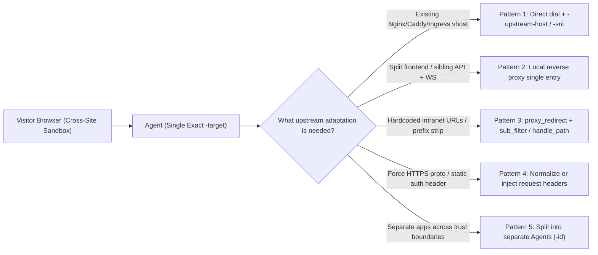

# Local Reverse-Proxy & Adapter Recipes

Each Agent locks strictly to a single exact `-target` origin (Pure Pipe neutrality; see [Project Constitution](../CONSTITUTION.md) and [Design Boundaries and Trade-offs](../DESIGN_TRADEOFFS.md)). When an application requires multi-origin API aggregation, hardcoded URL rewriting, path prefix stripping, or custom upstream header injection, run a standard local reverse proxy (Nginx or Caddy) behind `-target` to handle those application-layer rules.

> [!NOTE]
> This guide documents reusable **reverse-proxy patterns** rather than version-pinned vendor manuals. All proxy rules run outside the Agent process across standard HTTP / WebSocket boundaries, keeping core gateway code decoupled from third-party application churn.

---

## Pattern Quick Reference



| Pattern | Problem Solved | Extra Local Proxy? | Core Mechanism |
| :--- | :--- | :--- | :--- |
| **Pattern 1: Existing Virtual Host** | Host already runs Nginx, Caddy, or Ingress routing by `Host` / SNI | No | Agent `upstream_host` + `sni` |
| **Pattern 2: Multi-Origin Fan-In** | One app splits UI, REST APIs, and WebSockets across ports or subdomains | Yes (loopback) | Caddy `reverse_proxy` / Nginx `location` + WS Upgrade |
| **Pattern 3: URL Rewrite & Prefix Strip** | Legacy panels or routers hardcode internal IPs in HTML, JS, or 302s | Yes (loopback) | Nginx `proxy_redirect` + `sub_filter` / Caddy `handle_path` |
| **Pattern 4: Header Normalization & Auth** | Upstream requires `X-Forwarded-Proto: https` or static internal credentials | Yes (loopback) | Proxy-layer forwarding header override or `Authorization` / `X-API-Key` |
| **Pattern 5: Multi-Agent Trust Boundary** | Multiple unrelated services with different trust levels on one host | — | Run separate Agents with distinct `-id` values |

---

## Pattern 1: Targeting an Existing Local Virtual Host (No Extra Proxy)

**Summary**: When the intranet host already runs Nginx, Caddy, Traefik, or Kubernetes Ingress routing by `Host` header and TLS SNI, configure `upstream_host` and `sni` directly in Agent YAML without adding another proxy layer.

```yaml
# /etc/webrtc-gateway/agent-vhost.yaml
node_id: "intranet-app"
signal_url: "wss://portal.example.com/ws"
identity_key: "/var/lib/webrtc-gateway/intranet-app.ed25519.key"
state_file: "/var/lib/webrtc-gateway/intranet-app.state.json"

# Dial the local reverse proxy loopback port while selecting the virtual host via upstream_host + sni
target_url: "https://127.0.0.1:443"
upstream_host: "app.internal.example"
sni: "app.internal.example"
# Enable only when the local virtual host presents a self-signed or private CA certificate
insecure_target: false
```

- **Unified `upstream_host` semantics**: Validated Fail-Closed at startup as RFC 9110 `host[:port]`, overriding HTTP and WebSocket `Host` headers, `Origin`/`Referer` rewriting, `Location` header matching, and `ProxyCookieJar` virtual-host domain checks (so `Set-Cookie` headers with `Domain=app.internal.example` work seamlessly).
- **Subpath pairing**: If the virtual host mounts the app under a subpath, set `target_url: "https://127.0.0.1:443/app"` so Agent enforces subpath confinement at the same time.

---

## Pattern 2: Consolidating Split Frontend, API, and WebSocket Origins

**Summary**: When a single web application serves its UI, REST APIs, static assets, and WebSockets on separate internal ports or sibling subdomains, place a lightweight loopback Caddy or Nginx instance on `127.0.0.1` to consolidate them into one origin and point `Agent -target` there.

### 2.1 Minimal Caddyfile

```text
# /etc/caddy/Caddyfile.p2p-suite
{
    auto_https off
}

http://127.0.0.1:18080 {
    handle /api/* {
        reverse_proxy http://192.0.2.20:8000 {
            header_up Host api.internal.example
        }
    }

    handle /ws/* {
        reverse_proxy http://192.0.2.20:8001 {
            header_up Host ws.internal.example
        }
    }

    handle {
        reverse_proxy http://192.0.2.20:3000 {
            header_up Host app.internal.example
        }
    }
}
```

### 2.2 Nginx Configuration with WebSocket Upgrade

```nginx
# /etc/nginx/conf.d/p2p-suite.conf
map $http_upgrade $connection_upgrade {
    default upgrade;
    ''      close;
}

server {
    listen 127.0.0.1:18080;
    server_name _;

    location /api/ {
        proxy_pass http://192.0.2.20:8000;
        proxy_http_version 1.1;
        proxy_set_header Host api.internal.example;
        proxy_set_header X-Forwarded-For $proxy_add_x_forwarded_for;
        proxy_set_header X-Forwarded-Proto $scheme;
        proxy_buffering off;
    }

    location /ws/ {
        proxy_pass http://192.0.2.20:8001;
        proxy_http_version 1.1;
        proxy_set_header Host ws.internal.example;
        proxy_set_header Upgrade $http_upgrade;
        proxy_set_header Connection $connection_upgrade;
        proxy_read_timeout 3600s;
    }

    location / {
        proxy_pass http://192.0.2.20:3000;
        proxy_http_version 1.1;
        proxy_set_header Host app.internal.example;
        proxy_set_header X-Forwarded-For $proxy_add_x_forwarded_for;
    }
}
```

### 2.3 Matching Agent YAML

```yaml
# /etc/webrtc-gateway/agent-suite.yaml
node_id: "app-suite"
signal_url: "wss://portal.example.com/ws"
identity_key: "/var/lib/webrtc-gateway/app-suite.ed25519.key"
target_url: "http://127.0.0.1:18080"
```

---

## Pattern 3: Rewriting Hardcoded Intranet URLs and Stripping Path Prefixes

**Summary**: Legacy admin panels, routers, and older intranet tools often hardcode internal IPs or absolute URLs in HTML, CSS, JavaScript, or `302 Location` headers, or assume they own `/`; perform body substitution and prefix stripping in a local Nginx or Caddy sidecar to keep gateway logic clean.

### 3.1 Nginx `proxy_redirect` and `sub_filter`

```nginx
# /etc/nginx/conf.d/p2p-legacy.conf
server {
    listen 127.0.0.1:18081;
    server_name _;

    location / {
        proxy_pass http://192.0.2.30:8080;
        proxy_http_version 1.1;
        proxy_set_header Host 192.0.2.30:8080;

        # Disable upstream compression so sub_filter can match plaintext bodies
        proxy_set_header Accept-Encoding "";

        # Rewrite hardcoded absolute 301/302 Location URLs to relative paths
        proxy_redirect http://192.0.2.30:8080/ /;
        proxy_redirect http://legacy.internal.example/ /;

        # Rewrite hardcoded intranet origins in HTML / CSS / JS to root-relative paths
        sub_filter_once off;
        sub_filter_types text/css application/javascript text/javascript;
        sub_filter 'http://192.0.2.30:8080' '';
        sub_filter 'http://legacy.internal.example' '';
    }
}
```

### 3.2 Caddy Path Prefix Stripping (`handle_path`)

```text
# /etc/caddy/Caddyfile.p2p-prefix
{
    auto_https off
}

http://127.0.0.1:18082 {
    # Strip /legacy prefix so an app expecting root / receives /foo
    handle_path /legacy/* {
        reverse_proxy http://192.0.2.30:9000
    }
}
```

> [!WARNING]
> Always include `proxy_set_header Accept-Encoding "";` when using Nginx `sub_filter`, or compressed upstream `gzip` / `br` bodies will silently skip substitution. Disabling loopback compression does not waste WAN bandwidth — Agent automatically applies end-to-end streaming `gzip` compression over the P2P tunnel.

---

## Pattern 4: Adjusting Forwarding Headers and Injecting Upstream Auth Headers

**Summary**: When a local HTTP service expects `X-Forwarded-Proto: https` (to generate HTTPS callback URLs or pass strict CSRF / OAuth checks) or requires static internal credentials such as `Authorization` or `X-API-Key`, normalize or inject those headers in the local reverse proxy.

### 4.1 Forcing HTTPS Proxy Semantics (`X-Forwarded-Proto`)

When `Agent -target` points to plaintext `http://127.0.0.1:...`, Agent sends `X-Forwarded-Proto: http` matching the target scheme. If an upstream app expects visitor-facing HTTPS semantics (common in self-hosted drives, home automation hubs, and web frameworks), override forwarding headers in the loopback reverse proxy and add `127.0.0.1` to the application's trusted-proxy configuration. Agent's `ProxyCookieJar` honors W3C potentially trustworthy loopback origins (`127.0.0.0/8`, `::1`, `localhost`, `*.localhost`), so `Secure`, `__Host-`, and `__Secure-` login cookies issued under this pattern are stored and replayed normally:

```nginx
# /etc/nginx/conf.d/p2p-https-proto.conf
server {
    listen 127.0.0.1:18083;
    server_name _;

    location / {
        proxy_pass http://127.0.0.1:8123;
        proxy_http_version 1.1;
        proxy_set_header Host $http_host;
        proxy_set_header X-Forwarded-Proto https;
        proxy_set_header X-Forwarded-For $proxy_add_x_forwarded_for;
        proxy_set_header Upgrade $http_upgrade;
        proxy_set_header Connection $connection_upgrade;
        proxy_buffering off;
    }
}
```

### 4.2 Injecting Static Upstream Credentials

```text
# /etc/caddy/Caddyfile.p2p-apikey
{
    auto_https off
}

http://127.0.0.1:18084 {
    reverse_proxy http://127.0.0.1:9090 {
        # Inject from runtime environment; never hardcode plaintext secrets in configs
        header_up X-API-Key {$UPSTREAM_API_KEY}
    }
}
```

> [!IMPORTANT]
> Bind local adapter proxies strictly to loopback (`127.0.0.1`) so LAN peers cannot bypass authentication by dialing the credential-injecting port directly, and always protect the Agent with a strong `ACCESS_SECRET` (never combine credential injection with `-allow-public`) so visitors must complete in-DTLS RFC 9383 SPAKE2+ authentication first.

---

## Pattern 5: Security Boundary — When to Consolidate vs. Split Agents

**Summary**: Consolidate only tightly coupled endpoints belonging to the **same application and trust boundary**; isolate unrelated internal services under separate Agent processes with distinct `-id`, `ACCESS_SECRET`, and Ed25519 identity keys.

| Dimension | Same-App Consolidation (Recommended) | Cross-App Aggregation Behind One Proxy (Avoid) |
| :--- | :--- | :--- |
| **Typical example** | One app's UI + `/api` + `/ws` | Photo library + router admin + metrics panel behind one `-id` |
| **Cross-site sandbox origin** | Shared `sbx-<hash>.sandbox.example.net` is intentional | XSS in one app can access sessions of every other app sharing that origin |
| **Passwords & capability tokens** | Single `ACCESS_SECRET` and clean path-prefix scope | Cannot isolate credentials or revocation scopes per application |
| **Restart & key-rotation blast radius** | Limited to one application | Restarting or rekeying one node interrupts all aggregated services |

> [!TIP]
> To host multiple independent intranet services on one machine cleanly, run one Agent per service with a systemd template unit (see the multi-app template in [Agent Use Cases](./agent-use-cases.md)). Version-specific community recipes for individual third-party applications fit best in GitHub Discussions so core documentation stays concise and durable.
