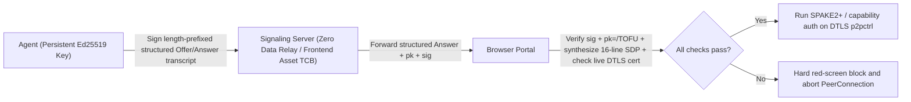

# Security and Cryptographic Boundaries

WebRTC Gateway enforces defense-in-depth with explicit trust roots spanning structured SDP synthesis, Ed25519 node identity, in-DTLS RFC 9383 SPAKE2+ authentication, cross-site dual-domain sandboxing, and strict proxy validation.

---

## 1. Structured SDP, Transport Encryption, and Ed25519 Node Identity

WebRTC DataChannels are encrypted with DTLS 1.2 (SCTP over DTLS, RFC 8261 / RFC 8831), and the signaling server never relays application traffic. To eliminate SDP parser differentials, delimiter injection, and active signaling MITM by construction, the stack combines structured `SessionDescriptor` exchange, persistent **Ed25519 Agent identity keys**, and live remote DTLS certificate verification:



- **Honest Trust Boundary (Frontend Asset TCB & Zero Data Relay)**: The signaling server never relays application plaintext or data-plane traffic and cannot read or offline brute-force in-DTLS visitor passwords. However, in a zero-client browser architecture, the Go `signal` binary delivers the Portal, Service Worker, and `patch.js` bundles, so the signaling host and its reverse proxy are part of the **frontend static-asset TCB**. Portal CSP strictly locks `connect-src 'self'`, prohibits runtime `?signal=` overrides, and serves startup pre-rendered content-hashed bundles with SHA-256 `ETag`s;
- **Zero Raw Peer SDP Over Signaling**: Signaling transmits only strictly validated `SessionDescriptor` objects (`fp`, `ice_ufrag`, `ice_pwd`, `setup`, `mid`, `sctp_port`, `max_msg_size`, `sdp_ver`), and both peers deterministically synthesize minimal 16-line RFC 8841 DataChannel-only SDPs — eliminating multi-section and dual-fingerprint parser differentials;
- **Unconditional Pure Ed25519 Signing and Live DTLS Cert Binding**: Even under `-allow-public`, every Answer signs a length-prefixed transcript (`p2pgw-v7:answer-v2:`); Agent always verifies Pion's `GetRemoteCertificate()`, and browsers supporting `RTCDtlsTransport.getRemoteCertificates()` (Chromium / Firefox) verify the live negotiated certificate digest directly (WebKit/Safari engines without this API rely on the browser DTLS stack matching the signed SDP fingerprint line);
- **Key Pinning and Fail-Closed SSH-Style TOFU**:
  - Links carrying `#node?pk=<22-char-sha256>` enforce non-bypassable pinning, and a mismatched `?pk=` cannot silently override an already-trusted `IndexedDB` TOFU entry;
  - Bare `#node` visits commit TOFU only after Ed25519 verification and channel authentication succeed; `IndexedDB` I/O failures fail closed, and key mismatches trigger a hard red-screen block before password entry.

---

## 2. Control Plane and In-DTLS RFC 9383 SPAKE2+ Authentication

### 1. Control Plane: Cluster Admission (`SIGNAL_SECRET` / `-node-secrets-file`)

- Go Signal validates WebSocket Origin and strict Upgrade headers (rejecting body-bearing or non-GET upgrade requests under bounded static deadlines) BEFORE checking `Authorization: Bearer <secret>` and per-IP upgrade quotas;
- Both cluster-wide `SIGNAL_SECRET` and per-node secrets in `-node-secrets-file` enforce a minimum length of **16 bytes** (when a node has an explicit per-node secret, global fallback is strictly rejected and auth lockouts are striped by `(IP, nodeID)` so a single misconfigured node cannot lock out siblings);
- Missing registration secrets fail closed at startup unless `-allow-anonymous-agents` is explicitly set;
- First registration binds node ownership via length-prefixed `p2pgw-v7:register-v2:` Ed25519 challenge-response with cross-restart atomic persistence via `-bound-keys-file` (`AtomicFileStore`); `-allow-force-rekey` defaults to `false` under a shared `SIGNAL_SECRET` (`true` under isolated per-node secrets) and requires both server opt-in and Agent `-force-rekey`.

### 2. Data Plane: In-DTLS `p2pctrl` RFC 9383 SPAKE2+

- **Zero Offline Brute-Force Oracle**: Visitor secrets (`ACCESS_SECRET`, mutually exclusive with `-allow-public`, failing closed if both are set) bound to the verified `agent_pk` and `node_id` are derived via 1-Block `PBKDF2-HMAC-SHA256` (300,000 iterations) + `HKDF-SHA256` (`p2pgw-v7:spake2p-w0w1`) into SPAKE2+ verifiers (`w0`, `L = w1·G`) and verified inside DTLS `p2pctrl` via **RFC 9383 SPAKE2+ (P-256)** mutual zero-knowledge authentication (validating both `confirm_p` and `confirm_v`, requiring live DTLS certificate verification and challenge issuance before accepting `AUTH_RESPONSE`, and blocking downgrades and all pre-auth data-lane frames);
- **Pre-PC Password Prompt, Short-Lived Signaling, and Single Attempt per Connection**: Portal prompts for the Owner password before creating `RTCPeerConnection` (eliminating human-typing races against the 10-second `UnauthSessionTimeout`); each connection permits strictly one auth attempt, and Portal closes its signaling WebSocket immediately once authenticated;
- **IPv6 `/64` Lockout-Preserving, Per-IP Serialized & Global Fail-Closed Rate Limiting**: `VisitorAuthLimiter` unmaps IPv4-mapped IPv6 addresses before normalizing true IPv6 addresses to `/64`, enforces a per-IP handshaking concurrency cap (`4`), per-IP attempt serialization, lockout-preserving LRU eviction, saturated Fail-Closed rejection, and a global failure ceiling (60 failures/minute), while strictly validating signaling-supplied `ClientIP` via `netip.ParseAddr`;
- **Unified Silent Reconnect**: On disconnect, Portal reconnects signaling on demand, builds a fresh `RTCPeerConnection`, and silently re-authenticates via SPAKE2+ reusing the tab's in-memory `(w0, w1)` verifier without storing plaintext passwords or reloading `appFrame`.

---

## 3. Ed25519 Scoped Capability Tokens and Persisted Revocation

Temporary sharing uses structured Capability Tokens signed by the Agent's Ed25519 private key:

```json
{
  "v": 7,
  "jti": "unique-token-id",
  "node": "homeserver",
  "exp": 1795752000,
  "path_prefix": "/public",
  "readonly": true,
  "max_conns": 4
}
```

- **Zero Password Re-Entry Minting, Cross-Process Lock Merge, and Live Continuous Revocation**: Authenticated Owners mint, list, and revoke tokens live over chunked DTLS `p2pctrl` `CAP_REQ`, or offline via `./bin/agent -mint-link 24h -mint-readonly -mint-path /public`; `-state-file` uses cross-process file locking plus `AtomicFileStore` read-merge-write with monotonic `revoked` union merging so running Agents reload updates cleanly and terminate revoked streams immediately; Portal immediately scrubs `cap=` from `location.hash` via `history.replaceState`;
- **Post-Resolve Scope Enforcement and Isolated Guest Jars**: Agent validates `path_prefix` (composed with `TargetSubpath`), `readonly` (stripping `X-HTTP-Method-Override`), and runtime expiration AFTER `DestinationPolicy.Resolve` canonicalization, and isolates each capability guest inside a dedicated `guestPool` `ProxyCookieJar` (`cap:<jti>:<rand>`) so guests sharing a link never share `HttpOnly` sessions;
- **Security Semantics**: A share link is a bearer capability — use short TTLs, minimal path prefixes, read-only mode when possible, and revoke tokens promptly when no longer needed.

---

## 4. 2-Tier Sandbox Isolation, W3C Fetch Anti-CSRF Gate, and Unified Cookie Protection

- **Explicit Startup Origins and 2-Tier Sandbox Isolation**: Signaling requires explicit `-portal-origin` and `-sandbox-origin` at startup (or explicit `-dev` on loopback) and never guesses scheme from runtime `X-Forwarded-Proto`:
  - **Tier 1 Cross-Site Wildcard Isolation (Recommended)**: Portal and `-sandbox-origin https://*.sandbox.example.net` reside on distinct eTLD+1 sites, deriving per-node and per-capability `sbx-<24hex>` origins to isolate Portal, nodes, and capability guests across Storage and Service Workers;
  - **Tier 2 Restricted Isolation**: Fixed single cross-site host (`-sandbox-origin https://app.example.net`, cross-site from Portal but sharing one sandbox origin across nodes/guests) or single-root same-site wildcard (`-allow-same-site-sandbox` + `Origin-Agent-Cluster: ?1`). Both Tier 2 modes display a persistent warning banner in Portal;
- **Zero-Temporal-Overlap Bridge, External `boot.js`, and `appFrame` Sandbox**: Bootstrap `bridge.html` runs with `sandbox="allow-scripts allow-same-origin"` strictly before `appFrame` mounts and is removed immediately upon `P2P_BRIDGE_READY`; `/__p2p_gw__/sw.js` requires `Service-Worker: script` or `Sec-Fetch-Dest: serviceworker` with `Cross-Origin-Resource-Policy: same-origin`; `bridge.js` and `patch.js` reject Service Worker registration probes; HTML responses inject external `<script src="/__p2p_gw__/boot.js">` + `patch.js` (zero inline scripts) while SW preserves upstream CSP directives and propagates script `nonce`s; `appFrame` enforces the `sandbox` attribute to block `top.location` hijacks;
- **W3C Fetch Anti-CSRF Gate and Per-Tab Quotas**: Portal locks `style-src 'self'`, `connect-src 'self'`, `form-action 'self'`, and `frame-ancestors 'none'`, returning `404` on `/__p2p_gw__/sw.js` and `/__p2p_gw__/bridge.html`; SW enforces one-time 128-bit `enterNonce` bound to `(tabId, nextPath)` and `GET`/`navigate`/`iframe`, **unconditionally blocks all `destination === 'document'` escape navigations** even for bound `clientId`s, rejects unbound subresources, cross-site POSTs, and unbound empty-referrer iframes in `-target` proxy mode (authorizing Back/Forward/Reload via W3C `replacesClientId` or a single-use short-lived `P2P_EXPECT_NAV` token posted by the bound root `appFrame`), isolates per-tab `clientToTab` quotas while protecting `rootClientId` against child-iframe floods, and emits `Content-Security-Policy: frame-ancestors 'self' <portalOrigin>` on navigation and HTML responses;
- **Unified RFC 6265bis `ProxyCookieJar` and In-Memory `CookieMirror`**: `patch.js` backs `Document.prototype.cookie` purely in memory (never touching browser cookies); Agent's unified single-table `ProxyCookieJar` enforces independent `httpOnly` / `visible` quotas, sweeps shadowing client cookies across more-specific paths whenever a server sets `HttpOnly`/`Secure` cookies, allows JS updates to ordinary non-protected cookies, honors W3C potentially trustworthy loopback origins for `Secure`/`__Host-`/`__Secure-` semantics, and enforces `credentials: 'omit'`, Mozilla PSL, Leave Secure Cookies Alone, `SameSite`, and the 400-day `MaxAge` cap synced bidirectionally via P2PMux V8 inline TLVs (SW commits mutations only upon `REQ_ACK` and rejects untrusted page-side `SW_COOKIE_SYNC` messages).

---

## 5. Single-Target Proxy Boundary, Fail-Closed mDNS, Client IP Propagation, and `O_NOFOLLOW` Static Sandbox

- **Strict Single-Target Confinement and WS 302 Escape Blocking**: Each Agent proxies strictly to its operator-configured `-target` exact `(scheme, host, port)` and optional subpath, rejecting `/__p2p_proxy__/`, `//` open redirects, backslashes, and `..;` traversal; consumes P2PMux V8 `FetchCtx` flags (unset `SameOriginClient` fails closed as cross-site); `-upstream-host` overrides only the virtual-host `Host`/origin semantics and default HTTPS SNI without altering the dial target; WebSocket dialing disables 302 redirects;
- **Fail-Closed mDNS Scrubbing, Single-Pass Canonicalization, and Right-to-Left XFF Peeling**: When `-ice-mdns=true` (default), Agent filters outbound `OnICECandidate` emissions Fail-Closed — dropping all non-`.local` `typ host` candidates and zeroing `raddr`/`rport` on `srflx`/`relay` candidates per RFC 8828 §5.2 even if IPv6 or multicast is unavailable; Go Signal canonicalizes `r.URL.EscapedPath()` once (blocking double URL encoding) and peels `X-Forwarded-For` right-to-left against loopback-only default `-trusted-proxies`;
- **Default Fail-Closed `O_NOFOLLOW` Go `os.Root` Static Adapter**: `-dir` and `-file` traverse directories via stepwise `os.Root.OpenRoot` plus `O_RDONLY|O_NONBLOCK|O_NOFOLLOW` opens, **rejecting all symlinks by default** alongside dotfiles and FIFO hangs (opt-in `-follow-symlinks` bounds resolution hops and strictly confines canonical targets within both the root directory and active capability `path_prefix`), and apply `Content-Security-Policy: sandbox` to **all** static files (including extensionless files).
