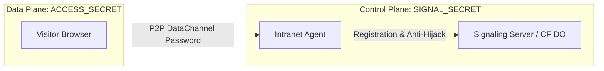

# Security Architecture & Access Control

WebRTC Gateway adheres to a Defense-in-Depth security philosophy, establishing multiple layers of protective barriers across the transport, control, data, and application sandbox planes.

---

## 1. Native Transport-Layer Encryption (DTLS-SRTP)

All traffic traversing the WebRTC `RTCDataChannel` is end-to-end encrypted via **DTLS 1.2 / 1.3** and **AES-128-GCM / AES-256-GCM**:
- **Zero-Knowledge Signaling**: The signaling server (whether self-hosted Go Signal or Cloudflare Workers) only routes ephemeral SDP/ICE metadata during initial handshakes. It cannot inspect, decrypt, or tamper with any application-layer HTTP requests or payload streams;
- **Man-in-the-Middle (MitM) Prevention**: The client browser and Agent exchange TLS certificate fingerprints during the DTLS handshake, guaranteeing remote peer authenticity.

---

## 2. Dual-Secret Decoupling Architecture

The gateway establishes a strict two-tier authentication architecture, cleanly separating the **Control Plane** and **Data Plane**:



### ① Control Plane Registration Secret (`-signal-secret` / `SIGNAL_SECRET`)
- **Audience**: Shared strictly between the Signaling Server and authorized internal Agents;
- **Scope**: Controls Agent cluster admission and prevents Node ID hijacking (`Node Hijack Protection`);
- **Protection**: If an unauthorized party attempts to claim an existing `node-id` without the matching `signal-secret`, the signaling server rejects registration immediately;
- **Zero Client Knowledge**: **The signaling server never discloses this secret to visitor browsers**, and visitors do not need to know it.

### ② Data Plane Visitor Access Password (`-access-secret` / `ACCESS_SECRET`)
- **Public Open Mode (Default)**:
  - When `-access-secret` is empty, the node is a **Public Node**;
  - Visitors establish WebRTC tunnels directly without password prompts. Even if the signaling server enforces a strict cluster registration secret, public nodes remain accessible to external visitors;
- **Protected Private Mode (DTLS Fingerprint Binding)**:
  - When `-access-secret` is configured, visitor browsers present a dark-themed password prompt;
  - **One-Way Derived Auth Key (F-02)**: The frontend computes `authKey = HMAC-SHA256(access_secret, "node-auth:" + nodeId)`, never sending the master secret over the network in plaintext;
  - **DTLS Certificate Fingerprint Anti-Replay (F-04)**: During WebRTC Offer generation, the client extracts its physical DTLS certificate fingerprint and computes `HMAC-SHA256(authKey, nodeId + ":" + exp + ":" + sdpFingerprint)`. Handshakes avoid plaintext secret transmission; even if the handshake payload is eavesdropped on public networks, replay attacks from other devices fail 100% due to mismatched DTLS certificate fingerprints.

---

## 3. Stateless HMAC-SHA256 Expiring Share Links

Stateless temporary sharing requires no database, no Redis cache, and no revocation list:

```text
Base Signature Algorithm:
signature = HMAC-SHA256(nodeId + ":" + expTimestamp, access_secret)
```

### ① CLI Quick Generation
```bash
./agent -node-id mynas \
        -target http://127.0.0.1:8096 \
        -access-secret myPassword \
        -sign-link 24h
```

### ② Web Console Generation
Open any connected private node, click the settings gear icon in the top right, navigate to "Secure Expiring Share", select the desired duration (1 hour, 6 hours, 24 hours, 7 days, 30 days), and copy the generated link:  
👉 `https://p2p.yourdomain.com/#mynas?exp=1731852000&sign=3f89e...`

### ③ Key Advantages
- Visitors access the service directly with **zero password prompts**;
- Visitors **cannot deduce the master password** from the signature;
- Once expired, the Agent rejects the signature locally via millisecond-level timestamp comparison.

### ④ DTLS Certificate Fingerprint Anti-Replay Protection
- When a visitor connects via an expiring share link, the frontend extracts its dynamically generated DTLS certificate fingerprint and computes a bound secondary signature `HMAC-SHA256(sign, nodeId + ":" + exp + ":" + sdpFingerprint)`;
- Eliminates replay threats where an eavesdropped unexpired share link URL is claimed on a third-party unauthorized device;
- Rejects any handshake attempts lacking valid DTLS certificate fingerprint binding signatures.

---

## 4. Production Rate Limiting & DoS Mitigation

### ① Agent Concurrent Stream Throttling (`-max-streams`)
- The Agent maintains a bounded stream semaphore (default: 512);
- Under traffic spikes or crawling attacks, requests exceeding capacity immediately receive `503 Service Unavailable` at the protocol layer, safeguarding lightweight backend devices (e.g. NAS or Raspberry Pi) from OOM crashes.

### ② Server Per-IP Connection Quota (`-max-ip-conns`)
- Tracks active WebSocket handshakes per client IP (default: 64);
- Rejects excess handshakes to prevent file descriptor and socket exhaustion on public signaling instances.

### ③ Trusted Reverse Proxy CIDR Filtering (`-trusted-proxies`)
- Automatically trusts private subnet CIDRs (`127.0.0.1/32`, `10.0.0.0/8`, `172.16.0.0/12`, `192.168.0.0/16`);
- When deployed directly on the public internet, requests from untrusted IPs ignore untrusted `X-Forwarded-For` headers and extract physical socket `RemoteAddr` values to eliminate IP spoofing.

---

## 5. Authoritative Client IP Propagation & WAF Integration

The gateway provides end-to-end client IP transparency, ending the dilemma where intranet web servers see all tunneled visitors as `127.0.0.1`:

### ① Authoritative Source Injection & Anti-Spoofing
- **Signaling Source Anchor**: When relaying SDP Offers, the signaling server extracts the real physical socket IP (or Cloudflare `cf-connecting-ip`) and forcefully overrides `msg.ClientIP = session.RemoteIP`, discarding any client-forged IP metadata;
- **Agent Reverse-Proxy Override**: Before forwarding HTTP and WebSocket requests, the Agent overwrites `X-Forwarded-For` and `X-Real-IP` with the authoritative IP, blocking spoofed headers inside DataChannels.

### ② WAF & Security Tooling Synergy
- **Targeted IP Blacklists**: SafeLine, Nginx WAF, and ModSecurity accurately block malicious public IPs without mistakenly banning `127.0.0.1`;
- **Per-IP Rate Limiting**: HTTP 429 throttling applies specifically to the offending visitor IP;
- **GeoIP & Compliance Auditing**: Internal backend access logs record authentic visitor geolocation.

### ③ In-Place ICE Restart Roaming Update
- When mobile visitors switch between Wi-Fi and 5G cellular networks, in-place ICE Restart keeps the DataChannel alive while the Agent dynamically refreshes the bound public IP, ensuring downstream requests immediately inherit the updated IP for WAF auditing.

---

## 6. Defense-in-Depth & Sandbox Governance

The gateway implements comprehensive defense-in-depth measures across all operational boundaries:

### ① Portal Web Console DOM XSS Prevention
- **Strict Character Set Whitelist**: Node IDs across URL hash, query parameters, subdomains, and local storage must conform to `/^[a-zA-Z0-9._-]{1,64}$/`. Non-compliant inputs are rejected and safely sanitized;
- **Native DOM Attribute Binding**: Settings modals avoid template string HTML concatenation, using standard DOM property assignments (`input.value = ...`) and HTML entity escaping.

### ② Principle of Least Privilege for Secret Handling (PoLP)
- Removed `window.__P2P_SECRET__` injection into proxied HTML pages, preventing upstream scripts from sniffing credentials;
- Stripped `?secret=` exposure from URL query parameters, iframe broadcasts, and signaling join handshakes.

### ③ `/--p2p-proxy/` Outbound Proxy Security Convergence & Multi-Tenant Isolation
- Deprecated fuzzy suffix heuristic matching (`.mp4` bypass) in favor of strict origin and subdomain boundary checks;
- Restricts proxying to same-origin and parent-domain subdomains by default, offering an `-allowed-proxy-domains` wildcard whitelist for legitimate external CDNs;
- **Mozilla Public Suffix List (PSL) Authoritative Root Domain Extraction**:
  - Integrates `golang.org/x/net/publicsuffix` to compute eTLD+1, resolving security boundary flaws where two-tier ccTLDs (e.g. `oxford.ac.uk`, `tokyo.ac.jp`) were improperly truncated;
  - **Multi-Tenant Platform Physical Isolation**: On public multi-tenant platforms (such as `*.github.io`, `*.pages.dev`), `my-app.github.io` is strictly isolated as an independent tenant boundary, blocking cross-tenant traversal to `attacker.github.io`;
  - **Bare Public Suffix Wildcard Fuse**: When the target is a bare public suffix (e.g. `github.io`, `co.uk`), the root domain returns empty, prohibiting wildcard expansion across all sibling tenants;
  - **Full-Format IPv6 Defensive Decoupling**: Uses `net.SplitHostPort` with bracket stripping to support bare or port-specified IPv6 addresses (`[::1]:8080`, `::1`) without truncation errors;
- Completely decoupled `-proxy` from the signaling transport to prevent local reverse-proxy pollution.

### ④ Sliding Window Brute-Force Defense & Endpoint Hardening
- Enforced sliding-window `IsLocked` circuit breaking during WebSocket handshakes, terminating connections on repeated auth failures;
- Removed unauthenticated `list_nodes` endpoints from edge Cloudflare Workers.

---

## 7. Control Plane & Data Plane Resource Governance

The gateway enforces strict quota governance and anti-DoS controls across signaling and data planes:

### ① Cross-Site WebSocket Hijacking Defense & Origin Whitelisting (CSWSH)
- **Browser Origin Enforcement**: For browser clients carrying `Origin` headers (Web Portal / visitors), the signaling server validates against an explicit `-allowed-origins` / `SIGNAL_ALLOWED_ORIGINS` whitelist. Wildcard subdomains (`https://*.pages.dev`) and port wildcards (`http://localhost:*`) are supported, with non-whitelisted origins rejected with `HTTP 403 Forbidden`;
- **Automatic Same-Origin Trust**: Matches where `Origin` equals the current signaling `Host` are trusted by default to avoid configuration friction;
- **Independent Native CLI Access**: Native CLI Agents and curl commands do not transmit `Origin` headers. The signaling server safely permits the WebSocket upgrade and delegates authentication to `SIGNAL_SECRET` HMAC anti-replay checks;
- **Strict Same-Origin Enforcement**: When no whitelist is configured, the server operates in strict same-origin mode by default, blocking cross-origin WebSocket handshakes with HTTP 403 Forbidden. Cross-origin access without whitelist is permitted only if `--allow-all-origins` (or `ALLOW_ALL_ORIGINS=true`) is explicitly enabled (dev/test environments only);
- **Decoupled Domain & Port Matching**: Supports arbitrary combinations of wildcard subdomains and ports (e.g. `https://*.pages.dev`, `http://localhost:*`, `https://*.example.com:8443`), with built-in anti-spoofing validation ensuring raw IP addresses (e.g. `192.168.1.1`) never match wildcard subdomain patterns.

### ② Control Plane Session Quotas & Janitor Anti-DoS
- **Per-Session Candidate Forwarding Cap**: ICE candidate forwarding per session is bounded to **32 candidates**, aligning with the Agent-side `MaxCandidatesPerSession = 32` quota to discard excess candidates;
- **Offline Waiting Queue Bound**: When a target Agent is offline, pending visitor queues are capped at **128 visitors** per node, preventing unbounded half-open session memory leaks;
- **Half-Open SDP Handshake Janitor**: A background cleanup loop automatically closes connections and releases resources if an Offer does not receive an Answer within 30 seconds.

### ③ Mux Global Inbound Memory Budget & Physical Backpressure
- **128MB Global Memory Budget**: Implements a global inbound memory ceiling (default 128MB) at the multiplexing layer to prevent slow consumers from exhausting Agent memory across concurrent streams;
- **Dual-Watermark SCTP a_rwnd Throttling**: When inbound buffers reach the 96MB high watermark, frame consumption pauses, naturally exhausting the transport-layer SCTP receive window (`a_rwnd`) and throttling remote sender transmission. Processing resumes when buffers drain below the 64MB low watermark;
- **Targeted Reset & Zero-Leak Accounting**: Streams stalling under backpressure beyond 3 seconds are isolated and terminated with `RST_STREAM` without impacting sibling streams. Draining and resets atomically decrement buffer counters to zero.

### ④ Production Security Warning Banner
- **Unprotected Mode Warnings**: When Signal or Agent launches without `SIGNAL_SECRET` or `ACCESS_SECRET`, the console emits high-contrast security warnings detailing potential risks of open registration or unauthorized access;
- **TTY Detection**: Automatically detects interactive terminal sessions to display ANSI high-contrast highlights, while stripping escape codes in non-interactive environments (Docker, Kubernetes, redirects) to ensure clean log collection.

---

## 8. Design Philosophy & Security Boundaries

To maintain core system agility and lightweight operational characteristics, the project strictly adheres to two fundamental architectural boundaries:

### ① Stateless Transport Gatekeeper
- `-access-secret` and HMAC expiring signatures function strictly as **L4/L7 network-level P2P tunnel admission controls**;
- Their purpose is to prevent unauthorized visitors from opening WebRTC physical tunnels using fast mathematical verification (HMAC-SHA256) without database or Redis dependencies;
- **Separation of Application Concerns**: Fine-grained user accounts, multi-tenant RBAC, OAuth2/OIDC single sign-on, and per-session revocations belong to upstream intranet web services (Nextcloud, Jellyfin, Vaultwarden) or dedicated authentication proxies (Authelia, Keycloak). The gateway does not act as a bloated centralized identity provider.

### ② Native SSRF Immunity by Design
- The Agent daemon employs **strict unidirectional target binding** (`-target http://127.0.0.1:8080`, `-dir`, or `-file`);
- Once a tunnel is established, visitor HTTP requests are strictly routed to the predetermined target; the Agent never permits arbitrary destination IP or outbound URL proxying;
- As a result, the gateway is **natively immune to SSRF (Server-Side Request Forgery)** at the topology level, avoiding fragile and complex internal IP/CIDR filtering.
