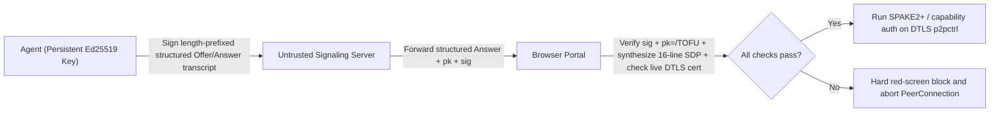

# Security and Cryptographic Boundaries

WebRTC Gateway enforces defense-in-depth with explicit trust roots spanning structured SDP synthesis, Ed25519 node identity, in-DTLS RFC 9383 SPAKE2+ authentication, cross-site dual-domain sandboxing, and strict proxy validation.

---

## 1. Structured SDP, Transport Encryption, and Ed25519 Node Identity

WebRTC DataChannels are encrypted with DTLS 1.2 (SCTP over DTLS, RFC 8261 / RFC 8831), and the signaling server never relays application traffic. To eliminate SDP parser differentials, delimiter injection, and active signaling MITM by construction, the stack combines structured `SessionDescriptor` exchange, persistent **Ed25519 Agent identity keys**, and live remote DTLS certificate verification:



- **Zero Raw Peer SDP Over Signaling**: Signaling transmits only strictly validated `SessionDescriptor` objects (`fp`, `ice_ufrag`, `ice_pwd`, `setup`, `mid`, `sctp_port`, `max_msg_size`, `sdp_ver`), and both peers deterministically synthesize minimal 16-line RFC 8841 DataChannel-only SDPs — eliminating multi-section and dual-fingerprint parser differentials;
- **Unconditional Pure Ed25519 Signing and Live DTLS Cert Binding**: Even under `-allow-public`, every Answer signs a length-prefixed transcript (`p2pgw-v7:answer-v2:`); both peers verify the actual negotiated remote DTLS certificate (`RTCDtlsTransport.getRemoteCertificates()` / Pion `GetRemoteCertificate()`, supporting multi-algorithm SDP fingerprint lines) against the signed fingerprint;
- **Key Pinning and Fail-Closed SSH-Style TOFU**:
  - Links carrying `#node?pk=<22-char-sha256>` enforce non-bypassable pinning, and a mismatched `?pk=` cannot silently override an already-trusted `IndexedDB` TOFU entry;
  - Bare `#node` visits commit TOFU only after Ed25519 verification and channel authentication succeed; `IndexedDB` I/O failures fail closed, and key mismatches trigger a hard red-screen block before password entry;
- **Unified Frontend TCB Boundary**: Both Portal and Sandbox content-hashed assets are delivered by the single authoritative Go `signal` binary via an explicit manifest inside one frontend TCB; Portal CSP strictly locks `connect-src 'self'` and prohibits runtime `?signal=` overrides.

---

## 2. Control Plane and In-DTLS RFC 9383 SPAKE2+ Authentication

### 1. Control Plane: Cluster Admission (`SIGNAL_SECRET` / `-node-secrets-file`)

- Go Signal verifies `Authorization: Bearer <secret>` during **HTTP WebSocket Upgrade**, supporting both cluster-wide `SIGNAL_SECRET` and per-node isolation via `-node-secrets-file` (when a node has an explicit per-node secret, global fallback is strictly rejected);
- Missing registration secrets fail closed at startup unless `-allow-anonymous-agents` is explicitly set;
- First registration binds node ownership via length-prefixed `p2pgw-v7:register-v2:` Ed25519 challenge-response with cross-restart atomic persistence via `-bound-keys-file` (`AtomicFileStore`); `-allow-force-rekey` defaults to `false` under a shared `SIGNAL_SECRET` (`true` under isolated per-node secrets) and requires both server opt-in and Agent `-force-rekey`.

### 2. Data Plane: In-DTLS `p2pctrl` RFC 9383 SPAKE2+

- **Zero Offline Brute-Force Oracle**: Visitor secrets (`ACCESS_SECRET`) bound to the verified `agent_pk` and `node_id` are derived via 1-Block `PBKDF2-HMAC-SHA256` (300,000 iterations) + `HKDF-SHA256` (`p2pgw-v7:spake2p-w0w1`) into SPAKE2+ verifiers (`w0`, `L = w1·G`) and verified inside DTLS `p2pctrl` via **RFC 9383 SPAKE2+ (P-256)** mutual zero-knowledge authentication (validating both `confirm_p` and `confirm_v`, blocking downgrades and all pre-auth pool DC frames);
- **Pre-PC Password Prompt and Single Attempt per Connection**: Portal prompts for the Owner password before creating `RTCPeerConnection` (eliminating human-typing races against the 10-second `UnauthSessionTimeout`); each connection permits strictly one auth attempt;
- **IPv6 `/64` Lockout-Preserving & Saturated Fail-Closed Rate Limiting**: `VisitorAuthLimiter` unmaps IPv4-mapped IPv6 addresses before normalizing true IPv6 addresses to `/64`, preserves active 5-minute lockouts under LRU pressure, and fails closed when saturated;
- **Unified Silent Reconnect**: On disconnect, Portal builds a fresh `RTCPeerConnection` and silently re-authenticates via SPAKE2+ reusing the tab's in-memory `(w0, w1)` verifier without storing plaintext passwords or reloading `appFrame`.

---

## 3. Ed25519 Scoped Capability Tokens and Persisted Revocation

Temporary sharing uses structured Capability Tokens signed by the Agent's Ed25519 private key:

```json
{
  "v": 7,
  "jti": "unique-token-id",
  "node": "homeserver",
  "exp": 1795752000,
  "path_prefix": "/public",
  "readonly": true,
  "max_conns": 4
}
```

- **Zero Password Re-Entry Minting and Live Continuous Revocation**: Authenticated Owners mint, list (paginated), and revoke tokens live over DTLS `CAP_REQ` (revocations persist atomically via `AtomicFileStore` to `-state-file` and terminate active streams/sessions immediately), or offline via `./bin/agent -mint-link 24h -mint-readonly -mint-path /public`; Portal immediately scrubs `cap=` from `location.hash` via `history.replaceState`;
- **Post-Resolve Scope Enforcement and Isolated Guest Jars**: Agent validates `path_prefix` (composed with `TargetSubpath`), `readonly` (stripping `X-HTTP-Method-Override`), and runtime expiration AFTER `DestinationPolicy.Resolve` canonicalization, and isolates each capability guest inside a dedicated `guestPool` `ProxyCookieJar` (`cap:<jti>:<rand>`) so guests sharing a link never share `HttpOnly` sessions;
- **Security Semantics**: A share link is a bearer capability — use short TTLs, minimal path prefixes, read-only mode when possible, and revoke tokens promptly when no longer needed.

---

## 4. 3-Tier Cross-Site Sandbox, W3C Fetch Anti-CSRF Gate, and Split-Pool Cookies

- **3-Tier Cross-Site Sandbox and `appFrame` Sandbox**: Production supports Tier 1 dual fixed domains (`-sandbox-host`), Tier 2 single-root same-site wildcard (`-allow-same-site-sandbox` + `Origin-Agent-Cluster: ?1`), and Tier 3 dual-root wildcard (`-sandbox-domain` + device-salted HMAC `sbx-<24hex>`; loopback auto-uses `*.localhost` while rejecting wildcard `*.localhost` WS Origins); `appFrame` enforces the `sandbox` attribute to block `top.location` hijacks;
- **W3C Fetch Anti-CSRF Gate and Asset Air-Gap**: Portal locks `style-src 'self'`, `connect-src 'self'`, `form-action 'self'`, and `frame-ancestors 'none'`, returning `404` on `/__p2p_gw__/sw.js` and `/__p2p_gw__/bridge.html`; SW enforces one-time 128-bit `enterNonce`, blocks unbound subresources, cross-site POSTs, and direct `document` navigations, and emits `Content-Security-Policy: frame-ancestors 'self' <portalOrigin>` on navigation and HTML responses;
- **Split-Pool RFC 6265bis `ProxyCookieJar` and In-Memory `CookieMirror`**: `ws_patch.ts` backs `Document.prototype.cookie` purely in memory (never touching browser cookies); Agent's `ProxyCookieJar` isolates `serverCookies` from `clientCookies` (blocking JS semicolon injection, name collisions, and flood eviction), enforcing Mozilla PSL, Leave Secure Cookies Alone, `__Host-`/`__Secure-`, `SameSite`, and the 400-day `MaxAge` cap synced bidirectionally via V7 inline TLVs.

---

## 5. Single-Target Proxy Boundary, Client IP Propagation, and Static File Sandbox

- **Strict Single-Target Confinement and WS 302 Escape Blocking**: Each Agent proxies strictly to its operator-configured `-target` exact `(scheme, host, port)` and optional subpath, rejecting `/__p2p_proxy__/`, `//` open redirects, backslashes, and `..;` traversal; consumes V7 `FetchCtx` flags (unset `SameOriginClient` fails closed as cross-site); `-upstream-host` overrides only the virtual-host `Host`/origin semantics and default HTTPS SNI without altering the dial target; WebSocket dialing disables 302 redirects;
- **Single-Pass Canonicalization and Right-to-Left XFF Peeling**: Go Signal canonicalizes `r.URL.EscapedPath()` once (blocking double URL encoding) and peels `X-Forwarded-For` right-to-left against loopback-only default `-trusted-proxies`;
- **Stepwise Go `os.Root` Static Adapter**: `-dir` and `-file` traverse directories via stepwise `os.Root.OpenRoot` plus `O_RDONLY|O_NONBLOCK|O_NOFOLLOW` opens, blocking multi-hop cross-root symlinks, dotfiles, and FIFO hangs, and apply `Content-Security-Policy: sandbox` to **all** static files (including extensionless files) while SW preserves multi-value CSPs via a strict directive tokenizer and `headers.append`.
