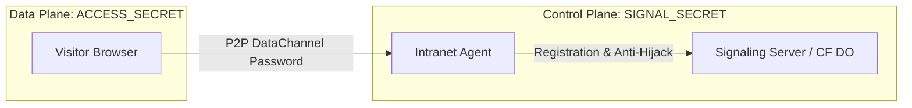

# Security Architecture & Access Control

WebRTC Gateway adheres to a Defense-in-Depth security philosophy, establishing multiple layers of protective barriers across the transport, control, data, and application sandbox planes.

---

## 1. Native Transport-Layer Encryption (DTLS-SRTP)

All traffic traversing the WebRTC `RTCDataChannel` is end-to-end encrypted via **DTLS 1.2 / 1.3** and **AES-128-GCM / AES-256-GCM**:
- **Zero-Knowledge Signaling**: The signaling server (whether self-hosted Go Signal or Cloudflare Workers) only routes ephemeral SDP/ICE metadata during initial handshakes. It cannot inspect, decrypt, or tamper with any application-layer HTTP requests or payload streams;
- **Man-in-the-Middle (MitM) Prevention**: The client browser and Agent exchange TLS certificate fingerprints during the DTLS handshake, guaranteeing remote peer authenticity.

---

## 2. Dual-Secret Decoupling Architecture

Starting with **v1.5.0**, the gateway completely decouples the legacy ambiguous `-secret` flag into two independent authentication tiers:



### ① Control Plane Registration Secret (`-signal-secret` / `SIGNAL_SECRET`)
- **Audience**: Shared strictly between the Signaling Server and authorized internal Agents;
- **Scope**: Controls Agent cluster admission and prevents Node ID hijacking (`Node Hijack Protection`);
- **Protection**: If an unauthorized party attempts to claim an existing `node-id` without the matching `signal-secret`, the signaling server rejects registration immediately;
- **Zero Client Knowledge**: **The signaling server never discloses this secret to visitor browsers**, and visitors do not need to know it.

### ② Data Plane Visitor Access Password (`-access-secret` / `ACCESS_SECRET`)
- **Public Open Mode (Default)**:
  - When `-access-secret` is empty, the node is a **Public Node**;
  - Visitors establish WebRTC tunnels directly without password prompts. Even if the signaling server enforces a strict cluster registration secret, public nodes remain accessible to external visitors;
- **Protected Private Mode**:
  - When `-access-secret` is configured, visitor browsers present a dark-themed password prompt (or accept credentials via URL Hash/Query);
  - The Agent validates the password upon receiving the WebRTC handshake Offer; invalid passwords terminate the connection without exposing intranet backend endpoints.

---

## 3. Stateless HMAC-SHA256 Expiring Share Links

Stateless temporary sharing requires no database, no Redis cache, and no revocation list:

```text
Signature Algorithm:
signature = HMAC-SHA256(nodeId + ":" + expTimestamp, access_secret)
```

### ① CLI Quick Generation
```bash
./agent -node-id mynas \
        -target http://127.0.0.1:8096 \
        -access-secret myPassword \
        -sign-link 24h
```

### ② Web Console Generation
Open any connected private node, click the settings gear icon in the top right, navigate to "Secure Expiring Share", select the desired duration (1 hour, 6 hours, 24 hours, 7 days, 30 days), and copy the generated link:  
👉 `https://p2p.yourdomain.com/#mynas?exp=1731852000&sign=3f89e...`

### ③ Key Advantages
- Visitors access the service directly with **zero password prompts**;
- Visitors **cannot deduce the master password** from the signature;
- Once expired, the Agent rejects the signature locally via millisecond-level timestamp comparison.

---

## 4. Production Rate Limiting & DoS Mitigation

### ① Agent Concurrent Stream Throttling (`-max-streams`)
- The Agent maintains a bounded stream semaphore (default: 512);
- Under traffic spikes or crawling attacks, requests exceeding capacity immediately receive `503 Service Unavailable` at the protocol layer, safeguarding lightweight backend devices (e.g. NAS or Raspberry Pi) from OOM crashes.

### ② Server Per-IP Connection Quota (`-max-ip-conns`)
- Tracks active WebSocket handshakes per client IP (default: 64);
- Rejects excess handshakes to prevent file descriptor and socket exhaustion on public signaling instances.

### ③ Trusted Reverse Proxy CIDR Filtering (`-trusted-proxies`)
- Automatically trusts private subnet CIDRs (`127.0.0.1/32`, `10.0.0.0/8`, `172.16.0.0/12`, `192.168.0.0/16`);
- When deployed directly on the public internet, requests from untrusted IPs ignore untrusted `X-Forwarded-For` headers and extract physical socket `RemoteAddr` values to eliminate IP spoofing.

---

## 5. Authoritative Client IP Propagation & WAF Integration

Starting with **v1.8.0**, the gateway provides end-to-end client IP transparency, ending the dilemma where intranet web servers see all tunneled visitors as `127.0.0.1`:

### ① Authoritative Source Injection & Anti-Spoofing
- **Signaling Source Anchor**: When relaying SDP Offers, the signaling server extracts the real physical socket IP (or Cloudflare `cf-connecting-ip`) and forcefully overrides `msg.ClientIP = session.RemoteIP`, discarding any client-forged IP metadata;
- **Agent Reverse-Proxy Override**: Before forwarding HTTP and WebSocket requests, the Agent overwrites `X-Forwarded-For` and `X-Real-IP` with the authoritative IP, blocking spoofed headers inside DataChannels.

### ② WAF & Security Tooling Synergy
- **Targeted IP Blacklists**: SafeLine, Nginx WAF, and ModSecurity accurately block malicious public IPs without mistakenly banning `127.0.0.1`;
- **Per-IP Rate Limiting**: HTTP 429 throttling applies specifically to the offending visitor IP;
- **GeoIP & Compliance Auditing**: Internal backend access logs record authentic visitor geolocation.
