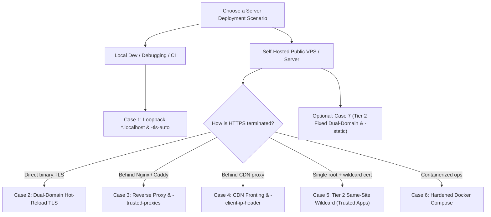

# Server Use Cases & Deployment Recipes

> Audience: operators deploying the signaling and portal service under different topologies (local, reverse proxy, Docker, and others).

This guide provides complete deployment templates and security boundaries for the single authoritative Go signaling and Portal server (`cmd/signal`) across common operational topologies. See [Production Deployment](./deployment) for domain planning and [Agent & Server Configuration](./agent-configuration) for the full parameter table.

---

## Topology Quick Reference



| Scenario | Server Stack | Key Flags / Config | Best Fit |
| :--- | :--- | :--- | :--- |
| **1. Local Dev & CI Verification** | Go `signal` | `-addr 127.0.0.1:8888 -dev`, optional `-tls-auto` | Local testing and E2E CI without public domains |
| **2. Dual-Domain VPS Direct TLS** | Go `signal` | `-portal-origin`, `-sandbox-origin`, `-bound-keys-file`, `-tls-cert` | Dedicated host with zero reverse-proxy dependency |
| **3. Behind Nginx / Caddy Proxy** | Go `signal` + proxy | `-trusted-proxies`, forward `Host`/`XFF`/WS | Sharing port 443 with existing websites |
| **4. Behind CDN / Edge Proxy** | Go `signal` + CDN | `-trusted-proxies`, `-client-ip-header`, `-node-secrets-file` | Origin IP hiding and per-node secret isolation |
| **5. Tier 2 Same-Site Wildcard** | Go `signal` | `-portal-origin`, `-sandbox-origin`, `-allow-same-site-sandbox` | Single root domain exposing only mutually trusted personal apps |
| **6. Hardened Container Stack** | Docker Compose | `read_only`, `cap_drop: [ALL]`, `signal_state` persistent volume | Public VPS runs `server`; intranet hosts run `agent` |
| **7. Tier 2 Fixed Dual-Domain & `-static`** | Go `signal` | `-portal-origin`, fixed `-sandbox-origin`, `-static` | Cross-site isolation without wildcard certs or custom external assets |

---

## Case 1: Local Development, Debugging & CI Verification

**Summary**: Passing `-dev` on a loopback listener (`127.0.0.1` or `::1`) enables RFC 6761 `*.localhost` cross-site sandbox mode (address-family scoped) with zero public domain or DNS setup.

```bash
# 1. Minimal loopback HTTP startup (enforcing >=16-byte SIGNAL_SECRET admission)
SIGNAL_SECRET=dev-cluster-secret-16b \
./bin/signal -addr 127.0.0.1:8888 -dev

# 2. Local HTTPS testing with in-memory self-signed cert (scoped to localhost / *.localhost / 127.0.0.1 / ::1)
SIGNAL_SECRET=dev-cluster-secret-16b \
./bin/signal -addr 127.0.0.1:8888 -dev -tls-auto

# 3. Throwaway local testing only: explicitly allow anonymous Agent registrations
./bin/signal -addr 127.0.0.1:8888 -dev -allow-anonymous-agents
```

> [!WARNING]
> Reserve `-allow-anonymous-agents` strictly for local or isolated test environments. Never enable it on public listeners, where any host could register and claim unbound node IDs.

---

## Case 2: Standard Cross-Site Dual-Domain VPS (Direct Hot-Reload TLS)

**Summary**: Terminating TLS directly in `signal` is the leanest production setup; `-tls-cert` and `-tls-key` reload automatically whenever disk file modification times change, so certificate renewals require neither process restarts nor WebSocket drops, while `-bound-keys-file` persists per-node Ed25519 key bindings across restarts.

### 2.1 Prerequisites

1. DNS records: point `portal.example.com` and wildcard `*.sandbox.example.net` to your server IP (the two domains must have distinct eTLD+1 suffixes).
2. TLS certificate: obtain a multi-domain SAN certificate covering `portal.example.com` and `*.sandbox.example.net` (for example via `acme.sh` DNS-01 automation).

### 2.2 Explicit YAML Config and systemd Unit

Create `/etc/webrtc-gateway/server.yaml` (see [`configs/server.example.yaml`](https://github.com/BeingNoAbility/WebRTC-Gateway/blob/main/configs/server.example.yaml) for every field):

```yaml
addr: "0.0.0.0:443"
portal_origin: "https://portal.example.com"
sandbox_origin: "https://*.sandbox.example.net"
tls_cert: "/etc/webrtc-gateway/certs/fullchain.pem"
tls_key: "/etc/webrtc-gateway/certs/privkey.pem"
bound_keys_file: "/var/lib/webrtc-gateway/bound-keys.json"
node_secrets_file: "/etc/webrtc-gateway/node-secrets.yaml"
max_ip_conns: 64
max_ip_msgs: 120
trusted_proxies: "127.0.0.0/8,::1/128"
metrics_addr: "127.0.0.1:9090"
```

Create `/etc/systemd/system/p2p-signal.service` (granting `CAP_NET_BIND_SERVICE` so a non-root user binds port 443):

```ini
[Unit]
Description=WebRTC Gateway Signaling Server
After=network-online.target
Wants=network-online.target

[Service]
Type=simple
User=p2pgw
Group=p2pgw
ExecStart=/usr/local/bin/signal -config /etc/webrtc-gateway/server.yaml
Environment=SIGNAL_SECRET_FILE=/etc/webrtc-gateway/signal.secret
AmbientCapabilities=CAP_NET_BIND_SERVICE
CapabilityBoundingSet=CAP_NET_BIND_SERVICE
NoNewPrivileges=true
ProtectSystem=strict
ReadOnlyPaths=/etc/webrtc-gateway
ReadWritePaths=/var/lib/webrtc-gateway
Restart=always
RestartSec=3

[Install]
WantedBy=multi-user.target
```

---

## Case 3: Behind an Nginx or Caddy Reverse Proxy

**Summary**: When port 443 is already managed by Nginx or Caddy, bind `signal` to `127.0.0.1:8888`, forward the original `Host`, `X-Forwarded-For`, and WebSocket `Upgrade` headers (external scheme and port are authoritatively declared via `-portal-origin` and `-sandbox-origin`, with zero runtime `X-Forwarded-Proto` guessing), and list the proxy's real CIDR in `-trusted-proxies` if it runs on another host or container bridge.

### 3.1 Start the Signaling Backend

```bash
SIGNAL_SECRET_FILE=/etc/webrtc-gateway/signal.secret \
./bin/signal \
  -addr 127.0.0.1:8888 \
  -portal-origin https://portal.example.com \
  -sandbox-origin 'https://*.sandbox.example.net' \
  -bound-keys-file /var/lib/webrtc-gateway/bound-keys.json \
  -trusted-proxies "127.0.0.0/8,::1/128"
```

### 3.2 Nginx Reverse Proxy Template

```nginx
map $http_upgrade $connection_upgrade {
    default upgrade;
    ''      close;
}

server {
    listen 443 ssl http2;
    server_name portal.example.com *.sandbox.example.net;

    ssl_certificate     /etc/nginx/certs/fullchain.pem;
    ssl_certificate_key /etc/nginx/certs/privkey.pem;

    location /ws/ {
        proxy_pass http://127.0.0.1:8888;
        proxy_http_version 1.1;
        proxy_set_header Upgrade $http_upgrade;
        proxy_set_header Connection $connection_upgrade;
        proxy_set_header Host $host;
        proxy_set_header X-Forwarded-For $proxy_add_x_forwarded_for;
        proxy_read_timeout 3600s;
        proxy_send_timeout 3600s;
    }

    location / {
        proxy_pass http://127.0.0.1:8888;
        proxy_http_version 1.1;
        proxy_set_header Host $host;
        proxy_set_header X-Forwarded-For $proxy_add_x_forwarded_for;
    }
}
```

### 3.3 Caddy Reverse Proxy Template

```text
portal.example.com, *.sandbox.example.net {
    tls {
        dns cloudflare {env.CF_API_TOKEN}
    }
    reverse_proxy 127.0.0.1:8888
}
```

> [!IMPORTANT]
> Always preserve `proxy_set_header Host $host`. `signal` enforces a strict Host allowlist; rewriting `Host` to `127.0.0.1:8888` causes every request to fail with `421 Misdirected Request`.

---

## Case 4: Behind a CDN / Edge Proxy & Per-Node Secret Isolation

**Summary**: Place Go `signal` behind any CDN or L7 edge proxy with `-trusted-proxies` and the single-value `-client-ip-header` flag (such as `CF-Connecting-IP`, `Fastly-Client-IP`, `True-Client-IP`, `CloudFront-Viewer-Address`, or `X-Real-IP`), and pair it with `-node-secrets-file` when multiple nodes share one signaling instance (minimum 16 bytes per secret; a node-specific secret strictly overrides the global `SIGNAL_SECRET` without fallback).

### 4.1 Self-Hosted Go Signal Behind a CDN Proxy

Configure strict origin TLS on your CDN (e.g. Cloudflare, Fastly, or CloudFront), add the trusted egress CIDRs to `-trusted-proxies`, and set `-client-ip-header` to the provider's single authoritative client IP header:

```bash
SIGNAL_SECRET_FILE=/etc/webrtc-gateway/signal.secret \
./bin/signal \
  -addr 0.0.0.0:443 \
  -portal-origin https://portal.example.com \
  -sandbox-origin 'https://*.sandbox.example.net' \
  -bound-keys-file /var/lib/webrtc-gateway/bound-keys.json \
  -node-secrets-file /etc/webrtc-gateway/node-secrets.yaml \
  -tls-cert /etc/webrtc-gateway/certs/origin.pem \
  -tls-key /etc/webrtc-gateway/certs/origin.key \
  -trusted-proxies "192.0.2.0/24,198.51.100.0/24" \
  -client-ip-header CF-Connecting-IP
```

> [!NOTE]
> Replace the RFC 5737 documentation CIDRs in `-trusted-proxies` with the actual CDN egress IP ranges (or your fronting reverse-proxy subnet) and set `-client-ip-header` to the single header emitted by your edge (supports both `IP` and `IP:port`). The header is honored only when the immediate peer matches `-trusted-proxies` and exactly one valid value is present; duplicate or malformed headers fail closed to the peer address.

### 4.2 Per-Node Admission Secret Map (`-node-secrets-file`)

When one signaling server brokers Agents across separate trust zones, create `/etc/webrtc-gateway/node-secrets.yaml` (mode `0600`):

```yaml
nas-media: "replace-with-nas-only-secret"
pve-console: "replace-with-pve-only-secret"
```

When `-node-secrets-file` is set without a global `SIGNAL_SECRET`, only listed nodes may register and unlisted nodes fail closed; add `-allow-force-rekey=false` to disable remote key rotation altogether.

---

## Case 5: Tier 2 Single-Root Same-Site Wildcard (Trusted Apps Only)

**Summary**: If you currently own only one root domain and expose solely mutually trusted personal intranet services, explicitly opt into `-allow-same-site-sandbox` (`ALLOW_SAME_SITE_SANDBOX=true`) using `https://portal.example.com` and a wildcard `https://*.sbx.example.com` certificate (the server emits `Origin-Agent-Cluster: ?1`).

```bash
SIGNAL_SECRET_FILE=/etc/webrtc-gateway/signal.secret \
./bin/signal \
  -addr 0.0.0.0:443 \
  -portal-origin https://portal.example.com \
  -sandbox-origin 'https://*.sbx.example.com' \
  -allow-same-site-sandbox \
  -bound-keys-file /var/lib/webrtc-gateway/bound-keys.json \
  -tls-cert /etc/webrtc-gateway/certs/wildcard-example.pem \
  -tls-key /etc/webrtc-gateway/certs/wildcard-example.key
```

> [!CAUTION]
> In this mode, the Portal and sandbox subdomains share the same eTLD+1 (same-site), removing browser site-level isolation; the Portal displays a persistent Tier 2 warning banner. Migrate to a distinct eTLD+1 Tier 1 cross-site wildcard `-sandbox-origin 'https://*.sandbox.example.net'` for multi-user or untrusted apps.

---

## Case 6: Hardened Container Deployment (Public Server + Intranet Agents)

**Summary**: The root [`docker-compose.yml`](https://github.com/BeingNoAbility/WebRTC-Gateway/blob/main/docker-compose.yml) enforces `read_only: true`, `cap_drop: [ALL]`, `no-new-privileges:true`, resource caps, persistent state volumes (`signal_state` and `agent_identity`), and `/app/server -health` probes. In production, run only `server` on a public host and run `agent` containers on each intranet machine.

### 6.1 Public VPS Running the Signaling Container Only

```bash
cat <<'EOF' > .env
PORTAL_ORIGIN=https://portal.example.com
SANDBOX_ORIGIN=https://*.sandbox.example.net
SIGNAL_URL=wss://portal.example.com/ws
SIGNAL_SECRET=replace-with-random-cluster-secret
ACCESS_SECRET=unused-on-server-only-host
TRUSTED_PROXIES=127.0.0.0/8,::1/128
EOF

docker compose up -d server
docker compose ps server
```

### 6.2 Intranet Host Running a Standalone Agent Container

```bash
docker run -d \
  --name webrtc-p2p-agent-nas \
  --restart unless-stopped \
  --read-only \
  --cap-drop ALL \
  --security-opt no-new-privileges:true \
  --tmpfs /tmp:noexec,nosuid,size=16m \
  --network host \
  -v agent_nas_identity:/var/lib/webrtc-gateway \
  -e NODE_ID=nas-media \
  -e SIGNAL_URL=wss://portal.example.com/ws \
  -e SIGNAL_SECRET=replace-with-random-cluster-secret \
  -e ACCESS_SECRET=replace-with-visitor-secret \
  -e IDENTITY_KEY=/var/lib/webrtc-gateway/nas-media.ed25519.key \
  -e STATE_FILE=/var/lib/webrtc-gateway/nas-media.state.json \
  -e TARGET_URL=http://127.0.0.1:8096 \
  ghcr.io/beingnoability/webrtc-p2p-agent:v5.0.0-alpha.3
```

> [!TIP]
> On macOS or Windows Docker Desktop, `--network host` cannot reach host loopback services. Omit `--network host`, pass `--add-host=host.docker.internal:host-gateway`, and point `TARGET_URL` to `http://host.docker.internal:8096`.

---

## Case 7: Tier 2 Fixed Cross-Site Host & External `-static` Override

**Summary**: When wildcard certificates are unavailable for a single-node or mutually trusted setup, use a fixed cross-site `-sandbox-origin https://app.example.net` (two ordinary HTTP-01 certs; Portal displays the Tier 2 warning banner); pass `-static` to override embedded web assets without rebuilding Go binaries.

### 7.1 Tier 2 Fixed Cross-Site Host (Zero Wildcard Certs)

Point two fixed hostnames on distinct eTLD+1 sites (`portal.example.com` and `app.example.net`) to the server with ordinary ACME HTTP-01 certificates:

```bash
SIGNAL_SECRET_FILE=/etc/webrtc-gateway/signal.secret \
./bin/signal \
  -addr 0.0.0.0:443 \
  -portal-origin https://portal.example.com \
  -sandbox-origin https://app.example.net \
  -bound-keys-file /var/lib/webrtc-gateway/bound-keys.json \
  -tls-cert /etc/webrtc-gateway/certs/dual-fixed.pem \
  -tls-key /etc/webrtc-gateway/certs/dual-fixed.key
```

### 7.2 Overriding Embedded Assets with `-static`

When `-static` is set, `signal` serves exclusively from the external directory via `manifest.json` and never mixes disk files with the embedded `DistFS`, preventing mismatched bundle versions:

```bash
npm --prefix web run build

SIGNAL_SECRET_FILE=/etc/webrtc-gateway/signal.secret \
./bin/signal \
  -addr 127.0.0.1:8888 \
  -portal-origin https://portal.example.com \
  -sandbox-origin 'https://*.sandbox.example.net' \
  -static /srv/webrtc-gateway/web/dist
```

All content-hashed Portal and Sandbox assets are served uniformly by the single Go `signal` binary with CSP locked to `connect-src 'self'` and zero runtime `?signal=` overrides.
