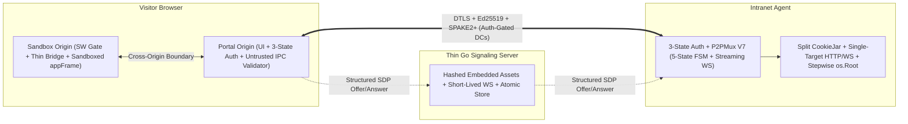

# RFC: WebRTC Gateway V7 Architecture (Honest Boundaries, P2PMux V7, Split CookieJar & Tiered Deployment)

> **Status**: Implemented  
> **Target Release**: `v5.0.0-alpha.3` / `v5.0.0` (wire protocol `P2PMux V7`)  
> **Related Docs**: [Constitution](../CONSTITUTION.md), [Review Guidelines](../REVIEW_GUIDELINES.md), [P2PMux Wire Specification](../guide/protocol-specification.md)

---

## 1. Design Goals

To consolidate WebRTC Gateway around honest security boundaries, strict memory accounting, and practical zero-client deployment, the V7 architecture addresses five core engineering goals:

1. **Honest Sandbox Boundaries & W3C Fetch Anti-CSRF Gating**: Avoid same-origin false boundaries between `bridge.html` and the proxied `appFrame`; enforce the HTML `sandbox` attribute on `appFrame`; and avoid relying on network-layer `Sec-Fetch-Site` (invisible to Service Worker `FetchEvent.request.headers`) by enforcing native W3C Fetch metadata and one-time `enterNonce` checks.
2. **Strict Protocol & Memory Budget Bounds**: Gate pre-negotiated HTTP pool DataChannels prior to authentication; prevent zero-byte and micro-fragment bypasses or heap amplification against `MemoryBudget`; forbid same-slot high-`Gen` preemption races; stream WebSocket traffic through fixed buffers while preserving RFC 6455 close codes; and prevent `204` or early-response `POST` requests from leaking client pool slots.
3. **Symmetric Auth FSM & Atomic Persistence**: Mandate unconditional `confirm_v` verification matched against the sent SPAKE2+ auth method; replace fragile roaming ratchets with stateless silent reconnects; use single-writer atomic persistence in `CapabilityStore` and `SignalBroker` to eliminate concurrent write races; and enforce fail-closed behavior when auth rate limiters saturate.
4. **Split-Pool Cookie Isolation & Single-Path Causal Sync**: Enforce RFC 6265 `cookie-octet` validation on client cookie mutations and isolate them from authoritative server `HttpOnly` / `Secure` cookies; eliminate cross-stream ordering races with single-path TLV sync; and keep `<meta charset>` within the browser's 1024-byte HTML5 prescan window.
5. **Single-Binary Asset Embedding & Tiered Deployment**: Verify content-hashed embedded frontend assets against an explicit build manifest, and offer three production sandbox tiers (dual fixed domains without wildcard certs, single-domain wildcard, and dual-domain wildcard) while preserving Portal-to-App origin separation.

---

## 2. Six V7 Architectural Decisions

### 2.1 Decision 1: Single-Binary Hashed Asset Embedding & Three-Tier Deployment

- Remove independent static Portal hosting paths (`-signal-origin`, `-allowed-origins`, `__SIGNAL_ORIGIN__`), consolidating on single-binary `cmd/signal` distribution with content-hashed frontend assets verified against the build manifest.
- Preserve strict Portal-to-App origin separation while offering three explicit deployment tiers:
  - **Tier 1 Dual Fixed Domains (No Wildcard)**: `-portal-domain` + `-sandbox-host` (distinct eTLD+1, compatible with standard HTTP-01 TLS automation, enforcing cross-site Portal-to-App isolation).
  - **Tier 2 Single-Domain Wildcard**: `-portal-domain` + `-sandbox-domain` + `-allow-same-site-sandbox` (forces `Origin-Agent-Cluster: ?1`).
  - **Tier 3 Dual-Domain Wildcard**: `-portal-domain` + `-sandbox-domain` (distinct eTLD+1, providing both cross-site and per-node/guest isolation).
- Default `-allow-force-rekey` to `false` when using a shared cluster `SIGNAL_SECRET`; enforce absolute client signaling lifetimes and post-offer idle timeouts; and implement concurrent bounded-timeout fan-out in `Broker.CloseAll()`.

### 2.2 Decision 2: Honest Trust Boundaries & W3C Fetch Native SW CSRF Gate

- Recognize only three real boundaries: Portal ↔ App Sandbox cross-origin, Portal ↔ Agent E2E authenticated DTLS, and Agent ↔ upstream target / read-only files. `bridge.html` acts solely as a thin `MessagePort` relay, and Portal `TunnelBridge` MUST treat all `bridgePort` input as untrusted.
- `appFrame` MUST enforce the HTML `sandbox` attribute (`allow-scripts allow-same-origin allow-forms allow-modals allow-downloads allow-popups allow-popups-to-escape-sandbox allow-pointer-lock`, omitting `allow-top-navigation` and `allow-top-navigation-by-user-activation`).
- The Service Worker MUST NOT rely on `Sec-Fetch-Site` in `FetchEvent.request.headers` or blind `lastTabId` fallback; it MUST enforce cross-site isolation via `event.clientId`, `event.resultingClientId`, `request.mode`, `request.destination`, `request.method`, `request.referrer`, and one-time `enterNonce`, paired with `Content-Security-Policy: frame-ancestors <portalOrigin>` (restricting any unbound `iframe` empty-`referrer` fallback to `sessions.size === 1` without setting `SameOriginClient`).
- Under wildcard tiers, Owner sandbox subdomains derive from a local 128-bit per-browser random salt (unpredictable externally, persistent locally across reloads), while Capability guests use per-tab random subdomains preserved across in-tab reconnects.

### 2.3 Decision 3: P2PMux V7 (5-State Single-Slot FSM, Native TLV Metadata & Streaming WS)

- Bump wire version to `ProtocolVersion = 7`; retain compact `TypeContinuation (0x11)` + `FlagMoreHeaders (0x04)` for compatibility with `MinNegotiatedMaxMsgSize = 4096`, tightening total assembled headers to `64 KiB` (`MaxContinuationFrames = 16`) under an explicit 5-state single-slot FSM (`IDLE -> RECEIVING_HEADERS -> OPEN -> HALF_CLOSED -> CLOSED`).
- Forbid same-slot high-`Gen` preemption; forbid `DATA`/`WS_*` or duplicate `HEADERS` during `RECEIVING_HEADERS`; forbid non-final 0-byte `CONTINUATION` and 0-byte `WS_CONT`; charge `headerChunks` against memory budgets with a 5-second assembly timeout.
- Remove `TypeCookieSync (0x07)` and `x-p2p-*` pseudo-headers, moving `fetchCtx`, `respFlags`, in-band client cookie mutations, and server cookie deltas into native V7 binary TLV fields.
- Account `len(payload) + 64` per queued chunk with a hard per-stream queue cap (`4096`); replace 2 ms busy polling with event-driven `OnBufferedAmountLow` backpressure; and stream `WSProxy` in `16 KiB` chunks while preserving valid RFC 6455 close codes.

### 2.4 Decision 4: Symmetric 3-State Auth FSM, Upgraded SPAKE2+ KDF & Silent Reconnect

- Remove the fragile sequential HKDF roaming ratchet (ICE Restart); upon disconnect, Portal silently establishes a fresh `RTCPeerConnection` and reattaches `bridgePort` while keeping `appFrame` mounted, resuming `ProxyCookieJar` via `cookie_resume_token` and reusing in-RAM derived `(w0, w1)` for the current tab.
- Enforce strict `WAIT_CHALLENGE -> WAIT_RESULT -> AUTHENTICATED` transitions; the client MUST match server `role` against its sent auth method, verify `confirm_v` unconditionally for SPAKE2+, and commit TOFU only after mutual verification; the Agent MUST atomically reject all non-`p2pctrl` frames prior to authentication.
- Update SPAKE2+ domain tags to `p2pgw-v7:*`, mix verified `agentPK` into the salt, derive `(w0, w1)` via single-block 300,000-iteration PBKDF2-HMAC-SHA256 + HKDF-SHA256, and enforce Capability revocation continuously at auth commit, stream routing, and periodic sweeps.

### 2.5 Decision 5: Split-Pool `ProxyCookieJar` & Single-Path Causal Sync

- Split `ProxyCookieJar` into an authoritative `serverCookies` pool and a quota-bounded `clientCookies` pool: client mutations MUST pass strict RFC 6265 `cookie-octet` validation and MUST NOT evict, overwrite, or downgrade server cookies; partition `SessionCookieManager` quotas by role and enforce idle TTLs on resumption.
- Consolidate cookie synchronization onto the single in-band V7 TLV path to eliminate cross-stream SCTP reordering.

### 2.6 Decision 6: Shared Atomic Persistence, Fail-Closed Limiters & Adversarial Gate

- Introduce a shared single-writer `pkg/state` atomic persistence component for `CapabilityStore` and `SignalBroker`; enforce fail-closed rejection when auth limiters saturate; reject malformed `-trusted-proxies` and `SIGNAL_URL` inputs at startup; and traverse static directories stepwise via `os.Root.OpenRoot`.
- Upgrade `scripts/gate.sh --full` to enforce embedded manifest completeness, zero `>= 400` gateway responses and zero uncaught exceptions in Chrome CDP, RFC 9383 Appendix C vectors, and Go/Node fuzz smoke tests.
