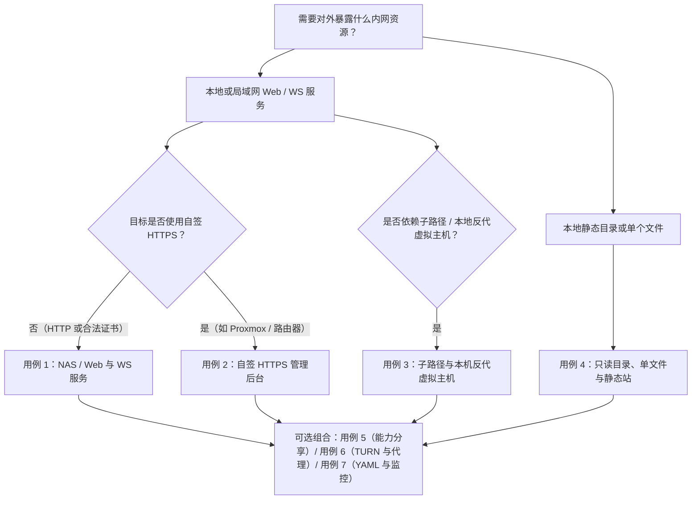

# Agent 典型用例与配置模板 (Agent Use Cases)

本页按真实业务场景给出内网 Agent 的完整配置模板、启动命令与安全边界。完整参数字典见 [Agent 与服务端配置](./agent-configuration)，静态适配器原理见 [只读文件与目录适配器](./file-server)，安全模型见 [安全机制与密码学边界](./security)。

---

## 场景速查表



| 场景 | 核心模式与关键参数 | 访问方式 | 适用对象 |
| :--- | :--- | :--- | :--- |
| **1. NAS / 自托管 Web 与 WS 应用** | `-target http://...`、`ACCESS_SECRET_FILE`、持久化 `-identity-key` | Portal 输入口令 | Jellyfin、Home Assistant、Gitea、Code-Server |
| **2. 自签 HTTPS 内网管理后台** | `-target https://...`、`-insecure-target`、`-sni` | Portal 输入口令 | Proxmox VE、ESXi、OpenWrt、NAS HTTPS 面板 |
| **3. 子路径与本机反代虚拟主机** | `-target https://.../subpath`、`-upstream-host`、`-sni` | Portal 输入口令 | 子路径应用、Nginx/Caddy/Ingress 虚拟主机与多服务聚合 |
| **4. 只读静态目录 / 单文件 / 文档站** | `-dir` 或 `-file`、`-hide-dotfiles`、按需 `-file-inline-active` | 口令或能力链接 | 照片/备份目录、安装包分发、构建报告站 |
| **5. 临时协作与自动化外链** | Portal 在线签发、CLI 离线 `-mint-link`、公开 `-allow-public` | `?pk=...&cap=...` 或免密 | 外部演示、CI 报告外链、短期只读分享 |
| **6. 严苛网络（对称 NAT / 跳板代理）** | `-turn-url` / `TURN_PASS_FILE`、`-proxy`、`-ice-mdns=true` | 与常规模式一致 | 双端对称 NAT、隔离 VLAN、企业出口限制 |
| **7. 生产运维（YAML / 轮换 / 监控）** | `-config`、`-force-rekey`、`-metrics-addr`、`-ephemeral-identity` | 运维管理与告警 | systemd 常驻、密钥轮换、Prometheus 采集 |

---

## 用例 1：个人 NAS / 自托管 Web 与 WebSocket 应用

**结论**：为每个内网应用运行独立的 Agent 进程与独立的 `-id`，使用 `*_FILE` 挂载密钥文件并持久化 `-identity-key`，确保多应用之间经跨站沙箱严格隔离且重启后浏览器 TOFU 与钉扎链接不失效。

### 1.1 命令行与密钥文件启动

```bash
# 准备最小权限密钥文件（仅运行用户可读）
install -d -m 0700 /etc/webrtc-gateway /var/lib/webrtc-gateway
printf '%s' 'replace-with-cluster-secret' > /etc/webrtc-gateway/signal.secret
printf '%s' 'replace-with-visitor-secret' > /etc/webrtc-gateway/access-nas.secret
chmod 0600 /etc/webrtc-gateway/*.secret

# 启动 Agent 反代本地应用（同时透传 HTTP、206 Range 与 WebSocket）
SIGNAL_SECRET_FILE=/etc/webrtc-gateway/signal.secret \
ACCESS_SECRET_FILE=/etc/webrtc-gateway/access-nas.secret \
./bin/agent \
  -id nas-media \
  -signal wss://portal.example.com/ws \
  -target http://127.0.0.1:8096 \
  -identity-key /var/lib/webrtc-gateway/nas-media.ed25519.key
```

访客在浏览器打开 `https://portal.example.com/#nas-media`，首次建立 DTLS 隧道后按提示输入访问口令，浏览器会自动记录该节点的 Ed25519 公钥指纹（TOFU）。

### 1.2 单机托管多个内网应用（systemd 模板）

每个 Agent 实例绑定一个目标服务与一个 `node_id`。使用 systemd 实例化模板（`/etc/systemd/system/p2p-agent@.service`）可为不同服务维护独立配置文件与独立 Ed25519 身份私钥：

```ini
[Unit]
Description=WebRTC Gateway Agent (%i)
After=network-online.target
Wants=network-online.target

[Service]
Type=simple
User=p2pgw
Group=p2pgw
ExecStart=/usr/local/bin/agent -config /etc/webrtc-gateway/agent-%i.yaml
Environment=SIGNAL_SECRET_FILE=/etc/webrtc-gateway/signal.secret
Environment=ACCESS_SECRET_FILE=/etc/webrtc-gateway/access-%i.secret
Restart=always
RestartSec=3
NoNewPrivileges=true
ProtectSystem=strict
ReadWritePaths=/var/lib/webrtc-gateway

[Install]
WantedBy=multi-user.target
```

> [!TIP]
> 切勿将所有内网服务聚合到同一个宽泛反代后再挂单个 Agent。为不同信任级别的应用分配独立 `node_id`，可让浏览器跨站沙箱把每个应用隔离在各自独立的源（`sbx-<hash>.sandbox.example.net`）中。

---

## 用例 2：内网自签 HTTPS 管理后台（Proxmox VE / 路由器 / NAS）

**结论**：Agent 默认严格校验上游 HTTPS 证书链；穿透使用自签名证书或内网私有 CA 的后台时显式启用 `-insecure-target`，若上游按虚拟主机域名路由还需通过 `-sni` 指定 TLS SNI。

```bash
SIGNAL_SECRET_FILE=/etc/webrtc-gateway/signal.secret \
ACCESS_SECRET_FILE=/etc/webrtc-gateway/access-pve.secret \
./bin/agent \
  -id pve-console \
  -signal wss://portal.example.com/ws \
  -target https://192.0.2.10:8006 \
  -insecure-target \
  -sni pve.internal.example \
  -identity-key /var/lib/webrtc-gateway/pve-console.ed25519.key
```

> [!WARNING]
> `-insecure-target` 仅跳过 Agent 到内网目标之间的 TLS 证书链校验，不影响访客浏览器到 Agent 之间的 DTLS 1.2 与 Ed25519 验签。仅在目标处于可信内网网段时启用。

---

## 用例 3：子路径应用与本机通用反代虚拟主机（`-upstream-host`）

**结论**：每个 Agent 严格锁定单一 `-target` 精确源（零外域代理与零黑盒主机改写）。针对按 `Host` 头分流的本机 Nginx / Caddy / Ingress 虚拟主机或子路径应用，使用 `-upstream-host` 与 `-sni` 无缝衔接；复杂多源聚合或响应体改写统一交由 `-target` 下游的通用反代承担。

```bash
SIGNAL_SECRET_FILE=/etc/webrtc-gateway/signal.secret \
ACCESS_SECRET_FILE=/etc/webrtc-gateway/access-app.secret \
./bin/agent \
  -id intranet-suite \
  -signal wss://portal.example.com/ws \
  -target https://127.0.0.1:443/dashboard \
  -upstream-host app.internal.example \
  -sni app.internal.example \
  -identity-key /var/lib/webrtc-gateway/intranet-suite.ed25519.key
```

- **子路径禁锢**：当 `-target` 包含 `/dashboard` 时，代理会将所有请求限定在该前缀之下，拦截 `/../admin` 与 `/..;/admin` 类越权路径。
- **`-upstream-host`（`UPSTREAM_HOST`）**：按 RFC 9110 `host[:port]` 严格校验（启动期 Fail-Closed，仅 `-target` 模式有效），同步覆写 HTTP 与 WebSocket 上游 `Host` 头、`Origin`/`Referer` 改写、`Location` 重定向匹配与 `ProxyCookieJar` 虚拟主机域校验；连接 HTTPS 虚拟主机时配合 `-sni` 一并使用。

> [!TIP]
> 若某个应用依赖分离式前后端多域名聚合、复杂路径剥离、响应头增删或响应体文本替换（例如 Nginx `sub_filter` / Caddy 改写规则），无需修改 Agent：直接在本机部署一层通用反向代理（Nginx / Caddy 或独立轻量 HTTP 适配 Sidecar）承接改写逻辑，再将 `Agent -target`（按需配 `-upstream-host`）指向该本机反代地址即可。完整 Nginx / Caddy 配方见 [本地反代协作与典型适配模式](./reverse-proxy-recipes.md)。

---

## 用例 4：只读静态目录、单文件分发与静态站点托管

**结论**：`-dir` 与 `-file` 基于 Go `os.Root` 句柄提供只读文件服务，无需额外搭建 Nginx 或文件服务器，并与 `-target` 互斥。

### 4.1 共享只读目录或单个安装包

```bash
# 共享只读目录（默认隐藏点文件与指向点文件的软链，且对全部静态文件下发 CSP: sandbox）
SIGNAL_SECRET_FILE=/etc/webrtc-gateway/signal.secret \
ACCESS_SECRET_FILE=/etc/webrtc-gateway/access-files.secret \
./bin/agent \
  -id team-files \
  -signal wss://portal.example.com/ws \
  -dir /srv/share \
  -identity-key /var/lib/webrtc-gateway/team-files.ed25519.key

# 分发单个大文件（直接挂载于根路径 /，支持 206 Range 断点续传）
SIGNAL_SECRET_FILE=/etc/webrtc-gateway/signal.secret \
ACCESS_SECRET_FILE=/etc/webrtc-gateway/access-pkg.secret \
./bin/agent \
  -id build-artifact \
  -signal wss://portal.example.com/ws \
  -file /srv/releases/app-release.tar.gz \
  -identity-key /var/lib/webrtc-gateway/build-artifact.ed25519.key
```

### 4.2 托管可信静态前端站点或构建文档报告

默认情况下，`-dir` 对**全部**静态文件（含 `.html` / `.svg` / 无扩展名文件）下发 `Content-Security-Policy: sandbox` 禁用脚本执行，防止不可信文件触发同源 XSS。仅当目录内全部文件均由你自己生成且受信任（例如 VitePress 文档、覆盖率报告、前端单页产物）时，才显式开启 `-file-inline-active`：

```bash
SIGNAL_SECRET_FILE=/etc/webrtc-gateway/signal.secret \
ACCESS_SECRET_FILE=/etc/webrtc-gateway/access-docs.secret \
./bin/agent \
  -id ci-report \
  -signal wss://portal.example.com/ws \
  -dir /srv/ci-reports/latest \
  -file-inline-active \
  -identity-key /var/lib/webrtc-gateway/ci-report.ed25519.key
```

---

## 用例 5：临时外部协作、能力分享链接与公开演示

**结论**：不要把主密码 `ACCESS_SECRET` 发给临时访客。人工临时分享优先在浏览器 Portal 内**在线签发**；无头脚本与 CI 流水线使用 CLI **离线签发**（`-mint-link`）；完全公开的静态/演示站点显式使用 `-allow-public`。

### 5.1 Portal 在线签发 vs CLI 离线签发

| 维度 | Portal 弹窗在线签发（`CAP_REQ`） | CLI 离线签发（`-mint-link`） |
| :--- | :--- | :--- |
| **适用场景** | 管理员日常在浏览器内临时分享给他人 | SSH 运维、CI 构建完成推送、定时脚本自动出链 |
| **是否需要常驻 Agent** | 是（当前已建立的 Owner DTLS 会话） | **是**（CLI 仅读私钥签名打印 URL 后退出，须另有常驻 daemon 运行） |
| **Portal 列表可见与即时吊销** | **即时支持**（在线查看活跃连接并一键吊销；原子持久化至 `-state-file`） | **重启后可见**（CLI 会将记录持久化至 `-state-file`，但常驻 daemon 仅在启动时加载状态文件，在线不自动重载；建议设置短 TTL） |
| **密钥一致性要求** | 自动使用常驻 Agent 密钥 | 必须与常驻 daemon 使用同一份持久化 `-identity-key`（不可与 `-ephemeral-identity` 混用） |

### 5.2 CLI 离线签发短期只读分享链接（配合常驻 daemon）

```bash
# 假设后台已运行 -id team-files 的常驻 Agent，且共用同一份持久化 Ed25519 私钥：
SHARE_URL=$(./bin/agent \
  -id team-files \
  -identity-key /var/lib/webrtc-gateway/team-files.ed25519.key \
  -portal-url https://portal.example.com \
  -mint-link 2h \
  -mint-path /public \
  -mint-readonly \
  -mint-max-conns 5)

printf '%s\n' "$SHARE_URL"
```

在容器化部署下，可直接复用挂载了持久化身份卷 `agent_identity` 的服务定义执行一次性出链：

```bash
docker compose run --rm agent \
  -mint-link 24h \
  -mint-readonly \
  -mint-path /public \
  -portal-url https://portal.example.com
```

> [!IMPORTANT]
> `-mint-readonly` 在代理层仅放行 `GET`、`HEAD`、`OPTIONS` 并拦截 WebSocket，非常适合 `-dir` 静态目录、纯文档站与规范 REST 监控页；若目标应用依赖 `POST` API（如 GraphQL）或 WebSocket 才能渲染页面，请省略 `-mint-readonly` 并缩短有效期与 `-mint-max-conns`。

### 5.3 免密公开展示（`-allow-public`）

若需对外公开只读文档或演示环境，显式声明 `-allow-public`（仍然保留 Ed25519 节点身份验签与跨站沙箱隔离）：

```bash
SIGNAL_SECRET_FILE=/etc/webrtc-gateway/signal.secret \
./bin/agent \
  -id public-demo \
  -signal wss://portal.example.com/ws \
  -dir /srv/public-docs \
  -allow-public \
  -identity-key /var/lib/webrtc-gateway/public-demo.ed25519.key
```

---

## 用例 6：严苛网络（对称 NAT、自建 TURN 与隔离内网代理）

**结论**：双端对称 NAT 无法直接打洞时配置用户自建 TURN（仅转发端到端 DTLS 密文）；Agent 需经跳板代理访问隔离 VLAN 内的目标服务时配置 `-proxy`；需要连出外网信令时通过标准 `HTTPS_PROXY` 环境变量控制。

```bash
SIGNAL_SECRET_FILE=/etc/webrtc-gateway/signal.secret \
ACCESS_SECRET_FILE=/etc/webrtc-gateway/access-corp.secret \
TURN_PASS_FILE=/etc/webrtc-gateway/turn.secret \
./bin/agent \
  -id branch-erp \
  -signal wss://portal.example.com/ws \
  -target http://198.51.100.30:8080 \
  -proxy socks5://127.0.0.1:1080 \
  -stun-servers "stun:stun.example.com:3478" \
  -turn-url "turn:turn.example.com:3478?transport=udp" \
  -turn-user relay-user \
  -ice-mdns=true \
  -identity-key /var/lib/webrtc-gateway/branch-erp.ed25519.key
```

- **`-proxy`（`PROXY_URL`）作用范围**：严格作用于 Agent 到上游 `-target` 的 HTTP 与 WebSocket 请求；若 URL 格式无效，Agent 按 Fail-Closed 原则直接拒绝启动，绝不回退直连。
- **信令出站代理**：Agent 连接信令 WebSocket 遵循标准 `HTTPS_PROXY` / `HTTP_PROXY` / `NO_PROXY` 环境变量。
- **TURN 格式规范**：必须使用 RFC 7065 格式（`turn:host:port?transport=udp` 或 `turns:host:5349?transport=tcp`），不得包含 `//`。
- **隐私隐藏**：`-ice-mdns` 默认开启（`true`），隐藏宿主机局域网、Docker 网桥与 VPN 网卡私有 IP。

---

## 用例 7：YAML 配置文件、密钥轮换与可观测性

**结论**：复杂参数优先写入显式 YAML 配置文件（通过 `-config` 或 `CONFIG_FILE` 加载），敏感密钥仍通过 `*_FILE` 环境变量注入；需要轮换泄露或重装后的 Ed25519 私钥时显式附加 `-force-rekey`。

### 7.1 显式 YAML 配置模板（`/etc/webrtc-gateway/agent-nas.yaml`）

完整字段参考见 [`configs/agent.example.yaml`](https://github.com/BeingNoAbility/WebRTC-Gateway/blob/main/configs/agent.example.yaml)。

```yaml
node_id: "nas-media"
signal_url: "wss://portal.example.com/ws"
identity_key: "/var/lib/webrtc-gateway/nas-media.ed25519.key"
state_file: "/var/lib/webrtc-gateway/nas-media.state.json"
target_url: "http://127.0.0.1:8096"
ice_mdns: true
max_streams: 512
metrics_addr: "127.0.0.1:9091"
portal_url: "https://portal.example.com"
```

启动与本地健康探测：

```bash
SIGNAL_SECRET_FILE=/etc/webrtc-gateway/signal.secret \
ACCESS_SECRET_FILE=/etc/webrtc-gateway/access-nas.secret \
./bin/agent -config /etc/webrtc-gateway/agent-nas.yaml

# 容器或巡检脚本探测 /healthz（可自定义 -health-url）
./bin/agent -health -health-url http://127.0.0.1:9091/healthz
```

### 7.2 合法轮换 Ed25519 节点身份密钥（`-force-rekey`）

信令服务端会记住每个 `node_id` 首次绑定的 Ed25519 公钥（配置 `-bound-keys-file` 时跨重启持久化；否则在离线宽限期内阻止异钥抢占）。当宿主机重装或主动轮换密钥时，需先确认服务端允许换钥（共享 `SIGNAL_SECRET` 下 `-allow-force-rekey` 默认 `false`，须使用逐节点 `-node-secrets-file` 或在服务端临时显式开启 `-allow-force-rekey=true`），再为 Agent 传入一次 `-force-rekey` 刷新绑定，完成后移除该参数：

```bash
rm -f /var/lib/webrtc-gateway/nas-media.ed25519.key

SIGNAL_SECRET_FILE=/etc/webrtc-gateway/signal.secret \
ACCESS_SECRET_FILE=/etc/webrtc-gateway/access-nas.secret \
./bin/agent \
  -config /etc/webrtc-gateway/agent-nas.yaml \
  -force-rekey
```

> [!NOTE]
> 仅在一次性 CI 或临时排障且不关心浏览器 TOFU 连续性时使用 `-ephemeral-identity`。常规常驻部署应当始终使用持久化 `-identity-key`。
