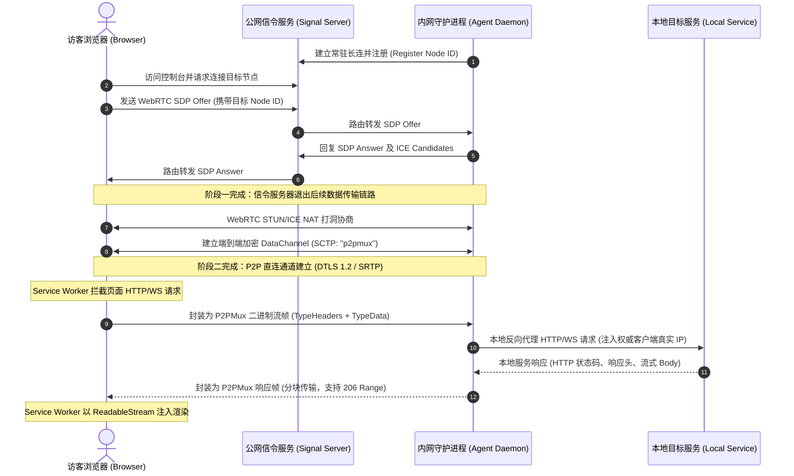

# 系统架构与核心设计 (Architecture & Design)

WebRTC Gateway 采用分层解耦的云原生边缘架构，由三个核心组件协作构成：
1. **Browser Client (前端沙箱运行时)**：包含 Web 门户 App-Shell、Service Worker 流量拦截器、DOM 虚拟化补丁 (`patch.js`) 与 TypeScript 版 P2PMux 二进制调度器；
2. **Signaling Server (信令撮合中心)**：无状态或轻量内存状态的 WebSocket 撮合服务（支持 Cloudflare Workers 或独立 Go 守护进程），仅在握手阶段传递 SDP Offer/Answer 及 ICE Candidates，一旦 P2P 建立即退出数据传输路径；
3. **Agent Daemon (内网守护进程)**：Go 编写的常驻服务，管理 WebRTC PeerConnection，负责 P2PMux 二进制流解包与多路复用，并向本地服务反代 HTTP/WS 或直接在内存中推流本地文件。

---

## 1. 端到端系统交互时序



---

## 2. P2PMux v1 二进制流式多路复用协议规范

为了在单个 WebRTC `RTCDataChannel` 上并发承载成百上千个独立的 HTTP 请求、大文件下载与 WebSocket 连接，且避免单个大文件的慢传输饿死关键 API（消除应用层发送队头饥饿 Application-Level Write Starvation，单有序通道在物理网络丢包下仍受 SCTP 传输层重传延迟约束），网关设计了轻量级二进制多路复用协议 **P2PMux v1**。

### 协议帧结构 (10 字节固定头部)：

```text
 0                   1                   2                   3
 0 1 2 3 4 5 6 7 8 9 0 1 2 3 4 5 6 7 8 9 0 1 2 3 4 5 6 7 8 9 0 1
+-+-+-+-+-+-+-+-+-+-+-+-+-+-+-+-+-+-+-+-+-+-+-+-+-+-+-+-+-+-+-+-+
|                          Stream ID (32 bits)                  |
+-+-+-+-+-+-+-+-+-+-+-+-+-+-+-+-+-+-+-+-+-+-+-+-+-+-+-+-+-+-+-+-+
|   Type (8)    |   Flags (8)   |       Payload Length (32)     |
+-+-+-+-+-+-+-+-+-+-+-+-+-+-+-+-+-+-+-+-+-+-+-+-+-+-+-+-+-+-+-+-+
|       Payload Length (cont.)  |   Payload Data (0 ~ 32KB) ... |
+-+-+-+-+-+-+-+-+-+-+-+-+-+-+-+-+                               |
```

- **Stream ID (uint32, 4 字节)**：流的唯一标识符。浏览器发起奇数流 ID（1, 3, 5...），Agent 发起偶数流 ID（2, 4, 6...），杜绝冲突；
- **Type (uint8, 1 字节)**：
  - `0x01 (TypeData)`：流的实际载荷数据块（分片流式传输）；
  - `0x02 (TypeHeaders)`：流的首包元数据（包含 HTTP 路径、方法、Query、Headers 等 JSON 序列化数据）；
  - `0x03 (TypeRstStream)`：流重置/异常终止，携带错误码；
  - `0x04 (TypeWindowUpdate)`：流量控制窗口更新（为高并发背压与流控扩展保留）；
  - `0x05 (TypePing)` / `0x06 (TypePong)`：用于端到端延迟精确测定与保活心跳；
  - `0x10 (TypeWSConnect)` / `0x11 (TypeWSData)` / `0x12 (TypeWSClose)`：原生 WebSocket 隧道专用握手、双向数据与关闭帧。
- **Flags (uint8, 1 字节)**：
  - `0x00 (FlagNone)`：常规数据帧；
  - `0x01 (FlagFin)`：标记该流的数据发送完毕（半关闭/完全关闭信号）；
  - `0x02 (FlagAck)`：控制帧确认应答。
- **Payload Length (uint32, 4 字节)**：载荷字节长度（大端序）。单帧最大载荷上限为 **64KB (MaxPayloadSize = 65536 字节)**，推荐分块流式传输尺寸为 **32KB (RecommendedChunkSize = 32758 字节)**。配合 10 字节定长帧头达到 **32768 字节 (32KB)**，精准契合 Go 语言运行时 `mcache` 内存分配阶梯与系统 I/O 缓冲区大小；物理网络层传输则由底层 WebRTC SCTP 协议栈根据以太网 MTU (~1500 字节) 进行透明数据包分片与有序重组。

---

## 3. 浏览器端 DOM 虚拟化与 Service Worker 核心机制

### ① Service Worker 与 Dedicated MessagePort 通道
- Portal 页面在注册 Service Worker 时，通过专用 `MessagePort` 建立双向直通通信管道（`PORTAL_ATTACH`）；
- Service Worker 拦截页面及其内嵌 iframe 的同源 `fetch` 事件，将请求通过 MessagePort 发送至页面中的 P2PMux 调度器，转换为 WebRTC 二进制帧并发送给 Agent；
- Agent 返回的响应以流式方式（`ReadableStream`）逐块返还给 Service Worker，使得超大文件与音视频流能够一边传输一边由浏览器解码呈现。

### ② W3C Fetch 规范严格对齐 (204/304 Null-Body)
- Chromium 与 WebKit 内核在根据规范处理响应时，严禁 HTTP 204 No Content、205 Reset Content、304 Not Modified 携带 Body，否则会触发 `TypeError: Response with null-body status cannot have body`；
- 网关在 Service Worker 中进行了规范级状态校验，遇到上述状态码强制使用 `new Response(null, { status })`，保证了各类 SPA 应用（如 SvelteKit、Next.js）缓存协商的稳定性。

### ③ W3C XMLHttpRequest Upload 上传进度虚拟化
- 浏览器原生 Service Worker 存在已知底层缺陷（Chromium Bug 1214207）：由 Service Worker 代理的 XHR 上传请求无法自动触发 `xhr.upload.onprogress` 事件，导致网盘、测速等应用的上行进度条卡死在 0%；
- 网关在 `patch.js` 中拦截了 `XMLHttpRequest.prototype.send`，根据物理传输速率自适应虚拟化调度 W3C 标准 `ProgressEvent` 事件流，使得 LibreSpeed 测速、网盘大文件上传进度条能够平滑、真实地前进。

### ④ WebSocket 跨 SCTP 帧流式重组 (Defragmentation)
- 原生 WebSocket 消息可能长达数百 KB，远超 WebRTC SCTP 每次安全发送的 16KB~32KB 限制；
- 网关在前端与 Agent 端分别设计了流式拼包缓冲区：在发送端将 WebSocket 报文打上 5 字节定长头（1 字节 Opcode + 4 字节 PayloadLen），在接收端自动维护环形缓冲，并在数据完整收齐后才触发前端 WebSocket 的 `onmessage`，确保超大 WebSocket 报文零乱序、零损坏。

### ⑤ 独立的会话 CookieJar 与 document.cookie 双向同步
- Agent 内部为每个远程 Session 实例化独立的 `http.CookieJar`。目标应用返回的敏感 `Set-Cookie`（包括 `HttpOnly`）由 Agent 自主维护并在后续请求中自动带上；
- Agent 将非 HttpOnly 的 Cookie 列表通过响应元数据下发给前端，由 `patch.js` 自动同步至浏览器本地的 `document.cookie`，兼顾了安全性与前端 JavaScript 读取 Cookie 的兼容性。

### ⑥ 防框架劫持机制 (Anti-Frame-Busting)
- 许多企业级管理系统（如 Portainer、Grafana、各类后台）内置了类似于 `if (window.top !== window.self) window.top.location = window.self.location;` 的框架劫持检测脚本；
- 网关在渲染 iframe 时移除了 `allow-top-navigation` 权限，并在页面注入虚拟化代理，拦截对 `window.top`、`window.parent`、`window.frameElement` 的检测，使其安全无感地在 Portal 内嵌沙箱中运行。

### ⑦ 第三方 CDN 防盗链破壁与新标签页/弹窗 Node ID 深度持久化
- **防盗链破壁**：在响应头和 HTML 中动态注入 `<meta name="referrer" content="no-referrer">`，并在 Agent 请求上游 CDN 时伪装 Origin 与 Referer，化解各类视频、图片图床返回 403 Forbidden 的问题；
- **新标签页/弹窗隧道保持**：
  - 针对各类点击新标签页打开子域链接（`<a target="_blank">` 或 `window.open`）的场景，Service Worker 维护全局 `activeNodeId` 并向 HTML 响应实时注入 `window.__P2P_NODE_ID__`；
  - `patch.js` 自动将新页面重写为虚拟化路径 `?peer=${nodeId}#${nodeId}`，解决新窗口脱离上下文误将子域名作为 Node ID 导致 `Target agent offline` 的问题。

### ⑧ 权威真实客户端 IP 透传与防伪中枢 (v1.8.0+)
- **权威信令锚点注入**：信令服务器在转发 Offer 时，物理提取客户端底层套接字真实 IP 强行覆写 `msg.ClientIP = session.RemoteIP`（Cloudflare Workers 提取 `cf-connecting-ip`），防止恶意客户端篡改信令自报伪造 IP；
- **强制覆写与防伪防御**：Agent 代理层在转发 HTTP 与 WebSocket 握手时，强制通过 `req.Header.Set` 覆写 `X-Forwarded-For` 与 `X-Real-IP` 为权威客户端公网 IP，防范恶意客户端自报伪造头；
- **WAF 与后端审计协同**：为雷池 SafeLine、Nginx WAF、ModSecurity 赋予单 IP 精准封禁、单 IP 频率限制与日志 GeoIP 溯源能力；支持移动漫游原地 ICE Restart 动态刷新出口 IP 与旧版信令优雅兜底 `127.0.0.1`。

---

## 4. 信令服务架构形态与部署拓扑权衡

WebRTC Gateway 提供双轨信令部署形态，满足不同规模与场景的可用性需求：

| 维度 | 单机轻量版 (`cmd/signal`) | 云原生边缘分布式 (`edge/cloudflare-worker/`) |
| :--- | :--- | :--- |
| **底层运行时** | 纯 Go 原生可执行二进制单文件 | Cloudflare Workers + SQLite Durable Objects (DO) |
| **网络调度** | 单点公网 IP / VPS 直连 | 遍布全球 300+ 城市的 Anycast 边缘路由 |
| **状态一致性** | 进程内单机 Map 与读写锁维护房间状态 | 按 NodeID 边缘哈希分片，由 Durable Object 保证强一致单例 |
| **长连接机制** | Go 原生 WebSocket 持续驻留协程 | WebSocket Hibernation API（休眠节省 CPU 计费，唤醒恢复会话） |
| **典型适用场景** | 局域网离线私有化、NAS 单机极速部署、开发自测 | 跨国高可用公网分发、免维护 Serverless 生产部署、海量并发穿透 |

---

## 5. 目标 Web 应用架构兼容性支持矩阵 (Target Web Application Compatibility Matrix)

由于 WebRTC Gateway 采用“零客户端 / 纯浏览器沙箱虚拟化”架构，不同目标站点的自身技术栈特性会直接影响沙箱拦截与代理效果：

| 兼容等级 | 典型目标应用类别 | 代表软件示例 | 架构特征与支持说明 |
| :---: | :--- | :--- | :--- |
| **Tier 1 (原生完美支持)** | • 标准 SPA / MPA 应用<br/>• 后台管理控制面板<br/>• 媒体流播放器<br/>• 监控与可视化系统 | Portainer, Grafana, Jellyfin, LibreSpeed, Vaultwarden, OpenList, 常用 NAS WebUI, 静态博客 | • 遵循标准 HTTP/1.1 与 WebSocket 通信；<br/>• 支持 204/304 缓存协商与 HTTP 206 范围断点续传；<br/>• CookieJar 与 防盗链/防顶层框架劫持自动生效。 |
| **Tier 2 (条件受限支持)** | • 涉及动态跨域跳转的应用<br/>• 强依赖外部 3P OAuth 登录站点 | 依赖 Google / GitHub 第三方外部 OAuth 鉴权的站点 | • 需配合 `--p2p-proxy` 或统一子域名代理以维持内部会话；<br/>• 外部第三方登录完成回调时需保留 Hash/Query 上下文。 |
| **Tier 3 (当前已知限制)** | • 目标站点**自身注册了 Service Worker** (PWA)<br/>• 严格声明 `COOP: same-origin` 的隔离站点 | 离线缓存型重度 PWA、依赖多级 Worker 且自带 SW 拦截的复杂云 IDE | • 浏览器的同源沙箱限制单个 Origin 仅能激活一个主导 Service Worker，目标站点的 SW 会与网关 SW 产生注册竞争；<br/>• 严格的 `Cross-Origin-Opener-Policy` 可能会阻断沙箱内弹窗的数据通信。推荐使用原生客户端或独立子域部署。 |
