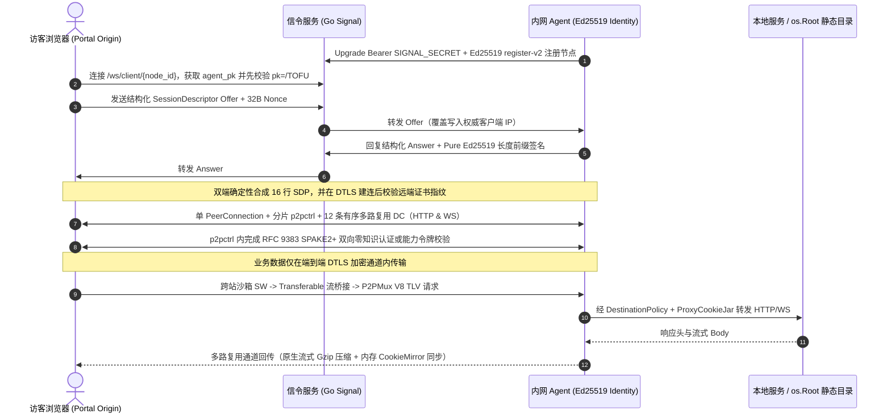

# 系统架构与核心设计 (Architecture & Design)

WebRTC Gateway 由三大解耦组件构成：
1. **Browser Client（模块化浏览器运行时）**：包含独立 Portal（内容哈希 `/__p2p_gw__/portal.<hash>.js` 与 `portal.<hash>.css`）、一次性引导桥接页（`/__p2p_gw__/bridge.html` 与 `/__p2p_gw__/assets/bridge.<hash>.js`）、模块化 Service Worker（`/__p2p_gw__/sw.js`）、外置启动脚本（`/__p2p_gw__/boot.js`）、纯兼容层模块化 DOM 与内存 `CookieMirror` 补丁（`/__p2p_gw__/assets/patch.<hash>.js`）以及 TypeScript P2PMux V8；
2. **Signaling Server（单一权威 Go 信令）**：单二进制 `cmd/signal`（`-tags embedweb` 于启动期预渲染内容哈希前端资产与 SHA-256 ETag），仅撮合结构化 `SessionDescriptor` Offer/Answer 与 ICE 候选，绝不中继或解码业务数据；
3. **Agent Daemon（内网守护进程）**：持久化 Ed25519 身份、RFC 9383 SPAKE2+ DTLS 通道内认证、单 PC 12 通道统一多路复用 P2PMux V8 与 Pure Pipe HTTP / 16 KiB 流式 WebSocket / `O_NOFOLLOW` `os.Root` 代理。

---

## 1. 端到端系统交互时序

---

## 2. 单 PC 统一多路复用数据面与原生流式 Gzip

- **信道拓扑**：每个访客会话仅维持 1 条 `RTCPeerConnection`，通过 `{ negotiated: true, ordered: true }` 预协商 1 条支持 `FlagMore` 分片的控制通道 `p2pctrl`（`id=0`）与 12 条有序多路复用业务通道 `p2p_01..p2p_12`（`id=1..12`），按每通道单调递增的 `StreamID` 统一承载 HTTP 与流式 WebSocket（零动态 DCEP 建道）。详细线格式与校验规则见 [P2PMux V8 协议规范](./protocol-specification)。
- **低队头阻塞与纯载荷字节流控**：并发请求均衡调度到 12 条独立有序 SCTP 通道，同一流的头帧、数据帧与流控帧保持严格因果顺序；线协议 `CREDIT` 仅计算纯载荷字节并按 `128 KiB` 或 `256` 分片回补，彻底消除槽位复用竞态与海量小包 SSE 窗口耗尽问题。
- **原生流式 Gzip 压缩**：Service Worker 通过 `FetchCtx` 声明客户端原生解压能力，Agent 使用 Go 标准库 `compress/gzip` 流式压缩并在每次写入后立即 `Flush`（SSE、`206 Partial Content`、`Cache-Control: no-transform` 与空体自动旁路并保留强 `ETag`），通过 `RespFlag.DECOMPRESS_GZIP` 通知浏览器调用原生 `DecompressionStream('gzip')`（支持未拉取前立即取消上游、`decompWriter.ready` 背压同步、首块 0B 窥探与膨胀比上限保护）。
- **短生命周期信令与统一静默重连**：DTLS 通道认证完成后 Portal 立即关闭信令 WebSocket（初始 ICE 失败时同样关闭）；ICE/PC/控制通道断开后，Portal 按需重连信令并建立新 `RTCPeerConnection`，复用当前 Tab 内存派生的 SPAKE2+ `(w0, w1)` 静默完成重认证，保持 `appFrame` 挂载不重载且不重弹密码框。

---

## 3. 两档沙箱隔离与模块化浏览器运行时

### 1. 启动期显式源、一次性引导桥接 (`/__p2p_gw__/bridge.html`) 与一次性 `enterNonce`

- **启动期显式源与两档沙箱隔离**：信令启动期显式配置 `-portal-origin` 与 `-sandbox-origin`（本地回环显式使用 `-dev` 自动 `*.localhost`），不再依赖运行时 `X-Forwarded-Proto` 猜测；**Tier 1 跨站通配符隔离**（不同 eTLD+1 派生本机私有盐 HMAC `sbx-<24hex>` 源，能力分享访客按 Tab 分配 128 位随机 `sbx-<32hex>` 源）提供完整站点与节点隔离；**Tier 2 受限隔离**包含固定单域跨站与 `-allow-same-site-sandbox` 同站通配符（下发 `Origin-Agent-Cluster: ?1`），两种 Tier 2 模式下 Portal 顶部均持续显示受限警示条；
- **零时间重叠引导、Transferable 流桥接与 W3C Fetch 抗 CSRF 门禁**：Portal 源拒绝服务 `/__p2p_gw__/sw.js` 与 `/__p2p_gw__/bridge.html`（返回 `404`），CSP 严格锁定 `style-src 'self'`、`connect-src 'self'`、`form-action 'self'` 与 `frame-ancestors 'none'`；沙箱侧 `/__p2p_gw__/sw.js` 要求 `Service-Worker: script` 或 `Sec-Fetch-Dest: serviceworker` 并带 `Cross-Origin-Resource-Policy: same-origin`；`bridge.js` 与 `patch.js` 拒绝 Service Worker 注册请求；Portal 仅在未挂载 `appFrame` 时短暂挂载带 `sandbox="allow-scripts allow-same-origin"` 的 `/__p2p_gw__/bridge.html?tab=<tabId>` 完成 SW 注册与 `bridgePort` 移交，收到 `P2P_BRIDGE_READY` 后**立即从 DOM 移除 `bridgeFrame`** 再创建 `appFrame`；SW 与 Portal 间通过原生 Transferable `ReadableStream` 零拷贝桥接 HTTP 请求/响应体（并在 Firefox `request.body === undefined` 时自动回退 `arrayBuffer()`）；挂载 `appFrame` 前经 `bridgePort` 向 SW 注册绑定 `(tabId, nextPath)` 的一次性 128 位 `enterNonce`，SW 无条件阻断一切 `destination === 'document'` 逃逸（即使 `clientId` 已绑定）、拦截未绑定子资源与跨站 POST、通过 W3C `replacesClientId` 或已绑定根 `appFrame` 发出的单次短时 `P2P_EXPECT_NAV` 令牌放行合法刷新与历史导航、按单标签页独立隔离 `clientToTab` 配额并下发 `frame-ancestors 'self' <portalOrigin>`；
- **不可信租户防御**：Portal `TunnelBridge` 与 Go Agent 将整个沙箱源视为不可信租户——请求头在边界处剥离伪造转发头，下载补窗 `ackConsumed` 严格受限于已投递载荷字节，WebSocket 与 HTTP 待写队列强制字节与并发上限（16 MiB 单消息上限），且 `HttpOnly` / `Secure` Cookie 由 Agent 内存中的 RFC 6265bis `ProxyCookieJar`（按 `httpOnly` / `visible` 池分别限额）集中保护。

### 2. 流式 HTML5 头部注入、外置 `boot.js` 与内存 `CookieMirror`

- **字节级 HTML5 分词器、外置 `boot.js` 与指令级 CSP 重写**（`web/src/sw/html_injector.ts`、`fetch_router.ts`）：完整处理 HTML5 注释、未加引号属性、`<template>`/`<svg>`/`<math>` 嵌套与自闭合（含异域自闭合 `<title/>` 与 `<![CDATA[...]]>`）、UTF-16 BOM 旁路与跨块 UTF-8 BOM；遇到无 `<head>` 文档或先于 `<head>` 出现的可执行 `<script>` 时严格在首段 `<script>` 之前注入；HTTP 头省略 `charset=` 时在 `<head>` 内最多前窥 1024 字节避免将 `<meta charset>` 挤出预扫描窗口，仅注入约 140 字节的外置 `<script src="/__p2p_gw__/boot.js">` + `patch.js`（零内联脚本文本）；SW 响应 `/__p2p_gw__/boot.js` 并在保留上游 CSP 的前提下按指令级重写自动允许同源脚本与传递 `nonce`，对发生转换的响应剥离强 `ETag`；
- **内存 `CookieMirror` 与 PWA 隧道保护**：模块化 `web/src/patch/` 覆写 `Document.prototype.cookie` 为纯内存镜像且绝不写入真实 `document.cookie`，经 P2PMux V8 行内请求/响应 TLV 与 Agent `ProxyCookieJar` 双向同步增删（采用非破坏性窥探与 `REQ_ACK` 确认后提交，严格遵守 `credentials: 'omit'` 并拒绝页面侧 `SW_COOKIE_SYNC`），并私有保存真实 `navigator.serviceWorker` 句柄对外屏蔽 `register`/`unregister`/`getRegistrations`，防止内网 PWA 误卸载隧道 SW；
- **会话活跃回收与 SW 休眠重建**：SW 在新会话接入与定期清理时通过 `BRIDGE_PING`（3000 ms）主动探测并删除已关闭/刷新标签的失效会话；若浏览器在空闲期回收 SW，SW 按标签页向存活同源嵌套 `appFrame` 发送 `P2P_SW_EVICTED`，Portal 经 `PORTAL_PING` 核实端口失效后先卸下 `appFrame`、重新执行零时间重叠的短暂 `bridgeFrame` 引导后再恢复 `appFrame`。

### 3. 前端模块分层 (`web/src/`)

- `web/src/protocol/`：P2PMux V8 帧编解码（`frame.ts`）、二进制 TLV 编解码（`tlv.ts`）与 12 通道统一多路复用器（`mux.ts`）；
- `web/src/shared/`：严格类型 Transferable 流 IPC 契约（`ipc.ts`）、WebCrypto 与 HKDF 原语（`crypto.ts`）、RFC 9383 SPAKE2+（`spake2p.ts`）、Fail-Closed Ed25519 TOFU 存储（`identity.ts`）、结构化 SDP 抽取与合成（`sdp.ts`）、两档沙箱推导（`sandbox_origin.ts`）及严格 URL 重写（`url_rewrite.ts`）；
- `web/src/portal/`：配置与 RFC 7065 ICE 校验（`core/config.ts`，自动清洗 `cap=`）、信令客户端（`core/signaling_client.ts`）、单 PC 传输与静默重连（`core/peer_session.ts`）、3 态 SPAKE2+/能力认证状态机（`core/auth_client.ts`）、遥测采集（`core/stats_collector.ts`）、跨站 Transferable 桥接（`core/bridge.ts`）、外置样式（`portal.css`）以及轻量 UI（`ui/modals.ts`、`ui/smart_pill.ts`、`i18n.ts`、`app.ts`）；
- `web/src/bridge/` & `web/src/sw/` & `web/src/patch/`：极简引导桥接页、模块化 SW 抗 CSRF 路由/Transferable 流桥接/原生 Gzip 解压/HTML5 外置注入/内存 CookieMirror，以及拆分后的 6 模块兼容层（`cookie_patch.ts`、`fetch_xhr_patch.ts`、`ws_client_patch.ts`、`nav_patch.ts`、`types.ts`、`ws_patch.ts`）。

---

## 4. 两档沙箱部署形态对比

| 维度 | Tier 1 跨站双域通配符（推荐） | Tier 2 受限隔离：固定单域跨站 | Tier 2 受限隔离：单根域同站通配符 |
| :--- | :--- | :--- | :--- |
| **域名与证书** | 两个不同 eTLD+1 域，沙箱侧泛域证书 | 两个不同 eTLD+1 固定主机，普通单域证书 | 单根域 + 通配符子域证书 |
| **关键参数** | `-portal-origin` + `-sandbox-origin https://*.sandbox.example.net` | `-portal-origin` + `-sandbox-origin https://app.example.net` | `-portal-origin` + `-sandbox-origin https://*.sbx.example.com` + `-allow-same-site-sandbox` |
| **隔离特性** | Portal、多节点与能力访客全跨站独立源隔离（无警示条） | Portal 与应用跨站，但多节点/能力访客共享单一沙箱源（显示 Tier 2 警示条） | 节点独立源 + `Origin-Agent-Cluster: ?1`，与 Portal 同站（显示 Tier 2 警示条） |
| **适用场景** | 多节点生产环境与企业内网（推荐默认） | 暂无通配符证书、单节点或互信自用场景 | 仅有单域名且仅穿透互信自用应用 |
