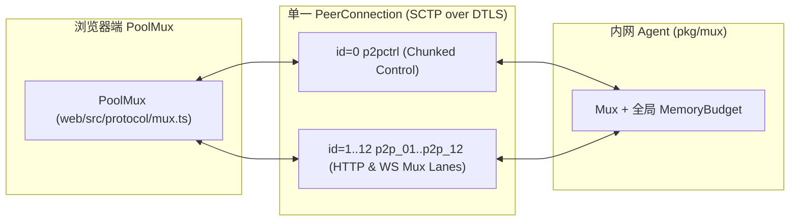

# P2PMux V8 传输层多路复用协议规范

> **协议版本**：P2PMux V8（对应 `test/fixtures/protocol_v8_golden_vectors.json` 中的 `"version": 8`）  
> **底层承载**：单一 WebRTC `RTCPeerConnection` + `1` 条分片控制通道 + `12` 条预协商有序多路复用数据通道（统一承载 HTTP 与流式 WebSocket，SCTP over DTLS，RFC 8831 / RFC 8261）  
> **参考实现**：Go [`pkg/protocol/`](https://github.com/BeingNoAbility/WebRTC-Gateway/blob/main/pkg/protocol/frame.go)、[`pkg/mux/`](https://github.com/BeingNoAbility/WebRTC-Gateway/blob/main/pkg/mux/mux.go)；TypeScript [`web/src/protocol/`](https://github.com/BeingNoAbility/WebRTC-Gateway/blob/main/web/src/protocol/mux.ts)

P2PMux V8 在浏览器与内网 Agent 之间采用精简统一的有序多路复用数据面：1 条支持 `FlagMore` 分片的控制通道配合 12 条预协商有序通道（按单调 `StreamID` 同时复用 HTTP 与流式 WebSocket），无需动态 DCEP 建道，采用纯载荷字节 `CREDIT` 流控与统一帧头，在保持单流严格因果有序的同时消除跨流队头阻塞、槽位复用竞态与微包流控死锁。

---

## 一、 信道拓扑与单调流 ID 不变量

每个访客会话仅建立 **1 条 `RTCPeerConnection`**，由两类预协商有序 DataChannel 组成：

| Channel ID | Label | 协商方式 | 职责 | 允许承载的帧类型 |
| :---: | :--- | :--- | :--- | :--- |
| `0` | `p2pctrl` | 预协商有序 | 控制信道（不排在业务数据之后；JSON 帧支持 `FlagMore` 分片至 `128 KiB`） | `SETTINGS`、`AUTH_CHALLENGE`、`AUTH_RESPONSE`、`AUTH_RESULT`、`CAP_REQ`、`CAP_RESP`、`PING`、`PONG`、`GOAWAY` |
| `1..12` | `p2p_01` .. `p2p_12` | 预协商有序 | 12 条多路复用业务通道（认证完成前拒收一切帧；按单调 `StreamID` 统一承载 HTTP 与 WebSocket，单会话 WS 上限 64 条） | `HEADERS`、`DATA`、`CREDIT`、`RESET`、`WS_TEXT`、`WS_BINARY`、`WS_CLOSE` |



### 每通道单调 `StreamID` 不变量

每条数据通道独立维护单调递增的无符号 32 位流编号（按最少活跃流与写缓冲水位择优调度至 12 条通道之一）：

$$\text{StreamID}_{\text{next}} = \text{StreamID}_{\text{prev}} + 1 \quad (1 \le \text{StreamID} \le 2^{32} - 1)$$

同一流的 `HEADERS`、`DATA` / `WS_*`、`CREDIT` 与 `RESET` 始终绑定在同一有序通道内传输，无需槽位复用 FSM 或动态 DCEP 通道；接收端拒绝重复或非单调的新流 ID，对已终结流的迟到帧按 O(1) 丢弃。

---

## 二、 8 字节定长帧头布局

所有多字节整数字段均为大端序（Network Byte Order）。每条 DataChannel 消息必须恰好包含一个完整帧（`len(msg) == 8 + payloadLen`）：

```text
 0                   1                   2                   3
 0 1 2 3 4 5 6 7 8 9 0 1 2 3 4 5 6 7 8 9 0 1 2 3 4 5 6 7 8 9 0 1
+-+-+-+-+-+-+-+-+-+-+-+-+-+-+-+-+-+-+-+-+-+-+-+-+-+-+-+-+-+-+-+-+
|                     StreamID (uint32)                         |  Offset 0..3
+-+-+-+-+-+-+-+-+-+-+-+-+-+-+-+-+-+-+-+-+-+-+-+-+-+-+-+-+-+-+-+-+
|     Type      |     Flags     |      Payload Length (u16)     |  Offset 4..7
+-+-+-+-+-+-+-+-+-+-+-+-+-+-+-+-+-+-+-+-+-+-+-+-+-+-+-+-+-+-+-+-+
|                   Payload (0 .. 65535 bytes)                  |  Offset 8..
+-+-+-+-+-+-+-+-+-+-+-+-+-+-+-+-+-+-+-+-+-+-+-+-+-+-+-+-+-+-+-+-+
```

- **StreamID（4 字节）**：控制通道固定为 `0`；数据通道为该通道内严格单调递增的非零流编号（`>= 1`）。
- **Type（1 字节）**：帧类型码；未知类型或错放通道立即拒绝。
- **Flags（1 字节）**：仅定义 `FlagFin = 0x01`（HTTP 方向半关闭）、`FlagMsgFin = 0x02`（标记 `WS_TEXT`/`WS_BINARY` 完整消息结束）与 `FlagMore = 0x04`（标记 `HEADERS` 或 JSON 控制帧还有后续分片），其余保留位必须为 `0`。
- **Payload Length（2 字节）**：上限 `MaxPayloadSize = 65535` 字节（`uint16` 最大值）；默认分块为 `DefaultChunkSize = 32760` 字节，并随 SCTP `maxMessageSize` 仅允许单调向下收窄（下限 `MinNegotiatedMaxMsgSize = 4096` 字节，分块下限 `MinChunkSize = 4088` 字节，确保 `17 * 4088 >= 64 KiB` 头块与 `34 * 4088 >= 128 KiB` 控制消息完整传输）。

---

## 三、 帧类型与严格校验表

| 类型码 | 名称 | 所在信道 | StreamID 约束 | 允许 Flags | 载荷约束 |
| :---: | :--- | :--- | :---: | :---: | :--- |
| `0x01` | `SETTINGS` | `p2pctrl` | `0` | `MORE` | JSON 会话参数（`max_frame_payload`, `pool_size`, `max_concurrent_ws`） |
| `0x02` | `AUTH_CHALLENGE` | `p2pctrl` | `0` | `MORE` | JSON（`agent_nonce`, `auth_methods`, `share_v`） |
| `0x03` | `AUTH_RESPONSE` | `p2pctrl` | `0` | `MORE` | JSON（`method`: `spake2p`/`cap`/`public`, `share_p`, `confirm_p`, `cap_token`, `cookie_resume_token`） |
| `0x04` | `AUTH_RESULT` | `p2pctrl` | `0` | `MORE` | JSON（`ok`, `role`, `confirm_v`, `cookie_resume_token`, `meta`） |
| `0x05` | `CAP_REQ` | `p2pctrl` | `0` | `MORE` | JSON（Owner 签发/查询/吊销能力令牌请求） |
| `0x06` | `CAP_RESP` | `p2pctrl` | `0` | `MORE` | JSON（能力令牌签发/列表/吊销结果，吊销返回 `jti` 与布尔 `revoked`，支持 `FlagMore` 分片至 `128 KiB`） |
| `0x08` | `PING` | `p2pctrl` | `0` | `0x00` | 严格 8 字节 `uint64` 序号 |
| `0x09` | `PONG` | `p2pctrl` | `0` | `0x00` | 严格 8 字节 `uint64` 回显序号 |
| `0x0A` | `GOAWAY` | `p2pctrl` | `0` | `0x00` | 严格 4 字节大端 `ErrorCode` |
| `0x10` | `HEADERS` | `p2p_01..12` | `> 0` | `FIN` 或 `MORE` | 紧凑二进制 TLV 头块（多片续传复用 `HEADERS` + `FlagMore`，禁止非末片同时携带 `FIN \| MORE`，总上限 `64 KiB` / `17` 片，禁止 0 字节非末片） |
| `0x12` | `DATA` | `p2p_01..12` | `> 0` | `FIN` | 原始 HTTP Body 字节流（无 `FIN` 时禁止 0 字节载荷） |
| `0x13` | `CREDIT` | `p2p_01..12` | `> 0` | `0x00` | 严格 4 字节大端 `uint32` 纯载荷字节增量，`1 <= delta <= 0x7fffffff` |
| `0x14` | `RESET` | `p2p_01..12` | `> 0` | `0x00` | 严格 4 字节大端 `ErrorCode` |
| `0x21` | `WS_TEXT` | `p2p_01..12` | `> 0` | `MSG_FIN` | WebSocket UTF-8 文本消息分片（流式重组至 16 MiB；无 `MSG_FIN` 时禁止 0 字节载荷） |
| `0x22` | `WS_BINARY` | `p2p_01..12` | `> 0` | `MSG_FIN` | WebSocket 二进制消息分片（流式重组至 16 MiB；无 `MSG_FIN` 时禁止 0 字节载荷） |
| `0x24` | `WS_CLOSE` | `p2p_01..12` | `> 0` | `0x00` | `u16 BE statusCode` + 合法 UTF-8 reason（≤ 123 字节） |

---

## 四、 紧凑二进制 TLV 头部与流式 WebSocket 帧

### 1. 请求与响应 TLV 编码

请求头与响应头采用二进制大端编码，内嵌 `FetchCtx`（bit 0 = `SameOriginClient`、bit 1 = `ClientDecompressGzip`、bit 2 = `CredentialsOmit`，其余保留位严格拒绝）、`RespFlags`（`DecompressGzip`）与行内 Cookie 变更/差量 TLV（在 1 字节 `op` 高位 `0x80` 复用 `Secure` 标志以原生支持安全上下文下的 `__Host-` / `__Secure-` Cookie，消除带外竞态并严格校验 `0 <= expiresMs <= Number.MAX_SAFE_INTEGER`），天然保留多值 Header（如多条 `Content-Security-Policy` 或 `Vary`）与有效 UTF-8 字符（含 BOM），并严格拒绝控制字符、CR/LF/NUL 与请求目标中的 ASCII 空格（`0x20`）：

```text
Request TLV:
  [u8 kind (1=HTTP, 2=WS)] [u8 fetchCtxFlags] [u8 methodLen] [method UTF-8]
  [u16 targetLen] [target UTF-8 (no spaces/ctl)] [u16 headerCount <= 256]
  repeat headerCount: [u16 nameLen] [lowercase name] [u16 valLen] [value UTF-8]
  [u16 cookieMutCount <= 32]
  repeat cookieMutCount: [u8 opFlags (bits0..1: 1=set, 2=del; bit7=Secure)] [u8 nameLen] [name] [u16 valLen] [val] [u16 pathLen] [path] [i64 expiresMs]

Response TLV:
  [u16 status (100..599)] [u8 respFlags (bit0=DecompressGzip)] [u16 headerCount <= 256]
  repeat headerCount: [u16 nameLen] [lowercase name] [u16 valLen] [value UTF-8]
  [u16 cookieDeltaCount <= 64]
  repeat cookieDeltaCount: [u8 opFlags (bits0..1: 1=set, 2=del; bit7=Secure)] [u8 nameLen] [name] [u16 valLen] [val] [u16 pathLen] [path] [i64 expiresMs]
```

### 2. 同通道流式 WebSocket 分片

`StreamKind = 2`（WebSocket）直接复用 12 条预协商数据通道之一，完成 `101` 握手后通过连续 `WS_TEXT` 或 `WS_BINARY` 帧流式分片传输消息，末片置 `FlagMsgFin (0x02)`：

```text
Message <= 16 MiB:
  Frame 1..k: [StreamID][Type=WS_TEXT|WS_BINARY][Flags=0x00 or MSG_FIN][chunk]
Close:
  Frame     : [StreamID][Type=WS_CLOSE]         [Flags=0x00]           [u16 code][reason <= 123B]
```

接收端每收到分片即在 `16 MiB` 硬上限与单消息 `16384` 片上限内按纯载荷字节回补 `CREDIT`（兼容 `4088` 字节最小分片下的完整 `16 MiB` 消息组装），确保 > `512 KiB` 的单条大消息平滑流式转发；收到 `WS_CLOSE` 前必须完整交付队列中已入队的待读消息；超过 `16 MiB` 时立即返回关闭码 `1009`。

---

## 五、 流控、内存预算与生命周期

- **纯载荷字节信用流控、SCTP 水位与微包防死锁**：每条流初始发送窗口 `512 KiB`，发送窗口等待超时 `30 s`（超时立即 `Reset`）；单条 DataChannel 写缓冲遵循高水位 `512 KiB` / 低水位 `128 KiB` 背压控制；消费方在同一通道发送纯载荷字节 `CREDIT`（绝不把内部 64B 结构开销混入线协议信用，且在累计达到 `128 KiB` 或 `256` 个分片时即触发补窗，避免海量 13B SSE 微包触发窗口耗尽或误重置），浏览器 `PoolStream.ackConsumed` 严格钳制补窗不超过实际已投递未确认载荷字节数。
- **三层入站内存预算、64B 帧开销记账、等长分配与无条件归还**：本地入站内存记账与线协议 `CREDIT` 严格解耦——Go 与 TS 端对入站数据与 WS 分片执行等长分配拷贝（`cap == len`），本地按 `len(payload) + 64` 计入每流 `2 MiB`（且单流排队分片上限 `16384`）、每访客会话 `32 MiB`、Go 跨会话全局 `256 MiB` 三层入站上限（防止 0 字节或微包堆放大攻击）；服务端未完成组装的 `HEADERS` 受 `10 s` 不可续命硬超时约束且拒绝提前 `CREDIT`；流类型在首个完整 `HEADERS` 时冻结为 HTTP 或 WS 不可变；流 `Close()` / `Reset()` 时无条件清扫未读入站缓冲并归还预算。
- **确定性并发限额与无锁重置**：每会话限制并发活跃 HTTP/WS 流总数（全局流上限默认 `512`，WS 上限 `64`）；HTTP 代理与浏览器均依据响应/请求 `HEADERS` 是否携带 `FlagFin` 判断是否存在消息体（`HasRequestBody()` / `hasResponseBody`），避免响应头与体在同微任务到达时误判空体；`Reset()` 立即无锁唤醒阻塞读写协程并确保不向已重置流再触发正常结束回调。
- **跨语言黄金测试向量**：Go 端 [`TestV8GoldenVectors`](https://github.com/BeingNoAbility/WebRTC-Gateway/blob/main/pkg/protocol/protocol_test.go) 与 TS 端 `test/web/protocol.test.mjs` 共享 `test/fixtures/protocol_v8_golden_vectors.json`（含 UTF-8 多字节字符、BOM 保留、V8 TLV、以及 RFC 9383 Appendix C.1 官方向量与 SPAKE2+ KDF 跨语言校验），保证两端编解码与密码学派生逐字节一致。
