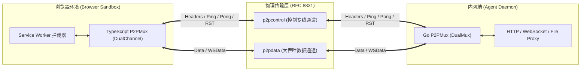
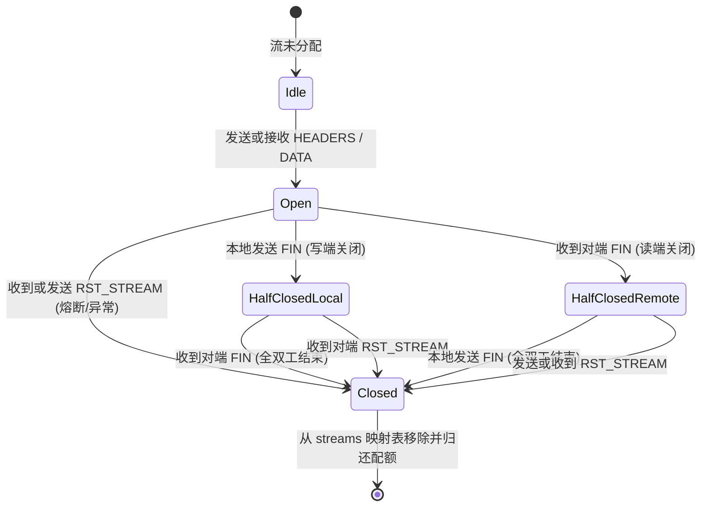
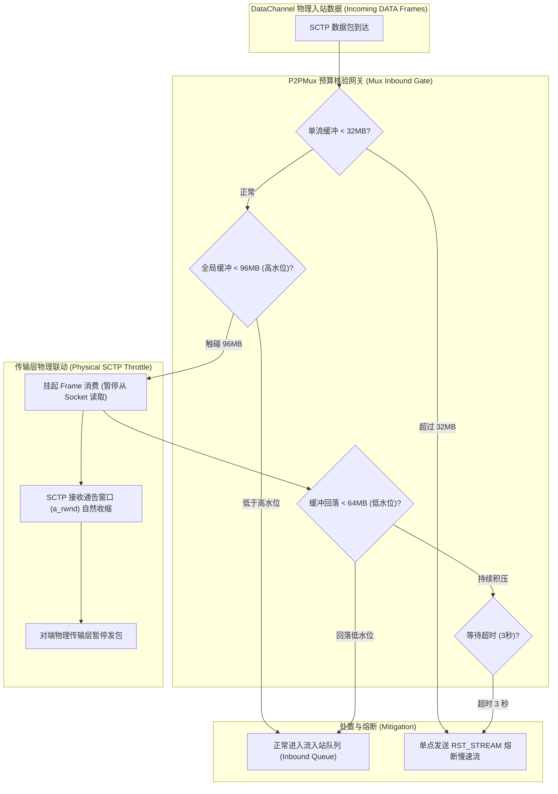
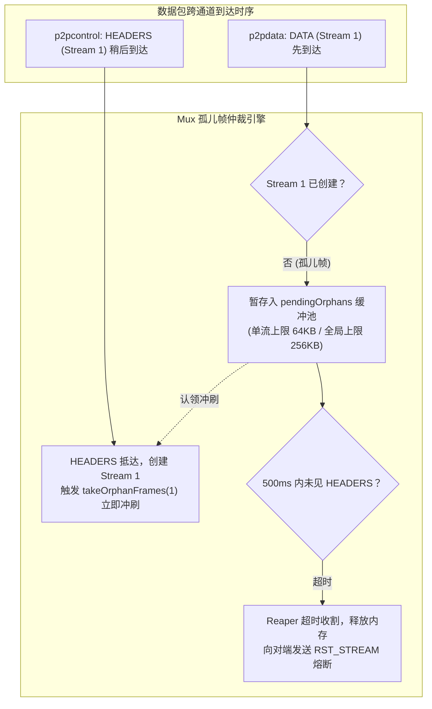

# P2PMux 传输层多路复用协议形式化规范 (P2PMux Wire Protocol Specification)

> **版本**：v2.3.0 (Sprint 2 Native Dual-Channel Formalization)  
> **底层承载**：IETF RFC 8831 (WebRTC DataChannel / SCTP)  
> **设计目标**：在零客户端浏览器沙箱与内网守护进程之间，提供极轻量、确定性、防死锁、彻底消除队头阻塞且天然契合 Go/V8 内存阶梯的高性能全双工二进制复用传输协议。

---

## 一、 协议定位与核心设计哲学 (Design Philosophy)



### 1. 为什么自研 P2PMux 而非 HTTP/2 或 yamux？
- **浏览器沙箱能力边界**：现代浏览器标准 Web API（如 `RTCDataChannel`）仅暴露基于消息的 ArrayBuffer/Blob 接口，缺乏裸 TCP 套接字直读直写能力，无法直接运行依赖纯流式 TCP 握手的标准 HTTP/2 或 yamux 协议栈；
- **零额外依赖与跨端极致轻量**：Go 端仅需标准库 `encoding/binary`，前端仅需标准 Web `DataView` 与 `Uint8Array`，零第三方协议解析依赖；
- **内存池对齐法则 (32KB Allocation Alignment)**：
  - P2PMux 采用 **10 字节定长帧头**；
  - 推荐单帧分片载荷长度设定为 `RecommendedChunkSize = 32758` 字节；
  - **$32758\text{ (Payload)} + 10\text{ (Header)} = 32768\text{ 字节} = 32\text{KB}$**；
  - 该尺寸精准契合 Go 语言运行时（Go Runtime Size-Classes）与 Linux 内核 Jemalloc/TCMalloc 的 32KB 内存块分配阶梯，在高并发大吞吐场景下实现零内存碎片与极高复用率。

---

## 二、 10 字节定长帧头二进制布局 (Binary Frame Layout)

P2PMux 在网络线路上以大端序（Big-Endian，网络字节序）进行序列化与传输。每个数据帧由 **10 字节定长头部** 和后续可变长度的 **有效载荷（Payload）** 组成：

```text
 0                   1                   2                   3
 0 1 2 3 4 5 6 7 8 9 0 1 2 3 4 5 6 7 8 9 0 1 2 3 4 5 6 7 8 9 0 1
+-+-+-+-+-+-+-+-+-+-+-+-+-+-+-+-+-+-+-+-+-+-+-+-+-+-+-+-+-+-+-+-+
|                          Stream ID                            |  (Offset 0..3)
+-+-+-+-+-+-+-+-+-+-+-+-+-+-+-+-+-+-+-+-+-+-+-+-+-+-+-+-+-+-+-+-+
|     Type      |     Flags     |        Payload Length         |  (Offset 4..7)
+-+-+-+-+-+-+-+-+-+-+-+-+-+-+-+-+-+-+-+-+-+-+-+-+-+-+-+-+-+-+-+-+
| (Length Cont) |               Payload Data (0..64KB)          |  (Offset 8..9)
+-+-+-+-+-+-+-+-+ - - - - - - - - - - - - - - - - - - - - - - - +
:                            Payload Data ...                   :  (Offset 10..)
+-+-+-+-+-+-+-+-+-+-+-+-+-+-+-+-+-+-+-+-+-+-+-+-+-+-+-+-+-+-+-+-+
```

### 字段逐位定义与约束

| 字段名称 | 字节偏移 | 字段类型 | 编码方式 | 详细描述与协议约束 |
| :--- | :---: | :---: | :---: | :--- |
| **Stream ID** | `0 .. 3` | `uint32` | 大端序 (Big-Endian) | **32 位逻辑流标识符**。<br/>• `0x00000000`：Mux 控制面保留流（仅用于 PING/PONG）。<br/>• 奇数（`1, 3, 5...`）：浏览器访客端发起的逻辑流。<br/>• 偶数（`2, 4, 6...`）：Agent 守护进程发起的逻辑流。 |
| **Type** | `4` | `uint8` | 单字节无符号数 | **帧语义类型**。<br/>定义载荷用途与调度管线（见下文帧类型定义）。 |
| **Flags** | `5` | `uint8` | 8-bit 位掩码 | **控制标志位**。<br/>支持位组合运算（如 `FlagFin = 0x01`, `FlagAck = 0x02`）。 |
| **Payload Length** | `6 .. 9` | `uint32` | 大端序 (Big-Endian) | **有效载荷长度**（字节数）。<br/>• 单帧最大载荷为 `65536` (64KB)；<br/>• 帧实际传输总字节数严格等于 $10 + \text{Length}$；<br/>• 若包实际长度与声明长度不符，接收端必须立即拒绝并报错 `ErrInvalidFrameLength`。 |
| **Payload** | `10 ..` | `[]byte` | 纯二进制切片 | 实际载荷数据。空载荷帧（如控制帧、FIN、RST）此部分长度为 0。 |

---

## 三、 帧类型与标志位语义矩阵 (Frame Types & Flags)

### 1. 帧类型定义表

| 类型十六进制 | 常量符号 | 载荷格式与语义 | 触发场景与禁止行为 |
| :---: | :--- | :--- | :--- |
| `0x01` | `TypeData` | 二进制流数据切片 | 承载 HTTP 请求体、响应体或直接文件分发二进制流。 |
| `0x02` | `TypeHeaders` | UTF-8 JSON 编码元数据 | 传递 HTTP 请求头、响应头、状态码与 URL 路由。**每个逻辑流必须且仅能接收一次有效元数据**。 |
| `0x03` | `TypeRstStream` | 可选错误码（通常 0 字节） | 异常中止流。接收端收到后必须立即取消 Context、清退内存配额并回收流 ID。 |
| `0x04` | `TypeWindowUpdate` | 4 字节 uint32 增量信用 | 预留信用流控机制。 |
| `0x05` | `TypePing` | 8 字节 uint64 大端序序号 | Mux 全局保活探测与 RTT 统计。StreamID 必须为 `0`。 |
| `0x06` | `TypePong` | 8 字节 uint64 原样回显 | 对 PING 帧的原样回显。StreamID 必须为 `0`。 |
| `0x10` | `TypeWSConnect` | UTF-8 JSON 代理握手头 | 标记该流升级为纯透明 WebSocket 全双工通道。 |
| `0x11` | `TypeWSData` | 完整或分片 WebSocket 帧 | 承载内网应用原生 WebSocket 二进制帧与文本帧。 |
| `0x12` | `TypeWSClose` | WebSocket 关闭码与原因 | 告知对端内网应用原生 WebSocket 已正常断开。 |

### 2. 标志位（Flags）定义表

```text
 7 6 5 4 3 2 1 0 (Bit Offset)
+-+-+-+-+-+-+-+-+
| Reserved  |A|F|
+-+-+-+-+-+-+-+-+
             │ └─ Bit 0: FlagFin (0x01) - 标记本流数据传输结束 (Half-Closed)
             └─── Bit 1: FlagAck (0x02) - 确认应答标志
```

- **`FlagFin (0x01)`**：
  - 标记发送方的数据发送完毕；
  - 触发本地写关闭（`writeClosed = true`）；对端接收后触发读关闭（`readClosed = true`）；
  - **允许与 `TypeData` 结合发送最后的尾数据**，也允许独立发送 0 字节 payload 的空 FIN 帧（如空 `GET`/`HEAD` 请求或 `204 No Content` 响应）。
- **`FlagAck (0x02)`**：
  - 用于协议层握手确认，当前版本作为保留拓展。

---

## 四、 奇偶流分配律与抗幽灵流不变量 (Stream Parity & Anti-Ghosting)

为了在全双工 P2P 对等网络中实现零协调、零冲突的流 ID 独立自增，P2PMux 严格执行**奇偶分工不变量**：

```text
Visitor Browser (Client)                 Agent Daemon (Server)
┌──────────────────────┐                 ┌──────────────────────┐
│ 分配奇数流 (Odd ID)   │                 │ 分配偶数流 (Even ID)  │
│  1, 3, 5, 7, 9 ...   │                 │  2, 4, 6, 8, 10 ...  │
└──────────────────────┘                 └──────────────────────┘
            │                                       │
            │─── Frame(StreamID=1, Type=HEADERS) ──>│ (合法: Agent 接受奇数入站流)
            │<── Frame(StreamID=1, Type=DATA) ──────│ (合法: Agent 沿用同流响应)
            │                                       │
            │<── Frame(StreamID=2, Type=DATA) ──────│ (合法: Client 接受偶数入站流)
            │                                       │
            │─── Frame(StreamID=3, Type=DATA) ──> ? │ (若流3在Client已关闭超时迟到)
            │                                       │ ➔ Agent 防护：单调淘汰，拒绝幽灵流
```

### 1. 奇偶校验准则 (Parity Invariant)
1. **Client 端规则**：本地创建的新流必须递增自分配奇数流 ID（`id % 2 === 1`）；收到对端发来的新流建联帧（`HEADERS`/`DATA`/`WS_CONNECT`）时，**仅接受偶数流 ID（`id % 2 === 0`）**；
2. **Agent 端规则**：本地创建的新流必须递增自分配偶数流 ID（`id % 2 === 0`）；收到对端发来的新流建联帧时，**仅接受奇数流 ID（`id % 2 === 1`）**；
3. **违规判定**：若一方收到对端发来一个未见过的、但奇偶性与自身相同的流 ID，表明对端使用了非法分配律或为本地已关闭的迟到残卷孤儿帧，**接收端必须直接静默丢弃，严禁为其创建新流实体**。

### 2. 32 位回卷防卫与单调窗口防护 (Wraparound Defense)
- **回卷门槛**：当流 ID 递增接近 `0xFFFF0000` 时，启动回卷复用；
- **防幽灵碰撞机制**：本地维护最近已关闭的流 ID 滑动保留窗口（`closedStreams`，默认容量 1024）；
- 在窗口内的延迟到达旧帧被直接丢弃；超出单调窗口（`maxPeerStreamID - streamWindow`）的旧历史记录由后台定时 Prune 剔除，保障内存常数阶 $\mathcal{O}(1)$ 稳定。

---

## 五、 流生命周期与状态机转换矩阵 (Stream Lifecycle)

P2PMux 单流遵循与 RFC 9113 (HTTP/2) 一脉相承的双向解耦状态机：



### 状态转移与操作动作矩阵

| 当前状态 | 触发事件 | 转移后状态 | 本地读写权限 | 资源与配额动作 |
| :--- | :--- | :--- | :---: | :--- |
| **Idle** | 本地 `OpenStream()` | **Open** | 允许读 / 允许写 | 分配递增奇偶 StreamID，计入活跃流计数。 |
| **Open** | 本地调用 `Close()` | **HalfClosedLocal** | 允许读 / **禁止写** | 向对端在线路上发送 `FlagFin` 帧。本地写端关闭。 |
| **Open** | 收到对端 `FlagFin` | **HalfClosedRemote** | **只读未读缓冲** / 允许写 | 读端标记结束。下游 Reader 读完现有数据后返回 `io.EOF`。 |
| **HalfClosedRemote** | 下游 Reader 读至 EOF 且本地 `Close()` | **Closed** | 禁止读 / 禁止写 | 双向彻底关闭。异步调用 `removeStream(id)`。 |
| **任意活跃状态** | 调用 `Reset()` 或收到 `TypeRstStream` | **Closed** | **立即中断** | 取消 Context，原子释放全部未读缓冲，从流表中销毁。 |

> [!IMPORTANT]
> **内存记账不变量 (Accounting Invariant)**：
> 在正常关闭流时，读取方会自然消费全部入站切片至 EOF，入站字节计数自然原子归零；
> **若流因异常（如 `Reset()`、收到远端 `RST_STREAM`、连接断开或超限熔断）非正常退出，必须显式调用 `drainUnreadInboundLocked()` 一次性扣减所有未消费的残留缓冲，绝不允许产生幽灵计数导致全局内存死锁！**

---

## 六、 资源配额治理与 SCTP 接收通告窗口物理背压 (Governance & Backpressure)

为了彻底根除恶意慢速消费客户端故意积压多个流引发宿主机 OOM 崩溃的风险，P2PMux 构筑了三层立体防御体系：



1. **单流容量硬顶（Single-Stream Bound）**：
   - 单流入站未读缓冲上限设为 **32MB** (`maxStreamInboundBytes`)；
   - 超过时单点重置该流，不牵连其他流。
2. **Mux 全局入站内存预算（Global Inbound Budget）**：
   - 单个 Mux 实例全局入站内存配额设为 **128MB** (`DefaultMaxInboundBytes`)。
3. **双水位线与 SCTP 接收通告窗口联动（High/Low Watermark Backpressure）**：
   - **高水位线 (High Watermark, 96MB)**：当入站总积压达到 96MB 时，`HandleIncomingMessage` 的处理协程在条件变量上阻塞挂起，停止从底层 DataChannel 读取数据；
   - **物理通告窗口收缩**：停止从 SCTP Socket 读取直接导致操作系统/用户态 SCTP 协议栈的接收通告窗口（`a_rwnd`）迅速耗尽，迫使对端发送方在底层传输层自动暂停发包；
   - **低水位线 (Low Watermark, 64MB)**：当下游消费读取使总积压回落至 64MB 以下时，触发条件变量广播唤醒，恢复正常帧处理；
   - **超时精准熔断 (3-Second Timeout)**：等待超过 3 秒仍未能缓解背压的慢速流，直接下发 `RST_STREAM` 熔断处置，保障系统整体健康度。

---

## 七、 原生双物理通道分流与孤儿帧仲裁规约 (Dual-Channel Routing & Orphan Frame Reconciliation)

网关在物理传输层采用**正交隔离的双 DataChannel 架构**，并在分帧层引入状态感知路由：

### 1. 物理信道职责分工表

| 物理通道标识符 | 承载帧类型 (Frame Types) | 背压控制策略 | 核心设计目标 |
| :--- | :--- | :--- | :--- |
| **`p2pcontrol`** | • `0x02 TypeHeaders`<br/>• `0x03 TypeRstStream`<br/>• `0x04 TypeWindowUpdate`<br/>• `0x05 TypePing`<br/>• `0x06 TypePong` | **完全旁路背压** (Zero Backpressure Delay) | 保证交互路由元数据、毫秒级延迟测量、心跳保活与流熔断重置指令即刻送达，彻底消除队头饥饿。 |
| **`p2pdata`** | • `0x01 TypeData`<br/>• `0x10 TypeWSConnect`<br/>• `0x11 TypeWSData`<br/>• `0x12 TypeWSClose` | **双水位与 SCTP a_rwnd 物理受控** (128MB 预算) | 承载大吞吐文件流与应用载荷，在积压时受控流控降速，杜绝内存 OOM。 |

### 2. 跨信道竞态与孤儿帧缓冲机制 (Orphan Frame Reconciliation Invariant)

由于 WebRTC 底层为每个 DataChannel 分配独立的 SCTP 流，高并发下 `p2pdata` 的首包 `DATA` 帧可能在微观调度上先于 `p2pcontrol` 的 `HEADERS` 帧抵达接收端对等实体：



- **单流孤儿内存硬顶**：`DefaultMaxOrphanBytesPerStream = 64KB`，超过限制直接丢弃新孤儿帧；
- **全局孤儿内存硬顶**：`DefaultMaxGlobalOrphanBytes = 256KB`，防止多流恶意并发堆积孤儿帧攻击宿主机；
- **500ms 超时熔断**：`DefaultOrphanFrameTTL = 500ms`，后台定时器扫描超时孤儿帧，丢弃缓冲并下发 `RST_STREAM`；
- **零丢失冲刷**：合法流在 `TypeHeaders` 抵达创建后，瞬间将积压的孤儿帧以原样二进制顺序写入下游 Reader，保障 HTTP/WebSocket 数据完整性 100% 对齐。

---

## 八、 跨语言黄金测试向量规约 (Golden Test Vectors)

为了保障异构平台（Go CLI Agent、TypeScript Web Portal、Cloudflare Worker DO）的实现保持严格二进制一致性，项目在 `test/fixtures/protocol_golden_vectors.json` 固化了跨语言共享黄金测试向量，并由两端自动化 CI 强制断言：

- **Go 验证端**：[pkg/protocol/golden_test.go](file:///c:/Users/Star/Documents/webrtc-gateway/pkg/protocol/golden_test.go)（执行全量向量反序列化、再序列化与 32KB 阶梯边界测试）；
- **TypeScript 验证端**：[test/test_protocol_vectors.cjs](file:///c:/Users/Star/Documents/webrtc-gateway/test/test_protocol_vectors.cjs)（挂载于 `npm test`，保证前端编解码逻辑与 Go 核心库 100% 互通）；
- **核心校验向量示例**：
  - `zero_payload_fin`: `00000001010100000000` (Stream 1, Type DATA, Flag FIN, Len 0)
  - `zero_payload_rst`: `00000002030000000000` (Stream 2, Type RST, Flag NONE, Len 0)
  - `ping_with_seq`: `000000000500000000080102030405060708` (Stream 0, Type PING, 8-byte uint64)
  - `recommended_chunk_32kb`: 32758 字节载荷经编码后总包长严格等于 `32768` 字节。
