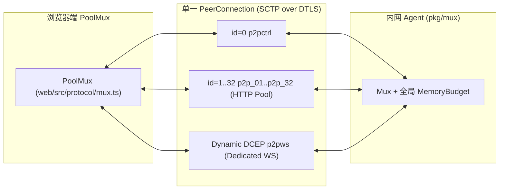

# P2PMux V7 传输层多路复用协议规范

> **协议版本**：P2PMux V7（对应 `test/fixtures/protocol_v7_golden_vectors.json` 中的 `"version": 7`）  
> **底层承载**：单一 WebRTC `RTCPeerConnection` + `1` 条控制通道 + `32` 条预协商有序 HTTP 池通道 + 动态专用 `"p2pws"` WebSocket 通道（SCTP over DTLS，RFC 8831 / RFC 8261）  
> **参考实现**：Go [`pkg/protocol/`](https://github.com/BeingNoAbility/WebRTC-Gateway/blob/main/pkg/protocol/frame.go)、[`pkg/mux/`](https://github.com/BeingNoAbility/WebRTC-Gateway/blob/main/pkg/mux/mux.go)；TypeScript [`web/src/protocol/`](https://github.com/BeingNoAbility/WebRTC-Gateway/blob/main/web/src/protocol/mux.ts)

P2PMux V7 在浏览器与内网 Agent 之间采用 DataChannel 池化（DC-Pool）数据面：每条活跃 HTTP 请求独占一条预协商有序通道并通过严格 5 态单槽 FSM 与单调 `Gen` 复用，每个 WebSocket 独占一条动态有序通道，在保持单流严格因果有序的同时根除跨流队头阻塞与流式 WebSocket 死锁。

---

## 一、 信道拓扑与复用不变量

每个访客会话仅建立 **1 条 `RTCPeerConnection`**，由三类有序 DataChannel 组成：

| Channel ID | Label | 协商方式 | 职责 | 允许承载的帧类型 |
| :---: | :--- | :--- | :--- | :--- |
| `0` | `p2pctrl` | 预协商有序 | 控制信道（不排在业务数据之后） | `SETTINGS`、`AUTH_CHALLENGE`、`AUTH_RESPONSE`、`AUTH_RESULT`、`CAP_REQ`、`CAP_RESP`、`PING`、`PONG`、`GOAWAY` |
| `1..32` | `p2p_01` .. `p2p_32` | 预协商有序 | 32 条可复用 HTTP 业务池通道（认证完成前拒收一切帧；每通道单活跃流 5 态 FSM） | `HEADERS`、`CONTINUATION`、`DATA`、`CREDIT`、`RESET` |
| 动态 DCEP | `p2pws` | 认证后动态有序 | 独立 WebSocket 通道（每条 WebSocket 连接独占 1 条，单会话上限 64 条） | `HEADERS`、`CONTINUATION`、`CREDIT`、`RESET`、`WS_TEXT`、`WS_BINARY`、`WS_CONT`、`WS_CLOSE` |



### 单通道单活跃流与代际号 (`Gen`) 不变量

每个 HTTP 池通道仅允许同时存在 1 条活跃流，客户端每发起新请求即令该槽位的无符号代际号递增：

$$\text{Gen}_{\text{next}} = (\text{Gen}_{\text{prev}} + 1) \bmod 2^{32}, \quad \text{跳过 } 0$$

流内控制帧（`CREDIT`、`RESET`）与数据帧（`HEADERS`、`CONTINUATION`、`DATA`）均在同一有序通道上按序传输，接收端对 `f.Gen != active.Gen` 的旧代迟到帧执行 O(1) 直接丢弃，无需额外状态表或跨信道顺序同步。

---

## 二、 8 字节定长帧头布局

所有多字节整数字段均为大端序（Network Byte Order）。每条 DataChannel 消息必须恰好包含一个完整帧（`len(msg) == 8 + payloadLen`）：

```text
 0                   1                   2                   3
 0 1 2 3 4 5 6 7 8 9 0 1 2 3 4 5 6 7 8 9 0 1 2 3 4 5 6 7 8 9 0 1
+-+-+-+-+-+-+-+-+-+-+-+-+-+-+-+-+-+-+-+-+-+-+-+-+-+-+-+-+-+-+-+-+
|                        Gen (uint32)                           |  Offset 0..3
+-+-+-+-+-+-+-+-+-+-+-+-+-+-+-+-+-+-+-+-+-+-+-+-+-+-+-+-+-+-+-+-+
|     Type      |     Flags     |      Payload Length (u16)     |  Offset 4..7
+-+-+-+-+-+-+-+-+-+-+-+-+-+-+-+-+-+-+-+-+-+-+-+-+-+-+-+-+-+-+-+-+
|                   Payload (0 .. 65535 bytes)                  |  Offset 8..
+-+-+-+-+-+-+-+-+-+-+-+-+-+-+-+-+-+-+-+-+-+-+-+-+-+-+-+-+-+-+-+-+
```

- **Gen（4 字节）**：控制通道固定为 `0`；HTTP 池通道为该槽位严格递增的非零代际号（`>= 1`）；专用 `"p2pws"` 通道固定为 `1`。
- **Type（1 字节）**：帧类型码；未知类型或错放通道立即拒绝。
- **Flags（1 字节）**：仅定义 `FlagFin = 0x01`、`FlagMsgFin = 0x02`（用于 `WS_TEXT`/`WS_BINARY`/`WS_CONT` 标记完整消息结束）与 `FlagMoreHeaders = 0x04`，其余保留位必须为 `0`。
- **Payload Length（2 字节）**：上限 `MaxPayloadSize = 65535` 字节（`uint16` 最大值）；默认分块为 `DefaultChunkSize = 32760` 字节，并随 SCTP `maxMessageSize` 仅允许单调向下收窄（下限 `MinMaxMessageSize = 4096` 字节，分块下限 `MinChunkSize = 4088` 字节，拒绝 `< 4096` 的协商值并确保 `17 * 4088 >= 64 KiB` 头块完整传输）。

---

## 三、 帧类型与严格校验表

| 类型码 | 名称 | 所在信道 | Gen 约束 | 允许 Flags | 载荷约束 |
| :---: | :--- | :--- | :---: | :---: | :--- |
| `0x01` | `SETTINGS` | `p2pctrl` | `0` | `0x00` | JSON 会话参数（`max_frame_payload`, `pool_size`, `max_concurrent_ws`） |
| `0x02` | `AUTH_CHALLENGE` | `p2pctrl` | `0` | `0x00` | JSON（`agent_nonce`, `auth_methods`, `share_v`） |
| `0x03` | `AUTH_RESPONSE` | `p2pctrl` | `0` | `0x00` | JSON（`method`: `spake2p`/`cap`/`public`, `share_p`, `confirm_p`, `cap_token`, `cookie_resume_token`） |
| `0x04` | `AUTH_RESULT` | `p2pctrl` | `0` | `0x00` | JSON（`ok`, `role`, `confirm_v`, `cookie_resume_token`, `meta`） |
| `0x05` | `CAP_REQ` | `p2pctrl` | `0` | `0x00` | JSON（Owner 签发/分页查询/吊销能力令牌请求） |
| `0x06` | `CAP_RESP` | `p2pctrl` | `0` | `0x00` | JSON（能力令牌结果与分页记录列表） |
| `0x08` | `PING` | `p2pctrl` | `0` | `0x00` | 严格 8 字节 `uint64` 序号 |
| `0x09` | `PONG` | `p2pctrl` | `0` | `0x00` | 严格 8 字节 `uint64` 回显序号 |
| `0x0A` | `GOAWAY` | `p2pctrl` | `0` | `0x00` | 严格 4 字节大端 `ErrorCode` |
| `0x10` | `HEADERS` | `p2p_01..32` / `p2pws` | `> 0` | `FIN \| MORE_HEADERS` | 紧凑二进制 TLV 头块（单流总头上限 `64 KiB`，重组超时 `5 s`） |
| `0x11` | `CONTINUATION` | `p2p_01..32` / `p2pws` | `> 0` | `MORE_HEADERS`（禁 `FIN`） | 最多 `16` 片，严格校验 `expectingContinuation` 且禁止 0 字节非末片 |
| `0x12` | `DATA` | `p2p_01..32` | `> 0` | `FIN` | 原始 HTTP Body 字节流 |
| `0x13` | `CREDIT` | `p2p_01..32` / `p2pws` | `> 0` | `0x00` | 严格 4 字节大端 `uint32`，`1 <= delta <= 0x7fffffff` |
| `0x14` | `RESET` | `p2p_01..32` / `p2pws` | `> 0` | `0x00` | 严格 4 字节大端 `ErrorCode` |
| `0x21` | `WS_TEXT` | `p2pws` | `1` | `MSG_FIN` | WebSocket UTF-8 文本消息首片 |
| `0x22` | `WS_BINARY` | `p2pws` | `1` | `MSG_FIN` | WebSocket 二进制消息首片 |
| `0x23` | `WS_CONT` | `p2pws` | `1` | `MSG_FIN` | WebSocket 续片（流式重组，支持最高 16 MiB 单消息无死锁） |
| `0x24` | `WS_CLOSE` | `p2pws` | `1` | `0x00` | `u16 BE statusCode` + UTF-8 reason（≤ 123 字节） |

---

## 四、 紧凑二进制 TLV 头部与流式 WebSocket 帧

### 1. 请求与响应 TLV 编码

请求头与响应头采用二进制大端编码，内嵌 `FetchCtx`（`SameOriginClient`、`TopLevelNav` 仅对 `mode === 'navigate' && destination === 'document'` 置位、`ClientDecompressGzip`、`CredentialsOmit` 抑制 Cookie 变更与响应 Cookie 保存）、`RespFlags`（`DecompressGzip`）与行内 Cookie 变更/差量 TLV（消除带外竞态，严格校验 `0 <= expiresMs <= Number.MAX_SAFE_INTEGER`），天然保留多值 Header（如多条 `Content-Security-Policy` 或 `Vary`），并严格拒绝控制字符、CR/LF/NUL 与请求目标中的 ASCII 空格（`0x20`）：

```text
Request TLV:
  [u8 kind (1=HTTP, 2=WS)] [u8 fetchCtxFlags] [u8 methodLen] [method UTF-8]
  [u16 targetLen] [target UTF-8 (no spaces/ctl)] [u16 headerCount <= 256]
  repeat headerCount: [u16 nameLen] [lowercase name] [u16 valLen] [value UTF-8]
  [u16 cookieMutCount <= 32]
  repeat cookieMutCount: [u8 op (1=set, 2=del)] [u8 nameLen] [name] [u16 valLen] [val] [u16 pathLen] [path] [i64 expiresMs]

Response TLV:
  [u16 status (100..599)] [u8 respFlags (bit0=DecompressGzip)] [u16 headerCount <= 256]
  repeat headerCount: [u16 nameLen] [lowercase name] [u16 valLen] [value UTF-8]
  [u16 cookieDeltaCount <= 64]
  repeat cookieDeltaCount: [u8 op (1=set, 2=del)] [u8 nameLen] [name] [u16 valLen] [val] [u16 pathLen] [path] [i64 expiresMs]
```

### 2. 专用 `"p2pws"` 流式 WebSocket 分片

`StreamKind = 2`（WebSocket）在认证后的动态 `"p2pws"` 通道上完成 `101` 握手后，通过 `WS_TEXT` / `WS_BINARY` + 零或多个 `WS_CONT` 流式分片传输消息，末片置 `FlagMsgFin (0x02)`：

```text
Message <= 16 MiB:
  Frame 1: [Gen=1][Type=WS_TEXT|WS_BINARY][Flags=0x00 or MSG_FIN][chunk_0]
  Frame k: [Gen=1][Type=WS_CONT]          [Flags=0x00 or MSG_FIN][chunk_k]
Close:
  Frame  : [Gen=1][Type=WS_CLOSE]         [Flags=0x00]           [u16 code][reason <= 123B]
```

接收端每收到分片即在 `16 MiB` 硬上限与单消息 `16384` 片上限内按需回补 `CREDIT`（兼容 `4088` 字节最小分片下的完整 `16 MiB` 消息组装），确保 > `2 MiB` 的单条大消息可平滑流式转发而绝不触发窗口死锁；超过 `16 MiB` 时立即返回关闭码 `1009`。

---

## 五、 流控、内存预算与生命周期

- **通道内信用流控、SCTP 水位与防伪造钳制**：每条流初始发送窗口 `2 MiB`，发送窗口等待超时 `30 s`（超时立即 `Reset`）；单条 DataChannel 写缓冲遵循高水位 `512 KiB` / 低水位 `128 KiB` 背压控制；消费方在同一通道发送 `CREDIT` 补窗，浏览器 `PoolStream.ackConsumed` 严格钳制补窗不超过实际已投递未确认字节数，防止不可信沙箱伪造窗口扩张。
- **三层入站内存预算、64B 帧开销记账、等长分配与无条件归还**：Go 与 TS 端对入站数据与 WS 分片执行等长分配拷贝（`cap == len`），每帧按 `len(payload) + 64` 计入每流 `4 MiB`、每访客会话 `32 MiB`、Go 跨会话全局 `256 MiB` 三层入站上限（防止 0/1 字节帧头放大攻击）；每槽位待重组头部块独立上限为 `64 KiB` / `16` 片 / `5 s` 超时（最多 `32` 池槽位 + `64` 动态 WS 槽位）；流 `Close()` / `Reset()` 时经 `purgeInbound()` 无条件清扫未读入站缓冲并归还预算。
- **5 态单槽 FSM、快速 `POST` 语义与无锁重置**：每个 HTTP 池槽位严格按 `IDLE -> RECEIVING_HEADERS -> OPEN -> HALF_CLOSED -> CLOSED` 推进，槽位活跃时收到新代际 `HEADERS` 直接返回协议错误而绝不静默抢占；HTTP 代理通过 `stream.HasRequestBody()`（记录请求 `HEADERS` 是否携带 `FIN`）判断请求体，且 `Reset()` 不等待写锁即可立即解除阻塞写协程，避免快速小 `POST` 丢体或写死锁。
- **跨语言黄金测试向量**：Go 端 [`TestV7GoldenVectors`](https://github.com/BeingNoAbility/WebRTC-Gateway/blob/main/pkg/protocol/protocol_test.go) 与 TS 端 `test/web/protocol.test.mjs` 共享 `test/fixtures/protocol_v7_golden_vectors.json`（含 UTF-8 多字节字符、V7 TLV、以及 RFC 9383 Appendix C.1 官方向量与 SPAKE2+ KDF 跨语言校验），保证两端编解码与密码学派生逐字节一致。
