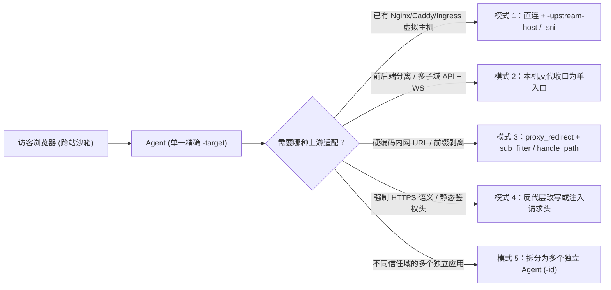

# 本地反代协作与典型适配模式

每个 Agent 严格锁定单一 `-target` 精确源（Pure Pipe 透明管道，详见 [核心原则](../CONSTITUTION.md) 与 [设计边界与架构权衡](../DESIGN_TRADEOFFS.md)）。当目标应用需要多源 API 聚合、硬编码链接改写、路径前缀剥离或自定义上游头注入时，标准做法是在 `-target` 之后部署一层本机通用反向代理（Nginx 或 Caddy），由其承接应用侧改写逻辑。

> [!NOTE]
> 本页沉淀的是长期稳定的**通用反代协作模式**，而非特定版本第三方软件的专属配置手册。所有反代规则均运行在 Agent 进程之外的标准 HTTP / WebSocket 边界上，与具体应用版本解耦。

---

## 模式速查



| 模式 | 适用问题 | 是否需要额外反代 | 核心机制 |
| :--- | :--- | :--- | :--- |
| **模式 1：直连已有虚拟主机** | 本机已有按 `Host` / SNI 分流的 Nginx、Caddy 或 Ingress | 否 | Agent `upstream_host` + `sni` |
| **模式 2：前后端与多源收口** | 同一应用的前端、API 与 WebSocket 分散在不同端口或子域 | 是（本机回环） | Caddy `reverse_proxy` / Nginx `location` + WS Upgrade |
| **模式 3：绝对链接改写与剥离前缀** | 老旧 WebUI / 路由器在 HTML、JS 或 302 中硬编码内网地址 | 是（本机回环） | Nginx `proxy_redirect` + `sub_filter` / Caddy `handle_path` |
| **模式 4：协议头补齐与鉴权头注入** | 上游要求 `X-Forwarded-Proto: https` 或固定内部鉴权头 | 是（本机回环） | 反代层改写转发头或注入 `Authorization` / `X-API-Key` |
| **模式 5：多信任域拆分红线** | 同机部署多个互不信任或面向不同访客的服务 | — | 按信任边界运行多个独立 `-id` 的 Agent |

---

## 模式 1：直连本机已有虚拟主机（零额外反代）

**结论**：如果内网宿主已部署 Nginx、Caddy、Traefik 或 Kubernetes Ingress 按 `Host` 头与 TLS SNI 路由服务，直接配置 Agent 的 `upstream_host` 与 `sni` 即可，无需再套一层反代。

```yaml
# /etc/webrtc-gateway/agent-vhost.yaml
node_id: "intranet-app"
signal_url: "wss://portal.example.com/ws"
identity_key: "/var/lib/webrtc-gateway/intranet-app.ed25519.key"
state_file: "/var/lib/webrtc-gateway/intranet-app.state.json"

# 拨号至本机反代回环端口，通过 upstream_host 与 sni 命中对应虚拟主机
target_url: "https://127.0.0.1:443"
upstream_host: "app.internal.example"
sni: "app.internal.example"
# 仅当本机虚拟主机使用自签或内网私有 CA 证书时显式开启
insecure_target: false
```

- **`upstream_host` 一致性语义**：Agent 启动时按 RFC 9110 `host[:port]` 做 Fail-Closed 校验，并同步作用于 HTTP/WS 上游 `Host` 头、`Origin`/`Referer` 改写、`Location` 重定向匹配与 `ProxyCookieJar` 虚拟主机域校验（使 `Domain=app.internal.example` 的 `Set-Cookie` 正常生效）。
- **子路径协同**：若目标虚拟主机将应用挂载在子路径下，可直接将 `target_url` 写为 `https://127.0.0.1:443/app`，Agent 同时执行子路径禁锢。

---

## 模式 2：前后端分离与多源 API 收口为单一入口

**结论**：当单个 Web 应用的前端页面、REST API、静态资源与 WebSocket 分别运行在不同内网端口或独立子域时，在本机回环地址启动轻量 Caddy 或 Nginx 将其统一收口到单一 `127.0.0.1` 端口，再由 Agent 反代该本地入口。

### 2.1 Caddy 极简配置

```text
# /etc/caddy/Caddyfile.p2p-suite
{
    auto_https off
}

http://127.0.0.1:18080 {
    handle /api/* {
        reverse_proxy http://192.0.2.20:8000 {
            header_up Host api.internal.example
        }
    }

    handle /ws/* {
        reverse_proxy http://192.0.2.20:8001 {
            header_up Host ws.internal.example
        }
    }

    handle {
        reverse_proxy http://192.0.2.20:3000 {
            header_up Host app.internal.example
        }
    }
}
```

### 2.2 Nginx 配置与 WebSocket 透传

```nginx
# /etc/nginx/conf.d/p2p-suite.conf
map $http_upgrade $connection_upgrade {
    default upgrade;
    ''      close;
}

server {
    listen 127.0.0.1:18080;
    server_name _;

    location /api/ {
        proxy_pass http://192.0.2.20:8000;
        proxy_http_version 1.1;
        proxy_set_header Host api.internal.example;
        proxy_set_header X-Forwarded-For $proxy_add_x_forwarded_for;
        proxy_set_header X-Forwarded-Proto $scheme;
        proxy_buffering off;
    }

    location /ws/ {
        proxy_pass http://192.0.2.20:8001;
        proxy_http_version 1.1;
        proxy_set_header Host ws.internal.example;
        proxy_set_header Upgrade $http_upgrade;
        proxy_set_header Connection $connection_upgrade;
        proxy_read_timeout 3600s;
    }

    location / {
        proxy_pass http://192.0.2.20:3000;
        proxy_http_version 1.1;
        proxy_set_header Host app.internal.example;
        proxy_set_header X-Forwarded-For $proxy_add_x_forwarded_for;
    }
}
```

### 2.3 对应 Agent YAML 配置

```yaml
# /etc/webrtc-gateway/agent-suite.yaml
node_id: "app-suite"
signal_url: "wss://portal.example.com/ws"
identity_key: "/var/lib/webrtc-gateway/app-suite.ed25519.key"
target_url: "http://127.0.0.1:18080"
```

---

## 模式 3：硬编码内网地址改写与路径前缀剥离

**结论**：部分旧版内网管理面板、路由器或遗留系统会在 HTML、CSS、JavaScript 或 `302 Location` 中硬编码内网 IP 与端口，或假定自身独占根路径 `/`；将响应体替换与路径剥离放在本机 Nginx 或 Caddy 中处理，可避免污染网关核心逻辑。

### 3.1 Nginx `proxy_redirect` 与 `sub_filter`

```nginx
# /etc/nginx/conf.d/p2p-legacy.conf
server {
    listen 127.0.0.1:18081;
    server_name _;

    location / {
        proxy_pass http://192.0.2.30:8080;
        proxy_http_version 1.1;
        proxy_set_header Host 192.0.2.30:8080;

        # 关闭上游压缩，确保 sub_filter 能匹配明文响应体
        proxy_set_header Accept-Encoding "";

        # 改写 301/302 Location 中的硬编码绝对地址为相对路径
        proxy_redirect http://192.0.2.30:8080/ /;
        proxy_redirect http://legacy.internal.example/ /;

        # 改写 HTML / CSS / JS 中的硬编码内网源为站内相对路径
        sub_filter_once off;
        sub_filter_types text/css application/javascript text/javascript;
        sub_filter 'http://192.0.2.30:8080' '';
        sub_filter 'http://legacy.internal.example' '';
    }
}
```

### 3.2 Caddy 路径前缀剥离（`handle_path`）

```text
# /etc/caddy/Caddyfile.p2p-prefix
{
    auto_https off
}

http://127.0.0.1:18082 {
    # 将外部 /legacy/foo 剥离前缀后以 /foo 转发给仅支持根路径部署的旧版应用
    handle_path /legacy/* {
        reverse_proxy http://192.0.2.30:9000
    }
}
```

> [!WARNING]
> 使用 Nginx `sub_filter` 时必须设置 `proxy_set_header Accept-Encoding "";`，否则后端返回 `gzip` / `br` 压缩体会导致字符串替换静默失效。关闭上游与本机反代之间的压缩不会造成公网带宽浪费——Agent 在经过 P2P 隧道发送给浏览器前会自动协商端到端原生流式 `gzip` 压缩。

---

## 模式 4：上游协议头补齐与自定义鉴权头注入

**结论**：当本地 HTTP 服务要求 `X-Forwarded-Proto: https`（例如需要生成 HTTPS 回调链接、通过严格 CSRF / OAuth 校验的框架）或需要静态内部认证头（如 `Authorization` / `X-API-Key`）时，在本机反代层统一补齐请求头。

### 4.1 强制 HTTPS 代理语义（`X-Forwarded-Proto`）

当 `Agent -target` 指向明文 `http://127.0.0.1:...` 时，Agent 按目标协议发出 `X-Forwarded-Proto: http`。若上游应用要求感知访客端为 HTTPS（常见于部分自托管云盘、智能家居与 Web 框架），由本机回环反代显式覆盖转发头，并在目标应用配置中将 `127.0.0.1` 加入受信任代理列表：

```nginx
# /etc/nginx/conf.d/p2p-https-proto.conf
server {
    listen 127.0.0.1:18083;
    server_name _;

    location / {
        proxy_pass http://127.0.0.1:8123;
        proxy_http_version 1.1;
        proxy_set_header Host $http_host;
        proxy_set_header X-Forwarded-Proto https;
        proxy_set_header X-Forwarded-For $proxy_add_x_forwarded_for;
        proxy_set_header Upgrade $http_upgrade;
        proxy_set_header Connection $connection_upgrade;
        proxy_buffering off;
    }
}
```

### 4.2 注入静态上游鉴权头

```text
# /etc/caddy/Caddyfile.p2p-apikey
{
    auto_https off
}

http://127.0.0.1:18084 {
    reverse_proxy http://127.0.0.1:9090 {
        # 通过运行环境变量注入，不在配置文件中硬编码明文密钥
        header_up X-API-Key {$UPSTREAM_API_KEY}
    }
}
```

> [!IMPORTANT]
> 本机反代监听地址必须绑定回环（`127.0.0.1`），避免局域网其他主机绕过认证直连已注入上游凭据的端口；同时务必为对应 Agent 配置强 `ACCESS_SECRET`（绝不与 `-allow-public` 混用），确保访客先通过 DTLS 通道内 RFC 9383 SPAKE2+ 认证。

---

## 模式 5：安全边界红线——何时聚合，何时必须拆分多 Agent

**结论**：本机反代聚合仅适用于**属于同一应用且处于同一信任边界**的组件；不同信任级别或不同受众的内网服务必须拆分为多个独立 Agent 进程（各自拥有独立 `-id`、`ACCESS_SECRET` 与 Ed25519 身份密钥）。

| 维度 | 同一应用内组件聚合（推荐） | 跨应用 / 跨信任域揉进单反代（避免） |
| :--- | :--- | :--- |
| **典型示例** | 同一系统的前端 UI + `/api` + `/ws` | 个人相册 + 路由器后台 + 监控面板共用 1 个 `-id` |
| **跨站沙箱源** | 共享同一 `sbx-<hash>.sandbox.example.net` 合理 | 任一应用的 XSS 可读写同一沙箱源下全部应用会话 |
| **访问口令与能力令牌** | 一套 `ACCESS_SECRET` 与路径前缀权限边界清晰 | 无法按应用隔离口令与吊销范围，误配路径极易越权 |
| **故障与密钥轮换半径** | 仅影响单个应用 | 单个节点重启或密钥轮换影响所有聚合服务 |

> [!TIP]
> 在同一台宿主机上托管多个独立内网服务时，使用 systemd 模板单元（见 [Agent 典型用例](./agent-use-cases.md) 中的单机多应用模板）即可用极低内存开销为每个服务运行独立 Agent。对于特定第三方软件版本相关的完整社区配方，建议在 GitHub Discussions 中共享与演进，保持核心指南简洁稳定。
