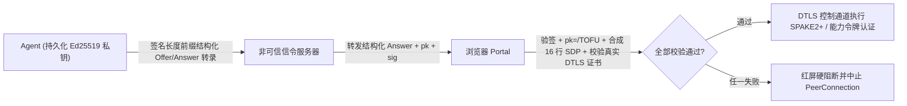

# 安全机制与权限控制 (Security & Authentication)

WebRTC Gateway 采用明确划分信任根的纵深防御架构，覆盖结构化 SDP 合成、Ed25519 身份验签、DTLS 通道内 RFC 9383 SPAKE2+ 认证、跨站双域沙箱与代理边界校验。

---

## 1. 结构化 SDP、传输层加密与 Ed25519 节点身份

WebRTC DataChannel 通过 DTLS 1.2 加密（SCTP over DTLS，RFC 8261 / RFC 8831），信令服务器不中继业务数据。为从根源消除 SDP 解析差异、分隔符注入及信令侧中间人攻击，采用结构化 `SessionDescriptor` + 持久化 **Ed25519 Agent 身份密钥** + 远端真实 DTLS 证书校验：



- **零原始对端 SDP 传递**：信令仅传输严格校验的 `SessionDescriptor`（`fp`、`ice_ufrag`、`ice_pwd`、`setup`、`mid`、`sctp_port`、`max_msg_size`、`sdp_ver`），双方本地确定性合成最小 16 行 RFC 8841 DataChannel-only SDP，从结构上消除多 `m=` 节与双指纹解析差异；
- **全模式 Pure Ed25519 验签与真实 DTLS 证书绑定**：无论是否启用 `-allow-public`，Agent 对长度前缀转录（`p2pgw-v7:answer-v2:`）做 Pure Ed25519 签名；浏览器校验签名并校验 `RTCDtlsTransport.getRemoteCertificates()` 真实指纹（Agent 同步校验 `GetRemoteCertificate()`，兼容多算法 SDP 指纹行）；
- **公钥钉扎与 Fail-Closed SSH 风格 TOFU**：
  - 带 `#node?pk=<22字符SHA256摘要>` 的链接执行强钉扎校验且不可绕过；若节点已在 `IndexedDB` 记录不同 TOFU 指纹，URL `?pk=` 不得静默覆盖既有信任；
  - 裸 `#node` 访问在完成 Ed25519 验签与通道认证后才提交 TOFU 记录；`IndexedDB` I/O 失败严格 Fail-Closed；公钥变更在建联前即弹出红屏阻断；
- **统一前端 TCB 边界**：Portal 与沙箱内容哈希静态资产由单一权威 Go `signal` 二进制按清单交付，同处于前端 TCB 内；Portal CSP 严格锁定 `connect-src 'self'`，严禁运行时 `?signal=` 覆写。

---

## 2. 控制面与 DTLS 通道内 RFC 9383 SPAKE2+ 认证

### 1. 控制面：信令集群准入 (`SIGNAL_SECRET` / `-node-secrets-file`)

- Go 信令在 **HTTP WebSocket Upgrade 阶段**校验 `Authorization: Bearer <secret>`，支持全局 `SIGNAL_SECRET` 与逐节点隔离文件 `-node-secrets-file`（命中逐节点密钥时严格禁止回退至全局密钥）；
- 非显式开启 `-allow-anonymous-agents` 时，未配置任何注册密钥直接 Fail-Closed 拒绝启动；
- 节点首次注册通过长度前缀 `p2pgw-v7:register-v2:` Ed25519 挑战绑定归属，支持 `-bound-keys-file` 经 `AtomicFileStore` 跨重启原子持久化；共享 `SIGNAL_SECRET` 下默认关闭 `-allow-force-rekey`（逐节点密钥下默认开启），轮换密钥需服务端允许且 Agent 持合法密钥传入 `-force-rekey`。

### 2. 数据面：DTLS `p2pctrl` 内 RFC 9383 SPAKE2+ 认证

- **零离线暴破预言机**：访客口令（`ACCESS_SECRET`，与 `-allow-public` 互斥，并存启动即拒）结合已校验的 `agent_pk` 与 `node_id` 经 1-Block `PBKDF2-HMAC-SHA256`（300,000 次迭代）+ `HKDF-SHA256`（`p2pgw-v7:spake2p-w0w1`）派生为 SPAKE2+ 验证子（`w0`, `L = w1·G`），并在 DTLS `p2pctrl` 内完成 **RFC 9383 SPAKE2+（P-256）双向零知识认证**（验证双方 `confirm_p` 与 `confirm_v`，严格要求完成远端证书指纹核验并下发挑战后方受理 `AUTH_RESPONSE`，拒绝降级与认证前任何 Pool DC 业务帧）；
- **先输入口令后建联与单连接单次尝试**：Portal 在收到 `JoinedDTO` 后先展示口令弹窗，待用户输入完毕再建立 `RTCPeerConnection`，避免人类输入耗时触发 10 秒 `UnauthSessionTimeout`；每条连接严格仅允许 1 次认证尝试；认证完成后 Portal 立即关闭信令 WebSocket；
- **抗 IPv6 轮换、单 IP 串行化与全局 Fail-Closed 限流**：`VisitorAuthLimiter` 先对 IPv4-mapped IPv6 调用 `Unmap()` 再将真实 IPv6 归一至 `/64` 前缀，同时执行单 IP 并发握手上限（`4`）、单 IP 认证尝试串行化、活跃 5 分钟锁定永不驱逐的 LRU 表、表满 Fail-Closed 及全局失败速率上限（60 次/分钟），且对信令传入的 `ClientIP` 严格按 `netip.ParseAddr` 校验；
- **统一静默重连**：断连时按需重连信令、新建 `RTCPeerConnection` 并复用当前 Tab 内存派生的 `(w0, w1)` 静默完成完整 SPAKE2+ 重认证，不落盘明文口令且保活 `appFrame`。

---

## 3. Ed25519 能力分享令牌与持久化吊销

临时外部分享采用由 Agent Ed25519 私钥签名的结构化能力令牌（Capability Token）：

```json
{
  "v": 7,
  "jti": "unique-token-id",
  "node": "homeserver",
  "exp": 1795752000,
  "path_prefix": "/public",
  "readonly": true,
  "max_conns": 4
}
```

- **零密码再输入签发、跨进程锁合并与实时持续吊销**：Owner 可在 Portal 分享弹窗内经 `CAP_REQ` 签发、按控制帧字节预算分页列举并即时吊销能力令牌，也可用 CLI `./bin/agent -mint-link 24h -mint-readonly -mint-path /public` 离线签发；`-state-file` 经跨进程文件锁 + `AtomicFileStore` 读盘并集合并（`revoked` 只增不减）原子持久化，活跃 Agent 按文件变更轻量重载并立即使吊销与新签发记录生效；Portal 载入分享链接后立即使用 `history.replaceState` 清洗地址栏中的 `cap=` 参数；
- **后置规范化范围与独立会话隔离**：Agent 在 `DestinationPolicy.Resolve` 规范化路径（叠加 `TargetSubpath`）之后才校验 `path_prefix` 与 `readonly`（并剥离 `X-HTTP-Method-Override`），运行时同步检查令牌过期，并为每个能力访客分配独立 `guestPool` 随机 `ProxyCookieJar`（`cap:<jti>:<rand>`），杜绝同链访客共享 `HttpOnly` 会话；
- **安全声明说明**：分享链接本质为持有者令牌（Bearer Capability），请为外部分享设置短有效期、最小路径前缀与只读权限，并在不需要时即时吊销。

---

## 4. 三档跨站沙箱、W3C Fetch 抗 CSRF 门禁与统一 Cookie 保护

- **三档跨站沙箱、零时间重叠桥接与 `appFrame` 沙箱**：生产环境支持 Tier 1 双固定域（`-sandbox-host`）、Tier 2 单根域同站通配符（`-allow-same-site-sandbox`，在信令资产与 SW 合成响应上同步下发 `Origin-Agent-Cluster: ?1`）与 Tier 3 双域通配符（`-sandbox-domain` + 本机私有盐 HMAC `sbx-<24hex>`；本地自动 `*.localhost` 并拒绝任意 `*.localhost` WS 连接）；引导用 `bridge.html` 仅在挂载 `appFrame` 之前短暂存活并附带 `sandbox="allow-scripts allow-same-origin"`，完成端口移交即从 DOM 移除（零时间重叠）；`bridge.js` 与 `patch.js` 位于 `/__p2p_gw__/assets/` 并带 `Vary: Service-Worker, Sec-Fetch-Dest` 拒绝 Service Worker 注册请求；`appFrame` 强制设置 `sandbox` 属性阻断 `top.location` 跳转；
- **W3C Fetch 抗 CSRF 门禁与资产隔离**：Portal CSP 锁定 `style-src 'self'`、`connect-src 'self'`、`form-action 'self'` 与 `frame-ancestors 'none'`，返回 `404` 拒绝 `/__p2p_gw__/sw.js` 与 `/__p2p_gw__/bridge.html`；SW 校验一次性 128 位 `enterNonce`，拦截全部未绑定子资源、跨站 POST、`document` 导航及代理模式（`-target`）下全部未绑定空 Referrer `iframe`，仅对真实顶层文档导航置位 `TopLevelNav`（绝不对 `iframe` 置位），并对导航与 HTML 响应强制下发 `Content-Security-Policy: frame-ancestors 'self' <portalOrigin>`；
- **统一单表 RFC 6265bis `ProxyCookieJar` 与内存 `CookieMirror`**：浏览器侧覆写 `Document.prototype.cookie` 为纯内存镜像且绝不写入真实浏览器 Cookie；Agent 侧 `ProxyCookieJar` 以统一单表配合服务端/客户端独立配额隔离受保护 Cookie——服务端下发 `HttpOnly`/`Secure` Cookie 时清扫同域同名更特异路径上的客户端 Cookie（阻断路径遮蔽），允许 JS 正常更新普通非受保护 Cookie，支持 W3C 潜在可信回环源（`127.0.0.0/8`、`::1`、`localhost`、`*.localhost`）的 `Secure`/`__Host-`/`__Secure-` 语义，严格遵守 `credentials: 'omit'`、Mozilla PSL、Leave Secure Cookies Alone、`SameSite` 与 400 天 `MaxAge` 上限，经 V7 行内 TLV 双向同步。

---

## 5. 单目标代理边界、Fail-Closed mDNS、客户端 IP 透传与静态文件沙箱

- **严格单目标精确源与 WS 302 逃逸阻断**：每个 Agent 仅允许转发至管理员显式配置的单一 `-target` 精确 `(scheme, host, port)` 及可选子路径，拒绝 `/__p2p_proxy__/`、`//` 同源开放重定向、反斜杠与 `..;` 穿越；消费 V7 `FetchCtx` 位域（未置位 `SameOriginClient` 一律 Fail-Closed 判跨站）；`-upstream-host` 仅覆写虚拟主机 `Host`/源语义及默认 HTTPS SNI，不改变实际拨号目标；WebSocket 拨号禁用 302 重定向；
- **Fail-Closed mDNS 候选清洗与可信代理从右向左剥离**：启用 `-ice-mdns=true`（默认）时，Agent 在出站 `OnICECandidate` 阶段强制丢弃一切非 `.local` 的 `typ host` 候选，并按 RFC 8828 §5.2 将 `srflx`/`relay` 中的 `raddr`/`rport` 置零，即使宿主禁用了 IPv6 或组播也绝不泄露内网真实 IP；Go 信令对 `r.URL.EscapedPath()` 做单次规范化解码防二次编码绕过，默认 `-trusted-proxies` 仅信任回环地址并从右向左剥离 `X-Forwarded-For`；
- **Go 逐级 `os.Root` 静态适配器**：`-dir` / `-file` 逐级调用 `os.Root.OpenRoot` 加 `O_RDONLY|O_NONBLOCK|O_NOFOLLOW` 打开，阻断跨根多跳软链、点文件与 FIFO 阻塞，并默认对**全部**静态文件（含无扩展名文件）下发 `Content-Security-Policy: sandbox`（SW 使用严格 CSP 指令分词器与 `headers.append` 保留多值策略）。
