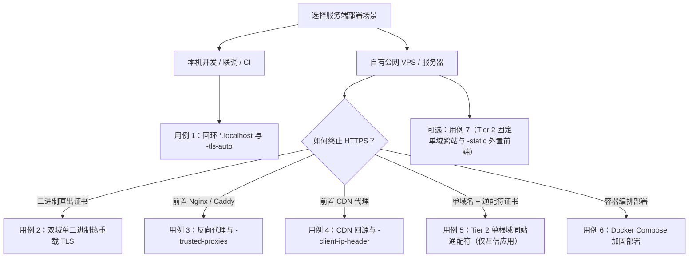

# 服务端典型用例与部署模板 (Server Use Cases)

> 适合：按不同运维拓扑（本机、反向代理、Docker 等）部署信令与门户服务的运维者。

本页按不同运维拓扑给出单一权威 Go 信令与门户服务端（`cmd/signal`）的完整部署模板与安全边界。基础域名规划见 [生产部署指南](./deployment)，完整参数表见 [Agent 与服务端配置](./agent-configuration)。

---

## 拓扑速查表



| 场景 | 服务端形态 | 关键参数 / 配置 | 适用对象 |
| :--- | :--- | :--- | :--- |
| **1. 本机研发与 CI 验证** | Go `signal` | `-addr 127.0.0.1:8888 -dev`、可选 `-tls-auto` | 本地联调、端到端测试、无需公网域名 |
| **2. 标准双域 VPS 直出 TLS** | Go `signal` | `-portal-origin`、`-sandbox-origin`、`-bound-keys-file`、`-tls-cert` | 独立主机部署、零额外反代依赖 |
| **3. 前置 Nginx / Caddy 反代** | Go `signal` + 反代 | `-trusted-proxies`、透传 `Host`/`XFF`/WS | 与现有 Web 站点复用 443 端口 |
| **4. 前置 CDN / 边缘代理** | Go `signal` + CDN | `-trusted-proxies`、`-client-ip-header`、`-node-secrets-file` | 隐藏源站 IP 与多节点准入隔离 |
| **5. Tier 2 单根域同站通配符** | Go `signal` | `-portal-origin`、`-sandbox-origin`、`-allow-same-site-sandbox` | 仅有单个根域且仅穿透互信自用服务 |
| **6. 加固容器化部署** | Docker Compose | `read_only`、`cap_drop: [ALL]`、`signal_state` 持久化卷 | 云主机仅跑 `server`，内网独立跑 `agent` |
| **7. Tier 2 固定单域跨站与 `-static`** | Go `signal` | `-portal-origin`、固定 `-sandbox-origin`、`-static` | 无泛域证书的跨站部署或外置前端资产覆盖 |

---

## 用例 1：本机研发、联调与 CI 临时验证

**结论**：显式传入 `-dev` 且监听回环地址（`127.0.0.1` 或 `::1`）时，服务端启用 RFC 6761 `*.localhost` 跨站沙箱模式（按 IPv4/IPv6 地址族隔离），无需配置公网域名与 DNS 记录。

```bash
# 1. 最简回环 HTTP 启动（保留 >=16 字节 SIGNAL_SECRET 准入校验）
SIGNAL_SECRET=dev-cluster-secret-16b \
./bin/signal -addr 127.0.0.1:8888 -dev

# 2. 需要测试 HTTPS 安全上下文时，启用内存自签证书（仅签发 localhost / *.localhost / 127.0.0.1 / ::1）
SIGNAL_SECRET=dev-cluster-secret-16b \
./bin/signal -addr 127.0.0.1:8888 -dev -tls-auto

# 3. 仅限本机临时测试：显式关闭 Agent 集群密钥校验
./bin/signal -addr 127.0.0.1:8888 -dev -allow-anonymous-agents
```

> [!WARNING]
> `-allow-anonymous-agents` 仅适用于本机或完全隔离的测试环境。切勿在公网监听实例上启用，否则任何主机均可注册占用未绑定节点。

---

## 用例 2：标准生产跨站双域自建（单二进制直出热重载 TLS）

**结论**：在公网 VPS 上直接由 `signal` 终止 TLS 是依赖最少的生产方案；`-tls-cert` 与 `-tls-key` 会根据磁盘文件修改时间自动热重载，证书续期时无需重启进程或中断已有 WebSocket；`-bound-keys-file` 持久化各 `node_id` 的 Ed25519 公钥绑定，确保进程重启后仍防抢注。

### 2.1 前置准备

1. DNS 记录：`portal.example.com` 指向服务端 IP，`*.sandbox.example.net` 泛域名指向同一服务端 IP（两个域名必须属于不同 eTLD+1）。
2. TLS 证书：签发包含 `portal.example.com` 与 `*.sandbox.example.net` 的多域 SAN 证书（如 via `acme.sh` DNS-01 自动化续期）。

### 2.2 显式 YAML 配置与 systemd 服务

创建 `/etc/webrtc-gateway/server.yaml`（完整字段参考见 [`configs/server.example.yaml`](https://github.com/BeingNoAbility/WebRTC-Gateway/blob/main/configs/server.example.yaml)）：

```yaml
addr: "0.0.0.0:443"
portal_origin: "https://portal.example.com"
sandbox_origin: "https://*.sandbox.example.net"
tls_cert: "/etc/webrtc-gateway/certs/fullchain.pem"
tls_key: "/etc/webrtc-gateway/certs/privkey.pem"
bound_keys_file: "/var/lib/webrtc-gateway/bound-keys.json"
node_secrets_file: "/etc/webrtc-gateway/node-secrets.yaml"
max_ip_conns: 64
max_ip_msgs: 120
trusted_proxies: "127.0.0.0/8,::1/128"
metrics_addr: "127.0.0.1:9090"
```

创建 `/etc/systemd/system/p2p-signal.service`（赋予 `CAP_NET_BIND_SERVICE` 以便非 root 用户绑定 443）：

```ini
[Unit]
Description=WebRTC Gateway Signaling Server
After=network-online.target
Wants=network-online.target

[Service]
Type=simple
User=p2pgw
Group=p2pgw
ExecStart=/usr/local/bin/signal -config /etc/webrtc-gateway/server.yaml
Environment=SIGNAL_SECRET_FILE=/etc/webrtc-gateway/signal.secret
AmbientCapabilities=CAP_NET_BIND_SERVICE
CapabilityBoundingSet=CAP_NET_BIND_SERVICE
NoNewPrivileges=true
ProtectSystem=strict
ReadOnlyPaths=/etc/webrtc-gateway
ReadWritePaths=/var/lib/webrtc-gateway
Restart=always
RestartSec=3

[Install]
WantedBy=multi-user.target
```

---

## 用例 3：前置 Nginx / Caddy 反向代理部署

**结论**：若服务器 443 端口已由 Nginx 或 Caddy 管理，令 `signal` 仅监听 `127.0.0.1:8888`，并在反代中透传原始 `Host`、`X-Forwarded-For` 与 WebSocket 升级头（对外协议与端口由启动期 `-portal-origin` 与 `-sandbox-origin` 权威声明，无需 `X-Forwarded-Proto` 运行时猜测）；若反代位于独立主机或容器网桥，必须在 `-trusted-proxies` 中声明反代真实 CIDR。

### 3.1 启动信令后端

```bash
SIGNAL_SECRET_FILE=/etc/webrtc-gateway/signal.secret \
./bin/signal \
  -addr 127.0.0.1:8888 \
  -portal-origin https://portal.example.com \
  -sandbox-origin 'https://*.sandbox.example.net' \
  -bound-keys-file /var/lib/webrtc-gateway/bound-keys.json \
  -trusted-proxies "127.0.0.0/8,::1/128"
```

### 3.2 Nginx 反向代理模板

```nginx
map $http_upgrade $connection_upgrade {
    default upgrade;
    ''      close;
}

server {
    listen 443 ssl http2;
    server_name portal.example.com *.sandbox.example.net;

    ssl_certificate     /etc/nginx/certs/fullchain.pem;
    ssl_certificate_key /etc/nginx/certs/privkey.pem;

    location /ws/ {
        proxy_pass http://127.0.0.1:8888;
        proxy_http_version 1.1;
        proxy_set_header Upgrade $http_upgrade;
        proxy_set_header Connection $connection_upgrade;
        proxy_set_header Host $host;
        proxy_set_header X-Forwarded-For $proxy_add_x_forwarded_for;
        proxy_read_timeout 3600s;
        proxy_send_timeout 3600s;
    }

    location / {
        proxy_pass http://127.0.0.1:8888;
        proxy_http_version 1.1;
        proxy_set_header Host $host;
        proxy_set_header X-Forwarded-For $proxy_add_x_forwarded_for;
    }
}
```

### 3.3 Caddy 反向代理模板

```text
portal.example.com, *.sandbox.example.net {
    tls {
        dns cloudflare {env.CF_API_TOKEN}
    }
    reverse_proxy 127.0.0.1:8888
}
```

> [!IMPORTANT]
> 切勿遗漏 `proxy_set_header Host $host`。`signal` 强制执行 Host 白名单，若反代改写了 `Host` 头（例如发成 `127.0.0.1:8888`），所有请求都会收到 `421 Misdirected Request`。

---

## 用例 4：前置 CDN / 边缘代理与多节点密钥隔离

**结论**：希望借助任意 CDN / 边缘代理隐藏源站 IP 时，在自建 Go `signal` 上配合 `-trusted-proxies` 与单值头开关 `-client-ip-header`（如 `CF-Connecting-IP`、`Fastly-Client-IP`、`True-Client-IP`、`CloudFront-Viewer-Address` 或 `X-Real-IP`）；多节点共享同一信令实例时，结合 `-node-secrets-file` 为每个 `node_id` 分配独立准入密钥（每条不少于 16 字节，已配置专属密钥的节点严格拒绝回退到全局 `SIGNAL_SECRET`）。

### 4.1 自建 Go 信令置于 CDN 代理之后

以 Cloudflare / Fastly / CloudFront 为例：在边缘开启代理并将回源 TLS 设为严格模式，在 `signal` 中将回源代理网段加入 `-trusted-proxies` 并显式声明该边缘的单个源 IP 头名：

```bash
SIGNAL_SECRET_FILE=/etc/webrtc-gateway/signal.secret \
./bin/signal \
  -addr 0.0.0.0:443 \
  -portal-origin https://portal.example.com \
  -sandbox-origin 'https://*.sandbox.example.net' \
  -bound-keys-file /var/lib/webrtc-gateway/bound-keys.json \
  -node-secrets-file /etc/webrtc-gateway/node-secrets.yaml \
  -tls-cert /etc/webrtc-gateway/certs/origin.pem \
  -tls-key /etc/webrtc-gateway/certs/origin.key \
  -trusted-proxies "192.0.2.0/24,198.51.100.0/24" \
  -client-ip-header CF-Connecting-IP
```

> [!NOTE]
> 请将 `-trusted-proxies` 中的示例网段替换为实际 CDN 回源 IP 段（或源站前置反代网段），并将 `-client-ip-header` 替换为所用边缘对应的单个请求头名（支持纯 `IP` 与 `IP:port` 格式）。服务端仅在直连对端命中 `-trusted-proxies` 且该头恰好出现一次合法值时采信，重复头或非法值均 Fail-Closed 回退为对端地址。

### 4.2 多节点独立准入密钥表 (`-node-secrets-file`)

当一台信令服务器服务多个不同信任域的 Agent 时，创建 `/etc/webrtc-gateway/node-secrets.yaml`（权限 `0600`）：

```yaml
nas-media: "replace-with-nas-only-secret"
pve-console: "replace-with-pve-only-secret"
```

若仅配置 `-node-secrets-file` 而未配置全局 `SIGNAL_SECRET`，则仅清单内的节点允许注册，未列出节点一律 Fail-Closed 拒绝；如需禁用在线密钥强制轮换，额外附加 `-allow-force-rekey=false`。

---

## 用例 5：Tier 2 单根域同站通配符（仅限互信应用）

**结论**：当暂时只有单个根域名且仅穿透个人互信内网服务时，可显式开启 `-allow-same-site-sandbox`（环境变量 `ALLOW_SAME_SITE_SANDBOX=true`），使用 `https://portal.example.com` 搭配 `https://*.sbx.example.com` 泛域证书（服务端自动下发 `Origin-Agent-Cluster: ?1`）。

```bash
SIGNAL_SECRET_FILE=/etc/webrtc-gateway/signal.secret \
./bin/signal \
  -addr 0.0.0.0:443 \
  -portal-origin https://portal.example.com \
  -sandbox-origin 'https://*.sbx.example.com' \
  -allow-same-site-sandbox \
  -bound-keys-file /var/lib/webrtc-gateway/bound-keys.json \
  -tls-cert /etc/webrtc-gateway/certs/wildcard-example.pem \
  -tls-key /etc/webrtc-gateway/certs/wildcard-example.key
```

> [!CAUTION]
> 该模式下 Portal 与沙箱子域共享同一 eTLD+1（同站），无法在浏览器站点级隔离跨节点 Storage；Portal 顶部会持续显示 Tier 2 受限隔离警示条。若托管多用户或含不可信第三方应用，必须迁移至不同 eTLD+1 的 Tier 1 跨站通配符 `-sandbox-origin 'https://*.sandbox.example.net'`。

---

## 用例 6：容器化加固部署（公网仅跑服务端，内网独立跑 Agent）

**结论**：根目录 [`docker-compose.yml`](https://github.com/BeingNoAbility/WebRTC-Gateway/blob/main/docker-compose.yml) 已内置只读根文件系统（`read_only: true`）、零内核能力（`cap_drop: [ALL]`）、`no-new-privileges:true`、资源配额、持久化状态卷（`signal_state` 与 `agent_identity`）与 `/app/server -health` 探针。生产中通常在公网主机仅启动 `server` 服务，在各自内网宿主机分别运行 `agent`。

### 6.1 公网 VPS 仅启动信令容器

```bash
cat <<'EOF' > .env
PORTAL_ORIGIN=https://portal.example.com
SANDBOX_ORIGIN=https://*.sandbox.example.net
SIGNAL_URL=wss://portal.example.com/ws
SIGNAL_SECRET=replace-with-random-cluster-secret
ACCESS_SECRET=unused-on-server-only-host
TRUSTED_PROXIES=127.0.0.0/8,::1/128
EOF

docker compose up -d server
docker compose ps server
```

### 6.2 内网宿主机独立启动 Agent 容器

```bash
docker run -d \
  --name webrtc-p2p-agent-nas \
  --restart unless-stopped \
  --read-only \
  --cap-drop ALL \
  --security-opt no-new-privileges:true \
  --tmpfs /tmp:noexec,nosuid,size=16m \
  --network host \
  -v agent_nas_identity:/var/lib/webrtc-gateway \
  -e NODE_ID=nas-media \
  -e SIGNAL_URL=wss://portal.example.com/ws \
  -e SIGNAL_SECRET=replace-with-random-cluster-secret \
  -e ACCESS_SECRET=replace-with-visitor-secret \
  -e IDENTITY_KEY=/var/lib/webrtc-gateway/nas-media.ed25519.key \
  -e STATE_FILE=/var/lib/webrtc-gateway/nas-media.state.json \
  -e TARGET_URL=http://127.0.0.1:8096 \
  ghcr.io/beingnoability/webrtc-p2p-agent:v5.0.0-alpha.4
```

> [!TIP]
> 在 macOS / Windows Docker Desktop 上无法使用 `--network host` 访问宿主机回环，请移除 `--network host`，添加 `--add-host=host.docker.internal:host-gateway` 并将 `TARGET_URL` 改为 `http://host.docker.internal:8096`。

---

## 用例 7：Tier 2 固定单域跨站与 `-static` 外置前端覆盖

**结论**：暂无泛域名证书且仅部署单节点或互信应用时，使用固定单域 `-sandbox-origin https://app.example.net`（仅需两张普通 HTTP-01 单域证书，Portal 持续显示 Tier 2 警示条）即可实现 Portal 与应用跨站；如需在不重编 Go 二进制的情况下替换前端资产，使用 `-static` 指定外部构建目录。

### 7.1 Tier 2 固定单域跨站（零通配符证书）

准备两个不同根域的固定主机名（如 `portal.example.com` 与 `app.example.net`），通过普通 ACME HTTP-01 证书即可运行：

```bash
SIGNAL_SECRET_FILE=/etc/webrtc-gateway/signal.secret \
./bin/signal \
  -addr 0.0.0.0:443 \
  -portal-origin https://portal.example.com \
  -sandbox-origin https://app.example.net \
  -bound-keys-file /var/lib/webrtc-gateway/bound-keys.json \
  -tls-cert /etc/webrtc-gateway/certs/dual-fixed.pem \
  -tls-key /etc/webrtc-gateway/certs/dual-fixed.key
```

### 7.2 使用外部构建产物覆盖内嵌前端（`-static`）

当指定 `-static` 时，`signal` 严格且仅从该目录按 `manifest.json` 读取前端文件，不与编译期内嵌 `DistFS` 混用，避免前后端资产版本错配：

```bash
npm --prefix web run build

SIGNAL_SECRET_FILE=/etc/webrtc-gateway/signal.secret \
./bin/signal \
  -addr 127.0.0.1:8888 \
  -portal-origin https://portal.example.com \
  -sandbox-origin 'https://*.sandbox.example.net' \
  -static /srv/webrtc-gateway/web/dist
```

所有 Portal 与沙箱内容哈希资产均由单一 Go `signal` 二进制统一交付，CSP 锁定 `connect-src 'self'` 且禁止运行时 `?signal=` 覆盖。
