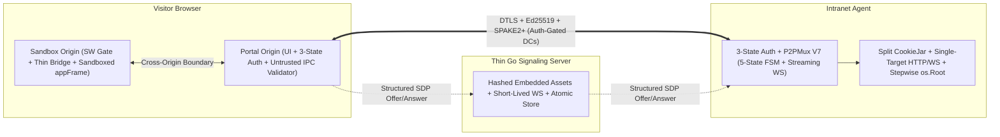

# RFC: WebRTC Gateway V7 架构设计（诚实边界、P2PMux V7、双池 Cookie 与分级部署）

> **状态**：历史架构决策记录（现行线协议已演进至 `P2PMux V8`，当前精确参数与不变量以 [指南文档](../guide/index.md) 与 [P2PMux 协议规范](../guide/protocol-specification.md) 为唯一事实源）  
> **目标版本**：`v5.0.0-alpha.3` / `v5.0.0`（原始提案线协议版本 `P2PMux V7`）  
> **关联文档**：[核心原则](../CONSTITUTION.md)、[审查清单](../REVIEW_GUIDELINES.md)、[P2PMux 协议规范](../guide/protocol-specification.md)

---

## 一、设计目标

为将 WebRTC Gateway 收口为安全边界清晰、内存受控且易于部署的零客户端 P2P 网关，V7 架构围绕 5 类核心工程目标进行结构性设计：

1. **沙箱诚实边界与 W3C Fetch 抗 CSRF 门禁**：避免 `bridge.html` 与被代理页面 `appFrame` 之间出现同源假隔离；为 `appFrame` 强制设置 HTML `sandbox` 属性；不依赖浏览器 Service Worker `FetchEvent.request.headers` 中不可见的网络层 `Sec-Fetch-Site`，而是以 W3C Fetch 原生属性与一次性 `enterNonce` 建立防线。
2. **协议与内存预算严格边界**：认证完成前阻断预协商 HTTP 池 DataChannel 帧；杜绝 0 字节与极小分片对 `MemoryBudget` 的绕过或堆放大；禁止同槽高 `Gen` 抢占旧流引发状态竞争；以固定缓冲流式转发 WebSocket 并保留 RFC 6455 关闭码；防止 `204` 或早响应 `POST` 泄漏客户端池槽位。
3. **对称认证状态机与原子持久化**：客户端 SPAKE2+ `AUTH_RESULT` 必须按已发送认证方法强制校验 `confirm_v`；以无状态静默重建取代易失步的漫游棘轮；`CapabilityStore` 与 `SignalBroker` 采用单写者原子落盘消除并发写丢数据；双端认证限流器在封禁表饱和时保持 Fail-Closed。
4. **双池隔离 Cookie 与单路径因果同步**：客户端写入严格按 RFC 6265 `cookie-octet` 校验，并与服务端 `HttpOnly` / `Secure` Cookie 分池隔离；取消双路径异步同步以消除跨流乱序覆盖；保护 `<meta charset>` 不被 HTML 注入推出浏览器 1024 字节预扫描窗口。
5. **单二进制资产内嵌与分级部署**：通过构建清单校验嵌入式内容哈希前端资产完整性，并在守住 Portal 与 App 跨源隔离底线的前提下提供免通配符双固定域、单根域通配符与双根域通配符三档生产配置。

---

## 二、V7 六大架构决策

### 2.1 决策 1：单二进制内容哈希分发与三级安全部署档位

- 移除独立静态 Portal 托管链路（`-signal-origin`、`-allowed-origins`、`__SIGNAL_ORIGIN__`），统一由 `cmd/signal` 内嵌带内容哈希的前端产物分发，并校验嵌入式资产与构建清单一致。
- 在守住“Portal 与被代理应用必须跨 Origin 隔离”底线的前提下，提供三档部署配置：
  - **Tier 1 双固定域（免通配符）**：`-portal-domain` + `-sandbox-host`（要求不同 eTLD+1，普通 HTTP-01 自动证书即可部署，提供 Portal 与 App 跨站隔离）。
  - **Tier 2 单根域通配符**：`-portal-domain` + `-sandbox-domain` + `-allow-same-site-sandbox`（强制下发 `Origin-Agent-Cluster: ?1`）。
  - **Tier 3 双根域通配符**：`-portal-domain` + `-sandbox-domain`（不同 eTLD+1，提供跨站隔离与多节点/访客隔离）。
- 仅共享全局 `SIGNAL_SECRET` 时默认关闭 `-allow-force-rekey`；客户端信令连接必须受绝对生命周期与握手后空闲超时约束；`Broker.CloseAll()` 必须采用带超时的并发扇出停机。

### 2.2 决策 2：诚实信任边界与 W3C Fetch 原生 SW 抗 CSRF 门禁

- 系统仅承认三道真实边界：Portal ↔ App Sandbox 跨源边界、Portal ↔ Agent 端到端加密认证边界、Agent ↔ 本地目标/只读文件出口边界。`bridge.html` 退化为极简 `MessagePort` 中继，Portal `TunnelBridge` 必须将 `bridgePort` 载荷视为不可信输入。
- `appFrame` 必须设置 HTML `sandbox` 属性（包含 `allow-scripts allow-same-origin allow-forms allow-modals allow-downloads allow-popups allow-popups-to-escape-sandbox allow-pointer-lock`，不得包含 `allow-top-navigation` 或 `allow-top-navigation-by-user-activation`）。
- Service Worker 不得依赖 `FetchEvent.request.headers` 中不可见的 `Sec-Fetch-Site`，也不得保留盲目 `lastTabId` 兜底；必须基于 `event.clientId`、`event.resultingClientId`、`request.mode`、`request.destination`、`request.method`、`request.referrer` 与一次性 `enterNonce`，配合响应头 `Content-Security-Policy: frame-ancestors <portalOrigin>` 拦截外部跨站请求（未绑定 `iframe` 的空 `referrer` 兜底仅在 `sessions.size === 1` 时放行且不置位 `SameOriginClient`）。
- 通配符档位下 Owner 沙箱子域由本机 128-bit 私有随机盐派生（对外不可预测，对本机跨刷新确定），Capability 访客使用每 Tab 随机子域并在同 Tab 重连间复用。

### 2.3 决策 3：P2PMux V7（5 态单槽 FSM、TLV 原生元数据与流式 WS）

- 线协议版本升级至 `ProtocolVersion = 7`；保留极简 `TypeContinuation (0x11)` + `FlagMoreHeaders (0x04)` 以兼容 `MinNegotiatedMaxMsgSize = 4096`，将组装头部总上限收紧至 `64 KiB`（`MaxContinuationFrames = 16`），并显式执行 5 态单槽 FSM（`IDLE -> RECEIVING_HEADERS -> OPEN -> HALF_CLOSED -> CLOSED`）。
- 禁止同槽高 `Gen` 抢占旧流；禁止在 `RECEIVING_HEADERS` 期间接收 `DATA`/`WS_*` 或重复 `HEADERS`；禁止非终结 0 字节 `CONTINUATION` 与 0 字节 `WS_CONT`；对 `headerChunks` 计入内存预算并施加 5 秒组装超时。
- 移除 `TypeCookieSync (0x07)` 及 `x-p2p-*` 伪头，将 `fetchCtx`、`respFlags`、随行 Cookie 变更与服务端 Cookie 差量纳入 V7 二进制 TLV 载荷。
- 内存预算采用每项 `len(payload) + 64` 开销感知记账与每流队列条数硬顶（`4096`）；传输背压改用事件驱动 `OnBufferedAmountLow`；`WSProxy` 改为 `16 KiB` 固定缓冲流式转发并保留 RFC 6455 合法线码。

### 2.4 决策 4：对称 3 态认证 FSM、SPAKE2+ KDF 升级与静默重连

- 移除脆弱的串行 HKDF 漫游棘轮（ICE Restart）；断网后由 Portal 后台静默重建新 `RTCPeerConnection` 并换绑 `bridgePort`，保活 `appFrame` 不刷新，凭 `cookie_resume_token` 续接 `ProxyCookieJar`，在当前 Tab 内存缓存派生后的 `(w0, w1)`。
- 认证状态机严格按 `WAIT_CHALLENGE -> WAIT_RESULT -> AUTHENTICATED` 执行；客户端必须按已发送方法匹配服务端 `role` 并无条件校验 `confirm_v`，认证通过后才可提交 TOFU；Agent 在认证完成前必须原子级拒收全部非 `p2pctrl` 帧。
- SPAKE2+ 域标签统一为 `p2pgw-v7:*`，Salt 混入已校验的 `agentPK`，改为单块 300,000 次 PBKDF2-HMAC-SHA256 + HKDF-SHA256 派生 `(w0, w1)`；Capability 吊销检查贯穿认证提交、每条流路由与周期清扫。

### 2.5 决策 5：双池分离 `ProxyCookieJar` 与单路径同步

- `ProxyCookieJar` 拆分为互不干扰的 `serverCookies` 权威池与 `clientCookies` 受限池：客户端变更必须通过 RFC 6265 `cookie-octet` 校验，不得驱逐、覆写或降级服务端项；`SessionCookieManager` 按角色隔离配额并强制校验空闲 TTL。
- 前端与后端 Cookie 同步收口为 V7 TLV 单路径因果随行携带，消除跨 SCTP 流乱序覆盖。

### 2.6 决策 6：通用原子落盘、真 Fail-Closed 限流与对抗性门禁

- 新增 `pkg/state` 单写者原子落盘组件统一服务 `CapabilityStore` 与 `SignalBroker`；双端限流器饱和时执行 Fail-Closed 拒绝；`-trusted-proxies` 与 `SIGNAL_URL` 解析错误启动即拒；`StaticFSHandler` 采用逐级 `os.Root.OpenRoot` 遍历消除中间目录软链 TOCTOU。
- 机器门禁 `scripts/gate.sh --full` 强制校验嵌入式清单完整性、Chrome CDP 网关路径零 `>= 400` 响应与零未捕获异常、RFC 9383 Appendix C 官方向量与 Go/Node 模糊冒烟。
